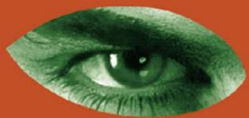
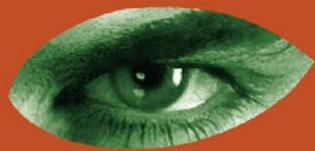
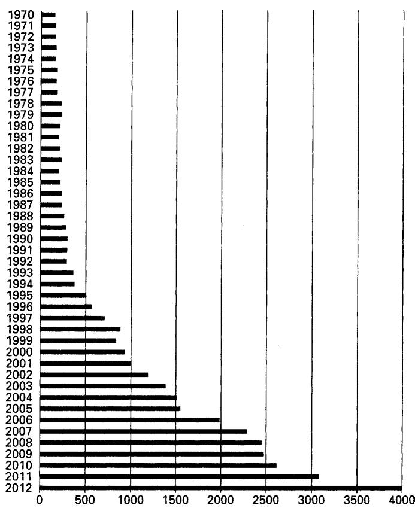
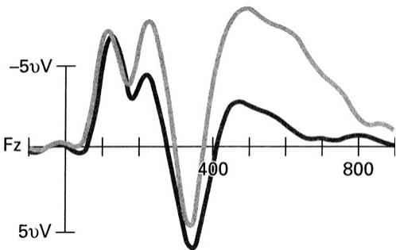
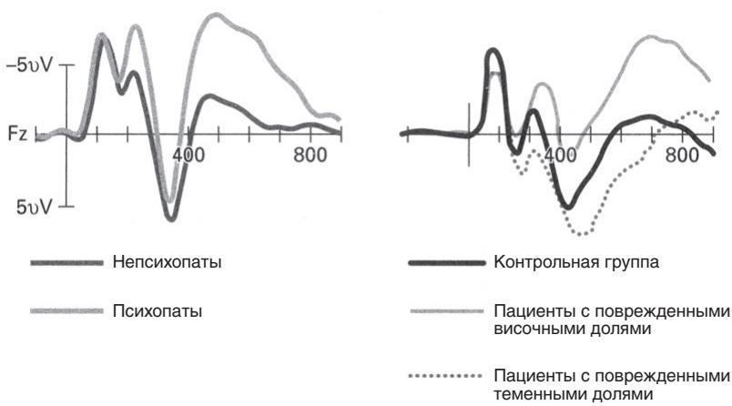
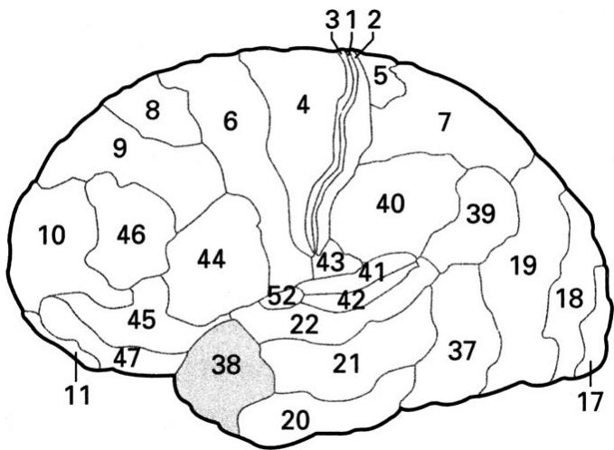
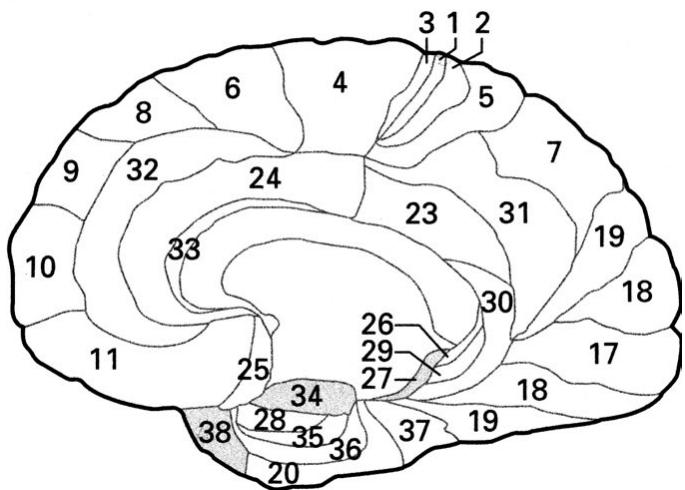

****

3

? . ,        .

The New Yorker

**Kent A. Kiehl PhD**

**ThePSYCHOPATH WHISPERER**

The Science of Those Without Conscience .

, npo∮eccop yuepcumema Hb-M

3

Охраняется законодательством РФ о защите интеллектуальных прав. Воспроизведение всей книги или любой ее части воспрещается без письменного разрешения издателя. Любые попытки нарушения закона будут преследоваться в судебном порядке.

**Оформление художника Е.Ю. Шурлаповой**

Кил Кент А.

Психопаты. Достоверный рассказ о людях без жалости, без совести, без раскаяния / Пер. с англ. Т.М. Шуликовой. — М.: ЗАО Изда тельство Центр- поли граф, 2015. — 319 с.

ISBN 978-5-227-05854-6

Доктор психологии, нейронаук и права, профессор Университета Нью-Мексико Кент Кил рассказывает о своей многолетней работе с пси хопатами — от безжалостных серийных убийц, которых он встречал за решеткой, до детей, в чьем поведении и чертах характера проявились тревожные сигналы этого будущего тяжелого расстройства. Личная исто рия доктора Кила сочетается с понятным и общедоступным повествова- . ный, но еще мало разгаданный мир чужого разума и задуматься о роли, которую все это может сыграть в жизни общества и обычного человека.

УДК 159.9.072.42

ББК 88.4

Copyright © 2014 by Kent A. Kiehl © Перевод и издание на русском языке, ЗАО «Издательство Центрполиграф», 2015

ISBN 978-5-227-05854-6 © Художественное оформление, ЗАО «Издательство Центрполиграф», 2015

**##**

**3 COCT**

**Маме и папе**

**Г л а в а 1 ТЮРЬМА СТРОГОГО РЕЖИМА**

ФАКТ: один из четырех заключенных в тюрь- мах строгого режима — психопат.

**День первый**

Лязг разблокированного замка сотряс недвижный утренний воздух, и большие металлические ворота с несколькими рядами колючей проволоки медленно поползли по желез- ным рельсам, раскрываясь. «Выстрел», как говорили про этот звук, отразился от соседних построек, усиливая зло- вещее настроение и без того мрачной сцены. От ворот на полкилометра в обе стороны протянулись два параллель- ных забора шестиметровой высоты из металлической сет- ки. В пространстве между ними шло 2,5-метровое заграж- дение из колючей проволоки — препятствие, которое не перескочил бы даже самый прыгучий зэк. Нигде не было видно ни души. Как будто ворота сами загадочным образом узнали о моем приближении и открылись, приветствуя меня в мой первый день работы в тюрьме строгого режима.

Тем утром я проехал сто километров под дождем из дома в Ванкувере до городка Эбботсфорд, где располага- ются несколько режимных тюрем канадской провинции Британская Колумбия. Комплекс Матски стоял всего в не- скольких минутах от шоссе среди скопления бензоколонок и мини-маркетов, где, очевидно, заправлялись сотни ма- шин и сотрудников, приезжавших туда каждый день. Вход на территорию ничем примечательным не выделялся, разве что предупреждающей надписью: «Все посетители и авто- мобили будут обысканы на предмет провоза запрещенных вещей, а найденные вещи будут изъяты». Вокруг, насколько мог видеть глаз, простирались темно-зеленые травянистые холмы, усыпанные зданиями, напоминавшими средневеко- вые замки в окружении рвов, высоких оград, увенчанных спиралями из колючей проволоки, и пятнадцатиметровых вышек, расставленных в стратегических местах у каждого поворота ограды. В конце долгой дороги находился Регио- нальный медицинский центр (РМЦ), который своим на званием мог ввести посетителей в заблуждение. РМЦ — ле- чебница строгого режима для осужденных за сексуальные и насильственные преступления. Тамошние 250 коек при- ютили опаснейших преступников Канады. Это и было мое новое место работы.

Мне было двадцать три, первый год в аспирантуре. По дороге в тюрьму рано утром я думал, что совершенно не го- тов к тому, чтобы интервьюировать ее обитателей, заклю- ченных за тяжкие преступления. Несколько предыдущих лет я делил время между изучением научной литературы о пси- хопатах, курсом методов визуализации мозговых структур и участием в исследовании электрической активности мозга косаток в процессе слухового восприятия, аналогичного та- кому процессу у человека, хотя это исследование и было мало связано с предыдущими двумя. Меня все больше за- тягивало изучение психопатии, и я с энтузиазмом учился у своего научного кумира — отца-основателя современных исследований психопатии профессора Роберта Д. Хэра, к которому я незадолго до того поступил в аспирантуру. Но сейчас, проходя через рамку металлодетектора у входа на окруженную колючей проволокой территорию тюрьмы, я замедлил шаг и задумался, как я вообще до такого дошел. Я собирался в одиночку взяться за опасную задачу: прово- дить углубленные интервью со свирепейшими осужденными преступниками, многие из которых признаны психопатами. После интервью я планировал проверить их электроэнцефа- лограммы (ЭЭГ), измеряя электрические импульсы мозга в ответ на эмоционально заряженные слова, — эти данные помогли бы нам понять связи между процессами, проходя- щими в мозге психопата, и его поведением.

Я прошел через пропускной пункт, где бледный сухопа- рый охранник с таким видом, будто полвека провел за ре- шеткой, вручил мне бедж с моим именем и сказал, как пройти в психиатрическое отделение. Уже со знакомым грохотом снова лязгнул и разблокировался замок на тяже- лой, обшитой свинцом двери. Я чуть подтолкнул ее вперед. Делая первые шаги в этом новом окружении, я улыбался, потому что мне не пришлось проходить полный досмотр полостей тела, который заботил меня больше всего. Я от- метил про себя, что надо расквитаться с другим аспиран- том, который меня убеждал, что в канадских тюрьмах при- нято полностью досматривать новых сотрудников.

Пока я шел от административного входа в психиатрию, заключенные в белых футболках, джинсах и темно-зеленых куртках слонялись между прачечной, парикмахерской и часовней. Внутри пахло дезинфекцией, и мне подумалось: интересно, чем они отчищают кровь.

Я вошел в большое зловещего вида здание и стал блуж- дать по коридорам, как потерявшийся мальчишка, пока не наткнулся на дверь кабинета с табличкой «Д-р Бринк». Там, почему-то отвернувшись от открытой двери, практи- чески напрашиваясь на то, чтобы я потихоньку проскольз- нул внутрь и застал его врасплох, сидел главный психиатр доктор Йохан Бринк. Я познакомился с доктором Бринком всего три месяца назад в Институте перспективных иссле- дований по психиатрии при НАТО. Это было в Португа- лии, в Алворе. За обильными ужинами и возлияниями я уговорил доктора Бринка сотрудничать со мной в моем ис- следовании ЭЭГ психопатов. Он помог мне добиться ут верждения моей программы в тюрьмах и университетской комиссии по этике. Со всеми этими разрешениями на ру- ках я негромко постучал по дверному косяку его кабинета. Он развернулся, не так уж чтоб испуганный, и приветство- вал меня широченной улыбкой.

— Кент, рад вас видеть! Милости просим к нам в тюрь- му! — проревел он с заметным южноафриканским акцентом.

Йохан проводил меня по коридору и показал кабинет, в котором был только стол с телефоном и два стула по обе стороны стола. Прямо посреди стены, где-то на уровне гру- ди, бросалась в глаза ярко-красная кнопка размером с се- ребряный доллар.

— Я вам советую сесть на стул поближе к двери; на вся- кий пожарный, мало ли, вдруг кого-нибудь разозлите, тог- да можно будет быстро выбежать. Все лучше, чем застрять по ту сторону стола. Если не сможете выбраться, бейте по кнопке, должна прибежать охрана.

Он говорил так беззаботно, что я не мог не подумать, не смеется ли он надо мной.

— А вот ваш ключ — не потеряйте!

Он дал мне 15-сантиметровый латунный ключ с боль- шими зубьями необычного и устрашающего вида. Такие ключи производят только две компании в мире специально для тюрем. Он открывает там большинство замков.

Доктор Бринк показал на большую дверь в конце кори- дора.

— Камеры там. Сейчас мне пора бежать, можем встре- титься вечером, ладно? — договорил Йохан с улыбкой, уже повернувшись.

Я вставил свой новый ключ в замок на уровне плеч и услышал негромкое, как мне показалось, «Успехов!», когда он плотно закрыл дверь своего кабинета — безусловно, чтобы следующий посетитель за ним уже не подглядывал.

Я открыл дверь в коридор, ведущий к камерам, развер- нулся, закрыл ее, вставил ключ с другой стороны и повер- нул тяжеленный замок на 180 градусов. Потом я потянул ручку, удостоверяясь, что дверь заперта, глубоко вдохнул и пошел по 30-метровому коридору в жилой блок.

Я подошел к «пузырю» — круглому помещению охраны с односторонними тонированными окнами без видимых дверей. От нее, словно спицы колеса, отходили четыре ко- ридора, по которым слонялись заключенные строгого ре- жима, холодно поглядывая на меня. Я не боялся, скорее беспокоился о том, согласится ли кто-нибудь из них разго- варивать со мной. Для подготовки профессор Хэр накануне вручил мне потрепанный экземпляр книги о тюремной жиз- ни под названием «Игры, в которые играют преступники» и сказал: «Сначала прочтите вот это, и удачи завтра!» Это было боевое крещение: пан или пропал. «Надо было про- читать ее вчера», — подумал я.

В конце коридора находилось небольшое помещение со стеклянными окнами и полудверью; там медсестра разда- вала стоявшим в очереди заключенным бритвенные станки. Она с любопытством посмотрела на меня и поманила ру- кой.

— Я могу вам помочь? — настороженно спросила она.

— Я тот парень из УБК, исследователь. Я пришел за- писать кого-нибудь на интервью и ЭЭГ.

УБК — это Университет Британской Колумбии, где я учился в аспирантуре на докторскую степень и изучал пси- хологию и нейронауки. ЭЭГ — это электроэнцефалография (и электроэнцефалограмма тоже), то есть запись электриче- ской активности мозга при помощи неинвазивных сенсоров, прикрепляемых к голове, эта активность усиливается и за- писывается на компьютер для последующего цифрового анализа.

— Тогда заходите, поговорим.

Я перегнулся через полудверь и поискал задвижку.

— Слева, — сказала она.

Я нашел задвижку, открыл дверцу, вошел и сел на бли- жайший стул. Медсестра закончила раздавать бритвы, по- вернулась и поглядела на меня.

— Заключенным дают бритвы? — озадаченно осведо- мился я.

— Ага, — сказала она и засмеялась, — и они часто про- падают. А я не спрашиваю, куда они деваются.

Я понял, что совет доктора Бринка — сидеть во время интервью поближе к двери — очень разумный.

Дороти Смит двадцать лет проработала в тюрьме стро- гого режима. Несмотря на долгое пребывание в тюрьме, ее никак нельзя было назвать видавшей виды. Ее стройность и спортивная подтянутость довершались обаятельным ха- рактером, который располагал к себе даже самых закоре- нелых уголовников. Она станет одним из моих ближайших друзей в те семь лет, которые я мотал по канадским тюрь- мам. И ей тоже, как и мне, было интересно узнать, что творится в голове у психопатов.

— Я вам выберу для первого разговора кого-нибудь по- симпатичнее, — сказала Дороти, глядя на схему располо- жения камер, приклеенную скотчем к шкафчику.

Я проследил за ее взглядом и увидел заключенных с подписанными данными: фамилия, имя и преступление. Покушение на убийство, изнасилование с убийством, под- жог с убийством, убийство троих, убийство с изнасилова- нием. Интересно, подумалось мне, «изнасилование с убий- ством» и «убийство с изнасилованием» — это одно и то же или нет? Я хотел было спросить у Дороти, но передумал. На самом деле мне не хотелось знать; для первого дня мне и без того было достаточно.

Заключенный, которого она выбрала, по имени Гор- дон\*, казался довольно вежливым, когда садился на стул у дальней стены кабинета. Сорок два года, седые редеющие волосы, тихий голос; под его снимком значилось: покуше- ние на убийство.

Обаятельный тип Гордон оказался серийным грабителем банков. Он поведал мне, что его преступные занятия по- зволяют ему вести шикарный образ жизни, включая между- народные авиаперелеты первым классом, места в первых рядах на хоккее, подружек и проституток в разных городах. Когда Гордона арестовали в последний раз, ему пришлось объяснять полиции, откуда у него больше 75 тысяч долла- ров наличными, притом что официально он безработный. Вместе со своим адвокатом он заключил сделку и получил иммунитет на всей территории Канады с условием, что по- может полиции раскрыть несколько ограблений. Количе- ство ограблений, в которых лично участвовал Гордон, при- ближалось к пятидесяти, но ни по одному из них ему не предъявили обвинения. Он рассказал мне, как обследовать город, потом тамошние банки, как войти и выйти меньше чем за минуту, как угнать машину и как отмыть деньги. Я спросил, как банку застраховаться от ограбления. Он не- сколько часов излагал мне свои идеи. Я даже начал запи- сывать, как лучше организовать банк. «Может, — подумал я, — если с научной карьерой не выгорит, буду консульти- ровать директоров банков».

Интервью с Гордоном было спланировано так, чтобы охва тить все сферы его жизни. Мы обсудили его воспитание, образование, родственников, друзей, спортивные занятия, опыт работы, карьерные цели, финансы, здоровье, интим- ные и романтические отношения, наркотики и алкоголь, импульсивное поведение, чувства, антиобщественные по ступки и его уголовные преступления. Обычно на интервью требуется от одного до трех часов. С Гордоном я проговорил шесть. Мы изучили все подробности его жизни. Это было увлекательно; если бы я к тому времени еще не определился с предметом изучения, то точно определился бы тогда.

Разговор с Гордоном о его опыте работы оказался корот- ким. Гордон с десяток раз устраивался на работу, но нигде не задерживался дольше месяца. Его постоянно увольняли, потому что вместо работы он предпочитал подстраивать ро- зыгрыши, долго обедать, выпивать и играть в азартные игры. В основном он устраивался на строительство или в автома- стерские (по его признанию, туда он шел, чтобы научиться лучше угонять машины). Когда я спросил его о планах на будущее, Гордон сказал, что хотел бы на оставшиеся награ- бленные деньги открыть собственное дело — продавать мо- тоциклы. Однако он не смог в полной мере осознать все юридические (и налоговые) следствия своего почина.

Когда мы разговаривали о его финансах, Гордон при- знался, что редко пользовался услугами банка.

— Боялись, что кто-нибудь его ограбит? — поддел я.

— Да нет, — осклабился он, — просто не люблю объ- яснять, откуда у меня наличные.

— А где же держать деньги, если не в банке?

— Я их зарываю в разных местах, — ответил он со смеш- ком, — нельзя же после дела вот так просто разъезжать с сотнями тысяч долларов. Или отправляю посылками в пя- тизвездочные отели где-нибудь в Азии, Европе или Южной Америке, где у меня забронирован номер на чужое имя; а могу отправить подружке в другой город, сказать ей, мол, это по- дарок, только не открывай его до моего приезда, всякое такое. Когда приезжаешь в гостиницу, надо всегда быть начеку и смотреть, чтобы копы за тобой не увязались. Обычно я меняю внешность и все осматриваю. Я предпочитаю сначала отпра- вить посылку, чтобы она пришла на следующий день, при- лететь и проследить за доставкой — убедиться, что полиция ничего не пронюхала. Я потерял не больше пары посылок.

Он помолчал, потом опять засмеялся и рассказал, как несколько лет назад отправил 50 тысяч наличными одной проститутке. Она так и не приехала за ним в аэропорт, и вообще он больше ее никогда не видел.

— Я ведь знал, что нельзя ей доверять… Раньше в аэро- порту можно было пронести пояс с деньгами, но сейчас с этим сложнее, риска больше, — размышлял он. Потом про- должил: — Иногда я использовал мулов, но вообще пред- почитаю забраться куда-нибудь подальше и припрятать. Тогда уже я точно знаю, что все денежки будут на месте, когда за ними приду. У меня полно хороших мест для ны- чек, но я об этом не распространяюсь.

Мы вернулись к разговору о его взглядах на отношения, семью и друзей. Гордон был одиночкой; он никогда не чув- ствовал потребности в близких отношениях. У него были сотни сексуальных связей начиная с 11 лет. Я спросил его, был ли он когда-нибудь влюблен, и он тут же широко за- улыбался и вспомнил, как однажды проводил время сразу с тремя проститутками — целую неделю.

— Эх, я их всех любил, — сказал он и глубоко вздохнул, вспоминая.

Гордон приравнивал любовь к хорошему сексу. Он был шесть раз женат — в разных странах и под разными име- нами. На мой вопрос, зачем женился, он ответил:

— Девчонки это любят, секс обеспечен на какое-то вре- мя, и их легче уговорить что-нибудь перевезти или при- прятать краденое.

Гордон признался, что проститутка, которой он отпра- вил 50 тысяч и больше ее не видел, была его женой номер три.

Он уже много лет не разговаривал с родными; когда в последний раз встречался с сестрой, он узнал от нее, что у них все в порядке, не жизнь, а «мечта про белый заборчик». Заключенные, когда они рассуждают, как скучно и утоми- тельно вести обычную жизнь, работать на простой работе, иметь семью и дом, называют это синдромом «белого за- борчика». На самом деле большинство сидящих в тюрьме сознаются, что были бы очень счастливы выйти из тюрьмы и жить в доме за белым заборчиком; психопаты, однако, этого понять не в состоянии — они смеются над теми, кто хочет жить такой монотонной жизнью.

Гордон считал всех остальных ненадежными людьми, но при этом был обходителен, обаятелен, остроумен и слово- охотлив. Я не всем его историям поверил — психопаты ча- сто лгут, — поэтому мне пришлось положиться на интуи- цию и позднее просмотреть его личное дело. Нельзя быть уверенным, что психопат говорит правду, надо тщательно изучать его документы, чтобы проверить все им сказанное. Если поймать его на лжи, нужно быть готовым прямо ска- зать об этом и наблюдать, как он отреагирует. Просто са- дись на стул поближе к двери — на случай если он разо- злится.

Еще через час разговоров о его детстве я стал задавать вопросы, что ему нравилось делать ребенком. Он вырос в Эбботсфорде, недалеко от тюрьмы, в которой мы беседова- ли. Городок притаился у гор Британской Колумбии, и от- туда на юго-востоке открывается великолепный вид на гору Бейкер, и в округе полно замечательных мест для рыбалки и троп для пешего туризма и любителей горного велосипеда. Гордон рассказывал мне о любимых местах на дальних озе- рах, где удил рыбу, о прекрасных видах. Он похвастал пой- манной рыбой громадной величины — соврал, как я по- думал. Он любил гулять там в одиночку, даже когда был ребенком. Рассказав мне о некоторых излюбленных местах, куда он ходил еще в детстве, Гордон внезапно смолк, по- смотрел на меня, затем в камеру, снимавшую наше интер- вью, и сказал:

— Отлично сделано. А ты малый не промах. Заставил меня говорить про всякие места, где я любил гулять и ры- бачить мальчишкой, чтобы выяснить, где я припрятал свое добро. Из меня несколько лет пытались это выудить. Ну ты и проныра. — Он засмеялся.

Я тоже засмеялся и сказал, что все подробности его дет- ства — необходимая часть интервью. Я блефовал. Как толь- ко он рассказал, что зарывал награбленное, я постарался так повести беседу, чтобы он выдал мне свои места. Я знал, что Гордон большую часть взрослой жизни провел в тюрь- ме, и решил, что места, где он стал бы прятать свое добро, он должен был знать еще с детства. Притом я воспользо- вался его преувеличенным мнением о себе, чтобы он раз- болтал мне о своем «большом улове».

Главным моим мотивом было желание усовершенство- вать технику интервью — сумею ли я заставить объект го- ворить, о чем нужно? Однако я не мог отделаться от раз- мышлений, как бы надрессировать мою черную немецкую овчарку, чтобы она выискивала кокаин. На очень многих 20- и 100-долларовых купюрах есть остатки кокаина, по- тому что ими часто пользуются, чтобы его нюхать. Опре- деленно пешие прогулки стали бы гораздо увлекательнее, если бы собака могла выкопать целый мешок денег!

Под конец интервью я попросил Гордона рассказать о его последнем преступлении. Видимо, он хорошо умел гра- бить банки и довольно плохо держать себя в руках. У Гор- дона был «слабый поведенческий контроль» — еще одна классическая черта психопата; он постоянно встревал в перепалки, которые перерастали в драки, — иногда прак- тически без повода. Сейчас он сидел в тюрьме за то, что чуть не убил любовника одной из своих подружек. Он за- подозрил, что она встречается с кем-то еще, выследил ее и застукал с поличным. Слово за слово, Гордон ранил того, другого, ножом. На следующее утро его арестовали. Надо сказать, что в тюрьме Гордон вел себя вполне прилично. Он знал, что за драку в тюрьме можно оказаться в карцере или получить дополнительный срок, и поэтому держал себя в руках. Он хотел выйти как можно быстрее, чтобы отко- пать все зарытое.

После ухода Гордона я достал свой экземпляр Руковод- ства по применению исправленного перечня психопатиче- ских черт Хэра (ИППЧ)1. Перечень психопатических черт, составленный профессором Хэром, — это инструмент, ко- торым мы пользуемся в полевых условиях для оценки пси хопатии. Он состоит из двадцати пунктов, описывающих основные признаки психопатии: например, отсутствие эм- патии, чувства вины и раскаяния, болтливость, поверх- ностность, склонность к паразитизму, скудость эмоций, безответственность, импульсивность. Эти черты нужно оценивать на протяжении всей жизни человека и во всех ее областях. То есть, чтобы зафиксировать «отсутствие эм- патии» по перечню, нужны свидетельства, что эта черта присутствует во всех аспектах жизни — дома, на работе, в школе, в общении с родными, друзьями и возлюбленными. Каждый из двадцати пунктов оценивается по трехбалльной шкале: 0 — неприменимо; 1 — применимо в некоторой сте- пени и 2 — безусловно применимо во многих отношениях. Так, можно получить от 0 до 40 баллов, а клинический диагноз психопатии достается тем, кто набирает 30 и выше. Заключенные в среднем набирают 22 балла. Обычный жи тель США и Канады, не сидевший в тюрьме, наберет в среднем 4 балла из сорока.

Гордон набрал 31 балл. Он был моим первым психопа- том.

Я закончил свои заметки с обоснованием оценки Гор- дона по Перечню психопатических черт, проглотив два бу- терброда с арахисовым маслом и вареньем, которые при- готовил накануне вечером. Мне нужны были силы для следующего интервью. Тяжело несколько часов сосредото- ченно беседовать с заключенными, постоянно соблюдая осторожность, пока стараешься получить необходимую ин- формацию, вызвать на откровенность и следить за дверью, чтобы всегда при необходимости иметь возможность вы- скочить наружу.

Я вернулся в жилой блок, и ко мне подошел сокамерник Гордона и мой второй собеседник Грант. Гордон сказал ему, что со мной «забавно» разговаривать, и предложил ему «попробовать» пообщаться со мной.

У Гранта была совершенно обычная внешность и мане- ры, которые подошли бы продавцу машин, если не обращать внимания на лихие татуировки, спиралью покрывавшие его руки. Он с самого рождения был связан с пенитенциарной системой: мать родила его в тюрьме, а теперь он отсиживал пятнадцать лет за два убийства, которые совершил в три- дцать. Гранта осудили за непредумышленное убийство двух сообщников по ограблению. По-видимому, они не подели- ли добычу. Мелькнули ножи, но куда им было против 9-мил- лиметрового пистолета Гранта.

— Бах-бах… бах-бах… и двое готовы, — продемонстри- ровал он, выставив указательный палец, как дуло пистоле- та. — Одна из моих лучших разборок.

Об убийствах он рассуждал так спокойно, как о чем-то само собой разумеющемся, и я даже поймал себя на мысли, а не врет ли он. Личное дело все подтвердило: два выстре- ла в «корпус» обоих подельников. Грант получил от пятна- дцати лет до пожизненного, главным образом благодаря сделке с обвинением: у них было недостаточно улик, чтобы обвинить его в умышленном убийстве, а орудие преступле- ния он выбросил. Что интересно, он подробно рассказал, как избавлялся от своего любимого «Глока-17» с увеличен- ной емкостью магазина. Сначала он хотел заявить о своей невиновности, но адвокат сказал, что проститутка, которой он заплатил, чтобы она обеспечила ему алиби, скорее все- го, сломается под перекрестным допросом в суде.

Я поинтересовался, совершал ли он что-нибудь проти- возаконное, за что его не ловили, и Грант засмеялся как-то по-детски проказливо и сказал:

— Да много чего… поджигал, грабил, влезал в дома, уго- нял машины, подделывал чеки и кредитки, ну и, само со- бой, кое-где еще лежит парочка покойников.

Он застрелил нескольких незнакомых людей, которые, по его словам, лезли куда не надо, и утопил по меньшей мере одну подружку в бассейне… и тут до меня дошло, что я сижу напротив настоящего серийного убийцы, хотя и необычайно дружелюбного.

В конце концов я вытянул из Гранта признание, что он убил десятерых. Как ни удивительно, он никогда их не счи- тал; фактически выкинул их из головы. Я попробовал впи- сать убийства Гранта в классический профиль серийного убийцы, но они никак не вписывались. Большинством серийных убийц в их деяниях движет тяга, как правило связанная с сексуальным доминированием или садизмом. Такие серийные убийцы, как Тед Банди, соответствуют критериям психопатии, и вдобавок им свойственна пара- филия (расстройство полового влечения), например садизм. Первым объясняется отсутствие эмоций, эмпатии и чувства вины, а вторым — склонность к убийствам. Если соединить психопатию с парафилией, получится очень опасный чело- век. К счастью, таких людей совсем немного.

У Гранта не было сексуальных расстройств вроде садиз- ма. Он описывал сравнительно нормальную половую жизнь. Да, он сознался, что бывал с женщинами довольно груб, но само причинение боли его не возбуждало. На самом деле большинство жертв Гранта — мужчины. Казалось, он легко прибегает к насилию, быстро и без особых раздумий. Ему повезло, что его поймали только на двух из десяти убийств.

В оставшееся время я узнал, что Грант еще с ранней юно- сти влипал в неприятности, много раз попадал в полицию, часто дрался и не мог или не хотел остановиться ни на одном роде занятий, профессии или месте работы дольше пары ме- сяцев. Он получал социальные пособия под разными име- нами, несколько раз был женат, зачал четырех детей — по крайней мере, сколько вспомнил. Этот последний пункт до- вольно любопытен. Грант не помнил, когда родились его дети, и вообще знал по имени только двоих. Он вел жизнь кочевника, переезжал с места на место — часто по малейшей прихоти, жил в своем фургоне, в палатке, иногда съезжался с женщинами, иногда они беременели, и он неизменно от- правлялся на поиски новых приключений.

Психопаты редко в подробностях осведомлены о своих детях. Как Грант, они часто даже не знают, сколько их все- го. Потом, в ходе исследования, мне станет ясно, что от- сутствие связей с детьми у психопатов — это одна из самых ярких черт личности.

Уже вечерело, так что я быстро свернул наше интервью и сказал Гранту, что, может быть, захочу попозже обсудить что-нибудь еще. Он встал, протянул руку, и мы обменялись рукопожатиями.

— Давайте сделаем это еще раз, — сказал он. — Мне понравилось.

И он вышел с таким видом, будто только что дал пресс- конференцию.

В некоторой растерянности я сел на место и достал свой ППЧ-Р, чтобы посчитать баллы Гранта. Откинувшись на спинку стула, я на мгновение задумался, не сплю ли я. День казался каким-то нереальным; я столько лет читал о психопатах в книжках и вот наконец-то провел два первых интервью.

Грант получил по перечню 34 балла. Два попадания из двух.

Я закончил записывать и положил видеокассеты с ин- тервью в шкаф под замок. Мы все записываем на видео, чтобы другой научный сотрудник тоже мог оценить иссле- дуемого по шкале психопатии. Таким образом все перепро- веряется, и можно гарантировать, что на оценку не повли- яло предвзятое отношение интервьюера к собеседнику.

Я закрыл и запер дверь, положил свой здоровенный ключ в ближайший ящик (он не должен покидать учреж- дения) и направился к доктору Бринку.

Дверь его кабинета была закрыта; он печатал что-то на компьютере, все так же сидя боком к двери. Я тихонько постучал в окошко. Он обернулся, улыбнулся и встал, что- бы меня впустить.

— Как прошло?

— Отлично. Примерно как я себе и представлял, только лучше, — ответил я. — Вообще без проблем. Все идет как по маслу. Я познакомился с Дороти, провел два интервью и получил наводку на других заключенных, поговорю с ними завтра. Готов ехать домой и выпить пива.

— Замечательно. Ну что ж, не буду отвлекать вас от ва- шего пива. Развлекайтесь до выходных и заходите, если что-нибудь понадобится, — сказал Бринк.

Я пошел назад по лабиринту коридоров, мимо часовни, прачечной и парикмахерской. Все опустело к шести вечера, заключенные уже сидели в запертых на ночь камерах. Было тихо, почти безмятежно — пока я не вздрогнул от лязга замка, когда открылись последние ворота. Я вышел, и меня охватило ощущение свободы. Никогда не забуду первого дня в тюрьме. И как мне станет ясно в последующие годы, каждый раз, выходя из тюрьмы, я буду испытывать чувство некоего облегчения, оттого что снова на воле.

Я сел в свою «тойоту» и отправился в дальнюю дорогу до Ванкувера. В тот день, когда начиналась моя тюремная эпопея, у моего пикапа пробег был 64 тысячи километров. Когда через несколько лет я закончу это исследование, он пробежит уже 450 тысяч километров — «лунную единицу», как я это назвал: потому что, разъезжая взад-вперед по тюрьмам, я проехал дистанцию, равную расстоянию между Землей и Луной (384 400 километров).

По пути домой я не мог отвязаться от мысли, как мож- но было лучше провести интервью. Я обдумывал свои ме- тоды, пытался сообразить, как вытянуть больше подроб- ностей от заключенных, как облегчить подсчет баллов по перечню. Я понял, что мне надо отредактировать готовое полуструктурированное интервью, которое шло вместе с Перечнем психопатических черт, и найти верный баланс между двумя задачами: узнать максимально много деталей из всех сфер жизни заключенных и при этом их не разо- злить. Когда я через полтора часа подъехал к дому, у меня уже было с десяток новых вопросов.

Я открыл калитку, и со двора из-за угла дома мне на- встречу выбежал Джейк, моя 50-килограммовая черная ов- чарка. При виде его мне вспомнилась моя мысль надрес- сировать его на кокаин, чтобы отыскать награбленное и припрятанное моим новым другом.

Я снимал жилье вместе с Андреасом, голодающим ху- дожником и любителем поговорить. Он уже вернулся до- мой после двойной смены в «Старбаксе».

— Принес неликвид? — спросил я Андреаса.

— А то, — сказал он, показывая на распухший рюкзак, брошенный в углу гостиной.

Несколько месяцев тому назад Андреаса сделали менед- жером смены в «Старбаксе», в обязанности которого входи- ло следить за сроком годности кофейных зерен, из которых там варили кофе. Зерна с истекшим сроком он должен был выбрасывать. Но они были еще совершенно нормальные. У Андреаса не поднималась рука вынести их на помойку, по- этому он приносил их домой, где они украшали гостиную нашей маленькой квартирки, словно кресла-груши. Вскоре у нас в гостиной накопилось больше 50 килограммов кофе. В конце концов я уговорил Андреаса с ним расстаться, и он стал рассылать его родственникам и друзьям по всей Канаде.

— Как прошел первый день? — чуть нервно спросил Ан- дреас.

— Изумительно. Проинтервьюировал своего первого в жизни серийного убийцу.

— Не знаю, как у тебя это получается… я бы с ума со- шел, — сказал он.

Меня часто спрашивают: «Как у тебя это получается?» И еще чаще: «А какие они, психопаты?» Но на самом деле все хотят знать: «Откуда у тебя вообще взялся этот интерес к психопатам?»

Я вырос в Такоме, в штате Вашингтон, всего в несколь- ких кварталах от того места, где рос Тед Банди. Мой отец был журналистом и главным редактором местной газеты «Такома ньюс трибюн». Я был совсем ребенком, когда в 1970-х прошумела история Теда Банди; отец приходил до- мой и пересказывал все то, что готовил для печати, о ре- бенке, который жил в нескольких домах от нас. Мы сиде- ли за обеденным столом и гадали, как такой человек мог вырасти в нашем сонном пригороде для среднего класса.

И правда, как? Эта мысль, словно семя, засела у меня в голове, дожидаясь подходящего момента, чтобы прорасти.

В старших классах я особенно не увлекался учебой. В ос- новном у меня были четверки, и я предпочитал заниматься спортом: американским футболом, тяжелой атлетикой и бе- гом. Отец очень повлиял на мои спортивные успехи. Он не пропускал ни единого моего спортивного соревнования — за двенадцать лет бейсбола, десять футбола, четыре года аме- риканского футбола и четыре легкой атлетики. Он был спор тивным журналистом и мог наизусть отбарабанить всю ста- тистику по каждому профессиональному бейсболисту. Он родился с мышечным заболеванием, которое называется немалиновой миопатией. У него было недостаточно мышеч- ных волокон, чтобы самому заниматься спортом, но это ни- как не сказалось на его энтузиазме. Он много лет тренировал мою бейсбольную и футбольную команды. Когда я перешел в старшие классы, в футбольный сезон он ходил на матчи наших соперников и подсказывал мне, как подготовиться к игре с очередной командой. Он был не меньше увлечен, чем мои школьные тренеры.

Родители очень много работали, чтобы отдать своих чет- верых детей — меня и трех моих сестер — в лучшую частную школу штата. В подготовительной школе в Беллармине ра- ботали очень увлеченные учителя, создавшие удивительную атмосферу общности. 98 процентов моего выпускного клас- са продолжили образование в университете, и я поступил в колледж, только чтобы не быть хуже одноклассников. Но приняли меня благодаря спорту.

Я обратился в несколько колледжей, и меня взяли в ко- манды по американскому футболу Вашингтонского универ- ситета, Университета штата Вашингтон, и др. Дон Джеймс, тренер Вашингтонского университета, разрешил мне при- ходить и играть в его команде, но сказал, что вряд ли я по- паду в первый дивизион за четыре года. Джеймс считал, что при спортивном росте я стану неплохим ресивером или от- крытым сейфти. В старшую школу я пришел щуплым, ро- стом метр восемьдесят и весом 68 килограммов, а в выпуск- ной год играл уже здоровяком метр девяносто ростом и

93 килограмма весом. Джеймс сказал, что, если я хочу играть все четыре года в колледже, мне можно подумать о лучшей программе второго дивизиона — в то время за ней нужно было идти в Калифорнийский университете в Дэвисе.

Я послал свои записи тамошним тренерам, и меня взя- ли. Они же помогли мне с поступлением в университет, и я решил отправиться в Калифорнию.

Моя футбольная карьера оказалась короткой; уже в кон- це первого года в команде Дэвиса меня подвело колено. После годовой реабилитации моя мечта ловить мячи и этим зарабатывать на жизнь окончательно рухнула. Я обратился к доктору Дебре Лонг, профессору психологии и своему на- ставнику. Одной из лучших вещей в Дэвисе в смысле на- учной работы было то, что там поощрялось тесное сотруд- ничество студентов с преподавателями. В первые два года обучения я много работал с доктором Лонг, и она очень хорошо меня узнала. Когда в конце второго года я пришел к ней за советом, она сказала: «Кент, у тебя научный склад ума; поезжай куда-нибудь на выходные, возвращайся в по- недельник и назови мне пять вещей, которые бы ты хотел изучать. Думаю, тебе надо подумать о том, чтобы стать уче- ным».

По ее словам, у меня слишком много энергии для обыч- ной работы с девяти до пяти. Мне нужна карьера, сказала она, а не работа. Я думал все выходные и, вернувшись, по- казал ей свой список предметов, которые мне хотелось бы изучать: 1) мозг, 2) психопаты (под влиянием своего дет- ского любопытства, вызванного Тедом Банди), 3) косатки (это семя тоже сидело во мне еще с детства, с того раза, когда косатка посмотрела мне прямо в глаза, когда мы с отцом рыбачили в Пьюджет-Саунд), 4) педагогика и 5) жен- щины. Последний пункт ее порядком насмешил.

Доктор Лонг позвонила еще нескольким преподавате- лям: доктору Майклу Газзаниге, основоположнику когни- тивной нейронауки (науки о том, как мозг обрабатывает информацию), и доктору Джорджу Мэнгану, который ис- следовал процессы внимания. Они оба вместе со своими лабораториями только что переехали в Дэвис из Дартмут- ского университета. Доктор Лонг сказала им, что хотела бы послать к ним одного своего целеустремленного студента. Потом она позвонила доктору Кэролин Олдвин с кафедры человеческого развития. Кэролин была замужем за докто- ром Майклом (Риком) Левенсоном, преподавателем и уче- ным, который, помимо других расстройств, занимался и психопатией. Еще она устроила мне возможность послу- шать лекцию Майкла Шимански, аспиранта, исследовав- шего электрическую активность мозга косаток. Вот это да! Когда мы с доктором Лонг пересекаемся, я обязательно ставлю ей выпить. Все, с кем она тогда связалась, стали моими наставниками и друзьями на всю жизнь, а в конеч- ном счете и оказали мне честь называть меня коллегой.

Моя жизнь преобразилась. Я понял, что нашел свой путь в жизни. Я хотел стать профессором и узнать о психопатах все, что только возможно. Я хотел овладеть методами ней- ровизуализации и рассказать всему миру, чем отличаются психопаты от остальных людей и что творится у них в го- лове.

Я перестал тусоваться и серьезно взялся за учебу. У меня была сотня приятелей, а осталось три-четыре хороших дру- га. Я учился на четверки, а стал на одни пятерки. Мне по- советовали, что если уж я хочу заняться психопатией, то надо идти в аспирантуру к самому выдающемуся в этой области ученому — профессору Роберту Хэру из Универси- тета Британской Колумбии.

Вот как я пошел по тому профессиональному пути, ко- торый и привел меня в тюрьму строгого режима.

**День второй**

Заруливая на парковку перед Региональным медицинским центром, я видел, как вдали всходит солнце над горой Бей- кер. Я подхватил с пассажирского места рюкзак и пошел к воротам.

Все тот же дряхлый охранник, который впускал меня накануне, сегодня тоже дал мне пройти через металлоде- тектор, даже не взглянув. Я остановился и постучал по окну.

— Вы забыли дорогу? — продребезжал голос в дина- мике.

— Нет. Я подумал, что вы не откажетесь взять немнож- ко кофе.

Я поднял руку с полукилограммовым мешком «старбак- сового» кофе (с разрешения моего друга Андреаса). Тут же лязгнул замок, и дверь раскрылась.

— Само собой, — сказал он. От улыбки его лицо по- крылось морщинками. — Большое спасибо!

Я распахнул тяжелую входную дверь и направился к себе в кабинет. Я прошел не больше двадцати шагов, когда из прачечной появился Грант с мешком чистой одежды.

— Привет, Кент, — сказал он. — Есть минутка?

— Есть, — сказал я, — что такое?

На лице Гранта обозначилось беспокойство. Он оглядел коридор в обе стороны и, увидев, что никого нет, сказал:

— Не знаю точно, что ты сделал, но прошел слух, будто ты не нравишься одному типу, насильнику. Его зовут Гэри. Держись от него подальше. Понял?

Он отстранился и зашел обратно в прачечную.

— Ясно, — еле выдавил я.

В моей голове закрутились мысли обо всем, что было вчера. Но я не мог вспомнить ничего такого, что могло бы разозлить заключенных. Мне это было нужно, как рыбе зонтик.

РМЦ делится на несколько жилых блоков. На западной стороне комплекса располагается крыло примерно на три- дцать коек для заключенных с серьезными психическими болезнями, например шизофренией. Как правило, они не смешиваются с остальными, потому что очень больны. Другие жилые помещения находятся в двухуровневом ком- плексе с четырьмя крыльями, отходящими от центра. В четырех крыльях первого уровня содержатся умственно от- сталые заключенные. Это люди с низким коэффициентом интеллекта и другими умственными трудностями. Верхние четыре крыла разделены попарно: на терапевтическую про- грамму для совершивших насильственные преступления и программу для совершивших преступления на сексуальной почве. Во всех четырех крыльях содержится от двадцати до сорока заключенных в зависимости от того, какие койки там стоят — обычные или двухъярусные. Обе программы верхнего уровня работают по схеме ротации: каждые три месяца туда поступают двадцать пять новых заключенных после того, как предыдущие завершат девятимесячную про- грамму терапии. Такой график дает постоянный поток за- ключенных для моих исследований.

Обычно насильники и тому подобные отделены от остальных преступников. Это делается потому, что в тю- ремной иерархии заключенных, совершивших преступле- ния против женщин, другие презирают. На самой низкой ступени стоят те, кто совершил насилие над ребенком, и они часто сами становятся жертвами насилия в тюрьмах. Поэтому для их безопасности и безопасности сотрудников (которым, возможно, придется защищать их от нападения) насильники содержатся отдельно от остальных.

Однако в РМЦ насильники и те, кто совершил другие тяжкие преступления, проходят терапию по одному и тому же графику и смешиваются друг с другом. Порой это при- водит к конфликтам, но, поскольку все заключенные уча- ствуют в программе лечения добровольно, как правило, они ведут себя гораздо лучше, чем в иной ситуации. Для большинства программа лечения в РМЦ — шаг к досроч- ному освобождению, так что они весьма терпимо относят- ся к изменениям тюремного распорядка.

Словом, во время работы в РМЦ я обнаружил, что обычные преступники довольно часто общаются с насиль- никами.

Я дошел до кабинета как в тумане. Я никак не мог ура- зуметь, какие мои действия могли спровоцировать заклю- ченного.

Я решил избегать этого Гэри, пока не разберусь, что де- лать.

Я добавил в свой план интервью по ППЧ десяток новых вопросов и распечатал два экземпляра. Взял бланки согла- сия на участие в исследовании и мешок с кофе. Достал ла- тунный ключ из ящика и инстинктивно сжал его в руке, имитируя прием самообороны, которому учат женщин, чтобы они могли защититься от нападения с помощью ключей от машины.

Потом я пошел в жилой блок и направился прямо к медпункту, не дожидаясь приглашения. Я просто отпер дверь и вошел, убедившись, что за мной никто не войдет. Мешок с кофе я вручил Дороти. По ее лицу расползлась улыбка, она взяла кофе и сразу же заварила.

— Приятная неожиданность, — сказала она. Потом по- вернулась и посмотрела на меня: — Что-то случилось?

Дороти отличалась первоклассной интуицией клиници- ста и умением читать по лицам, отточенным за двадцать лет работы с заключенными. Мне подумалось, что, пожа- луй, против нее не стоит садиться играть в покер.

— Э-э… вы знаете насильника по имени Гэри?

— Разумеется, — сказала она. — Вон он. Драчун.

Я не знал, что мне делать после такого заявления Гран- та. Я обещал никому ничего не говорить и не был уверен, что могу поделиться деталями, которые он мне рассказал. Решил сохранить разговор в тайне, но посчитал, что, если я расспрошу Дороти о Гэри, вреда не будет.

Дороти рассказала, что Гэри вечно что-то замышляет. У него были трения с руководителем групповой терапии; недавно он пробил стену, поскандалив с терапевтом (види- мо, медики были рады такому результату, ведь для Гэри прогресс, что он ударил стену, а не врача); его застукали, когда он варил брагу (зелье из дрожжей, фруктов и воды, из которых после брожения получается алкогольный на- питок, и его обычно хранят в бачке унитаза); кроме того, подозревали, что он избил нескольких заключенных, хотя никто на него не жаловался.

Под снимком Гэри в списке на шкафчике Дороти я про- читал, что он получил пятнадцать лет за два изнасилова- ния. Он уже отсидел четырнадцать и вскоре должен был выйти. В РМЦ он находился потому, что канадский депар- тамент исполнения наказаний решил его полечить, прежде чем его придется выпустить на свободу по отбытии нака- зания. Позднее я узнал, что, по оценке тюремной админи- страции, у Гэри был очень высокий риск рецидива, и она пыталась найти способ снизить этот риск.

Гэри был настоящий великан. Многие заключенные на- качивают мышцы, потому что качаются по нескольку часов в день, но у Гэри был рост больше ста восьмидесяти, бочко- образная грудь, огромные плечи и вес под 125 килограммов.

Я покрутил в руке ключ… Мне стало еще тревожнее при мысли о тщетности попыток остановить злобного 125-ки- лограммового насильника каким-то латунным ключиком.

Гэри шел своей дорогой на групповую терапию, и я чув- ствовал на себе его взгляд. Увидев, что он заходит в дверь, которая вела в помещение для групповых занятий, я ис- пытал облегчение.

Гордон слонялся поблизости, заметил меня и направил- ся к станции.

— Я тут нашел для тебя еще нескольких ребят, — сказал он, сунул руку в карман и достал мятый листок бумаги примерно с пятнадцатью именами.

— Спасибо за помощь, — сказал я.

— Да без проблем. Эй, — сказал он, оглядевшись и убеждаясь, что нас никто не слышит. — Как ты думаешь, мне не приплатят или, может, чего-нибудь дадут за то, что тебе помогаю?

Я улыбнулся:

— Хорошая попытка. Боюсь, самое большее, что я могу сделать, — это разрешить вам быть первым на следующем этапе исследования. Нам не разрешается привлекать участ- ников к набору исследуемых. Но все равно спасибо за по- мощь.

— Ну ладно, хотя бы попробовал… — ответил Гордон. — Ну и когда начнется следующий этап?

— Через пару недель. Пока что я собираю оборудова- ние, — сказал я.

— Круто.

Гордон повернулся и пошел прочь.

Я просмотрел список имен. Такое впечатление, будто Гордон накануне вечером обошел все камеры и заставил подписаться все свое крыло. Хотя, скорее всего, он просто взял и переписал имена из списка заключенных и даже не подумал с ними поговорить. Хм, неужели я всего за один день превратился в циника?

Я вышел из медпункта, посмотрел налево, убеждаясь, что дверь, за которую вышел Гэри, не открылась и не впу- стила никого в жилой блок, и потом отправился к неболь- шой общей комнате в конце крыла, где содержался Гордон. Вокруг туда-сюда ходили заключенные. Я назвал первое имя из своего нового списка:

— Майк Уэст. Здесь есть Майк?

— Есть. Это я, — раздался голос из дальнего угла.

— Вы не найдете минутку поговорить насчет того, чтобы поучаствовать в исследовании УБК? — спросил я.

— Найду, — согласился голос. Ко мне вышел высокий, худой человек и сказал: — Пошли. Гордон нам рассказал, чем вы вчера занимались.

Я начал думать, что сделал слишком поспешный вывод о намерениях Гордона или, скорее, о его желании получить вознаграждение.

У Майка были проблемы с наркотиками. В начале на- шего интервью он сразу же доложил, что сидит тут совсем не за такие тяжкие преступления, как все остальные. Он всего лишь участвовал в ограблении, которое пошло не- множко не так и кое-кто пострадал.

— Мне просто надо было добыть денег на дозу, — вспо- минал он.

Майк вырос в пригороде Торонто. Он окончил школу и пошел работать на стройку, постепенно продвигался по службе и в конце концов стал оператором тяжелой техни- ки. Он несколько раз менял место работы и дольше всего задержался на четыре года. В момент нашей встречи ему было под сорок, он отсидел пять лет из шести, к которым его приговорили за нападение и избиение с отягчающими обстоятельствами, уклонение от правосудия, преступную небрежность и еще по нескольким обвинениям. Майк уже десять лет был женат. Его жена переехала поближе к тюрь- ме, чтобы чаще его навещать. Она жила всего в нескольких километрах от тюрьмы и работала официанткой в ближай- шем ресторане.

Марихуану, которую он называл стартовым наркотиком, он стал покуривать еще в старших классах. Дилеры снача- ла подсадили его, потом уговорили продавать, потом пред ложили попробовать кое-что новое. Он попробовал героин и сразу же попал в зависимость. Майк пытался колоться только иногда, чтобы расслабиться, но в конце концов стал героинщиком. Он скрывал это от семьи, друзей и даже от женщины, которая потом стала его женой, до тех пор пока уже не мог придумывать, куда уходят все деньги. Он начал грабить, сдавать в ломбард краденые телевизоры и электро- нику. Он влез в кредиты, долги и в конце концов взял ору- жие и стал грабить. Плевое дело, объяснял он, залезть в дом обычной семьи и раздобыть четыреста—пятьсот бак- сов — достаточно, чтобы на неделю обеспечить себя нар котиками. По его словам, он пытался бросить, но у него не получалось. И в конце концов наступил час Х, как он вы разился. Он грабил круглосуточный магазинчик и уже успел выбежать наружу и запрыгнуть в машину. Но мимо случайно проезжал полицейский патруль и принял вызов. Началась погоня, которая кончилась аварией. Майк стол- кнулся с машиной, в которой ехала семья. Они попали в больницу с тяжкими травмами, угрожающими жизни. Ког- да Майк говорил об этом в конце нашего интервью, у него на глазах выступили слезы.

— Я наделал столько ошибок, — сказал он. — Но теперь я чист и трезв уже больше пяти лет.

До суда и приговора к заключению в федеральной тюрь- ме Майк отсидел год в следственном изоляторе. В Канаде сроки менее двух лет отсиживают в тюрьмах провинций, таких же, как окружные и городские тюрьмы в США. По- лучившие более долгие сроки отправляются в федеральное заведение, находящееся в ведении канадского департамен- та исполнения наказаний, располагающего тюрьмами во всех провинциях страны.

В местной тюрьме Майк прошел детоксикацию и про- грамму психологического и фармакологического лечения — когнитивно-поведенческой психотерапии для наркоманов плюс медикаменты для снятия абстинентного синдрома. Их дозу постепенно снижали, пока он совсем не перестал их принимать. Майк не собирался возвращаться к прежней жизни, ведь он обещал жене и родным. Он собирался до- сидеть срок, выйти на волю, опять пойти на стройку и за- вести детей. Белый заборчик. Ему не обязательно было говорить эти слова; и так было ясно, что это был предел его желаний.

Майк испытывал эмоциональную привязанность к род- ным, жене, даже к некоторым другим заключенным. Он преподавал им основы арифметики и английский язык и получал поощрения за хорошее поведение. У него не было ни одного нарушения распорядка, случая употребления наркотиков или драки. Майк не связывался с проблемны- ми заключенными. Сначала его отправили в тюрьму уси- ленного режима, но через год перевели на общий. Он счи- тался неопасным и образцовым заключенным.

— Как же вы оказались здесь, на строгом режиме? — спросил я.

— Из-за молодежи, — пояснил он. — Они [тюремные психологи] сказали, что мне хорошо было бы продолжать терапию, чтобы опять не начал вести себя плохо, и что, раз я отказался от наркотиков, мой пример был бы полезен для молодежи, потому что наркотики никого до добра не дово- дят. Этим я и занимаюсь. Рассказываю, каким образом до- шел до такой жизни и как все могло бы быть гораздо лучше.

Майк получил 11 баллов по шкале психопатии. Это очень низкий балл для заключенного в тюрьме строгого режима, намного ниже среднего — 22. Майк больше не попадет в тюрьму, подумал я; он научился на собственных ошибках.

Майк предложил мне проинтервьюировать своего сока- мерника Боба. Боб был полон сил и энтузиазма и готов на все. Любопытный тип. Во время нашей беседы мне еле-еле удавалось вставить слово. Только я задавал ему вопрос, как он тут же заваливал меня историями минут на пятнадцать. Это было первое интервью, когда я смеялся в голос. Я не уверен, что человек в моем положении мог позволить себе хохотать во время клинического интервью, но я просто расслабился, сам подначивал его и говорил, что он насто- ящий комик. И, честно признаться, истории, в которые он попадал, были, прямо скажем, очень смешные.

Поскольку моя роль не была враждебной по отношению к заключенным, они обычно были очень открытыми и от- кровенными в наших интервью. Все, что они мне рассказы- вали, оставалось между нами. Это не попадало в их личные дела и не грозило им неприятностями. (И, как говорилось выше, я изменил их имена и описания, чтобы никто из чи- тателей этой книги не смог понять, о ком я говорю.) Я раз- говаривал с ними потому, что хотел их понять. Я помнил это чувство, словно был лейтенантом Коломбо, когда только начинал работать в тюрьме; мне хотелось знать, что повли- яло на этих людей, как они туда попали. Моей целью в то время было использовать услышанное в интервью для того, чтобы усовершенствовать оценку риска повторных преступ- лений.

В Канаде в середине 1990-х тысячи преступников выхо- дили по условно-досрочному освобождению каждый год. Полномочиями решать, кто выйдет на волю, а кто останет- ся в тюрьме, обладали комиссии по УДО, члены которых назначались и имели очень разную профессиональную под- готовку. Если преступник ходатайствовал о досрочном осво- бождении, комиссии нужно было знать, какова вероятность, что он снова совершит преступление. Для заключенного это могло быть вопросом жизни и смерти, как, впрочем, и для окружающих его на свободе людей. Безусловно, это решение влекло громадные экономические и, разумеется, эмоцио- нальные последствия для общества в целом и для потенци- альных жертв в частности. Комиссии по освобождению ино- гда принимали решение самостоятельно после разговора с заключенным (всегда плохая идея); иногда обращались за профессиональной консультацией к специалисту по психи- ческому здоровью, например психологу, социальному работ- нику или психиатру (и это не очень хорошая идея); либо они могли распорядиться об оценке риска и на основании этой оценки принять информированное решение (хорошая идея во всех случаях).

Комиссии по УДО обычно не очень хорошо угадывают, кого следует выпустить из тюрьмы. Одно исследование не- давнего времени показало, что у преступников-психопатов больше шансов убедить комиссию по сравнению с непси- хопатами2. Это извечная проблема, так как известно, что у психопатов вероятность рецидива выше, чем у непсихопа- тов. Профессиональное суждение психолога или психиатра тоже, как оказалось, очень ненадежно для прогноза по- вторных преступлений3.

Из-за недостатков такой системы, когда приходится по- лагаться на догадку горстки людей или ненадежное мнение одного человека, ученые постарались создать инструмент для оценки риска, то есть процедуру, которая бы учитыва- ла множество переменных для информированной и деталь- ной оценки риска по каждому конкретному преступнику. Криминологи и судебные психологи изучили, какие фак- торы повышают риск, а какие способствуют его снижению. Некоторые из них относятся к «статистическим», как, на- пример, возраст преступника, пол жертвы, тип предыдущих преступлений, возраст начала преступной деятельности и т. д. Они неплохо предсказывают примерную вероятность повторного преступления, но не очень хорошо помогают ответить на вопрос, кто совершит преступление на сексу- альной почве, а кто — иное тяжкое деяние. Кроме того, есть психологические факторы, например интеллект и лич- ные качества, в том числе психопатические черты. И на- конец, есть динамические факторы — то, что меняется, то есть семейное положение, образование, профессия и т. д. Из них составляются большие базы данных, а ученые ана- лизируют их и пытаются определить, которые из них го- ворят о том, что преступник снова пойдет по кривой до- рожке. Вооруженные этой информацией, исследователи разрабатывают тесты, которые потом могут применять ко- миссии по УДО, чтобы их трудная задача стала чуть легче.

Таково было положение, когда я начинал свои занятия наукой. Оценка риска едва успела появиться в судебно-пе- нитенциарной системе, и моей главной целью было попы таться усовершенствовать диагностическую точность и стратегию прогнозирования риска. Я хотел помочь людям, принимающим решение, правильно оценить риск рециди- ва у преступников, в частности психопатов, чтобы их не выпустили досрочно или, по крайней мере, выпустили на особых, очень строгих условиях, чтобы не допустить по- вторных преступлений.

Область исследования психопатии в середине 1990-х на- ходилась еще в зародыше. Не было еще ни одного иссле- дования со сканированием мозга психопатов. Лишь в 1991 году вообще появилась надежная процедура их кли- нической диагностики (когда впервые вышел в свет Пере- чень психопатических черт). Было известно одно: что у психопатов очень высокий риск рецидива. У заключенного, получившего высокий балл по ППЧ, вероятность повтор- ного преступления в следующие пять лет в 4—8 раз выше, чем у получившего низкий балл, а также гораздо больше вероятность насильственного преступления4. Понятно, что это решающий компонент любой оценки риска.

Боб рассказал, как переходил через границу в США (граница между США и Канадой протянулась на пять ты- сяч километров, и она закрыта лишь в немногих местах), автостопом добирался до индейских резерваций и покупал сигареты блоками, сколько влезало в его большой рюкзак. Потом автостопом доезжал до границы и пешком возвра- щался в Канаду с десятками блоков. В Канаде он продавал их с огромным наваром, потому что там они облагались большими налогами. Боб прилично на этом зарабатывал.

— Кому вы их продавали? — спросил я.

— О, это самое интересное, — ответил он. — Надо про- давать тем, кто тебя не сдаст; я их сбывал беременным женщинам. Они стесняются покупать сигареты в магазине, так что всегда готовы купить у тебя даже дороже, чем в обычном супермаркете. Легкие деньги. Класс.

Боб занимался всеми видами незаконной деятельности, о которых мне только доводилось слышать, и еще несколь- кими, о которых не доводилось. Он мошенничал с кредит- ными картами, похищал персональные данные (прежде чем выйти из кабинета, я проверил бумажник), был домушни- ком, угонщиком, иногда грабил на улице, несколько раз по- падался на употреблении и сбыте наркотиков и рецептурных лекарств (как-то раз он шантажом вынудил врача выписать ему фальшивые рецепты и потом бегал по всем аптекам го- рода, чтобы накупить лекарств), и самое последнее пре- ступление — Боба судили за непредумышленное убийство.

Еще у Боба был фетиш. Ему нравилось подглядывать, и он собирал женское белье. После одного ареста полиция на- шла у него в шкафу больше трех тысяч пар женских трусиков.

Боб рассказывал, как его допрашивали у него же дома по подозрению в краже со взломом, а он сидел на диване в наручниках.

— Я же предупреждал, чтоб он не лазил в шкаф.

Полицейский отпер шкаф, дверцы распахнулись, и тру- сы вывалились прямо на него (многие были грязные; Боб, кажется, предпочитал красть их из корзин для грязного белья, когда влезал в дом, или из стиральных машин).

Я так хохотал, что прослезился.

— Вот так вот. — Боб посмеялся вместе со мной. — Даже другие копы смеялись. А что тут скажешь? Люблю женское белье. Всякое, какое угодно. А вы не могли бы мне ска- зать, — продолжил он, — есть у меня синдром дефицита внимания или нет? В детстве сказали, что он у меня есть, но я что-то сомневаюсь. То есть, я имею в виду, знаете, как трудно тихо сидеть на дереве и заглядывать в щелки между жалюзи в окне второго этажа и дожидаться, пока кто-нибудь придет в спальню и начнет раздеваться?

— Нет, — сказал я.

— Ну, это непросто, — сказал он, откидываясь на спин- ку стула.

Примерно через час его баек у меня сложился довольно ясный образ Боба.

— Ладно, Боб, давайте поговорим о вашем последнем преступлении. Что там случилось?

— А, об этом… Там, в общем, все очень просто, правда. Жили мы с одной девчонкой, и она, как бы сказать, все время меня доводила. То есть, ну, буквально все время, и я просто вышел из себя. Побежал за ней в ванную, где она наливала воду, и как толкнул ее о стену. Она ударилась головой и сползла в ванну, а там было полно воды. Я взял ее за горло и держал под водой. Как же я разозлился. А потом, знаете, как будто какой-то звоночек в голове… мать твою, ну я и влип. Смотри, что наделал. Надо же теперь все отмывать, придумывать, как отмазаться. Но ведь она в тот раз сама меня довела, тварь.

Боб говорил оживленно, смеялся над какими-то «забав- ными» подробностями истории. Он много жестикулировал, изображая руками чуть ли не все перипетии.

Мне стало тошно при мысли о том, что он сделал. Сидя через стол от него, я уже довольно давно перестал смеяться.

— В общем, завернул я ее в большое одеяло, вынес на улицу [уже стемнело] и засунул в машину. Знаете, это было очень глупо. Я положил ее на переднее пассажирское си- денье. Потом поехал на мост и сбросил в реку, одеяло вы- кинул в мусорный бак и пошел делать себе алиби.

— Куда? — спросил я.

— Да в ближайший паб, знаете, поел там, пивка выпил, как будто ничего не случилось. Потом вышел и снял про- ститутку. Я хотел заплатить кредиткой, ну, знаете, чтобы получить чек, но она не соглашалась, тогда пришлось по- колотить ее маленько, чтобы она меня запомнила, раз уж не дала чека. Знаете, я ее сильно не бил, так, слегка, чтобы запомнила, ради алиби.

Потом поехал домой. Спать лег. Прошло уже дня два, когда все закрутилось. Ее мамаша все названивала, искала ее [он говорит об этом с недоумевающим выражением на лице, как будто не понимает, почему мать его подружки беспокоится, что та куда-то пропала], и я ей сказал, что мы поскандалили и она собрала вещи и съехала.

Потом пришла полиция, стала меня расспрашивать. Я им сказал все то же самое, сказал, куда пошел после ее ухода. Мол, ходил к проститутке — идите проверьте.

Они [полицейские] все приходили и уходили, расспраши- вали меня, но я все время стоял на своем. Где-то через месяц ее мамаша довела копов до белого каления, и они опять при- ходили ко мне, надевали наручники, говорили, что нашли тело [неправда], всякое такое. Даже установили у меня каме- ру. Но я их надурил. Когда они записывали допрос, я сказал, что хочу адвоката, и повторял, повторял. Потом же я просто мог сказать, мол, они же не дали мне адвоката.

Я подумал, что когда-нибудь тело все-таки найдется, и тогда мне крышка. Тогда я решил, что если признаюсь на запись после того, как они отказали мне в адвокате, то дело закроют из-за нарушения формальностей, и тогда они уже не смогут меня опять обвинить, даже когда найдут тело и все остальное. В общем, я все требовал адвоката на камеру, а потом и сказал, что я это сделал, убил ее. Но я у них по- требовал привести мне адвоката и не сказал, куда дел тело.

И тут они в конце концов приводят мне адвоката. Я ему рассказываю про видеозапись, что они не давали мне ад- воката и так далее. Это же типа нарушение моих прав, так?

Ну, адвокат говорит мне, что копы ему никакой видео- записи не давали, что она нигде не значится по докумен- там. Выходит, говорит он, ты признался. В общем, выкла- дывай, где труп, а я тебе устрою сделку. Я так разозлился, понимаете? По телевизору такие дела проворачивают за милую душу. Короче, адвокат устроил мне сделку — не- предумышленное убийство, отсижу я свои лет пять и выйду по УДО, и все будет нормально. Все ништяк.

Еще одно отличие психопатов от других осужденных в том, что их не угнетает пребывание в тюрьме. Боль- шинство, попадая в тюрьму, испытывают подавленность, для них это большой стресс. Психопаты же заметно от- личаются тем, что их вообще мало что волнует. Они не предаются глубоким размышлениям и не впадают в де- прессию.

Боб набрал по перечню 35 из 40 баллов — явный психопат. Я задумался, не сказать ли Майку, что с его со- камерником не все в порядке. Но так я нарушил бы кон- фиденциальность. Придется Майку помучиться неизвест- ностью.

Через пять лет, я тогда все еще работал в этой же тюрь- ме, ко мне вприпрыжку подскочил Боб и сказал:

— Эй, все исследуете? Я бы не отказался поучаствовать еще раз.

Я уставился на него:

— За что вас опять?

— Да ну. — Он улыбнулся и рассказал: — Еще одна тел- ка довела меня до ручки. Что поделать нашему брату?

Он засмеялся и ушел. Как довести Боба до ручки? По- дружка назвала его «жирным, лысым нищебродом».

— Она нажала сразу на три кнопки, — сказал он мне в наш следующий разговор, — но уж ее я зарыл как следует.

После первого интервью с Бобом я направился к себе в кабинет и по дороге прошел мимо Гранта.

— Привет, Кент, как сегодня дела? — спросил он.

— Отлично, — ответил я.

— Здорово, рад слышать. Нам с ребятами [он имел в виду обычных заключенных] ты понравился. Только по- осторожнее с насильниками.

— Обязательно, — ответил я.

Я открыл дверь, запер ее за собой все тем же латунным ключом и пошел к себе.

Что-то шло не так. Я же так тщательно старался никого не разозлить, особенно тех, с кем я вообще не встречался, кого я даже не вызывал на интервью.

Я вышел из тюрьмы и, когда проходил через главные ворота, набрал полную грудь воздуха, вдыхая свободу.

**День третий**

После привычной утренней поездки из дома, раздачи кофе и визита к принтеру за новыми копиями вопросов по Пе- речню психопатических черт я шел к главному входу в пси- хиатрию и оттуда по уже знакомой дороге в жилой блок. Закрыв за собой дверь, я заметил фигуру в конце коридора. Ошибиться было невозможно — огромный зловещий силу- эт мог принадлежать только Гэри. Он стоял прямо в дверях жилого блока. Я знал, что в этом месте нет камер наблю- дения. Гэри тоже знал, и меня это нервировало. Я повер- нулся и не торопясь отпер дверь своим латунным ключом, стараясь, чтобы он не заметил, что я обратил на него вни- мание. Я пытался вспомнить какие-нибудь приемы само- обороны, если вдруг этот дамоклов меч падет на меня в конце коридора. У меня бешено колотилось сердце.

Позади меня раскрылась дверь, и я пропустил двух за- ключенных. Одной секунды мне хватило, чтобы осознать, что одним из них был Грант. Он повернулся ко мне и по- махал по дороге к жилому блоку.

Гэри сверлил меня глазами. Он стоял прямо, глядя по- верх голов приближавшихся к нему соузников, не сводя с меня холодного взгляда. Грант замедлил шаг и снова огля- нулся на меня, потом обернулся к Гэри и подошел к нему. Гэри взглянул на него сверху вниз, они обменялись не- сколькими словами. Гэри вперил на Гранта тяжелый взгляд. Все это время я продолжал идти. Мне казалось, будто все замедлилось, как на кинопленке. Потом Гэри вдруг раз- вернулся, бросил еще один холодный взгляд в мою сторону и вошел в жилой блок. Грант двинулся за ним, ничего мне не сказав.

Через несколько часов я сидел в медпункте, Дороти куда-то вышла, и у двери возник Грант.

— Привет, — сказал он. — Я только хотел сказать, что решил вашу проблемку с Гэри. Кажется, сегодня утром он хотел разобраться с тобой, но я ему велел тебя не трогать, пригрозил, что иначе он будет иметь дело со мной. А со мной лучше не связываться. Пока, увидимся.

С этими словами он исчез в коридоре жилого блока. Я даже не смог выдавить ни слова в ответ.

У меня на лбу выступил холодный пот. Я чуть не на- рвался на драку с насильником-великаном.

В тот день ушел из тюрьмы пораньше и поехал домой в тишине и глубокой задумчивости. Я взял Джейка, и мы по- бежали вдоль берега, чтобы снять напряжение. Потом за ужином я дочитал «Игры, в которые играют преступники». И на меня снизошло озарение.

**День четвертый**

На следующее утро я шел к себе другой дорогой, избегая мест, где свободно передвигались заключенные. Я раздал кофе еще нескольким охранникам, получил в ответ улыбки и благодарности. Я тоже улыбался, хотя и слегка нервничал из-за того, что собирался сделать.

Устроившись у себя в кабинете, я позвонил в медпункт. Дороти сняла трубку.

— Грант на месте? — спросил я.

— Минутку, — сказала она. — Да, он у себя в камере. Хотите, чтобы я за ним сходила?

— Будьте так добры. Пришлите его в психиатрию.

— У вас нет еще кофе? — спросила она.

— Есть. Я с ним быстро поговорю и заскочу к вам.

— Тогда он сейчас будет, — сказала она.

Я пошел к главной двери и стал ждать Гранта, поигры- вая моим латунным ключиком.

Грант появился через несколько минут. Он быстро ша- гал по коридору и в руках держал папку с листком бумаги.

— Еще какое-нибудь исследование? — сказал он.

— Ага, — сказал я.

«Что-то в этом роде», — подумал я про себя.

— Ну ладно. А скажи, ты не мог бы мне оказать услугу? У меня тут папка с домашним заданием на групповое за- нятие, оно будет попозже, и мне надо сделать несколько копий — раздать ребятам.

— Вы же знаете порядок: закажите копии, и за них вы- чтут из ваших личных средств, — ответил я.

— Да, но мы же приятели; я тебе помог, ты же знаешь. Я же чуть не подрался за тебя с этим насильником. — В его голосе послышалась хрипотца. — Ты у меня в долгу.

— Сядьте, — твердо сказал я. — Вы с Гэри пытались меня облапошить.

Он уставился на меня:

— Чушь собачья. Я не имею дел с насильниками, бра- тан. И это благодарность за то, что я спас тебе жизнь?

В его заявлении была доля правды — осужденные за тяжкие преступления не якшаются с насильниками.

Я в упор смотрел на него и дожимал:

— Вы блефуете. Пытаетесь мной манипулировать.

И тут он раскололся.

— У нас все еще конфиденциальный разговор? — спро- сил он.

— Да, — ответил я.

Он расхохотался:

— Как ты додумался?

— Я, может, и новичок, но не дурак, — ответил я, остав- ляя за скобками, что лишился сна, пытаясь разобраться, в какую муть я вляпался, или что мне казалось, будто я за пару дней постарел на год.

— Ты не держи зла, договорились? Ты понимаешь, мы же должны были тебя проверить. Мы всегда так поступа- ем с новичками. — Ухмылка у него разъехалась от уха до уха. — Мы, я тебе скажу, и не такие шутки устраивали до тебя. У нас с Гэри роли доведены до совершенства. Я уж думал, что поймал тебя на крючок, — сказал он. — Осо- бенно когда ты нам сказал про конфиденциальность. Мы решили, что, если не зайдем слишком далеко, все будет в порядке; ты же не стал бы жаловаться, что тебя надурили.

Так я получил полезный урок, которым могу поделиться с работающими в тюрьмах коллегами: постарайтесь, чтобы заключенные не воспользовались оговоркой о конфиденци- альности, которая придумана для их же защиты, чтобы об- вести вас вокруг пальца.

— И ради чего вы старались? — спросил я. — Что вы надеялись от меня получить?

— Сигареты, может, травку, — сказал он, пожав плеча- ми, — что-нибудь такое. Если бы вас и застукали, вам бы особо ничего не сделали. Мы просто хотели чуть-чуть по- радовать себя, чтобы время быстрее пролетело.

Что-то подсказало мне, что Грант и Гэри не останови- лись бы на сигаретах и другой мелкой контрабанде.

— Ладно, надо возвращаться к работе, — сказал я. — Рад, что мы все выяснили. Я никому не скажу.

Я не собирался никому ничего говорить — мне было стыдно, что меня развели.

— О’кей. Пойду скажу Гэри, что игра кончена. Серь- езно, ты не обиделся? Я все равно хочу участвовать в ис- следовании.

— Я с вами свяжусь, — сказал я. — Вы прекрасный объ- ект для изучения, — язвительно добавил я, когда он встал, чтобы выйти.

— Ах да, захватите это для Дороти, — сказал я и передал ему мешок с кофе. — Если мешка у нее не окажется, я буду знать, с кого спросить.

Он засмеялся, и я проводил его по коридору к жилому блоку.

Вернувшись в кабинет, я сел на стул и глубоко вздохнул. Потом сделал заметку в блокноте. «В тюрьме скучно не бы- вает», — написал я. Это стало одной из моих любимых по- говорок, когда я рассказывал, в какой обстановке соби- рался провести большую часть следующих двадцати лет. В тюрьме скучно не бывает.

Меня ждали запланированные на сегодня интервью. Просмотрев личные дела заключенных, я пошел в жилой блок, чтобы записать кого-нибудь на интервью, а потом решил выпить кофе с Дороти.

Мы поболтали об РМЦ. Я разузнал, когда прибудут но- вые заключенные, расспросил о работающих там терапев- тах, о том, чего не надо нарушать, чтобы не разозлить охра- ну. Весьма важная информация для того, кто в тюрьме без году неделю.

Гэри показался в конце своего крыла, знакомое мне ка- менное выражение на лице пропало. Теперь на его лице была сдержанная улыбка. Он легонько кивнул, повернулся и пошел к себе в камеру.

— Пора возвращаться к работе, — сказал я Дороти.

— Пора, — повторила она.

Я в первый раз направился по крылу насильников. Я шел мимо камер, пока не прочел на двери одной имя Гэри.

— Гэри, — позвал я, вглядываясь в темноту.

На стенах висели снимки хоккеистов и футболистов.

— Я так и думал, что мы с вами скоро встретимся, — раздался ответ из темноты.

Гэри появился из ниши в камере и подошел к двери.

Ну и здоровый же он был парень! Мышцы, выпирающие под белой футболкой, так и бросались в глаза. Слава богу, что у нас все кончилось миром.

— Хотите участвовать в исследовании или нет? — спро- сил я.

Он засмеялся и ответил:

— Конечно. А вы ничего больше не хотите сказать?

— Можем поговорить о чем хотите, когда подпишете бланки с согласием и документы о конфиденциальности, — сказал я.

— Значит, пока мы говорим не конфиденциально, — нервно сказал он.

— Нет, если только не запишетесь на исследование, — сказал я, вдруг понимая, что сам могу манипулировать объ- ектом изучения, чтобы принудить его к участию.

«Ой, ну и ладно, — подумал я, — комиссия по этике меня поймет».

— Ладно. Почему бы нет. Ребята говорят, с вами забав- но разговаривать, — ответил он.

— Подпишите здесь — это ваше согласие на то, чтобы мне дали ваше личное дело. Тогда я приду за вами после обеда, и мы поговорим.

— Без проблем, — сказал он. — Правда, вам может не хватить времени, если вы хотите прочитать все мое личное дело.

Он засмеялся и сел на койку.

— Ну, значит, в два часа я за вами зайду.

Я вышел и направился прямо в хранилище документов, где запросил материалы по Гэри.

Обычно в таких случаях мне приносили одну-две под- шитые папки толщиной где-то 5—10 сантиметров. В личных делах хранятся полицейские рапорты, отчеты о поведении в тюрьме, сведения, полученные от соцработников, психиат- ров и психологов, данные о семье, школе и местах работы и т. п. На этот раз служащая вернулась с папкой толщиной сантиметров пятнадцать, перехваченной несколькими тол- стыми резинками. «Не так уж плохо», — подумал я, забирая ее. Но служащая сказала:

— Погодите, это только первая. — И потом крикнула: — Вам сложить в коробку или попробуете унести так, в руках? — Хм… лучше в коробку, если вам не трудно, — сказал я.

Личное дело Гэри уместилось в коробку из-под бумаги для копировального аппарата. Он был прав; мне не хватит перерыва на обед, чтобы прочитать его дело.

Это оказалось одно из самых поразительных дел, кото- рые мне когда-либо доводилось читать. Гэри станет моим первым идеальным психопатом — 40 баллов из 40, а таких в следующие двадцать лет я встретил немного.

Гэри также стал первым психопатом, у кого несколько лет спустя просканировали мозг.

Когда я разгадал подстроенную Гэри и Грантом шараду, заключенные стали считать меня за своего и дружно запи- сываться на исследование. За мои семь лет работы в РМЦ больше 95 процентов тамошних обитателей добровольно вы- звались участвовать. Так все и шло по накатанной: я интер вьюировал сотни заключенных, каталогизировал истории их жизни, оценивал симптомы и черты характера и в конечном итоге забрался к ним в мозг.

**Г л а в а 2 СТРАДАЮЩИЕ ДУШИ**

ФАКТ: во всем мире насчитывается более 29 миллионов психопатов1.

В 2008 году журналист издания The New Yorker Джон Си- брук написал статью о моей лаборатории, которую назвал «Страдающие души»2. Собирая материал для статьи, Джон несколько раз побывал у меня в лаборатории и в одной из тюрем Нью-Мексико, где мы с командой проводили ис- следования. Вначале Сибрук ничего не знал об истории изучения психопатов и главным образом полагался на то, как психопаты изображаются в популярном кино и газетах. Мы с Сибруком несколько недель разговаривали о психо- патии в исторической перспективе, и ему удалось сплести из этого чудесный рассказ, отразивший тогдашнее состоя- ние этой области науки со всеми ее спорными вопросами.

Как я сказал Сибруку, менее процента обычных людей, или примерно 1 из 150 человек, отвечает критериям психопа- тии. Однако в тюрьмах доля психопатов гораздо больше, чем в обществе, потому что они склонны нарушать закон. Иссле- дования показывают, что во всем мире от 15 до 35 процентов заключенных соответствуют критериям психопатии — и боль- ше всего психопатов содержится в тюрьмах усиленного и строгого режима. Я сказал Сибруку, что, когда большинство психопатических черт сливаются в одном человеке, как будто происходит нечто особенное. Мои слова о том, что психопаты «просто отличаются от остальных», стали довольно известны.

Тем не менее нужно понимать, что черты психопатии присутствуют в той или иной степени у всех нас. К сча- стью, распространены они неравномерно: у большинства людей очень мало таких черт, у некоторых их чуть больше, и лишь у немногих большинство этих черт проявляются в полной мере. Именно для этой последней группы ученые приберегли диагноз «психопатия».

Однако термин «психопат» по-прежнему употребляют неверно в самых разных контекстах. Например, часто бы- вает, что газеты объявляют психопатом какого-нибудь бро- кера с Уолл-стрит, политика или папашу, уклоняющегося от алиментов. В таких случаях слово имеет уничижитель- ный смысл и не связано с конкретным определением пси- хопатического расстройства. Когда меня спрашивают о них, обычно я отвечаю, что у подобных лиц, возможно, чуть больше психопатических черт, чем у обычных людей, но все же я предпочитаю оставлять диагноз психопатия для тех, кто демонстрирует это расстройство во всей полноте.

Теперь давайте узнаем, как запечатлелись в истории те из нас, кто «просто отличается от остальных».

**Краткая история психопатии**

Как и Сибрук, я позаимствовал название этой главы — «Страдающие души» — у немецкого психиатра Юлиуса Людвига Августа Коха (1841—1908), который, как считает- ся, изобрел термин psychopatische, то есть психопат, пси- хопатический3. В буквальном переводе он означает «стра- дающая душа».

Однако психопаты под другими названиями и ярлыками обращали на себя внимание задолго до Коха. Можно ска- зать, с самого появления человека в истории сохранились сведения о людях, у которых проявлялось то, что мы теперь называем психопатическим расстройством.

Возможно, первое письменное описание психопатиче- ских черт можно найти в книге Второзакония примерно за 700 лет до н. э.4 Около трехсот лет спустя один из учеников Аристотеля Теофраст (371—287 до н. э.) стал первым уче- ным, подробно описавшим «прототип» психопата. Он на- звал его «бессовестным человеком»5.

Психопаты во множестве населяют литературу. Грече- ская и римская мифология изобилует описаниями подоб- ных персонажей. Рассказов о них предостаточно в Библии, начиная с Каина — первого убийцы. Психопаты неизмен- но присутствуют в произведениях культуры любого народа: от Шекспира с его Ричардом III и мавром Аароном из «Тита Андроника» до Симэнь Цина из китайского романа XVII века «Цзинь пин мэй» («Цветы сливы в золотой вазе»). Из персонажей поновее у нас есть Макхит из «Трехгрошо- вой оперы» Бертольта Брехта и Ганнибал Лектер из «Мол- чания ягнят» Тома Харриса.

Психопаты встречаются и в племенах, стоящих на доин- дустриальном этапе развития. Это позволяет сделать вывод, что они появляются не под влиянием прогресса и цивили- зации, но живут среди нас с самого нашего возникновения как вида. В племени йоруба из Юго-Западной Нигерии пси хопатов зовут «арана-кан», что означает «человек, который всегда поступает по-своему, не обращая внимания на дру- гих, неприязненный, злонамеренный и упрямый»6. У инуи тов есть слово «кунлангета», которым они называют челове- ка, который «умом знает, что надо делать, но не делает» и который постоянно лжет, крадет, жульничает и насилует7.

В прошлом психопаты обычно описывались как чудо- вища, злодеи, люди, не испытывающие эмоциональных привязанностей, свойственных большинству людей. Проще говоря, у психопатов нет совести и сострадания.

Психиатры, как и все остальные, тоже были заинтриго- ваны психопатами. Практикующие специалисты начали писать о них с самого возникновения психиатрической на- уки в начале XIX века.

**История изучения психопатии в психиатрии**

Первым из психиатров, описавшим это состояние, был директор знаменитейшего в мире приюта для душевно- больных — больницы Бисетр на окраине Парижа. Филипп Пинель (1745—1826), основоположник современной пси- хиатрии, написал о группе пациентов, страдающих «mania sans délire» («безумием без бреда»)8. Этот термин использо- вали в тех случаях, когда человек обладал нормальным ин- теллектом, но отличался значительными недостатками по- ведения с такими типичными чертами, как жестокость, асоциальность, злоупотребление спиртным и наркотиче- скими веществами, безответственность и безнравствен- ность.

Пинеля поразило, что эти люди, как правило, отлича- лись очень развитым умом, но что-то в них было не так. Пинеля учили считать душевнобольными людей с бредо- выми идеями и искаженным восприятием реальности. Но ему все больше встречались такие пациенты, страдавшие явным дефицитом морали, и он изменил свой взгляд на них. Пинель первым описал такой тип безумия, которому были не свойственны расстройства мышления и интеллек- та, что отличало этих пациентов от психотиков.

Надо понимать, что психотические пациенты (то есть страдающие психозом) и психопаты очень отличаются. Психоз — это фрагментация мышления, приводящая к та- ким симптомам, как галлюцинации, бред и спутанность сознания. Психотические симптомы показаны в любимом критиками фильме «Игры разума», где актер Рассел Кроу изображает математика Джона Нэша, лауреата Нобелев- ской премии. Нэш страдал галлюцинациями и бредом, но все же смог разработать теорию игр, которая вызвала пере- ворот в экономической науке. Психоз проявляется в таких состояниях, как шизофрения, биполярное расстройство личности и клиническая депрессия. Эти симптомы, как правило, не наблюдаются у психопатов9. По существу во- проса именно отсутствие психотических симптомов с само- го начала позволило отличить психопатов от других паци- ентов психиатрических больниц.

Повторив Пинеля, американский психиатр Бенджамин Раш (1745—1813) утверждал, что на нравственные качества, как и интеллектуальные, могут влиять повреждения мозга и они тоже должны входить в компетенцию медицинской науки10.

По мере развития судебно-правовой системы в США на первый план вышло понятие свободной воли и ответствен- ности, и психиатры описывали все больше психических болезней, связанных с такими нарушениями, на основании которых защита могла объявить о невменяемости и, следо- вательно, неподсудности обвиняемого. У психиатрии и за- кона сразу же сложились бурные отношения. Напряжение достигло максимума в вопросе о «нравственном помеша- тельстве». Первым такой термин предложил Джеймс При- чард (1786—1848)11. Причард широко применял его прак- тически ко всем душевным болезням, за исключением шизофрении и умственной отсталости. В начале XIX века концепция нравственного помешательства вызывала ожив- ленные дебаты у психиатров США.

По ту сторону океана приверженец Причарда, ведущий британский психиатр Генри Модсли (1835—1918) в 1875 году утверждал, что: «Как есть люди, неспособные различать цве- та, страдающие так называемым дальтонизмом, или другие, не имеющие музыкального слуха, неспособные отличить одну мелодию от другой, есть и те, кто от природы лишен нравственного чувства»12.

Выдающиеся сторонники идеи нравственного помеша- тельства, такие как Айзек Рей (1807—1881), утверждали, что эмоциональные и интеллектуальные способности оди- наково важны для определения безумия. Рей считал, что за поведение отвечает исключительно мозг и что эмоциональ- ные аберрации связаны с аномальными состояниями рас- судка13.

Так начались долгие и запутанные отношения концепции нравственного помешательства и ее следствий с судебно- правовой системой. С одной стороны, психиатры утвержда- ли, что у пациентов с психопатическими симптомами такое же расстройство мышления, как и у пациентов с шизофре- нией; с другой стороны, многие всерьез опасались, что это фактически означает приравнивание преступного поведения к болезни.

Нравственное помешательство по-прежнему вызывало споры в юридических и научных кругах, в свет выходило множество книг и других публикаций, отстаивающих ту или иную позицию. Отчасти из-за противоречивости тер- мина «нравственное помешательство» и из-за его размыто- сти, которая приводила к тому, что оно применялось к многим, кто просто был преступником, немецкий психиатр Юлиус Людвиг Август Кох (1841—1908) и изобрел термин «психопат» в 1888 году.

Кох также был первым, кто настаивал на том, что для диагноза психопатии нужно рассмотреть всю историю и все аспекты жизни человека, чтобы получить полную картину проявления симптомов. Это был заключительный фрагмент головоломки, благодаря которому сложилось большинство тех принципов, на основании которых мы в настоящее вре- мя оцениваем психопатические черты в судебно-правовой системе. Диагностические критерии Коха завоевали боль- шую популярность и вошли в восьмое издание класси- ческого учебника клинической психиатрии Эмиля Крепе- лина14.

Хотя термин Коха был гораздо уWже нравственного по- мешательства, применимого к самым разным преступни- кам, все же это была довольно широкая и неконкретная концепция, подразумевавшая множество расстройств лич- ности. Так называемая немецкая школа психопатии рас- ширила категорию психопатов, включив в нее тех, кто при- чиняет боль не только другим, но и себе, и в процессе этого расширения, видимо, забыла о нравственной неспо- собности, ключевой для этого состояния.

В 1920-х годах психиатрия применяла термин «психо- пат» в том числе и к людям подавленным, слабовольным, чрезмерно робким и неуверенным — иными словами, практически ко всем, кто как-то отклонялся от нормы. На- пример, в одном из моих любимых фильмов — в «Подки дыше», трагической истории, основанной на реальных со- бытиях 1928 года, Кристину Коллинз (которую сыграла Анджелина Джоли) помещают в «палату психопатов» за эмоциональность, так как она неоднократно высказывала недовольство действиями полиции по делу ее пропавшего сына.

**Социопатия и психопатия**

До сего момента концепция психопатии базировалась на физической, или биологической, основе, как описывал ее Кох. Это мнение вскоре вступило в противоречие с воз- никшим бихевиоризмом в психологии. Бихевиористы счи- тали, что человеческий мозг при рождении представляет собой чистый лист, и все черты, даже психопатические, формируются под влиянием социума15. Термин «социопа- тия» появился в 1930-х и означал социальную подоплеку психопатии. Один из недостатков диагноза социопатии за- ключался в том, что он был чрезмерно широк и охватывал слишком многих. Практически любой преступник удовлет- ворял критериям этого расстройства. Еще одним неприят- ным следствием оказалось то, что социопатию с тех пор постоянно путают с психопатией.

Социопатия и психопатия очень разные. Социопатия включает в себя более широкую и разнородную категорию людей, совершающих антиобщественные поступки, кото- рые, как считается, обусловлены социальными условиями и окружением. Психопатия же коренится в биологии и на- следственности, и на самом деле неизвестно, каковы ее причины и этиология. Иными словами, понятие психопа- тии основывается на генетике и структуре мозга, а также и среде. Хотя в настоящее время в научных кругах термин «социопатия» не применяется для обозначения психопа- тии, их, как и прежде, путают.

**Диагностика психопатии**

Первую официальную конференцию по психопатии орга- низовал судебный психиатр Бен Карпман (1886—1962). Она состоялась в вашингтонской больнице Святой Елизаветы в 1923 году. Карпман полагал, что из-за недостаточных зна- ний в этой области вопрос происхождения психопатии (врожденное это состояние или приобретенное) должен оставаться открытым до тех пор, пока не будут установле- ны ее точные симптомы. На конференцию съехались не- мецкие, английские, итальянские и американские ученые, чтобы сформулировать первый исчерпывающий набор ха- рактерных для психопатии симптомов16. Одной из главных тем было то, что поступки психопатов не переставали удив- лять психиатров. Психопаты были умны, и психиатров ста- вило в тупик то обстоятельство, что они неспособны ис- пользовать ум, чтобы управлять своим поведением.

Я часто называю психопатов ходячим оксюмороном: они говорят одно, а делают совершенно другое. Практику- ющих врачей в первые годы после рождения психиатрии озадачивало, обескураживало и даже ставило в тупик неиз- менное самоубийственное поведение психопатов, стоило им только покинуть кабинет психиатра, больничную пала- ту или тюремную камеру. Психиатрам казалось, что психо- паты должны извлекать уроки из своих бед (развода, бан- кротства, ареста, конфликтов с родными и друзьями) и не повторять плохих решений. Однако, к досаде врачей, пси- хопаты редко меняли свои поведенческие шаблоны, встав с кушетки в кабинете психиатра.

**XX век**

В первой половине XX века большим влиянием пользова- лась школа психоанализа, основанная Зигмундом Фрейдом (1856—1939). Фрейд утверждал, что психику человека можно разделить на три составляющие: Оно, Я и Сверх-Я. Предпо- лагалось, что Сверх-Я формируется из-за эдипова комплек- са — конфликта, возникающего из бессознательного жела- ния мальчика сексуально обладать матерью и убить отца. Нормальное Сверх-Я тормозит порывы и девиантное поло- вое поведение. Если психика нарушена или неразвита, она неспособна подавлять Оно (инстинктивные побуждения), и в итоге возникает антиобщественное поведение.

Теоретики психодинамического подхода писали, что психоанализ в лечении психопатов никогда не приводит к успеху. Более того, эгоцентризм психопата питается инте- ресом психоаналитика. Таким образом, многие психодина- мические терапевты, пытаясь лечить психопатов, обнару- жили, что состояние пациентов только ухудшалось и они становились еще более эгоцентричными.

Это убеждение сегодня пронизывает изображения пси- хопатов в популярной культуре. Например, в популярней- шем американском сериале «Клан Сопрано» психотера- певт, много лет занимавшаяся вымышленным мафиози Тони Сопрано (которого сыграл Джеймс Гандольфини), в конце концов заявила, что ей стало совершенно ясно, что Тони неизлечимый психопат, и отказалась его лечить.

Психопаты сопротивляются психодинамическому лече- нию, отчасти потому, что, как правило, не чувствуют, буд- то бы с ними что-то не так; они редко хотят участвовать в терапии или измениться. Вследствие этого психодинами- ческая терапия не добилась успеха в лечении психопатов, и это привело к распространенному на сегодня мнению, что психопаты не поддаются терапии17.

Психодинамическая теория Фрейда в общем и психо- аналитическое лечение в частности сразу же оказалось под градом критики, как только стало ясно, что это даже не научная теория; иными словами, она не делает предсказа- ний и из нее нельзя вывести никаких проверяемых гипотез.

Исследования психопатии радикально изменил амери- канский психиатр Херви Клекли (1903—1984), когда издал свой шедевр «Маска нормальности», впервые опубликован- ный в 1941 году18. Клекли хотел прояснить концепцию пси- хопатии, отделив ее от магических формул, и дать психи- атрическому сообществу научный труд, основанный на множестве примеров из практики. Исходя из этих примеров, Клекли сформулировал шестнадцать четких критериев, ко- торые легли в основу современной диагностики психопатии. Изящным, прекрасным слогом Клекли просвещает читателя о симптомах и компонентах психопатии. Его критерии, ко- торые приведены во вставке 1, согласуются с признаками психопатии, установленными предшественниками Клекли, но гораздо более подробно проанализированы и уточнены. В четырех последующих изданиях «Маски нормальности», охвативших почти полвека клинического опыта, Клекли продолжил оттачивать и иллюстрировать концепцию психо- патии, как мы понимаем ее сегодня.

**В С Т А В К А 1**

16 характеристик психопата из пяти изданий «Маски нормальности» американского психиатра Херви Клек- ли (1941, 1950, 1955, 1964, 1976)

1. Поверхностное обаяние и хороший «ум»

2. Отсутствие бредовых идей и других признаков ирра- ционального мышления

3. Отсутствие «нервозности» и психоневротических про- явлений

4. Ненадежность

5. Лживость и неискренность

6. Отсутствие раскаяния и стыда

7. Неадекватно мотивированное антиобщественное по- ведение

8. Недальновидность и неспособность учиться на опыте

9. Патологическая эгоцентричность и неспособность лю- бить

10. Общая скудость аффективных реакций

11. Специфический недостаток интуиции

12. Равнодушие в межличностных отношениях

13. Странное и немотивированное поведение в состоянии опьянения, а иногда и в трезвом состоянии

14. Ложные попытки самоубийства

15. Безличная половая жизнь, тривиальная и фрагменти- рованная

16. Неспособность следовать жизненному плану

Невозможно переоценить вклад Клекли в изучение пси- хопатии. Многочисленные переиздания «Маски нормаль- ности» совершили настоящий переворот в нашем понима- нии и систематизации этого расстройства.

**Перечень психопатических черт Хэра**

Начиная с середины 1970-х некоторые практикующие вра- чи начали переосмысливать рабочее, клиническое опреде- ление психопатии. На основе критериев Клекли доктор Роберт Д. Хэр и его ученики разработали шкалу клиниче- ской оценки психопатии.

Первый вариант Перечня психопатических черт (ППЧ) увидел свет в 1980 году19. В 1991 году вышло исправленное издание ППЧ, кое-что было объединено и обновлено, были оптимизированы критерии оценки20. После выхода исправ- ленного ППЧ в 1991 году количество пунктов и критерии оценки не менялись. Руководство к ИППЧ было снова ис- правлено и дополнено в 2003 году с учетом данных послед- них исследований, проведенных при помощи этого инстру- мента за предыдущие десять лет21.

В первые полтора века изучения психопатии специалисты не располагали общим диагностическим инструментом для оценки пациентов. Однако после публикации исправленно- го ППЧ ученые в течение двадцати с лишним лет проводили исследования при помощи одного и того же инструмента, также появилась обширная литература, удостоверяющая его надежность и эффективность. Многочисленные испытания подтвердили, что исправленный Перечень психопатических черт Хэра надежно диагностирует психопатию. Однако надо отметить, что в противоречивой ситуации, сложившейся в судебно-правовой системе, Перечень психопатических черт, как любой психологический инструмент, может порой при- меняться неправильно. Чтобы избежать подобных ошибок, система правосудия должна для решения спорных вопросов обращаться к экспертам, и приглашать их должен суд, а не обвинение или защита. Эта литература и образует научный хребет всего того, что вы прочтете дальше (см. рис. 1).

Для большинства клинических врачей и исследователей исправленный Перечень психопатических черт Хэра (далее просто «перечень» или ППЧ) стал золотым стандартом диагностики психопатии. Это главный и самый часто ис- пользуемый инструмент в оценке психопатов вообще и тех, кто находится под следствием или осужден, в частности. Он переведен на шестнадцать языков и распространен во всем мире.

  
Рис. 1. Результаты поиска ежегодно публикуемой научной литературы с 1970 по 2012 год по ключевому слову «психопатия», поиск прово- дился с помощью «Академии Google». Начиная примерно с 1993 го да мы видим резкое увеличение — связанное, вероятно, с разработкой такого инструмента оценки психопатии, как исправленный Перечень психопатических черт Хэра (ППЧ), опубликованный в 1991 году. (По иск в «Академии Google» проводился 7 декабря 2011 года; данные за 2011 и 2012 годы добавлены 11 июня 2013 года.)

Как следует из вставки 2, перечень включает в себя поч- ти все признаки, сформулированные Клекли и его пред- шественниками, а также дополнительные, оценивающие социально-девиантное поведение.

Работая с перечнем, практикующий специалист, прошед- ший специальную подготовку, должен провести с пациентом подробное полуструктурированное интервью продолжитель- ностью не менее двух часов и изучить дополнительные ма- териалы. Как правило, это полицейские рапорты, замечания соцработников, сведения о семье, работе, образовании, от- ношениях, детстве, юности и истории преступлений22. На основании этих источников информации, интервью и лич- ного дела обученные специалисты оценивают каждый из 20 пунктов по трехбалльной системе в соответствии с кри- териями перечня.

Я обучил сотни человек пользоваться ППЧ, считая сту- дентов, стажеров и аспирантов, интернов психиатрических больниц, психиатров и психологов23. Практически любой может научиться получать надежные результаты диагности- ки по перечню примерно за неделю интенсивного обучения и работы со случаями из практики.

Доктор Роберт Д. Хэр в настоящее время считается ос- новоположником современных исследований в области психопатии. В 2010 году он получил орден Канады — выс- шую гражданскую награду страны, врученную ему за на- учные и общественные достижения в разработке Перечня психопатических черт.

**В С Т А В К А 2**

20 пунктов исправленного Перечня психопатических черт Хэра (Hare, 1991, 2003) — клинический инстру- мент и золотой стандарт диагностики психопатов на- чиная с 1991 года

П у н к т ы п е р е ч н я

1. Болтливость/поверхностное обаяние

2. Преувеличенное чувство собственной значимости

3. Потребность в психическом возбуждении

4. Патологическая лживость

5. Мошенничество/манипулирование

6. Отсутствие раскаяния и чувства вины

7. Поверхностность аффективных реакций

8. Бессердечие/отсутствие эмпатии

9. Паразитический образ жизни

10. Слабый поведенческий контроль

11. Беспорядочные половые связи

12. Проблемное поведение в детстве

13. Отсутствие реалистичных целей на будущее

14. Импульсивность

15. Безответственность

16. Неспособность нести ответственность за собственные действия

17. Неоднократные недолгие браки

18. Подростковая делинквентность

19. Отмена условного освобождения

20. Разнообразие преступной деятельности

**Психопатия и Руководство по диагностике и статистике психических расстройств (DSM)**

Хотя практически все понимали важность аффективных черт, названных Хэром и Клекли, некоторые психиатры сомневались в способности обычного практикующего вра- ча успешно распознать такие признаки, как отсутствие эм- патии, чувства вины и угрызений совести.

Есть одна распространенная ошибка, которая ведет к завышенной оценке некоторых аффективных черт, напри- мер отсутствия эмпатии, а именно когда специалист фоку- сируется на одном поступке, например тяжком преступ- лении, которое и стало причиной оценки человека, его совершившего. Например, если преступник совершил сек- суальное насилие над ребенком, многие стажеры ответят утвердительно на вопрос, соответствует ли это поведение высокому баллу по пункту отсутствия эмпатии. Однако они могут ошибаться24. Сексуальное преступление — лишь одно свидетельство, предполагающее недостаток эмпатии. Для высокого балла признаки этой черты должны проявляться в разных сферах жизни человека на большем ее протяже- нии — как показал и Кох в своем эпохальном вкладе в изу- чение личностных черт (при расстройстве). Итак, человек, надругавшийся над ребенком, вполне может заслуживать высокого балла по шкале отсутствия эмпатии, но если и так, то устанавливается это потому, что он демонстрировал недостаток эмпатии в течение длительного времени во всех сферах жизни — а единственное преступление не гаранти- рует автоматически высокого балла.

Готовя клинических врачей, мы учим их одному приему при оценке психопатии: оставить за рамками тяжкое пре- ступление, за которое человека взяли под стражу или суди- ли. Он должен получить тот же балл, независимо от пре- ступления, которое привело к тюремному сроку. Таким образом можно не попасться в типичную ловушку, когда из-за одного ужасного деяния специалист дает человеку высокий балл по всем пунктам.

Без должной подготовки средний практик, скорее всего, не сумеет эффективно диагностировать психопатию. Про- стое решение этой проблемы состоит в том, что врач, перед которым стоит профессиональная необходимость оцени- вать психопатию, должен пройти специальное обучение. И это одна из причин, почему для получения лицензии на профессиональные занятия психологией и психиатрией врач должен повышать квалификацию.

Однако разногласия между теми, кто полагал, что аф- фективные черты можно надежно диагностировать, и их противниками много раз приводило к изменениям в клас- сификации психопатии в Руководстве по диагностике и статистике психических расстройств (DSM) Американской психиатрической ассоциации.

DSM — американская библия психических болезней. Руководство дает практикующим врачам шаблон для оцен- ки и классификации пациентов. Диагностика пациента обычно является первым шагом к назначению оптималь- ного лечения. Однако определение психической болез- ни — весьма запутанный процесс, и я всегда учу студентов выходить за рамки DSM. Иначе говоря, DSM — хорошая отправная точка, но, чтобы действительно быть на перед- нем крае психиатрической науки или в курсе новейших способов лечения, необходимо знать плюсы и минусы лю- бого процесса установки психиатрического диагноза. Бо- лее того, DSM постоянно меняется, и в его основе лежит наука, экономика и политика (и не обязательно именно в таком порядке). Поэтому исследователь обязательно дол- жен разобраться в истории изучаемой психической болез- ни и узнать, как она определялась в предыдущих версиях DSM.

Первые изложенные в DSM варианты терапии диссо- циального расстройства личности/психопатии вызвали ши- рокое недовольство25, 26. Это заставило Американскую пси- хиатрическую ассоциацию провести полевые исследования, чтобы руководство полнее описывало традиционные сим- птомы психопатии. В итоге в DSM-IV (и DSM-V) вновь оказались введены некоторые аффективные критерии, уда- ленные из DSM-III, но так половинчато, что оно практи- чески ничего не говорит о том, как составить из отдельных симптомов единое целое.

Пожалуй, еще важнее — и опаснее — то, что судебные эксперты могут диагностировать у лица диссоциальное рас- стройство личности по определению DSM, но при этом неправильно использовать литературу, как Перечень пси- хопатических черт, и ошибочно связать новейшие откры- тия о рецидивизме и методах лечения с лицом, у которого лишь минимальные диссоциальные симптомы.

Я регулярно консультирую юристов и судей и знаю, что они довольно часто слышат от своих консультантов, будто бы у ППЧ и DSM одинаковые критерии диссоциального расстройства, тогда как это совершенно неверно.

На семинарах профессиональной подготовки я вкратце описываю отношение между определением диссоциально- го расстройства личности в DSM и психопатии в ППЧ.

Критерии диссоциального расстройства личности в DSM примерно полдороги не доходят до диагноза психопатии по перечню Хэра. Если вы врач, работающий с обычным на- селением, и проведете интервью с клиентом и обнаружите, что он соответствует критериям DSM, можете быть уверены, что перед вами человек с очень тяжелым характером. Но по- сле этого вы должны выйти за рамки DSM и оценить при- знаки психопатии при помощи перечня Хэра. Таким обра- зом вы будете знать, имеете ли вы дело с психопатом, и это позволит составить программу терапии и стратегию обраще- ния с клиентом. Если же вы работаете в судебно-правовой системе, вам следует даже не обращать внимания на крите- рии DSM и пользоваться только исправленным Перечнем психопатических черт.

Эволюция исследований психопатии полна неожидан- ных поворотов, однако научное сообщество в итоге сумело создать систему оценки этого расстройства. В следующей главе я подробнее рассмотрю симптомы психопатии на примере двух известных убийц.

**Г л а в а 3 УБИЙЦЫ ПРЕЗИДЕНТОВ**

ФАКТ: в США и Канаде психопаты убивают больше людей, чем погибло при теракте 11 сен- тября 2001 года1.

Во второй половине XIX века американцев дважды по- трясли убийства президентов. Первое произошло в 1865 го- ду, когда Джон Уилкс Бут выстрелил в Авраама Линколь- на. Через шестнадцать лет, в 1881-м, Шарль Джулиус Гито убил президента Джеймса Гарфилда. Оба убийцы восполь- зовались одним и тем же орудием преступления — ре- вольвером 44-го калибра, но на этом сходство заканчива ется.

Джон Уилкс Бут был известным театральным актером и вел довольно богемную жизнь. Бут симпатизировал южа- нам и застрелил Линкольна через несколько дней после капитуляции конфедератов, подписанной главнокоманду- ющим Робертом Ли. Убийством президента Бут пытался вернуть перевес в Гражданской войне на сторону Юга. Преступление Шарля Гито, в отличие от совершенного Бу- том, не имело никакого мотива и поставило в тупик аме- риканский народ. Суд над Гито расколет медицинское и юридическое сообщество по вопросу так называемого нравственного помешательства и ответственности за пре- ступление.

Многим кажется, что ужасные преступления сами по себе доказывают, что преступник психически нестабилен и даже ненормален. Меня часто спрашивают, все ли убий- цы — психопаты. Многие думают, что это так. Но, как мы видели, психопатия несколько сложнее, чем можно выве- сти из любого отдельного преступления, каким бы оно ни было чудовищным. На следующих страницах я собираюсь оценить признаки психопатии у двух известнейших убийц в истории Америки и показать, каким образом на осно- вании этой оценки можно поставить клинический диа- гноз. Как мы узнали из главы 2, на психопатию, как ее определяет перечень Хэра, указывают 20 черт, то есть типичных аффективных, импульсивных и антисоциаль- ных симптомов этого расстройства. Каждый пункт оцени- вается по трехбалльной шкале от нуля до двух. 0 означа- ет, что данная черта не характерна для человека, 1 — что она свойственна ему в некоторой степени или некоторых аспектах, а 2 говорит, что она присутствует во всех аспек- тах его жизни. Обычно перед диагностикой я лично бесе- дую с пациентами, но, разумеется, Бут и Гито мертвы, поэтому нам придется полагаться на исторические хро- ники. К счастью, благодаря известности их преступлений о них обоих известно очень многое. У нас есть десятки рассказов родственников, друзей, статьи журналистов и репортеров, автобиографии и биографии и даже лич- ные дневники. Таких дополнительных источников доста- точно для оценки психопатических черт обоих убийц. При этом мы должны постараться сохранить объективность, чтобы их преступления не оказали чрезмерного влияния на нашу оценку. Хотя они оба совершили преступле- ния против собственной страны, мы не можем позволить, чтобы единственный инцидент исказил нашу оценку; мы обязаны рассмотреть жизнь Бута и Гито во всей пол- ноте.

Моя цель в этой главе — предложить читателю позна- комиться с тем, как ученый оценивает психопатические черты индивида. Чаще всего ППЧ применяется для оценки риска в случае с преступниками, но он используется и в других сферах судебно-правовой системы, например в спо- рах об опеке, бракоразводных и других процессах. Оценить эти черты не так просто, как кажется, и результат может вас удивить. Давайте изучим их одну за другой и класси- фицируем Джона Уилкса Бута и Шарля Гито в свете того, что нам о них известно.

**1. Болтливость/поверхностное обаяние**

Типичное поведение из репертуара психопатов — то, что они склонны говорить быстро, многословно и часто прерывают разговор других возбужденной речью, которую наблюдателю бывает трудно понимать и обрабатывать в реальном време- ни. Психопаты бомбардируют слушателя таким количеством информации, что после разговора он зачастую не в состо- янии все это переварить. Затем наблюдатель вспоминает ситуацию и интерпретирует услышанную информацию обычно в очень положительном ключе. В итоге психопат не- редко производит впечатление остроумного, даже приятно- го человека, но «чутьем» собеседник понимает, что в этом человеке есть что-то неправильное. Требуется опыт, чтобы отфильтровать речь психопата.

Занимаясь со студентами-психологами, я очень люблю отправить их в тюрьму, чтобы они проинтервьюировали заключенных психопатов, но при этом не давать никаких до- полнительных материалов и не сообщать, что человек, с ко- торым они будут говорить, психопат. Я наблюдаю за интер- вью и даю студентам возможность самим задавать вопросы. После окончания я спрашиваю у студентов, что они думают о собеседнике. В большинстве случаев я слышу в ответ что-то вроде «Он такой симпатичный человек, даже не представ- ляю, за что он сидит» или «Если бы мы с ним встретились на воле, я бы с ним выпил пива». И уже тогда я даю им прочи- тать личное дело заключенного. «Это не может быть один и тот же человек», — обычно говорят новички. На это я гово рю: «Идите и поговорите с ним еще раз теперь, когда уже знаете всю подноготную». Во время второй беседы студент спрашивает: «Почему вы не рассказали о том, что есть в ва- шем личном деле, о преступлениях, изнасилованиях, грабе- жах?» Как правило, психопаты отвечают примерно так: «А, все это в прошлом. Я хотел поговорить о том, каким я стал».

Это весьма полезный урок для любого, кто хочет рабо- тать с психопатами. Невозможно оценить психопатические черты только на основании интервью. Для правильной оценки нужны дополнительные сведения.

Вы думаете, жертвы психопатов знали, что им грозит опасность? Конечно нет. Они, может быть, видели тревож- ные сигналы, может быть, чувствовали нутром, что дело нечисто, но большинство жертв психопатов не понимали, с кем имеют дело, иначе они убежали бы оттуда со всех ног. Психолог должен доверять этому чутью и разобраться, что не так. Не дайте застигнуть себя врасплох. Когда рабо- таешь с психопатами, нужно всегда быть настороже.

Что касается Шарля Гито, то, по свидетельству деловых партнеров, бывшей жены, родителей, братьев и сестер, дру- зей, знакомых, адвокатов и репортеров о его жизни и су- дебном процессе, болтливость и поверхностность была свойственна ему на протяжении всей жизни. Гито говорил с такой силой и возбуждением, что это производило впе- чатление на всех, с кем он общался. По этому пункту Гито получает высший балл — 2.

В отличие от Гито Джона Уилкса Бута называют Брэдом Питтом своего времени. Он был привлекательным и спортив- ным мужчиной, хорошим актером из знаменитой династии драматических актеров. Он играл в трагедиях Шекспира и дру- гих классических пьесах более чем в тридцати городах. Он спо- собствовал тому, что для освещения сцены стали использовать мощные цветные прожекторы, что вызвало восторженные ре- цензии и завоевало ему популярность. Он был известным дам- ским угодником. Женщины, очарованные его актерским та- лантом, буквально выстраивались в очередь, чтобы уйти с ним после спектакля. Бута также считали по-настоящему обаятель- ным. Это была незаурядная личность. По этому пункту у нас нет сведений о психопатологии, однако ему был свойственен образ жизни знаменитости, в том числе и позиция превосход- ства, что заслуживает некоторого внимания. Я даю ему 1 балл (умеренный) по нашей трехбалльной шкале (0, 1 и 2).

Подведем итог по этой черте:

Бут 1

Гито 2

**2. Преувеличенное чувство собственной значимости**

Джон Уилкс Бут стремился идти по стопам своего знаме- нитого отца Джуниуса Брутуса Бута. Джуниус был звездой международного масштаба и считался одним из лучших британских трагиков, прежде чем переселился в США в 1821 году. Он ездил с гастролями по стране, вызывая бур- ные овации. Знаменитый поэт Уолт Уитмен назвал его «ве- личайшим актером современности».

Эдвин, старший брат Джона Уилкса, тоже добился боль- шой популярности своими шекспировскими ролями. Эд- вин считается одним из величайших американских актеров, сыгравших роль Гамлета.

Начало театральной карьеры Джона Уилкса было до- вольно скованным. В первые выходы на подмостки он му- чился страхом перед сценой, забывал текст и вел себя неуклюже. Джон Уилкс Бут сначала пользовался вместо фамилии вторым именем, чтобы не запятнать семейную славу, пытаясь твердо встать на ноги и не полагаться на то, что слава отца и брата даст толчок его собственной карьере.

Бут упорно трудился и в конце концов стал блестящим актером. По некоторым сведениям, за 1860 год он зарабо- тал больше 20 тысяч долларов, что по сегодняшним меркам составляет около 500 тысяч долларов, и это отнесло его к 1 проценту населения с самыми большими гонорарами того времени. В те годы у зрителей было принято бросать в ак- теров фруктами, напитками и даже камнями, если те оши- бались. В некоторых театрах зрители погрубее, бывало, даже стреляли в неудачливых комедиантов. Эдвин Бут пи- шет в автобиографии о таких случаях, когда он ездил с га- стролями по Калифорнии во времена золотой лихорадки. Настроение толпы могло быстро испортиться, если она получала недостаточно блестящее зрелище, ведь за него платили деньгами, добытыми тяжким трудом. Джон Уилкс Бут научился приспосабливаться к этому и в конце концов добился успеха.

Джона Уилкса в какой-то степени можно назвать плей- боем. Он сам говорил о себе, что высокомерен. И это на- водит на мысль, не хотел ли он убийством президента Лин- кольна попробовать приобрести еще больше славы, как предполагают некоторые историки. Однако большинство исследователей считает, что только политические убежде- ния заставили его стрелять в Линкольна. Бут видел себя солдатом конфедератов, глубоко преданным своему делу, а Линкольна считал тираном, заслуживающим казни. Бут по- лагал, что смерть президента можно будет использовать, чтобы поднять мятеж. Единственное признание, которого он, видимо, хотел добиться своим политическим преступ- лением, считая его актом войны, было одобрение соотече- ственников. Более того, Джон Уилкс, по всей вероятности, не отличался чрезмерным сознанием собственной важно- сти. Благодаря упорному труду он смог добиться большой популярности. Он сохранял тесные связи с родными и друзьями. Я могу поставить ему по этому пункту умерен- ный балл, не больше 1.

Гито, с другой стороны, считал, что «лакейская» работа ниже его достоинства. Его бывшая жена поведала, что на людей, которые такой работой занимались, он смотрел сверху вниз. Он полагал, что его сочинения заслуживают публикации, но не стал тратить на них труда и времени, а попросту совершил плагиат. Как оратор он умел добиться внимания толпы, но списывал свои религиозные речи у других. Он мечтал жениться на богатой женщине, разъез- жать по миру, жить на широкую ногу, хотя у него не было никакого реалистичного плана, как всего этого достигнуть. Бывшая жена заметила: «Он всегда очень старался жить не по средствам. Это всегда было „только лучшее”, лучший дом среди лучших людей высшего класса, выдающихся, из- вестных положением и богатством. Это было его главной целью — всегда находиться среди них, жить в самых до- рогих гостиницах и домах, иметь самые лучшие удобства; простая жизнь его совсем не устраивала»2.

Когда Гито арестовали, в его кармане нашли письмо, которое проливает дополнительный свет на эту его черту:

**«В Белый дом**

Трагическая смерть президента составляет печальную не- обходимость, однако она должна объединить республикан- скую партию и спасти Республику. Жизнь — мимолетный сон и не имеет значения после смерти. Жизнь человека име- ет не большую ценность. Во время войны полегли тысячи смелых ребят, без вызвав ни слезы. Я полагаю, что президент добрый христианин и будет более счастлив в раю, что здесь. А для миссис Гарфилд, доброй души, будет не горше рас- статься с супругом так, чем из-за смерти от естественных причин. Так или иначе, он должен был уйти. Я не чувствую злобы к президенту. Его смерть — поли тическая необходи- мость. Я адвокат, богослов и политик. Я республиканец из республиканцев. Я был с генералом Грантом и прочими на- шими людьми в Нью-Йорке во время предвыборной кампа- нии. Я хочу передать в печать некоторые бумаги, которые оставляю у Байрона Эндрюса и его коллег по адресу № 1420, Нью-Йорк-авеню, где репортеры могут их увидеть. А я от- правляюсь в тюрьму.

**Шарль Гито».**

Обыскав дом Гито после его ареста, полиция обнаружи- ла многочисленные письма, в том числе к вице-президен- ту Честеру Артуру (который стал преемником Гарфилда), где Гито давал рекомендации о том, как выбрать членов нового правительства.

Один сумасшедший поклонник предложил выкупить тело Гито после казни за 1000 долларов. Гито ответил: «По- моему, я стою дороже… Может, кто-нибудь предложит 2200 долларов, тогда я смогу оплатить долги, чтобы, если будет новый суд, этот жалкий Коркхилл не смог привести кучу народа затем, чтобы они клялись, что я им всем дол- жен». Дело в том, что обвинитель Коркхилл вызвал в суд множество свидетелей, показавших, что Гито должен им денег.

Во время пребывания в тюрьме Гито диктовал автобио- графию. Человек, который записывал ее скорописью, ска- зал, что от тщеславия Гито его «буквально тошнило».

И разумеется, Гито хотел сам представлять себя на суде. По своему клиническому опыту общения с заключенными могу сказать, что многие психопаты настолько высокого мнения о себе, что думают, будто лучше защитят себя в суде, чем опытный адвокат, хотя большинство даже не окончило школу.

Такой эгоизм и высокомерие пронизывает буквально все аспекты жизни Гито. Он получает идеальный балл по этому пункту.

Бут 1 Гито 2

**3. Потребность в психическом возбуждении/ подверженность скуке**

Эта черта отражает потребность человека в возбуждении и переменах. Психопатам многие занятия кажутся скучными, они часто меняют планы. Потребность в высоком уровне стимуляции приводит к неудачам в учебе, работе и отно- шениях. Однако дело не в недостатке ума, а в том, что они легко отвлекаются.

Джон Уилкс Бут, по рассказам, учился средне или даже чуть ниже среднего. Однако, по словам родных и учителей начальной школы, он был старательным учеником, кото- рый, решив задачу, всегда мог повторить процесс, даже если школьные уроки не всегда легко ему давались. Бут, как его братья и сестра, учился в школе-интернате.

Актерское ремесло тоже далось ему не слишком просто, но в профессии, как и в учебе, он проявлял все то же упор- ство и трудолюбие. Усердие и не позволяет дать ему высо- кий балл по этому пункту. Действительно, в театре Бут вы- ходил в одной и той же роли раз за разом, а это было бы очень трудно человеку с высокой потребностью в психиче- ской стимуляции.

Бут, как и его отец, любил выпить. Иногда он напи- вался допьяна и опаздывал или вовсе пропускал спектак- ли. Еще он был дамским угодником. У него было немало возможностей остепениться, но он предпочитал компа- нию разных женщин, даже проституток. Поэтому все же можно говорить, что эта черта в некоторой степени про- явилась у него, хотя и не в отношении семьи, работы или учебы.

Гито же не смог закончить колледж и никогда долго не удерживался на одном рабочем месте. Он считал, что мно- гие занятия его недостойны. Ему хотелось жить интересной жизнью, путешествовать, занимать высокое положение, прославиться, но он не желал трудиться ради того, чтобы этого достичь. Он отправлял письма генералам, сенаторам, даже президентам, с просьбами сделать его послом или дать другой высокий пост за границей. Им часто двигала потребность в возбуждении.

Люди с такой чертой часто злоупотребляют алкоголем и наркотиками. По словам Гито, он никогда не употреб- лял ни наркотиков, ни спиртного. Но это опровергается сведениями о том, что его арестовывали за пьянство в общественных местах и частенько видели в барах. Нужно с большой осторожностью относиться к противоречивым свидетельствам из разных источников. В данном случае полицейские документы, зафиксировавшие аресты Гито, и множество других свидетелей его пьянства более надеж- ны, чем утверждения его жены о том, что ее муж не брал в рот ни капли.

За исключением наркотиков, Гито — классический при- мер этой черты.

Бут 1

Гито 2

**4. Патологическая лживость**

Любому человеку в тот или иной момент жизни приходи- лось лгать. Здесь нас не интересует безобидный обман или приукрашивание.

Лживость означает патологическое вранье, часто совсем без причин, даже если факты легко проверить. Изначально этот пункт подразумевал качество человека в общении с другими людьми. Те, кто получает высокий балл по этому пункту, часто лгут вовсе без причин, а когда их ловят на лжи, ничуть не смущаются и невозмутимо переходят к сле- дующему вопросу во время интервью. Как и другие черты, такое поведение должно присутствовать в большинстве сфер жизни человека, а не только, к примеру, в финансо- вых сделках.

У Бута мы не видим признаков патологической лживо- сти. Фактически даже в многочисленных отношениях с женщинами он, во всей видимости, был очень прямолине- ен. Он честно говорил им, что не хочет жениться, что его интересуют только плотские удовольствия и их общество на короткое время. По плану Бута, который он должен был осуществлять вместе с другими сторонниками конфедера- тов, вначале предполагалось похитить Линкольна и при- нудить Север к обмену пленниками, чтобы освободить сот- ни захваченных солдат-южан. Как следует из дневника Бута, на него подействовали рассказы о том, как северяне пытали южан в лагерях, чтобы те выдали местонахождение своих сторонников, скрывающихся на Севере. Замышляя похитить Линкольна, Бут и другие заговорщики, конечно, лгали семье и друзьям, но эта ложь ограничивается кон- кретной ситуацией и имеет цель. Это не тот вид бессмыс- ленного вранья, который характерен для этого пункта. Бут не был патологическим лжецом.

У Гито мы видим явные признаки лживости, еще в дет- стве в общении с отцом и братьями, и с бывшей женой, и, разумеется, в темных делах, которые он проворачивал всю свою жизнь. Бывшая жена, давая интервью после его аре- ста, сказала, что нельзя было верить ни единому слову Гито, если только ты не знал наверняка, что это правда, из других источников.

Гито врал о своем образовании, утверждал, что закончил колледж и получил степень в Мичиганском университете, хотя он прослушал там лишь несколько лекций. Он врал о своем роде занятий, часто говорил, что пишет книги (вся его единственная книга — плагиат); хвалил себя как опыт- ного адвоката (его лишили лицензии); писал, что был вер- ным мужем (жена привела его любовницу на их бракораз- водный процесс). Вот как я распределяю баллы по этому пункту:

Бут 0 Гито 2

**5. Мошенничество/манипулирование**

Здесь мы должны оценить, насколько человек готов мани- пулировать окружающими ради собственной выгоды, не считаясь ни с чем (например, мошенничать и жульничать).

Гито манипулировал всеми, с кем только вступал в кон- такт. От его всевозможных афер и махинаций пострадали сотни жертв. Его лишили звания адвоката в Иллинойсе за мошенническую сделку, он вымогал деньги у родных, дру- зей и деловых партнеров. Он намеренно заводил такие зна- комства, чтобы мог брать в долг, выуживать и выпрашивать деньги. Он выдал себя за председателя государственного банка, чтобы взять кредит и купить газету, где мог бы пу- бликовать свои размышления и (плагиированные) сочине ния. Он мошенническим образом отпечатал свою книгу «Жизнь Христа», незаконно использовав логотип издатель- ства D. Lockwood & Co., и с ее помощью убедил издатель- ство Wright and Porter издать еще один тираж — но при этом так и не заплатил за работу. В другой своей афере он представился юристом из массачусетской палаты предста- вителей, хотя даже не имел разрешения на работу в этом штате (и был лишен его в штате Иллинойс).

У Бута мы не видим признаков склонности к мошенни- честву и манипуляциям. До убийства Линкольна Бут был известен как порядочный предприниматель, честный с родными и друзьями. Он и его братья занимались благо- творительностью. Более того, статуя Уильяма Шекспира, воздвигнутая на доход с благотворительных спектаклей братьев Бут, до сих пор стоит в Центральном парке Нью- Йорка чуть южнее Променада.

Бут 0 Гито 2

**6. Отсутствие раскаяния и чувства вины**

Во время перекрестного допроса на процессе после убий- ства президента Гарфилда прокурор спросил Гито: «Вы ни- когда не выказывали признаков раскаяния?»

Гито ответил: «Мой разум чист на этот предмет».

Обвинитель: «Вы не испытываете никаких угрызений совести из-за того, что оставили супругу [президента Гар- филда] вдовой, а ее детей сиротами?»

Гито ответил: «Я не считаю это убийством или умерщ- влением».

Затем Гито не слишком убедительно ответил, что «сожа- леет» о том, что преступление было необходимо, но долг перед американским народом превозмог его личные чувства.

Мы видим и другие свидетельства отсутствия угрызений совести и чувства вины в жизни Гито. Его не волновало, как его поведение отражалось на отце, братьях и сестрах, деловых партнерах и жене. В 1874 году Гито подал в суд на New York Herald, обвиняя газету в клевете и требуя 100 ты- сяч долларов за статью о его афере с гостиницами (архив NYT, 3 июля 1881 года). Гито утверждал, что газета нанес- ла урон его репутации и не имела права раскрывать его сделки. (Дело не кончилось ничем.) Возможно, самое оче- видное, но и самое печальное свидетельство эмоциональ- ной низости Гито — личные письма его отца. Еще за годы до убийства Гарфилда отец Гито писал:

«Я готов поверить, что он способен на любое безумство, глупость и негодяйство. Единственное оправдание, которое я в силах найти для него, — это безумие. Да, если бы меня вы- звали свидетелем в суд, я склонен думать, что заявил бы, что он совершенно помешан и вряд ли отвечает за собственные поступки. Мне кажется, что, если только что-нибудь не по ложит конец его глупым и сумасбродным делам, он оконча- тельно обезумеет, так что самое место ему будет в сумасшед шем доме. Перед тем как отречься от него, я исчерпал все средства и возможности урезонить его, пытаясь безуспешно повлиять на его действия и мысли. Я узнал, что он лжив и совершенно ненадежен, упрям, своеволен, тщеславен, воз- мутительно порочен и, как видно, одержим дьяволом. Раз или два я видел, как мне казалось, что был готов на любое злоде яние, какое ему заблагорассудится… Его безумие того рода, что он, скорее всего, станет хитрым и коварным головоре- зом… Я давно решил больше не давать ему ни доллара, пока не удостоверюсь, что он решительно переменился и присми- рел. Иногда я боюсь, что он будет воровать, грабить и творить прочие дела, пока из него силой не выбьют эгоизм и чванство, а может быть, даже и это не поможет. Так что вы видите, я считаю его случай безнадежным или почти безнадежным…» (Лютер Гито о своем сыне Шарле, 30 марта 1873 года)3.

Гито ни разу не попросил прощения и никак не пока- зал, что испытывает хоть слабое чувство вины за убийство президента Гарфилда. Такое впечатление, что даже по пути на виселицу он так и не понял тяжести своего преступле- ния. Он поставил в тупик весь американский народ.

Джон Уилкс Бут, напротив, в дневнике умолял родных простить его за совершенное преступление и признавался, что испытывает отвращение перед убийством, но при этом, как считал, был вынужден действовать. И видимо, перед самой своей смертью после убийства Линкольна он начал понимать ошибочность своего поступка. История говорит, что Бут спланировал одно из самых ужасных и трусливых преступлений, но сам он, очевидно, был способен чувство- вать раскаяние и вину.

Бут 0 Гито 2

**7. Поверхностность аффективных реакций**

Здесь нас интересует глубина, качество и стабильность эмо- циональной жизни человека. По описанию Клекли, психо- пат выказывает полное равнодушие к трудностям, будь то финансовые, социальные, эмоциональные, физические или иные, которые возникают из-за него у окружающих и даже у тех, кого, по его словам, он любит4. Отвечая на вопросы интервьюера, психопаты редко говорят, что понятия не име- ют, что такое любовь. Они часто приравнивают любовь к сексу. Типичный случай для психопата (а в подавляющем большинстве это мужчины) — признавать, что он никогда не испытывал ни к кому чувств, за исключением физическо го удовольствия от секса. Внимательный наблюдатель за- метит, что психопаты охотно выражают чувства, эмоции и аффект, но они весьма ограниченны по силе и глубине. Пси- хопат «знает слова, но не мелодию»5.

Клекли говорит, что психопаты никогда не чувствуют горя, искренности, глубокой радости или подлинного от- чаяния. На основании моего собственного опыта к наблю- дениям Клекли я бы добавил, что психопаты никогда ни на чем не зацикливаются. Постоянное обдумывание чего- либо — процесс, который часто усиливает депрессию, а в чрезмерных формах — обсессивно-компульсивное расстрой- ство. Он часто связан с тревогой и субъективными ощуще- ниями беспокойства и тоски, и это иногда заставляет чело- века измениться, чтобы избавиться от тревоги. Психопат ничего такого не испытывает. Если спросить психопата, беспокоился ли он когда-нибудь, что забыл выключить в доме газ (типичная беда страдающих обсессивно-компуль- сивным расстройством), он посмотрит на вас, как на ино- планетянина, с недоумением и сомнением. Подобный об- раз мыслей психопату совершенно незнаком. Психопатия находится на противоположном конце спектра от обсессив- но-компульсивного расстройства.

Что касается тюремного заключения, то Гито, само со- бой, пережил его без всякого вреда для себя. На самом деле он еще до совершения преступления изучил тюрьму, в ко- торую его потом поместили. Он хотел узнать лучше свое бу- дущее место жительства. Тюремщики и повара рассказали, что во время заключения вплоть до дня казни он не прояв- лял никаких признаков печали, подавленности или беспо- койства. Весьма примечательно, что он не испытывал ужаса перед казнью. Наказание не вызывало у него никакой тре- воги или страха. Это еще одна заметная характеристика пси- хопатов. Наказание, реальное или угрожающее, не меняет поступков психопата. Обычному человеку хватит резкой от- поведи или физического наказания, чтобы заставить его передумать и впредь поступать по-другому, чтобы в будущем не пришлось расплачиваться. Для психопата такая острастка не имеет значения. Обычным людям трудно это понять. Как правило, нам достаточно реального или потенциального на- казания, чтобы удержаться на правильном пути. Однако психопаты, как кажется, не способны извлекать уроки из наказания, даже сурового. Оно не меняет их поступков. Возьмем, к примеру, смертную казнь. Сторонники смертной казни утверждают, что это сдерживающий фактор. Но мысль о пожизненном заключении в камере два на два с половиной метра без шанса когда-либо выйти на свободу, в компании чрезвычайно неприятных типов, и без того способна удер- жать от преступления 99 процентов людей. Но тот 1 процент, к которому относятся психопаты, не задумывается даже о смерти как потенциальном наказании за убийство — казнь не имеет для них абсолютно никакого сдерживающего эф- фекта. Так было и с Гито.

Есть достаточно данных, позволяющих предположить, что Гито не чувствовал сильной эмоциональной привязан- ности к людям. У него было мало знакомых, и он был «не- способен заводить друзей»6.

Бут, в полную противоположность Гито, часто испыты- вал значительную тревогу в жизни, особенно в начале теа- тральной карьеры. Он поддерживал очень близкие отноше- ния с сестрой и братьями до Гражданской войны. Даже во время войны Бут оставался близок с сестрой, хотя семья Бута разделилась на два идеологических лагеря. Буты вы- росли в штате Мэриленд, который стоит на границе между

Севером и Югом. Его братья встали на сторону Севера, а Джон Уилкс поддержал Юг. Из-за этого от него отдалился старший брат Эдвин и после убийства президента Лин- кольна сначала даже отрекся от него. Однако позднее Эд- вин добился права похоронить тело Джона Уилкса на се- мейном участке на кладбище, чтобы он покоился в мире вместе с родными.

Бут ходил на похороны близких друзей и родных и, по всей видимости, выказывал обычный спектр и глубину эмо- ций в подобных и других обстоятельствах. Он заботился о родных и их детях и, когда осознал, какой роковой путь вы- брал для себя, завещал им свои деньги и имущество.

О Буте говорили, что он легко возбудим, и это отражалось на его роде занятий. Как актер он полностью отдавался роли и играл с большим воодушевлением. Во многих пьесах, где он участвовал, затрагивали тему убийства или свержения не- праведного властелина, как, например, в истории Уильяма Уоллеса (которого прославил фильм Мела Гибсона «Храброе сердце»). Любимой ролью Бута был Брут — убийца тирана. Историки высказали предположение, что, возможно, теат- ральный опыт повлиял на политические убеждения Бута и в конечном итоге на его решение, что Авраам Линкольн — тиран, которого следует устранить. Надо отметить, что Бут был не одинок в своих взглядах (заблуждениях). Так или иначе, есть множество данных, свидетельствующих, что Бут был способен испытывать эмоции нормального спектра и глубины.

Бут 0

Гито 2

**8. Бессердечие/отсутствие эмпатии**

Гито был известным на весь Чикаго сутяжником и стряпчим по сомнительным делам — порочным и необузданным ти- пом. Ему запретили выступать в суде, из-за чего ему при- шлось уехать из Чикаго и поселиться на Восточном побере- жье. Отец, брат, сестра, муж сестры, бывшая жена, знакомые и деловые партнеры говорили о его злобном характере. Про- ворачивая аферы, он не задумывался о чувствах жертв. По словам бывшей жены, за пять лет совместной жизни она ни разу не слышала от Гито, что он сожалеет о своих поступках; видимо, совесть совсем не мучила его из-за махинаций7. Его природный нрав называли «мерзким». Он обожал распоря- жаться другими людьми. Он каждый день морально и физи- чески издевался над женой и на протяжении всей жизни демонстрировал бессердечие и отсутствие эмпатии к людям.

Одно из писем Бута помогает понять, что он умел чув- ствовать сострадание и эмпатию. Разве это письмо черство- го человека?

«Всем заинтересованным лицам.

Прав я или не прав, пусть Бог судит меня, а не люди. Хороши или плохи мои побуждения, в одном я уверен — в том, что Север будет осужден. Я люблю мир больше жизни. Я не в силах выразить, как любил Союз. Четыре года я ждал, надеялся и молил, чтобы разошлись грозовые тучи и к нам вернулось былое солнце. Дальнейшее ожидание было бы преступным. Любая надежда на мир погибла. Мои мо- литвы оказались такими же тщетными, как и надежды. Пусть свершится воля Божья… Я знаю, что за такой по- ступок меня сочтут глупцом, ведь у меня есть много друзей и все, что нужно для счастья, профессией я заработал доход более 20 тысяч долларов за год, и передо мной открыто такое огромное поле для труда, где я мог бы удовлетворить самые честолюбивые порывы. С другой же стороны, Юг не сказал мне ни единого доброго слова; это место, где у меня не осталось друзей, кроме как похороненных в земле; ме- сто, где я должен стать либо рядовым солдатом, либо ни- щим. Отречься от всего первого ради второго, от матери и сестер, которых я люблю всей душой (хоть они и придер- живаются совсем иных убеждений), кажется безумием, но Бог мне судья. Я люблю справедливость больше страны, которая от нее отреклась, больше славы и богатства, боль- ше (да простит меня Господь, если я ошибаюсь) счастли- вого дома… Любовь (на сей день) осталась у меня к одному Югу. И не считаю бесчестьем попытку пленить этого чело- века, из-за которого он претерпел столько мук. Если мне будет сопутствовать удача, я пойду нищим рядом с Югом. Говорят, что он засел в том «последнем окопе», который так долго высмеивал Север и пытался загнать туда Юг, за- быв, что это наши братья и что неразумно доводить про- тивника до безумия. Если мне удастся достигнуть его и увидеть, что истина на его стороне, я буду с честью просить разрешения победить или умереть в одном «окопе» плечом к плечу с ним» (A Confederate doing duty upon his own responsibility. J. Wilkes Booth. Report for the year 1864).

Бут разделял идеологию расизма того времени. Я лично нахожу очень трудным не поставить расисту, одобряющему рабство, высокий балл по пункту «бессердечие/отсутствие эмпатии». Однако мы обязаны рассматривать всю жизнь Бута. В ней мы не находим признаков бессердечия или не- способности сострадать. Поскольку это проявилось лишь в одной области его жизни, мы должны поставить ему балл от низкого до среднего.

Бут 1 Гито 2

**9. Паразитический образ жизни**

Гито часто занимал деньги у друзей и родственников, по- долгу жил у них, часто никак не пытался найти работу и, как видно, никому не возвращал денег. Он продолжал за- нимать деньги на оплату колледжа долгое время после того, как уже его бросил.

Когда я читаю лекции студентам, я отмечаю, что мы все, по крайней мере несколько раз, просили у родителей не- много взаймы. Но если вы постоянно берете деньги у мамы с папой, так что им становится трудно оплачивать ваши рас- ходы, вы начинаете удовлетворять критериям этого пункта.

Гито постоянно жил за счет других. Отец называл его «ленивым до крайности». Он выдавал себя за проповедни- ка, чтобы бесплатно ездить на поезде. Гито был настоящим воплощением паразита и иждивенца во всех отношениях с людьми и коммерческих сделках.

Бут, насколько мне удалось выяснить, никогда не одал- живал денег. Он жертвовал на благотворительность. Есть много сведений о том, что он останавливался в гостиницах во время гастролей, но нет никаких данных, что он не пла- тил по счетам. В завещании он оставил сестре и ее семье облигации, наличные и земельный участок.

Бут 0 Гито 2

**10. Слабый поведенческий контроль**

Гито как-то раз грозил сестре топором (хотя позднее ут- верждал, что просто валял дурака). По сообщениям прессы, он угрожал пистолетом человеку в городе Рочестер, штат Нью-Йорк. В восемнадцать лет он подрался с отцом. Отец описывал его как человека злобного и вспыльчивого. Све- дений о драках с участием Гито довольно мало, но вспыш- ки словесной агрессии случались часто. Окружающие гово- рили, что он чрезвычайно вспыльчивый человек, который взрывается по самым мелким поводам или вообще без по- вода. Он часто терял контроль над собой. Пожалуй, один из самых ярких документальных примеров неспособности Гито контролировать свое поведение дает один случай с его судебного процесса. Он перебивал всех и всегда, когда судья инструктировал присяжных, когда свидетели давали показания, когда обвинители общались с защитниками и т. д. Он постоянно стучал кулаками по столу, повышал го- лос, даже вскакивал и кричал, выводя из себя прокурора. Судья в этом смысле проявил к нему заметную снисходи- тельность. Однако в криках, воплях и стучании по столу кулаком не было ничего бредового или психотического.

Гито просто не контролировал себя. Публика была шоки- рована его выходками, но жена Гито оставалась невозму- тимой, утверждая, что он всегда такой.

Бут, по рассказам, был довольно импульсивен, часто действовал без плана и необдуманно. Из некоторых источ- ников также известно, что он любил выпить лишнего и иногда вел себя разнузданно. Однако не складывается впе- чатления, что Бут был таким же вспыльчивым, как Гито.

Бут 1

Гито 2

**11. Беспорядочные половые связи**

Жена Гито Энни Банн успешно добилась развода, приведя в суд любовницу Гито Клару Дженнингс. Давая свидетель- ские показания, Дженнингс признала, что уже несколько лет состояла в связи с Гито.

На языке того времени Гито называли порочным челове- ком, который поддерживал «развратных» женщин. Один ис- точник говорит, что он был завсегдатаем борделей и из-за этого заразился венерической болезнью. Трудно докумен- тально установить сексуальные склонности Гито в течение всей его жизни, но, видимо, у нас достаточно данных, чтобы поставить ему высокий балл.

Бут в данном случае тоже получает двойку. О его связях с женщинами ходили легенды — после спектакля он редко возвращался домой один. Но его отношение к сексу не особенно отличалось от отношения брата и отца или мно- гих других мужчин того времени. Тем не менее у Бута были весьма беспечные, хотя и прямолинейные, взгляды на сек- суальные связи. Он просто хотел иметь как можно боль- ше женщин, что обеспечивает ему высокий балл по этому пункту.

Бут 2

Гито 2

**12. Проблемное поведение в детстве**

Друг семьи рассказал о страхе и ужасе родителей, который внушал им Шарль Гито еще ребенком. Он обладал вред- ным и упрямым нравом. Отец не мог с ним справиться и (правильно) предсказывал, что Шарль навлечет на семью бесчестье. Очевидно, он испробовал все средства, чтобы воспитать из Шарля хорошего человека, но все было на- прасно. Большинство источников говорит, что семья счи- талась весьма респектабельной, и пятеро братьев и сестер Шарля, по-видимому, выросли без осложнений. Шарль оказался паршивой овцой в стаде.

Большинство знакомых считали его отца образцовым родителем. Из других рассказов следует, что его отец был авторитарен и чрезвычайно, патологически набожен. Не- ясно, каким именно образом отец прививал дисциплину Гито. Но Шарля в округе называли «жалким мерзавцем». Семейный врач поставил Шарлю диагноз имбецил, вторя популярному в то время понятию нравственного помеша- тельства (смягченное название психопатии).

Самое, быть может, яркое историческое свидетельство о ранних летах Гито оставил он сам. В 18 лет, чтобы всту- пить в общину округа Онайда на севере штата Нью-Йорк, он сделал тамошним жителям признание, что с самых малых лет не слушался отца, что, будучи служащим торго- вого дома, с 13 до 17 лет неоднократно воровал большие суммы денег из кассы работодателя, что был завсегдатаем борделей, заразился венерической болезнью и так пристра- стился к мастурбации, что серьезно повредил здоровье. Шарль рассказал, что сильно повздорил с отцом примерно в 18 лет, до такой степени, что даже хотел причинить ему боль8.

В оценке этого симптома нас в первую очередь занима- ет очень раннее детство, а мне удалось найти лишь скуд- ные свидетельства о первых годах жизни Гито. Эти непол- ные данные позволяют предположить, что у Гито проблемы с поведением начались уже в раннем возрасте. Но без воз- можности поговорить с Шарлем о детстве и в отсут- ствие других надежных источников информации, например школьных записей, отчетов соцработников и его братьев и сестер, будет лучше пропустить этот пункт. Если мы это сделаем, то общий результат по Перечню психопатических черт будет рассчитан пропорционально на основе осталь- ных баллов.

В наше время высокий балл по этому пункту обычно получают дети, которых социальные службы забирают из дома до 12 лет, даже если остальные дети в семье растут без серьезных происшествий. Поведение ребенка должно быть сравнительно независимым от окружения.

Что касается Бута, то у нас много свидетельств о его раннем детстве от братьев и сестры и мало что говорит, что ребенком он отличался от других. Эдвин рассказывал, что Джон Уилкс был любимчиком у родителей (из десяти детей, из которых только шестеро доживут до зрелого воз- раста — трое детей умерло буквально за месяц в эпидемию холеры 1833 года, а еще один умер от оспы четыре года спустя). Сестра Бута вспомнила случай из детства, как из-за неудачного фейерверка слегка пострадал прохожий. Пришел констебль, и Джон Уилкс сознался, что это он устроил фейерверк, но отказался назвать друзей и братьев, которые тоже участвовали в проказе, и всю вину взял на себя. Он с детства любил музыку, мюзиклы и театр. В ран- нем возрасте у него нет признаков девиантного поведения.

Бут 0

Балл Гито будет рассчитан пропорционально

**13. Отсутствие реалистичных целей на будущее**

Здесь нас интересует вопрос, способен ли человек строить реалистичные планы на будущее и выполнять их. Все по- пытки Шарля терпели неудачу. Его планы на будущее всегда были непрактичными и часто слишком грандиоз- ными (см. пункт 2). В разное время Гито обращался к вла- стям с просьбами сделать его министром в Австрии, кон- сулом в Ливерпуле и генеральным консулом в Париже, однако у него не было никаких реальных шансов получить эти посты.

Гито планировал жениться на состоятельной женщине и расписывал бывшей жене, что у него на примете сотни богачек, только помани, и, когда он женится, он сможет выплачивать ей алименты, на которые она имеет полное право. За несколько лет до убийства он написал такое письмо будущему президенту, а тогда генералу Гарфилду:

«Многоуважаемый генерал.

Я, Шарль Гито, ходатайствую перед вами о моем назна- чении в австрийскую миссию. Поскольку я собираюсь же- ниться на состоятельной и образованной наследнице из этого города, мы полагаем, что сможем представлять наш страну с достоинством и благородством. Я убежден, что, исходя из принципа живой очереди, вы благосклонно рас- смотрите мое ходатайство.

Шарль Гито».

По-видимому, Гарфилду показали это письмо, и он не- сколько раз в насмешку припоминал его как пример не- бывалой самоуверенности и нахальства.

У Гито была необузданная склонность невозмутимо и непоколебимо строить несбыточные планы на далекое бу- дущее.

После начала Гражданской войны Джон Уилкс Бут пе- рестал играть в спектаклях и начал вкладывать деньги в землю и добычу нефти. Видимо, его инвестиции оказались неудачными, и он решил вернуться в театр ради заработка.

Бут и другие заговорщики сначала планировали похи- тить президента Линкольна, чтобы обменять его на плен- ных южан, находившихся в неволе на севере. Когда Кон- федерация стала распадаться, план быстро перешел к государственному перевороту. В ту роковую ночь было ре- шено убить президента Линкольна, вице-президента Эн- дрю Джонсона и Госсекретаря Уильяма Сьюарда. Заговор- щики надеялись, что в правительстве США воцарится хаос, и Юг вернет себе силы, чтобы добиться пересмотра мир- ного договора. Буту удалось расправиться с Линкольном; его соучастники оказались не такими ловкими. Один за- говорщик несколько раз жестоко ударил ножом Сьюарда прямо в голову (Сьюард, как ни удивительно, выжил), а у того, кто должен был расправиться с Джонсоном, сдали не- рвы. Так, хотя план имел четкие цели, нам неизвестно, чем бы все кончилось, если бы их замысел удался. На самом деле об этом страшно даже подумать. Как бы то ни было, Бут умел строить планы в разных сферах жизни, а также их осуществлять.

Бут 0 Гито 2

**14. Импульсивность**

черты нас больше всего интересуют поступки необдуман- ные, незапланированные или случайные, совершенные под влиянием момента.

Несмотря на то что у Гито были обычные умственные способности или, может быть, даже несколько выше сред- него, он не мог надолго удержаться на работе, хотя и был к этому «способен». Он бросался от занятия к занятию, переселялся из одной меблированной квартиры в другую, никогда не планируя заранее. Что касается личных отно- шений, то он не поддерживал ни близкой дружбы, ни ро- мантической связи. Он часто переезжал с места на место и в разное время жил в Калифорнии, Мэне, Иллинойсе и Нью-Йорке.

Гито, безусловно, умел замышлять и проворачивать афе- ры и мошенничества. Он также выслеживал президента и даже тренировался в стрельбе из нового пистолета перед убийством. Однако ясно, что эти планы всегда были крат- косрочными и не очень продуманными (он так и не зара- ботал состояния и был схвачен сразу же после выстрела в

Гарфилда). Все это заставляет дать Гито высокий балл по этому пункту.

Бут говорил о себе, что он порывист в мыслях, однако мало что свидетельствует о том, что он действовал без плана или что окружающие считали его импульсивным. Однако зафиксировано много эпизодов пьянства, случайных драк в питейных заведениях и некоторых других примеров, из-за которых он получает умеренный балл по этому пункту.

Бут 1 Гито 2

**15. Безответственность**

Здесь речь идет о чувстве ответственности во всех обла- стях жизни. Гито не соблюдал обязательств ни перед кем и никогда, ни в отношениях с родными и женщинами, ни в учебе и финансовых делах. Как следует из газет, Гито за- должал чуть ли не всем гостиницам в Нью-Йорке, Бостоне и Чикаго, он уезжал, не заплатив за номер, напитки и еду. Он должен был по суду выплачивать алименты, но бывшая жена поведала, что не получила от него ни цента. В Чикаго его лишили адвокатской лицензии за мошенничество с ми- ровым соглашением, когда он прикарманил около 275 дол- ларов. Он занимал деньги у всех под «слово чести», но никто ни разу не сказал, чтобы он потом что-то вернул. Гито — на- стоящее воплощение безответственности.

Бут часто действовал из чувства долга перед Конфеде- рацией. Именно эта сознательность заставила его пойти на совершенное им жестокое деяние. Поступок Бута невоз- можно оправдать, но нам ясно, что в своих мотивах он ис- ходил из чувства верности и долга перед Югом, хотя и из- вращенного. В остальной его жизни мы не видим признаков безответственности.

Бут 0 Гито 2

**16. Неспособность нести ответственность за собственные действия**

Самые знаменитые слова Гито: «Врачи убили Гарфилда; я всего лишь выстрелил в него». Иначе говоря, он не взял на себя ответственность за смерть президента. Гито упрекал жену в их бедности, заявляя, что надо было жениться на богачке. Он обвинял газету New York Herald в том, что она погубила его репутацию, опубликовав факты о его сомни- тельных сделках. Когда Гито открыл собственную газету «Ежедневник теократа», взяв на это деньги у онайдской общины, но бизнес прогорел, он винил соседей, что те дали ему недостаточно много денег. Он подал на них в суд, но без успеха, и прибег к шантажу, угрожая рассказать га- зетчикам про их дела. По словам бывшей жены Гито, он был неспособен взять ответственность ни за один свой по- ступок.

Бут же в письме, которое мы приводили выше, призна- ет, что совершил преступление. Он берет на себя ответ- ственность даже за собственную смерть, как и за содеян- ное. Он был готов пожертвовать и пожертвовал собой за убеждения, пусть даже ошибочные. В этом и заключается смысл ответственности за свои поступки.

Бут 0

Гито 2

**17. Неоднократные недолгие браки**

Смысл этой черты в том, что психопат готов ринуться в брак (часто без раздумий) и потом так же ринуться обратно (и снова без раздумий). Некоторые психопаты, с которыми я говорил, были женаты по шесть-семь раз.

Гито, насколько нам известно, женился только раз — на Энни Банн. Возможно, махинации не оставляли ему вре- мени на другие романтические отношения.

Бут не был женат, может быть, потому, что умер отно- сительно молодым — в 27 лет. Говорили, что однажды он был помолвлен, но это не дает возможность начислить ему баллы по этому пункту.

Бут 0 Гито 0

**18. Подростковая делинквентность**

Симптомы психопатии начинают проявляться в раннем детстве и усиливаются в подростковый период. Этот пункт касается серьезных правонарушений в ранней юности. ки, но большинство из них вырастает без существенных инцидентов. Здесь мы ищем случаи серьезного и хрониче- ского антиобщественного поведения, которое в большин- стве случаев оканчивается арестом и предъявлением обви- нения.

Что касается Гито, то у нас есть его признание, что он грабил, пользовался услугами проституток и иногда изби- вал людей еще подростком. Из рассказов родных, соседей и знакомых следует, что Гито был неуправляем и террори- зировал город, в котором рос. Многие такие истории были задокументированы еще до убийства Гарфилда, поэтому мы можем не беспокоиться, что его преступление могло заставить людей преувеличить антисоциальность его пове- дения в юности. Мы уверенно можем дать ему высокий балл по этому пункту.

Я не смог найти никаких сведений о том, что у Бута были проблемы с законом в ранней юности. В рассказах родственников и друзей о его подростковых годах нет ни слова о каких-либо серьезных правонарушениях.

Бут 0 Гито 2

**19. Отмена условного освобождения**

Здесь мы обращаем внимание на то, что человек не в со- стоянии использовать второй шанс и исправиться. В боль- шинстве законодательств есть механизмы сдерживания антиобщественного поведения. Один из таких механиз- мов — условный срок или освобождение вместо тюремно- го заключения. Условный срок — как предупредительный выстрел в воздух: больше не безобразь, или поблажек не будет. Человек, преступивший закон в первый раз, может быть, научится на своих ошибках и побоится наказания. Как уже говорилось, психопаты не извлекают уроков из опыта, и угроза наказания не влияет на их поведение в бу- дущем. В данном пункте мы обращаем внимание на эту черту. Кроме того, мы оцениваем готовность человека об- мануть доверие не только родных и друзей. Когда государ- ство выпускает преступников из тюрьмы раньше времени, как при условно-досрочном освобождении, некоторые лег- ко злоупотребляют его снисхождением.

Гито нарушал условия залога и не являлся в суд. Так случалось много раз, что обеспечивает ему высокий балл.

О Буте нам неизвестно, что он когда-либо арестовывал- ся, поэтому придется пропустить этот пункт и посчитать итоговый результат пропорционально.

Балл Бута будет рассчитан пропорционально Гито 2

**20. Разнообразие преступной деятельности**

У Гито очень длинный список нарушений закона: убий- ство, мошенничество, кража, побои, грабеж, угроза оружи- ем, незаконное владение оружием, подделка, неявка в суд, будучи отпущенным под залог, нападение на представите- ля закона при исполнении служебных обязанностей (драка с тюремщиком), незаконное лишение свободы (на брако- разводном процессе стало известно по меньшей мере об одном случае, когда он запер жену в чулане и держал ее там, пока она чуть не задохнулась, и только после этого выпустил), бродяжничество и пьянство в общественном месте. У Гито не было предпочтений в преступных заня- тиях.

Этот пункт касается не только количества антисоциаль- ных поступков, но и готовности участвовать в разнообраз- ной незаконной деятельности. Психопат, как правило, не останавливается на одном виде преступлений, что отлича- ет его от обычного преступника, который, скажем, влезает в дом, чтобы добыть себе денег на наркотики. Здесь важно разнообразие.

У Бута было не много пороков, и, хотя он совершил убийство Линкольна, у нас нет сведений о других престу- плениях в различных областях его жизни.

Бут 0 Гито 2

**Итог**

На этом упражнении сквозь призму убийств двух президен- тов XIX века я проиллюстрировал, как ученые оценивают психопатические черты. Оба убийцы совершили ужасные деяния, с которыми их имена будут связаны навсегда. Од- нако, как показал анализ, в том, что касается психопати- ческих черт, они совершенно не похожи друг на друга.

Гито попадает в 99-ю процентиль психопатии — 37,5 бал- ла из 40, считая полбалла за пропущенный пункт. Иными словами, из тысяч людей, исследованных при помощи Пе- речня психопатических черт, Гито практически по всем пунк там является образцом — и приближается к максималь- ному баллу. Гито соответствует почти всем критериям пси- хопатии не только по данным современной науки, но и по Клекли. Примечательно, что у него никогда не было бреда, галлюцинаций и тревожности — даже на пути к эшафоту. При этом и совершенное им убийство президента Гарфилда не имело удовлетворительного мотива. Доктор Спицка, сви- детель на судебном процессе со стороны защиты, слегка вы- шел за рамки нравственного помешательства и заявил, что Гито — «моральное чудовище». На суде Гито вел себя, мягко говоря, театрально. Давая показания, он цитировал соб- ственные стихи, постоянно и активно пытался сам представ- лять себя и поносил защитников. После вынесения смерт- ного приговора он попросил, чтобы во время его казни играл оркестр (судья отказал). На пути к эшафоту Гито все так же проявлял психопатическое возбуждение, приплясывал на ступеньках, махал зрителям, жал руку палачу, а в качестве последнего слова прочитал свое стихотворение.

Отсутствие мотива у Гито заставило всю страну гадать о смысле его поступка. После приговора Гито граждане го- рода Флинт в штате Мичиган, где он вырос и где соседям много лет приходилось иметь с ним дело, вздернули на ви- селицу его фигуру — горький конец трагической истории.

Бут, с другой стороны, набрал всего 8,4 балла из 40 — низкий результат. Хотя по баллам Бут вдвое опережает обычного жителя США и Канады (в среднем 4 балла из 40 по ППЧ), он далеко не доходит до типичного преступника. До убийства он был тем человеком, с которым я сам мог бы выпить пива и попробовать доказать ему ошибочность его политических убеждений. Однако Бут остался в исто- рии как человек, совершивший одно из самых вопиющих злодеяний в истории Америки и лишивший страну одного из ее величайших президентов. Именно этим он и будет известен всегда. Однако его нельзя назвать психопатом в клиническом смысле. Поэтому мы называем его лишь тем, кем он и был, — убийцей.

**Г л а в а 4 ПСИХОПАТЫ И ЭЛЕКТРИЧЕСТВО**

ФАКТ: 77 процентов психопатов в США сидят в тюрьме1.

1998 год. Мое воскресное утро началось с часовой поездки под дождем туда, где в условиях строгого режима проходи- ли программу терапии самые отъявленные преступники Канады. Это был особый день, потому что туда должна была прибыть новая партия заключенных. Меня будоражи- ла возможность поговорить с 25 новичками и записать их на свое диссертационное исследование.

К тому моменту я проработал в канадских тюрьмах уже пять с лишним лет. Я проинтервьюировал сотни заключен- ных, многие из них были психопатами. Несколько даже получили максимальный балл по ППЧ.

В рабочие дни я всегда приезжал в тюрьму рано, еще до того, как заключенные вставали в своих камерах на утрен- нюю перекличку в семь утра. Я работал в обеденный пере- рыв и задерживался у себя, пока охранники не прогоняли меня в семь вечера, когда заключенных запирали на ночь. Я жил своей мечтой, каждый день интервьюировал психо- патов. Это было страшно увлекательное дело. В то же время меня беспокоило, что через несколько лет я закончу аспи- рантуру и оставлю тюрьму. Я боялся, что мне уже никогда не доведется работать в таком удивительном заведении, в окружении таких доброжелательных сотрудников и, честно говоря, таких готовых к сотрудничеству заключенных.

Поэтому я работал очень много. Я приезжал туда в субботу и воскресенье, потому что в выходные у заключенных больше свободного времени, чем на неделе. Я пропускал зимние праздники и проводил Рождество в тюрьме. Кое-кто из друзей говорил, что я трудоголик и мне надо научиться делать пере- рыв. Но разве я мог остановиться, особенно если приезжала целая новая партия заключенных. Мой научный руководитель доктор Роберт Хэр спросил с опаской, нет ли у меня мании. Узнав, что это не мимолетный эпизод, он немного успокоил- ся. Я работал в таком режиме уже несколько лет.

У меня с собой была свежая пачка распечатанных во- просов по ППЧ; порядок, когда и как их задавать, я отто- чил за сотни интервью. Я установил камеру на треножник, достал чистую видеокассету и вставил в камеру. Потом по- шел в жилой блок, покручивая в руке латунный ключ, и поймал себя на том, что насвистываю какую-то мелодию. Мне не терпелось встретиться с новыми заключенными. Однако это воскресенье превзойдет все мои самые смелые ожидания. Да, этот день я никогда не забуду.

Я пришел в жилой блок еще до того, как заключенных выпустили из камер. Зашел в медпункт и включил кофе- варку.

Раскрылись камеры, и заключенные поспешили в душ или общую комнату с телевизором. Шел футбольный се- зон, и как раз начинались матчи команд Восточного по- бережья. Заключенные набились в общую комнату. Я при- слонился к дверному косяку и поглядывал в телевизор, надеясь застать показ лучших моментов прошлых игр. Я вспоминал свои футбольные дни и вдруг понял, что заго- раживаю путь одному тяжкому преступнику, который хотел занять последний оставшийся свободным стул в комнате. Он мягко отодвинул меня в сторону и сел.

И тут в воздухе вдруг повисло напряжение. Я почувство- вал его своим затылком, даже прежде чем осознал, что про- исходит. Слонявшиеся вокруг заключенные замедлили шаг, топот ног по холодному бетонному полу смолк, у телеви- зора как будто прибавили громкость, и я вдруг явственно почувствовал, как к моему носу поднимается пар от круж- ки с горячим кофе.

Оказалось, что один заключенный вышел из своей камеры совершенно голый и пошел по коридору. Я заметил его краем глаза. Он прошел мимо телекомнаты, мимо душевых и пусто- го медпункта и направился по лестнице к дверям, которые вели в спортивную зону. Некоторые обернулись, когда он прошел мимо, и провожали его взглядом. Другие старались не смотреть в его сторону, но я видел, что они его тоже за- метили. Все были озадачены и встревожены. Что он задумал?

Голый человек вышел на улицу под дождь, пошел по короткой беговой дорожке и дважды сделал круг. Телеком- ната находилась на втором этаже, и нам хорошо было вид- но дорожку. Некоторые выглянули в окна и наблюдали за ним. Все отвлеклись от своих дел, но никто ничего не го- ворил. Мы все были ошарашены.

Голый заключенный вернулся, поднялся по лестнице на второй этаж и пошел к себе в камеру. Напряжение в теле- комнате возросло. Вскоре этот странный тип появился из камеры с полотенцем и направился в душ. Он шагал прямо по центру, а остальные медленно уступали ему дорогу или вообще уходили в камеры. Некоторые делали вид, что про- сто беседуют друг с другом, но на самом деле старались не встретиться с ним взглядом. Я заметил, что один из самых крупных здоровяков слегка замедлил шаг, чтобы не стол- кнуться с новичком.

Голый человек быстро принял душ и вернулся к себе в камеру; в его походке было что-то развязное. Он был не очень высокий, но мускулистый.

Я должен был проинтервьюировать его. Я глотнул кофе и направился к его камере.

Над его дверью значилось имя Ричард.

— Доброе утро, я из УБК, провожу исследование. Мы беседуем с теми, кто здесь лечится, и замеряем активность мозга. Вы не хотели бы узнать подробнее? — спросил я.

— Не вопрос, — раздался ответ из темной камеры.

— Отлично. Может, оденетесь, возьмете что-нибудь пе- рекусить, а приблизительно через полчаса я за вами зай ду? Мы с вами поговорим у меня в кабинете внизу.

Я вернулся в медпункт и выпил еще пару чашек кофе. Мне надо было полностью проснуться для интервью с Ри- чардом.

Ричард надел классическую тюремную одежду: синие джинсы, белую футболку и темно-зеленую куртку. Он не- торопливо спустился по лестнице и прошел через крытый проход в столовую, чтобы позавтракать. Минут через пят- надцать он вернулся в камеру. Я еле мог его дождаться и пошел за ним раньше обговоренного времени.

Он вошел в кабинет за мной и плюхнулся на стул на- против.

Прежде чем я успел достать из стола бланк согласия, он уставился на меня и сказал:

— Вам когда-нибудь приходится нажимать эту красную кнопку?

Он говорил о кнопке размером с серебряный доллар по- среди стены; при нажатии она включала сигнал тревоги. На посту охраны раздавалась сирена.

Мы оба сидели примерно на одинаковом расстоянии от кнопки. Я понял, что, возможно, не успею добраться до нее быстрее, чем он до меня. Я тут же стал выискивать но- вый способ расстановки мебели, чтобы сидеть к кнопке ближе, чем интервьюируемый.

— Нет, — ответил я, — за пять лет, что я здесь работаю, мне еще никогда не приходилось ее нажимать.

Я вставил эти «пять лет», чтобы дать ему понять: у меня есть кое-какой опыт. Я не хотел, чтобы со мной еще раз сыграли шутку, принимая меня за новичка.

Не говоря ни слова, он резко встал и ударил по кнопке. Я не успел даже отреагировать. Он сел на место так же бы- стро, как вскочил.

— Посмотрим, что будет, — спокойно сказал он, отки- дываясь на спинку стула.

Через минуту мы услышали хлопанье дверей вдали и то- пот бегущих ног.

Я подумал, не встать ли, чтобы открыть дверь для охра- ны, но тогда мне пришлось бы пройти мимо Ричарда. По- этому я просто сидел на стуле и ждал. Ричард преспокойно разглядывал компьютеры, папки и книги, скопившиеся у меня в кабинете за пять лет. У меня там сбоку был неболь- шой чулан, примерно полтора на полтора метра, где я уста- новил аппаратуру для записи мозговой активности. В ка- бинете я все устроил так, чтобы следить за компьютерами, пока заключенный сидит в чуланчике на удобном стуле, и я снимаю его ЭЭГ. Недостаток планировки моего кабине- та заключался в том, что во время интервью заключенный сидел ближе к двери. Может быть, я стал слишком безза- ботным? Может, надо было переставить мебель, последо- вать совету, который дал мне доктор Бринк в первый же день, — всегда сидеть ближе к двери на случай, если я ко- го-нибудь выведу из себя? Я только мог надеяться, что не совершил роковой ошибки.

Все эти мысли пронеслись у меня в голове, пока тяну- лась вечность, в течение которой охрана добиралась со своего поста в конец коридора, где находился мой кабинет. Стояло воскресное утро, и из персонала я единственный находился в здании. Мне показалось, что охране, чтобы от- реагировать, понадобились целые эоны.

В мою дверь воткнулся ключ, и она распахнулась. Вбе- жали два запыхавшихся охранника и уставились на нас.

Ричард спокойно повернулся, не вставая со стула, и спросил:

— Что случилось?

— Кто-то нажал тревожную кнопку, — буркнул охран- ник. — Все в порядке? — Его вопрос был обращен ко мне.

— Ой, это, наверное, я ее случайно нажал, когда снимал куртку, — ответил Ричард. — У нас все прекрасно; мы тут беседуем о научных вопросах.

— Хорошо, — сказал охранник. — Больше не надо так делать.

Я только кивнул. У меня пропал дар речи.

Охранники закрыли дверь, Ричард отвернулся от нее и посмотрел на меня.

— Меня зовут Ричи-Шокер, — сказал он. — Я и вас буду шокировать.

Собрав все свои моральные силы, я ответил:

— Жду не дождусь; я здесь как раз для этого. Валяйте.

Ричи-Шокер усмехнулся.

«В тюрьме скучно не бывает», — подумал я.

Мы заполнили бланк согласия, и я начал интервью с вопроса, который мне не пришлось задать больше ни од- ному заключенному за всю свою жизнь.

— Почему вы вышли голым под дождь?

— Меня привезли вчера вечером. Как только тебя при- возят в новое место, надо сразу же произвести впечатление на остальных. Я видел, как вы стоите там, у общей комна- ты. Вы заметили, что все остальные слегка занервничали, когда я вышел из камеры. Даже здоровым ребятам стано- вится не по себе, когда проделываешь такое. Себя надо сразу поставить. Если не поставишь, будут думать, что на тебе можно ездить.

Он смотрел на меня как ни в чем не бывало; пустота в его глазах внушала тревогу.

— Когда я такое вытворяю, остальные не знают, что по- думать. Я непредсказуем. Иногда я даже сам не знаю, что сделаю. Просто беру и делаю.

У меня снова закрутились мысли в голове. Его рассужде- ния, при всей извращенности, были вполне логичными; он уже сумел установить свой авторитет в этой тюрьме. Он явно получит высокий балл по крайней мере по нескольким пси- хопатическим чертам. Фирма Nike, наверное, и не мечтала, что уголовник-психопат претворит в жизнь их слоган Just do it («просто делай это») вот таким вот образом.

— Вы здесь работаете уже пять лет?

— Да, с тех пор, как поступил в аспирантуру, — отве- тил я.

— Со многими поговорили, да?

— Да, с сотнями.

— Ну, такой, как я, вам еще не попадался, — сказал он.

— Правда? Чем же вы отличаетесь?

— Я такое сделал, что вы даже не представляете. Вы бу- дете в шоке, я всех шокирую, — сказал он спокойно. — Давайте ближе к делу.

Ричи нравилось поступать плохо. Ему еще не исполни- лось тридцати ко времени нашего разговора, но такого по- служного списка мне еще не приходилось видеть ни у кого. Еще подростком он совершал кражи со взломом, вооружен- ные ограбления банков и магазинов, поджоги по заказу и всевозможные преступления, связанные с наркотиками, от сбыта до принуждения к транспортировке других лиц. Он заставлял женщин прятать пакет с кокаином в отверстиях тела, чтобы перевозить через границу и на самолетах. Одна из девушек Ричарда везла такой пакетик у себя во влагали- ще, и он застрял. Ричи взял нож и «маленько откупорил ее», чтобы достать пакет. Он сказал, что после этого он больше ее услугами не пользовался. На мой вопрос, что он имеет в виду, он сказал, что не использовал ее для секса, она стала слишком широкая, да и перевозить наркоту трусила.

Ричи улыбался, когда рассказывал о проститутке, кото- рую убил из-за того, что она его разозлила. У него даже был какой-то гордый вид, когда он описывал, как завернул ее в то же самое одеяло, которым задушил, чтобы все улики со- брать в одном месте. Он положил тело в багажник и вывез на заброшенную дорогу у густого леса. Посмеиваясь, он рас- сказал, что там его остановила полиция, потому что он не- ровно ехал: выискивал грунтовую дорогу, чтобы съехать в лес и зарыть труп.

— В общем, останавливает меня коп, подходит к окну и спрашивает, не выпил ли я. Я соврал, что нет. Говорю ему, мне надо отлить, вот я и ищу место. А он все равно решил проверить меня на алкоголь. Я решил, если не пройду тест, придется и его убрать, иначе он полезет в багажник и най- дет труп. Он не стал меня обыскивать, когда я вышел из машины, а у меня был при себе нож и пистолет. Странно даже, но тест я прошел, хотя ночью кой-чего выпил. Я сна- чала хотел забить его до смерти, а потом посадить труп на заднее сиденье его машины. Потом бы я выстрелил ему в голову из его же пистолета и устроил бы так, будто бы он совершил самоубийство из-за того, что случайно убил про- ститутку, когда насиловал ее на заднем сиденье. Все бы просто решили, что он очередной извращенец.

Ирония его последних слов осталась им совершенно не замеченной.

Полицейский показал ему, где чуть дальше съехать на грун- товую дорогу, чтобы Ричи смог отлить. Поразительно, что

Ричи смог сохранять такое спокойствие, что коп даже ничего не заподозрил. Ведь у Ричи в багажнике лежал разлагающий- ся труп. Но, видимо, Ричи не выказал перед полицейским никакой нервозности. Большинство психопатов вроде Ричи не чувствуют тревоги и страха перед возможным наказанием.

Ричи поехал, куда показал ему коп, и доехал до деревян- ных мостков. Там он затормозил, остановился и достал труп из багажника.

— У меня был прекрасный план: унести труп на не- сколько километров в лес и зарыть его поглубже, чтобы его никогда не нашли. Только уж очень трудно тащить труп. Вы когда-нибудь пробовали тащить труп? — спросил он.

— Нет, не приходилось, — сказал я ему.

— Ну и тяжелая это работка, скажу я вам. В общем, я отошел в лес всего-то метров на сто от дороги и уже вы- бился из сил. Тогда я вернулся, взял из багажника лопату и стал рыть яму. — Он уставился на меня своими пустыми глазами и спросил: — Вы знаете, как тяжело вырыть яму, чтобы туда поместился труп?

— Нет, — ответил я, — такого опыта у меня нет.

— Потрудней, чем вы думаете. — И он продолжил: — Ко- роче, я решил передохнуть, а тут одеяло развернулось, и я заметил, что оттуда торчит ее задница. Ну, я подошел и оты- мел ее.

Тут он меня застал врасплох. И знал это.

— Удивил я вас, да? Я же говорил. — Он гордился собой.

Мне стало тошно, и я с трудом проговорил:

— Да, вы меня удивили.

— Она была еще теплая, знаете, ну и у меня встал. А что делать? Задница у нее была что надо. Ну, все дела, в об- щем, стою я там и думаю, может, сжечь и труп, и все ули- ки, но потом забил и решил просто забросать ее землей. Хе-хе. — Тут он засмеялся. — Надо же, так все прекрасно распланировал, дескать, унесу ее подальше и зарою в здо- ровенную яму, чтобы никто никогда не нашел.

Через несколько недель компания пеших туристов на- шла труп. Ричи-Шокер прочитал об этом в газетах, но в том убийстве его так и не обвинили.

Я вспомнил про свой первый день в тюрьме, про то, как читал, за что сидели заключенные, в перечне в медпункте. Выходит, все-таки есть разница между изнасилованием с убийством и убийством с изнасилованием. Лучше бы мне было вообще этого не узнавать.

Ричи признался, что никогда не нуждался в друзьях. За всю свою жизнь он ни с кем не был особенно близок. Предпочитал делать все сам. Еще он никому не доверял. В этом я ему поверил. У Ричи не было друзей в тюрьме, его никто не навещал, и все остальные заключенные говорили, что ему нельзя доверять. И он не доверял им в ответ.

Он добывал средства на жизнь преступлениями, никог- да ничему не учился после школы, ни разу даже не пытал- ся изменить образ жизни. Главным источником доходов для него были расправы с конкурентами-наркодилерами. Он заключал с ними сделки в разных городах и потом гра- бил, а иногда убивал. Ричи не испытывал ни страха, ни колебаний по поводу убийств. Еще у него было больше дюжины фальшивых документов на чужие имена.

Он долго занимался сутенерством. Заставлял работать на себя сбежавших из дома девчонок. Подсаживал их на наркотики и гнал работать на улице. Нескольких убил. Люди для него были вещами, которыми можно манипули- ровать; все мы существовали только ради его развлечения.

Когда Ричи в последний раз выпустили из тюрьмы, его взял к себе старший брат. Брат не был преступником. Шел, так сказать, по прямому и узкому пути. Через несколько месяцев, в течение которых Ричи водил домой проституток и торговал наркотой прямо в доме брата, тот сказал Ричи, что либо он все это прекратит, либо пусть убирается из дома. Они поругались, но Ричи даже не пытался вести себя по-другому. В конце концов брату надоело. Он снял труб- ку, чтобы позвонить в полицию и посадить Ричи за нарко- тики.

— Я был под кайфом, — сказал Ричи, — но не больше обычного. Я прыгнул на него и стал бить прямо телефоном. Пока он, оглушенный, лежал на полу, я побежал в кухню и взял нож. Потом пару раз его пырнул.

Он вглядывался в меня, желая знать, насколько я шо- кирован.

— Что было дальше? — спросил я.

— Я решил, что надо сделать так, как будто кто-то при- шел и убил его из-за наркоты, якобы они чего-то там не поделили. Потом я подумал, что, может, лучше сделать так, будто бы мой брат изнасиловал какую-нибудь из моих де- виц, и она его пырнула.

Под девицами он имел в виду проституток из своей «ко- нюшни».

После убийства брата он ушел из дома и развлекался день или два. Потом вернулся домой с проституткой, ко- торую собирался убить, и вложить оружие в руку мертвого брата. Он хотел перетащить обоих в подвал и сделать вид, будто его брат быстро погиб во время потасовки, а девуш- ка умерла медленно из-за ран.

Когда он в гостиной занимался сексом с проституткой, она сказала, что чувствует какой-то странный запах.

— Вы знаете, как пахнет труп, который разлагался не- сколько дней? — спросил он.

— Нет, и такого опыта у меня нет.

— В общем, воняет, просто жуть. Лучше побыстрее от них избавляйтесь, вот вам мой совет.

После секса он собирался заманить девушку в подвал, но она пошла в туалет и там выпрыгнула в окно и убежала. Вечером пришла полиция и попросила осмотреть дом. Ви- димо, девушка почувствовала, что странный запах идет от разлагающегося трупа. У нее оказался хороший инстинкт самосохранения.

Ричи сказал полицейским, что несколько дней тусо- вался и не был дома. Он не знал, что его брата убили. Ричи сознался, что занимается сутенерством и наркотика- ми, и сказал, что задолжал много денег разным людям. Он дал полиции с десяток имен потенциальных подозрева- емых.

В конце концов его арестовали. Через адвоката Ричи за- ключил сделку с обвинением. Он признал себя виновным в неумышленном убийстве, и его приговорили к семи го- дам тюрьмы. Он уже отсидел шесть и должен был выйти на свободу после завершения программы лечения.

Ричи в тот день порадовал меня еще несколькими пи- кантными историями. Он целиком соответствовал моим требованиям. Вернувшись вечером домой, я открыл бутыл- ку вина и опустошил ее, прежде чем сообразил, что делаю.

К концу следующей недели я закончил интервью с боль- шинством новых заключенных и назначил им время для ЭЭГ. Ричи-Шокер стоял у меня первым в списке. Я должен был знать, что творится у него в мозге.

**Таинственные волны мозга**

Для начала позвольте несколько слов о мозговых волнах. Нейроны в мозге действуют подобно миллионам крошеч- ных электрических батарей. Генерируемое ими электриче- ское поле можно записать при помощи сенсоров — элек- тродов, которые крепятся к поверхности головы. Запись волновой активности мозга называется электроэнцефало- граммой, или ЭЭГ. ЭЭГ часто используют для исследова- ния и оценки клинических расстройств: от судорожной активности при эпилепсии до аномальных ритмов, харак- терных для нарушений сна.

ЭЭГ можно также записать и проанализировать на ком- пьютере, чтобы детально разобраться в том, как мозг вос- принимает информацию. Есть техника изучения того, как мозг обрабатывает определенные стимулы, например слова или картинки. Ученые показывают эти слова или картинки исследуемым на экране компьютера, снимая при этом ЭЭГ. При помощи компьютерного алгоритма ученые фиксируют активность мозга примерно в течение секунды после пред- ставления каждого вида изображений или слов. Таким об- разом определяется так называемый событийно связанный вызванный потенциал (ССВП) — мозговые волны при об- работке подобного рода стимулов. В аспирантуре мои од- нокашники прозвали тех, кто занимался такими исследо- ваниями в тюрьмах, «ССВП-мафией».

ССВП обычно длится около секунды. Ученые разделяют его на первичные, вторичные и более поздние компоненты. Первичные, длящиеся примерно первые 200 миллисекунд, отражают обработку сенсорных впечатлений и то, сколько внимания она потребовала. Сильная первичная реакция означает, что либо слово или картинка захватили внимание исследуемого, либо он очень сосредотачивался, рассматри- вая их. Вторичные компоненты имеют место между 200- и 500-миллисекундой после предъявления стимула и отража- ют работу памяти, опознание в контексте и моторные про- цессы, связанные с генерированием реакции на стимул. Чем больше памяти участвует, тем больше вторичные ком- поненты. Наконец, поздние компоненты обычно длятся от 500-й до 1000-й миллисекунды и отражают процесс иден- тификации и оценивания. Если вы глубоко задумаетесь о чем-то, это, скорее всего, покажут большие поздние ком- поненты.

Пики и падения ССВП называют по их порядковому номеру и полярности. Первый негативный пик называется N100, третий положительный пик — P300. Положительные и негативные отклонения одинаково важны. Если малень кая батарея (группа нейронов) направлена вверх, получа- ется положительная волна, если вниз, получается отрица- тельная.

Я познакомился с ССВП в довольно любопытных обсто- ятельствах. Я участвовал в исследовании, в котором при по- мощи ССВП оценивался слуховой диапазон косаток. Еще в Дэвисе я услышал лекцию аспиранта Майкла Шимански, который работал над мобильной системой для записи мозго- вой активности косаток в океанариуме «Морской мир Афри- ка—США» в калифорнийском Вальехо. Заинтересованный исследованием Майкла, я вызвался помочь ему в разработке мобильной ЭЭГ-системы для косаток. У меня был четырех- летний опыт работы в отделении анестезии ветеринарного факультета, где я отслеживал активность мозга у животных во время хирургических операций. Майкл обрадовался ново- му помощнику, который разбирался в технике, и мы с тех пор стали друзьями на всю жизнь.

Мы сделали сенсоры и вставили их в трехдюймовые при- соски, которые крепятся к голове косатки для записи моз- говых волн. Дрессировщики океанариума приучили косаток неподвижно держаться у края бассейна, пока мы закрепляли присоски. У косаток нет ушной раковины или наружного уха. Они воспринимают звуки под водой через челюсть. По- этому мы проигрывали им звуки под водой при помощи спе- циального устройства с уместным названием гидрофон.

Исследование было сопряжено с большими технически- ми трудностями, но через два года разработок и доработок, испытаний и проверок мы разобрались, как надо записы- вать мозговые реакции косаток на звуки. Мы воспользова- лись тем, что мозг автоматически реагирует на звуки, если они на различаемых им частотах. Это называется акусти- ческий стволовой вызванный потенциал (АСВП), он очень короткий, длится всего семь миллисекунд. Фактически это последовательность реакции первых семи нейронных ядер слухового пути, по мере того как мозг распознает звук. То есть, когда мы регистрировали АСВП, это значило, что ко- сатки различают звук такой частоты. И наоборот, если мы не видели АСВП, это значило, что киты на такой частоте звуков не слышат. Эта техника обычно используется для диагностики проблем со слухом у детей, повреждений при травмах мозга или для оценки потери слуха, например из- за частого посещения рок-концертов.

Мы обнаружили, что косатки могут воспринимать ча- стоты в десять раз выше, чем может слышать человек. Так- же они слышат звук на гораздо более низких частотах. Бла- годаря этой работе флот США изменил программу своих океанских экспериментов. Исследования ВМФ были скор ректированы таким образом, чтобы шумы, производимые в ходе экспериментов, не вмешивались в оптимальные ча- стоты, воспринимаемые косатками. Запись мозговой ак- тивности двух косаток океанариума по кличке Яка и Вигга опубликовал престижный журнал2. Даже двадцать лет спу- стя они по-прежнему остаются самыми крупными живот- ными, у которых записаны волны мозга. Мы с Майклом очень горды проделанной работой, как и тем, что благо- даря ей были предприняты усилия по защите слуха и аку- стического сообщения между косатками.

Мои занятия ССВП у косаток также познакомили меня с различными парадигмами исследования здоровых мозго- вых волн у животных и людей. У меня было любимое зада- ние для записи ССВП, к тому же одно из самых легких. Это так называемая oddball\*. Участникам исследования предъ- являют серию звуков разного тона. У большинства звуков одинаковая высота (стандартные стимулы), но иногда она выше (девиантный стимул). Испытуемый должен как можно быстрее нажать кнопку, услышав более высокий звук, но только этот звук и никакой другой. Иногда мы включаем какие-нибудь забавные произвольные звуки, просто чтобы слегка запутать. Ими мы проверяем реакцию мозга на новый стимул.

Oddball-тест существует уже больше полувека. Оказыва- ется, что девиантные стимулы вызывают очень активную и впечатляющую реакцию мозга. Самый заметный компо- нент называется Р300 (третий положительный пик после предъявления девиантного стимула). Р300 — чрезвычайно комплексная волна; я много лет посещал ежегодные кон- ференции, на которых ученые обсуждали исключительно что они думают о значении этого компонента. С момента открытия компонента Р300 в 1965 году3 о нем опублико- ваны тысячи научных трудов.

Почему же он так интересен? Компонент Р300 очень удобен для клинических исследований. Большинство видов психических болезней показывают аномалии в Р300. При шизофрении у Р300 уменьшенная амплитуда и небольшое запаздывание, которые заметнее всего в левой височной доле мозга. При глубокой депрессии у Р300 уменьшенная амплитуда в лобных долях мозга. То есть вариации ампли- туды (высоты), латентности (продолжительности) и топо- графии (формы) компонента Р300 могут помочь обнару- жить процессы, характерные для психических заболеваний.

После стольких научных конференций и публикаций удалось ли нам понять, что означает Р300? Я склоняюсь к тому мнению, что Р300 — это своеобразный зонд, прове- ряющий работу мозга; если в Р300 отклонения, это значит, что с мозгом что-то не так.

На эти нестандартные стимулы мозг, как правило, реаги- рует автоматически, даже рефлекторно. Происходит процесс автоматического ориентирования. Мозг как бы говорит: «А, вот это важный стимул. Дайте-ка я его как следует об- работаю». Я приведу вам свой любимый пример, чтобы по- яснить, что я имею в виду.

Однажды летом мы с коллегой по изучению косаток Майклом Шимански пошли в поход по пешей тропе через Тихоокеанский гребень в Калифорнии. Мы находились чуть южнее Йосемитского заповедника. Мы пробыли там больше недели и хотели уже заканчивать и выйти у заповедника Кингс-Каньон где-то в шестнадцати километрах оттуда. С нами были две мои черные немецкие овчарки Анди (в честь Андских гор) и Алая (в честь Гималайских). Мы с Анди шли впереди, Алая за мной, а Майкл замыкал нашу группу. Вдруг мы с Анди услышали странный шум, доносившийся откуда- то с тропы перед нами. Такое ощущение, что птица билась под камнем. Анди навострила уши, а я вдруг подумал, что наш мозг только что отреагировал на новый стимул вол- ной Р300.

Анди побежала вперед, к камню, откуда доносился звук. Когда она была уже в шаге от него, она замерла и резко отпрыгнула вверх и назад. У нее на рюкзачке висела ма- ленькая гремучая змея. Я тут же сбросил змею с Анди сво- ей палкой, и мы увидели, как она уползает вниз по холму. Мы только посмотрели друг на друга. Из-за змеи у всех нас были огромные Р300, но все мы были в норме. Оказалось, что хвост у нее еще не полностью сформировался, и по- этому мы не узнали хорошо знакомый нам характерный звук змеиной погремушки.

Примерно через полкилометра мы опять услышали тот же звук. Однако на этот раз мозг уже был к нему готов. Все мы, люди и собаки, тут же отскочили от дороги. Снова Р300.

просить участников нажимать кнопку в ответ на слуховые стимулы, которые мы считаем важными или необычными. Необычный символ вызывает заметный компонент Р300.

Почему мозг реагирует подобным образом? Дело в том, что он приспособлен к тому, чтобы быстро реагировать на важные стимулы в окружении. Если бы мозг не позволял нам быстро учиться, то эта змея могла бы убить нас с Анди, и наши гниющие трупы лежали бы у туристической тропы в заповеднике Кингс-Каньон.

Ученые считают, что мозг рефлекторно реагирует каж- дый раз при предъявлении потенциально важного стимула. Задействуя этот мозговой рефлекс, мы готовимся к обра- ботке важных стимулов и адаптации к ним. В этом и есть суть Р300.

Моя лаборатория показала, что oddball-тест задействует более тридцати пяти областей мозга. Синхронная актив- ность этих тридцати пяти с лишним областей отражается в волнах, которые мы фиксируем в виде Р300. Любые ано- малии в тридцати пяти областях мозга, отвечающих за Р300, приводят к изменениям в амплитуде, латентности или топографии компонента. Когда мы видим, что психи- ческое расстройство связано с какими-то изменениями Р300, мы должны выяснить, какие области мозга вызывают аномалию. Таким образом, Р300 может служить индикато- ром того, что неправильно работает в этих примерно три- дцати пяти областях мозга4.

Я провел oddball-тест с Ричи-Шокером и взял данные до- мой. Вечером, анализируя его ЭЭГ, я заметил нечто очень странное в компоненте Р300. У него была не только умень- шенная амплитуда в лобной доле мозга по сравнению с дру- гими заключенными (не психопатами), но и большой провал сразу после Р300. В тот вечер я долго рассматривал эту кривую.

Я собрал данные по oddball-тесту еще у сорока психо- патов, помимо Ричи-Шокера. Еще я собрал ЭЭГ у сорока заключенных с низким баллом по Перечню психопатиче- ских черт. Вторая группа составила контрольную группу непсихопатов (см. рис. 2).

  
Рис. 2. Событийно связанный вызванный потенциал (ССВП) лоб- ного участка мозга у 40 психопатов (серая линия) в сравнении с 40 непсихопатами (черная линия) — реакция на oddball-стимул. Об- ратите внимание на заметное отличие между психопатами и непси- хопатами, которое начинается примерно через 400 миллисекунд и продолжается до 800-й миллисекунды. Это аномальная мозговая активность психопатов. На оси ординат отмечены микровольты, от- рицательные значения вверху; на оси абсцисс — миллисекунды по- сле предъявления стимула. Данные взяты из Kiehl K.A., et al. (2006). Brain potentials implicate temporal lobe abnormalities in criminal psychopaths // Journal of Abnormal Psychology. P. 115, 443—453

Я распечатал восемьдесят одну запись реакции заклю- ченных на oddball-тест, произвольно их пронумеровал и убрал все сведения о том, к кому относятся графики волн — к психопатам или нет. Затем я попросил ассистента рас- сортировать графики: в одну стопку те, где есть странный Р300, в другую те, где его нет. Ассистент правильно опре- делил сорок из сорока одного психопата. Ни один непси- хопат не попал в чужую группу. Иными словами, необыч- ный Р300 позволил буквально диагностировать психопатию. 97 процентов психопатов показали эту странную реакцию головного мозга, которая отсутствовала у всех непсихопа- тов. Поразительный результат.

За несколько следующих лет моя лаборатория собрала тысячи дополнительных результатов с контрольных испы- туемых, которые не сидели в тюрьме. Мы изучали их реак- цию на oddball-стимул, пытаясь узнать, не проявятся ли какие-то признаки странного Р300 у кого-нибудь, кроме психопатов.

Однажды утром в лабораторию пришел взволнованный технический ассистент и показал мне недавно полученный им график ЭЭГ. Я подумал, что это какой-нибудь новый психопат, потому что этот ассистент только что прошел подготовку по работе с заключенными. Я просмотрел гра- фик и пришел к выводу, что он совпадает с типичным, как мы установили, для мозга психопата. Я поздравил его с первой психопатической ЭЭГ.

И тут он побледнел как смерть.

— Что случилось? — спросил я.

— В-вы не понимаете, — заикаясь, пролепетал он, — это график не заключенного. Это мой сосед, мы вместе снима- ем квартиру.

Первым делом я подумал, что хорошо бы моему асси- стенту как можно быстрее сменить жилье. Второй моей мыслью было то, что мы не можем ничего сказать его со- седу, так как это было бы серьезным нарушением этики.

Мой ассистент дрожал. Он что-то бормотал про соседа, которого нашел по объявлению. Парень казался довольно приятным, был разговорчив, и помимо того, что часто ку- рил марихуану, на первый взгляд в нем как будто не было ничего плохого.

В конце концов ассистент решил, что, пожалуй, ему следует съехать. Лучший способ не стать жертвой психопа- та — доверять своему чутью.

Через несколько недель мой ассистент сказал, что у него есть несколько любопытных новостей. Во-первых, он пере- ехал к родителям, и ему сразу стало гораздо спокойнее. Однако он сказал, что перед его отъездом сосед признался ему, что его отец сидел за убийство.

Интересно. Может быть, поиск смысла странной Р300- реакции у психопатов приведет нас к выводу, что эти ано- малии мозга отчасти обусловлены генетикой?

**Г л а в а 5 ПСИХОПАТЫ И МАГНИТЫ**

ФАКТ: у психопатов в шесть раз больше веро- ятность рецидива после освобождения из тюрь- мы, чем у других преступников.

Твердо решив найти ответ на загадку Р300 у психопатов, я изучил тысячи научных статей, опубликованных по поводу этого компонента. Параллельно я постоянно представлял свое неожиданное открытие о Р300 у психопатов на науч- ных конференциях. Я придумал плакат с изображением больших разноцветных графиков мозговых волн, которые сразу бросались в глаза. Однако никто не мог сказать, что означает странный компонент Р300.

Потом я напечатал вариант плаката размером поменьше и, приезжая на конференции, просил других ученых, за- нимавшихся ССВП, посмотреть на мои графики. И опять ничего.

Тогда я стал брать свои данные на чужие выступления и просил на них взглянуть. Я заводил дружбу с аспирантами из лабораторий, которые занимались исследованиями ССВП. Никто никогда не видел ничего похожего на мои странные результаты. По правде говоря, большинство аспирантов пер- вым делом думали, что мои результаты — артефакт. Но я упирал, что получаю такие результаты раз за разом, и они часто просили меня еще раз взглянуть на графики и просто смотрели на них несколько минут. Потом поднимали глаза и извинялись; странная кривая никому не была знакома.

Примерно через год моих поисков ответа с графиками в руках я стал терять терпение. И у меня появились опасе- ния, что я не смогу защититься на докторскую степень, если не найду разгадки.

И тут меня пригласили выступить на европейской кон- ференции в Будапеште. Может быть, подумал я, кто-нибудь в Европе поможет мне решить загадку странных мозговых волн психопатов? Я принял приглашение и полетел через океан, чтобы выступить с докладом о необычном Р300 у психопатов.

Слушатели нашли мои результаты очень интересными, но никто не смог ответить, что они значат. На той же кон- ференции присутствовал доктор Роберт Найт, невролог, которого я знал еще по учебе в Дэвисе. Боб опубликовал результаты своего исследования, показавшего, что у паци- ентов с поврежденными лобными долями мозга аномаль- ный Р300. Но аномалии отличались от тех, что мы видели у психопатов. Тем не менее я спросил у Боба про свои гра- фики.

Мы пошли в бар под открытым небом, откуда откры- вался вид на город, и заказали по паре пива. Боб предло- жил мне подать заявку на факультет в Калифорнийском университете в Беркли, куда он только что сам перебрался из Дэвиса. Меня очень интересовало место на факультете, но я сказал ему, что вряд ли сумею скоро защититься, если не найду удачной интерпретации странного Р300 у психо- патов.

— Дай-ка я еще раз взгляну на твой график, — ска- зал он.

Какое-то время он внимательно его изучал. Мы с ним работали с одним и тем же программным обеспечением, поэтому он был хорошо знаком с пользовательскими гра- поднял на меня глаза и сказал:

— По-моему, я что-то такое уже видел. Только не пом- ню где. — Он положил график на стол. — Я пришлю тебе список моих статей. Можешь посмотреть, может, есть где- нибудь такой же.

Боб прислал мне список более чем двухсот опублико- ванных им статей.

Я пошел в библиотеку и потратил уйму денег, чтобы от- копировать все его статьи. Потом я их внимательно про- глядел. Ничего. Я проверил второй раз, и опять ничего. Можно сказать, я стал экспертом по научным работам Боба Найта.

Я написал Бобу и сказал, что не нашел у него ничего похожего на мои графики, но все равно поблагодарил его за список. Он ответил, что я могу еще проверить написан- ные им главы книг. Иногда его группа публиковала в них данные ЭЭГ.

Обычно ученых заботят только рецензируемые публика- ции в научных журналах, когда двое или больше коллег анонимно критикуют рукопись и дают отзыв, чтобы редак- тор мог решить, принять ее или отвергнуть. Большинство приличных изданий публикуют только 10—20 процентов полученных статей, так что довольно трудно добиться, что- бы твою рукопись опубликовали в рецензируемом журнале. Главы книг, с другой стороны, часто пишутся по просьбе того человека, который составляет книгу, и они, скорее всего, не рецензируются. В научном мире главы книг це- нятся не так высоко, как статьи в рецензируемых журналах.

Боб написал главы к более чем пятидесяти книгам. Сно- ва в библиотеку, снова тратиться на копии.

Список книг был составлен в алфавитном порядке по фамилии ведущего автора. Копии глав я сложил в пачку в том же порядке на кухонном столе и просматривал их за ужином одну за другой, выискивая ЭЭГ. Пробираясь сквозь пачку листов, я неторопливо выпил целую бутылку вина.

Наконец я добрался до последней главы, написанной Ямагучи и Найтом для книги, опубликованной в 1993 году1. Это было исследование Р300 у пациентов с поврежденны- ми боковыми и средними частями височных долей. Я пере- вернул страницу, посмотрел на график и раскрыл рот (см. рис. 3).

Вот и он. У пациентов с поврежденными височными долями та же странная Р300-реакция, что и у психопатов. Я не мог этому поверить. Главу я запомнил наизусть.

Время от времени мы с Бобом встречаемся на конфе- ренциях. Недавно он выступал с лекцией, и кто-то из ауди- тории спросил о данных из одной его старой публикации. Он посмотрел на меня и сказал: «Я не помню, но вот Кент Кил, спросите у него».

  
Рис. 3. Графики мозговой активности психопатов из Kiehl et al. (2005; левый график) и Yamaguchi and Knight (1993; правый график) в ответ на слуховые стимулы. Оба графика адаптированы к одному и тому же масштабу. Отрицательная амплитуда сверху. Обратите внимание на схожести между кривыми психопатов и пациентов с поврежден- ными височными долями. У обеих групп увеличенная негативная реакция на 200-й миллисекунде, уменьшенная позитивная реакция на 350-й миллисекунде и увеличенная негативная реакция между 400-й и 800-й миллисекундой по сравнению с контрольной группой

Аудитория засмеялась, я взял переданный мне Бобом микрофон и рассказал о результатах из работы 1993 года за авторством Ямагучи и Найта.

**Окно в разум психопата**

Вооруженный разгадкой необычного Р300 психопатическо- го мозга, я точно знал, какие исследования я должен про- вести, чтобы еще ближе подойти к ответу, что идет не так у них в голове.

Большинство спланированных мной исследований име- ли целью изучить, есть ли у психопатов аномалии в сред- них и боковых частях височной доли. К этим областям от- носятся миндалевидное тело, гиппокамп и полюс височной доли (полное его название — передняя верхняя височная извилина; см. рис. 4).

Миндалевидное тело — область, находящаяся глубоко в мозге, которая отвечает за усиление значимой информа- ции. Это усиление прерывает текущий ход мысли и застав- ляет обратить внимание на стимул. Например, вы идете по людной улице, слышите грохот и быстро поворачиваетесь, чтобы найти источник шума. Этот шум только что был уси- лен миндалевидным телом, и вы почувствовали легкий ис- пуг, который сообщил вам, что вам обязательно нужно об- ратить внимание на то, что происходит. Такую реакцию обеспечивает работа миндалевидного тела.

Миндалевидное тело также помогает определить, какие стимулы надо усилить, и доводит эту информацию до вни- мания; например, понять, что не стоит хвататься за рас- каленную сковороду или лизать электрическую розетку. Миндалевидное тело помогает научиться этим базовым ситуациям страха и эмоций.

Гиппокамп — это место в мозге человека, где находится память. Он отвечает за объединение и хранение воспоми- наний. Эта область мозга продолжает расти всю жизнь, становясь с возрастом все толще2. Гиппокамп особенно хорошо хранит эмоциональные воспоминания.

Височный полюс здесь слегка чужой. Миндалевидное тело и гиппокамп — классические члены лимбической си- стемы, которая, как считается, отвечает за управление аф- фективными и эмоциональными процессами в мозге. Ви- сочный полюс, однако, не входит в лимбическую систему, впервые описанную нейроанатомом Полем Брока (1824— 1880) и Джеймсом Папезом (1883—1958). Височный полюс относится к так называемой гетеромодальной ассоциативной коре. Это значит, что туда поступает и там интегрируется сенсорная информация. Так, слуховая и зрительная инфор- мация сходятся в височном полюсе и сливаются для после- дующей более тонкой обработки — примерно так, как мон- тажеры сводят звук и видео, чтобы получился кинофильм.

  
Рис. 4. Схема боковой (вверху) и средней (внизу) части человеческо- го мозга. Средняя часть — это как если бы вы разрезали мозг по- середине и разделили обе половинки, чтобы посмотреть, что там внутри. Числа соответствуют карте отделов коры больших полуша- рий головного мозга, разработанной анатомом Корбинианом Брод- маном в 1909 году. Ученые пользуются картой Бродмана, поскольку это облегчает сравнение результатов разных исследований и разных лабораторий. В странной Р300-кривой у психопатов участвует мин- далевидное тело (34), гиппокамп (27) и височный полюс (38)

Исследования показали, что повреждения правого височ- ного полюса могут приводить к ухудшению просодии речи3. Просодия — это аффективная интонация речи. Люди, у ко- торых поврежден височный полюс, не могут описывать или с трудом определяют, какую эмоцию передает аффективная речь. Кроме того, повреждение височного полюса может привести к ухудшению восприятия абстрактных компонен- тов речи, таких как метафоры4.

Мой обзор литературы о функциях миндалевидного тела, гиппокампа и височного полюса привел меня к ряду новых направлений в исследованиях. В некоторых я тоже использовал ЭЭГ. Однако по-настоящему меня захватили исследования при помощи новой техники — функциональ- ной магнитно-резонансной томографии (фМРТ).

**МРТ и мозг психопата**

В магнитно-резонансной томографии (МРТ) используется комбинация сильных магнитных полей и радиоволн, кото- рая создает поразительные изображения человеческой ана- томии. МРТ используется с середины 1980-х, и сегодня томографы есть во всех больницах США. МРТ не приме- няет радиации или рентгеновских лучей и потому считает- ся неинвазивным методом, совершенно безопасным для исследовательских целей.

Помимо создания прекрасных изображений анатомии мозга, новейшие технические достижения в МРТ позволи- ли ученым изучить мозг в действии. В самой распростра- ненной методике, имеющейся в арсенале ученых, исполь- зуется модифицированная система МРТ, которая измеряет происходящие в мозге изменения кровообращения с мар- кированным кислородом. Подобно мышцам, нейроны моз- га нуждаются в кислороде для работы. В легких кислород связывается с гемоглобином в крови, и кровеносная систе- ма доставляет нагруженный кислородом гемоглобин в мозг (и мышцы). Сигнал насыщенной кислородом крови от- личается на МРТ от сигнала крови, в которой кислорода мало. Насыщенная кровь ярко-красная (артериальная), а лишенная кислорода — синяя (венозная). Томограф можно настроить так, чтобы он фиксировал точные снимки участ- ков мозга, куда доставляется и где потребляется кислород (например, цвет меняется с красного на синий). В течение нескольких минут ученые могут определить, какие области мозга потребляют кислород, в то время как исследуемый выполняет те или иные задачи. Это называется определе- нием уровня оксигенации крови функциональной магнит- но-резонансной томографией (BOLD МРТ). Обычно эта методика называется коротко функциональной МРТ, или фМРТ.

Функциональная МРТ была изобретена в 1992 году5, когда я еще учился в Дэвисе. Я работал с профессорами Майклом Газзанигой и Роном Мэнганом, которые сразу же начали использовать фМРТ у себя в лабораториях. Бла- годаря замечательной научной атмосфере университета я смог познакомиться с техническими аспектами МРТ с ее первых лет.

К тому времени, как я отправился в Университет Бри- танской Колумбии летом 1994 года, я успел проработать с данными фМРТ более двух лет. Обосновавшись в Ванку- вере, я стал искать лучшую МРТ-систему в городе, где мы могли бы проводить функциональные исследования в то- мографе на психопатах. Техника BOLD МРТ предъявляет большие требования от МРТ-системы, потому что при сбо- ре функциональных данных заставляет ее работать на мак- симуме возможностей. В обычном режиме на томографе можно собрать около 10—20 изображений. Но фМРТ дает от 10 до 20 тысяч изображений. Помимо специального обо- рудования, помещение должно быть оснащено проекци- онными системами высокого разрешения, видеоэкранами, оптоволоконными устройствами и особыми, совместимы- ми с МРТ кабелями. Я часто ловлю себя на мысли, что «совместимый с МРТ» на самом деле — эвфемизм выраже- ния «сумасшедше дорогой». Например, обычный джойстик для видеоигр может стоить 20 долларов, а оптоволоконный, совместимый с МРТ джойстик стоит около 2 тысяч. Так, чтобы получить возможность проводить функциональную томографию на простом томографе, нужно его очень мно- го дорабатывать, тратя немало денег.

Мне удалось выяснить, что больница Университета Бри- танской Колумбии только что приобрела совершенно но- венький магнитно-резонансный томограф «Дженерал элек- трик» 1,5Т. Я донимал их звонками, пока не выяснил, кто отвечает за новую систему. Оказалось, что это доктор Брюс Форстер, радиолог; с ним мне и нужно было встретиться.

Я начал разведку с того, что обошел всю территорию больницы в поисках бокса с томографом. Оказалось, что он встроен прямо с торца больницы и имеет собственный служебный подъезд с кирпичной дорогой. Я предположил, что дорогу проложили, чтобы обеспечить доставку систе- мы. Клинические сканеры весят до 27 тонн и требуют спе- циальных помещений.

Я вошел в университетскую больницу через кафетерий в подвале и стал искать указатель к томографу. Таблички привели меня по длинному коридору к главному входу от- деления МРТ. Я подошел к администратору, представился и спросил, нельзя ли поговорить с доктором Форстером. Администратор заметила, что его кабинет наверху, но он как раз собирается уходить, поэтому, если я хочу его за- стать, мне надо бежать со всех ног.

Я бросился по коридору, потом вверх по лестнице — плюс два этажа. Я распахнул этажную дверь и быстро за- шагал по коридору среди радиологических кабинетов. Было около шести часов вечера, и в одном из кабинетов в конце коридора была открыта дверь и горел свет.

Когда я подошел к двери, из кабинета вышел человек, и мы с ним столкнулись. Я скомканно пробормотал извине- ние. Увидев, что я посторонний, он спросил, не помочь ли мне найти дорогу. Я совершенно не заметил надпись на вхо- де в коридор, где значилось «Посторонним вход воспрещен».

— Да, я ищу доктора Форстера.

— Это я. Чем могу помочь? — ответил он.

— Я аспирант УБК, изучаю преступников-психопатов. Я хотел бы узнать, нельзя ли как-нибудь доставить их к вам из тюрьмы строгого режима и просканировать на вашем новом томографе, — невозмутимо сказал я.

Он кашлянул, шагнул назад и по-новому оценил ситу- ацию.

Доктор Форстер был идеально одет; даже его носки под- ходили к костюму. У него была безупречно постриженная бородка и зачесанные назад волосы. Он был похож на со- временного Зигмунда Фрейда.

Наконец он заговорил — очень низким, но при этом мягким и властным тоном:

— Давайте присядем, и вы мне расскажете подробнее, что у вас на уме.

Он показал на стулья в его образцово чистом кабинете. Я вошел и сел. Он сел за ближайший к двери стол.

— Так что вы там хотите сделать? — спросил он.

Я рассказал ему об исследовании, которое проводил я и доктор Хэр, о своем опыте работы с фМРТ под руковод- ством доктора Газзаниги и доктора Мэнгана в Дэвисе. Я и еще один аспирант из лаборатории доктора Хэра собира- лись обратиться к канадскому департаменту исполнения наказаний с просьбой разрешить нам доставить заключен- ных из тюрьмы в больницу, чтобы мы просканировали их мозг. Я хотел знать, способен ли его сканер на фМРТ.

Он откинулся на спинку стула и сказал, что никогда в жизни не подумал бы, что кто-то будет просить проверить на его томографе преступников-психопатов.

— Расскажите подробнее, — сказал он.

После получасового разговора доктор Форстер отвел меня вниз, к комплексу МРТ.

Мы подошли к установке, и он представил меня своему главному физику — доктору Алексу Мэки. Доктор Мэки воз- главлял исследовательскую группу, которая занималась по- ражениями белого вещества мозга. В течение дня томограф был постоянно занят пациентами больницы, но Мэки до- говорился с руководством, что сможет проводить исследова- ния каждый вечер среды с шести до полуночи и даже позже.

Я быстро изложил доктору Мэки свои познания и опыт работы с фМРТ.

— Вот как, — сказал он. — Мы тут собрали самую луч- шую аппаратуру как раз на тот случай, если кому-нибудь вздумается сделать фМРТ.

Тут вмешался доктор Форстер и сказал, что был бы счаст- лив, если бы его группа первой в Канаде использовала функ- циональную томографию для дооперационного картиро- вания.

Дооперационное картирование — процедура, которую проводят нейрохирурги перед тем, как удалить опухоль и соседние ткани мозга. Нейрохирургам нужно убрать всю пораженную ткань, не затрагивая важные, или элоквент- ные, зоны коры. Элоквентными называются те зоны коры мозга, которые управляют такими способностями, как речь и движения языком. Раньше дооперационное картирование происходило следующим способом: пациенту удаляли че- реп и электрически стимулировали мозг, чтобы выяснить, какие его части за что отвечают. Хирурги кропотливо опре- деляли элоквентные зоны мозга при помощи электриче- ских записывающих устройств, довольно похожих на ап- паратуру для ЭЭГ, прежде чем взять скальпель и удалить опухоль и соседние ткани, которые тоже могли быть по- ражены.

Однако фМРТ позволяет провести такое дооперацион- ное картирование без скальпеля. При помощи сканера уче- ные могут разметить области, занятые в языковых и мотор- ных функциях. Так нейрохирург получит карту элоквентной коры пациента, и ему не нужно будет удалять череп и при- бегать к электрической стимуляции.

В Университете Британской Колумбии также работал доктор Дзюн Вада, первооткрыватель методики, при кото- рой одно из полушарий мозга погружается в сон с помо- щью анестезии. Таким образом хирург может выяснить, какая сторона мозга отвечает за язык. У большинства лю- дей это левое полушарие. Но у некоторых — примерно 10 процентов населения — языком управляет правое полу- шарие. При резекции опухолей безопаснее удалять моз- говую ткань из полушария, которое не отвечает за язык. Методика Вады помогает локализовать языковые центры.

Однако это инвазивная процедура, и порой пациенты уми- рают от нее самой, прежде чем доберутся до операции для удаления опухоли. Если бы удалось заменить методику Вады неинвазивной функциональной томографией, это имело бы очень важное значение.

Так что я вызвался проводить дооперационное картиро- вание для доктора Форстера. Доктор Мэки также велико- душно позволил мне добровольно работать вместе с его группой в МРТ-исследованиях белого вещества. И мы втроем решили вместе придумать, как просканировать мозг заключенным на новеньком больничном томографе.

Даже удивительно, что доктор Форстер просто не вы- бежал из кабинета, когда я бесцеремонно выложил ему план привезти к нему уголовников из тюрьмы строгого ре- жима в 130 километрах от больницы, снять с них наручни- ки и уложить в томограф. Я, может быть, забыл сказать доктору Форстеру, что нам придется снять с них наручни- ки перед сканированием, потому что в комнате с томогра- фом не может находиться металл. Я решил, что об этом мы договоримся позже, когда дойдет до дела. Ему и так будет о чем подумать.

В следующие несколько лет я почти каждую среду с ше- сти до полуночи работал с доктором Мэки. Я часто сам был добровольцем, подопытным кроликом, который ложился в сканер и что-нибудь испытывал на себе, когда Алекс с его командой аспирантов разрабатывал новые последователь- ности импульсов. За эти годы мой мозг просканировали десятки раз. В конце концов я узнал, что томограф — очень удобное место для сна. Сейчас мне вообще трудно не за- снуть, как только я оказываюсь в томографе.

Мы сумели провести несколько дооперационных карти- рований пациентов доктора Форстера. Он был в восторге и представил наши данные на нескольких профессиональ- ных симпозиумах, говоря о тех возможностях, которые эта новая технология могла бы открыть перед такими пациен- тами.

Одной из них была восемнадцатилетняя девушка с не- большой мальформацией\* кровеносных сосудов мозга. Примерно за неделю до нашей встречи она стала испыты- вать такие симптомы, как покалывание в лице, руках и языке. И однажды она проснулась и не смогла сказать ни слова, хотя оставалась в ясном сознании. Она зашла в комнату матери и отца и попыталась сказать им, что слу чилось, но упала в обморок. Обезумевшие от страха роди- тели привезли ее в приемный покой больницы УБК, где доктор Форстер и нашел аномалию. Он предложил де- вушке пройти дооперационное картирование с помощью фМРТ.

Я составил специальные задания, чтобы выяснить, ка- кие участки мозга отвечают у нее за работу рук, лица и языка в ее мозге. Потом я придумал задание, чтобы опре- делить участки мозга, управляющие речью. В день ска- нирования мы с ней встретились, и я потренировал ее выполнять задания. Она с большим любопытством рас- спрашивала о предстоящей процедуре, но глаза выдавали ее тревогу и опасения. Она волновалась, что мы найдем что-нибудь плохое.

Мы выяснили, где перепутались ее артерии и вены и какие части мозга связаны с той областью, которую соби- рался наглухо заклеить нейрохирург. Дело в том, что в этой процедуре действительно используется клей, чтобы закрыть неправильно работающую артерию. Однако ткани мозга, которые снабжает кровью эта артерия, могут отмереть, ли- шив девушку способности управлять лицом, руками или языком, то есть возможности говорить.

Потом я мучительно бился над анализом данных карти- рования, ведь я должен был сделать все возможное, чтобы не допустить ошибки. Я не хотел, чтобы нейрохирург уда- лил важную часть мозга из-за моего просчета. Мы вместе с хирургом просмотрели результаты, и я рассказал ему обо всех недостатках и ограничениях техники фМРТ.

Нейрохирург воспользовался нашими результатами, что- бы добраться до нужного места и заклеить артерию. К все- общему восторгу, девушка полностью поправилась.

**Разработка заданий для фМРТ**

Я собирал данные нейровизуализации по выходным, когда не работал в тюрьме. Большинство аспирантов охотно да- вали себя просканировать в обмен на изображение мозга. Мы еще не успели проработать на томографе и года, а поч- ти все аспиранты УБК уже получили снимки собственного мозга. Наша команда разрабатывала задачи и процедуры, с помощью которых мы собирались исследовать заключен- ных, как только организуем их транспортировку в больни- цу. Долгими днями в отделении МРТ я накапливал и ана- лизировал данные и еще более долгими днями в тюрьме интервьюировал заключенных и собирал все новые ЭЭГ.

Я бы не смог скоординировать доставку психопатов из тюрьмы для исследования с помощью функциональной то- мографии, если бы мне не помогали многие другие люди. Андра Смит, аспирантка УБК, сначала изучала проявления агрессии на крысах, но потом у нее обнаружилась на них сильная аллергия. Поэтому она стала изучать психопатию и работать с заключенными. Мы с Андрой много дней про- вели за совместной работой в тюрьме; именно она написа- ла большинство заявок на гранты, которые мы получили для финансирования нашего проекта. Ни одно оригиналь- ное исследование с нейровизуализацией психопатов не было бы закончено без ее самоотверженной помощи.

Доктор Питер Лиддл, физик и психиатр, сыграл важную роль, подготовив нас к сложностям анализа изображений мозга. Перед тем как доктор Лиддл перебрался в УБК, он был основателем и членом группы, которая работала в Хам- мерсмитской больнице в Лондоне и создала пакет программ- ного обеспечения для статистического параметрического картирования, или СПК. Питер взял к себе молодого пси- хиатра Карла Фристона, чтобы тот помог ему провести кли- ническую оценку пациентов с шизофренией. Карл также интересовался математикой и разработал набор самых по- пулярных в мире компьютерных программ для анализа дан ных нейровизуализации. Более чем в 80 процентах рецензи- руемых публикаций всего мира использованы СПК для анализа снимков мозга. Мне повезло работать с Питером, Карлом и их сотрудниками и овладеть наилучшими спосо- бами анализа данных нейровизуализации с первых лет после возникновения этой области науки.

У новой установки МРТ в университетской больнице оказались свои заморочки. Мы выжимали из машины все возможное, и инженеры «Дженерал электрик» не ожидали, что возникнут такие проблемы, которые возникли у нас. Одна из них заключалась в том, что система могла сделать не более 512 изображений подряд. Но ведь во время функ- циональной томографии мы собираем тысячи изображений за сеанс. Ища решение этой трудности, я познакомился с несколькими учеными-коллегами, которые тоже пытались избавиться от этой помехи и решить другие проблемы с томографом «Дженерал электрик».

На конференции по МРТ в Ванкувере в том же году я по- знакомился с аспирантом-физиком из Висконсина Брайаном Моком. За бутербродами и пивом он буквально перевернул наш процесс сбора данных на сканере. Брайан дал нам код, который позволял брать данные МРТ и реконструировать первичные данные на другом компьютере. Именно эта «оф- лайновая реконструкция» Брайана дала нам возможность обойти ограничение на 512 изображений. Потом Брайан ска- зал, что, если мы хотим, чтобы сканер работал быстрее, мож но отключить пару тепловых датчиков. Такое впечатление, что инженерам «Дженерал электрик» даже в голову не при- шло, что ученые будут настолько напрягать томограф при сборе данных функциональной МРТ, и они встроили туда маленький частотный регулятор, вроде ограничителя скоро- сти в автомобиле. Брайан научил меня, как его отключить.

После обеда с Брайаном я позвонил техникам и велел им отключить регулятор на томографе. Потом я попросил их сделать последовательность снимков фМРТ на «фанто- ме» (бутылке с водой, которую мы используем для испы- таний). Техники сунули фантом в томограф и проскани- ровали его. Оказалось, что наш сканер стал работать на 40 процентов быстрее! Просто удивительно.

Как только Брайан окончил аспирантуру, его тут же взя- ли в «Дженерал электрик». Теперь он руководит группой по разработке аппаратуры для магнитно-резонансной то- мографии, и я каждый раз при встрече предлагаю ему вы- пить и закусить за мой счет.

Еще по электронной почте я познакомился со студентом Мэрилендского университета Винсом Калхуном, который пытался решить ту же проблему — ограничение скорости сканеров «Дженерал электрик», на которых он тоже рабо- тал. Винс был инженером и искал новые способы анали- зировать нейронные сети мозга. Тогда я поделился с Вин- сом хитростями, которые узнал от Брайана Мока. Через несколько лет мы с Винсом Калхуном вместе стали млад- шими научными сотрудниками. И уже Винс ставит мне выпивку и закуску за свой счет.

Моя однокашница Андра Смит воспользовалась моим источником кофе из «Старбакса» и стала раздавать его в конвойной службе канадского департамента исполнения наказаний. Конвойная служба отвечает за транспортировку заключенных из одной тюрьмы в другую или в специаль- ные медицинские учреждения. Примерно через полгода раздачи бесплатного кофе Андра поинтересовалась, не смо- гут ли они доставить заключенных из нашей тюрьмы в уни- верситетскую больницу для томографии. Ей ответили, что с радостью помогут.

Тюремная охрана опасалась сообщать заключенным, в какой день их повезут в больницу на МРТ. Региональная конвойная служба хотела сделать все возможное, чтобы они не спланировали побег. Она особенно беспокоилась насчет того, что они свяжутся с сообщниками на воле, и те помогут им сбежать во время перевозки. Наш проект при- шлось готовить в полной секретности.

Проблема побега была весьма серьезной. 18 июня 1990 го- да сообщники заключенного угнали вертолет и посадили его прямо у ограды канадской тюрьмы строгого режима (по за- бавному совпадению носящей название Кент). Побег орга- низовал один заключенный, отбывающий пожизненный срок, и еще один присоединился к нему уже после посадки вертолета. Преступники стреляли в охранников и одного серьезно ранили. План побега они как будто взяли прямо из голливудского боевика. Заключенные с сообщниками вы брались из тюрьмы, но их схватили несколько недель спустя, когда они прятались в лесу.

Как-то я разговаривал с начальником конвойной коман- ды о мерах безопасности и спросил, запретят ли заключен- ным звонить по телефону в те дни, когда мы кого-то по- везем на исследование. Он сказал, что в эти дни в тюрьме планируется отменить все телефонные звонки, чтобы за- ключенные не смогли никому позвонить и рассказать, что их повезут в больницу.

«Пожалуй, хорошая идея», — подумал я. Но потом спро- сил: а что, если сигнал — это отсутствие звонка? Иными словами, если заключенный звонил одному и тому же че- ловеку каждый день и вдруг не позвонил, это может быть знаком.

Этого начальник не ожидал. Поэтому в течение не- скольких недель перед первым сканированием в тюрьме в произвольные дни отключали телефоны для всех. Канад- ский департамент исполнения наказаний — это нечто; на что он только не шел ради нашего исследования.

Как-то утром в середине лета мы приступили к осущест- влению нашего проекта по сканированию мозга. Воору- женный конвой доставил пятерых психопатов за 130 кило метров из Эбботсфорда в Ванкувер. Всего было четыре машины. Первая разведывала дорогу и ехала минут на де- сять раньше остальных, чтобы убедиться: впереди все чи- сто. Потом ехала спецмашина, сразу же за ней грузовик с людьми. Он был похож на бронированную машину инкас- саторов. Через пять минут после грузовика ехал последний автомобиль с двумя до зубов вооруженными охранниками.

В университетской больнице устроили специальный подъездной путь и расставили охрану по всей территории. Там даже поставили деревянные щиты, которые закрывали подъезд к отделению МРТ вместе с грузовиком. Грузовик мог подъехать по кирпичной дороге и припарковаться в десяти шагах от входа.

Я никогда не забуду первый раз, когда мы доставляли заключенных.

Я проснулся еще до рассвета и стал готовиться к пред- стоящему дню. Мы убрали из помещения с томографом все, что можно было бы использовать как оружие. Мы по- просили больничную охрану проверить периметр и убе- диться, что никакие сообщники не прячутся поблизости и не попытаются обеспечить кому-нибудь побег.

По дороге в больницу я купил пару дюжин пончиков и много-много кофе для охраны и заключенных. Доктор Лиддл и доктор Форстер уже были на месте, как и мои коллеги Андра Смит и наш проверенный техник Труди Шоу.

Первая машина прибыла в семь утра, задолго до того, как большинство сотрудников больницы пришло на рабо- ту. Вошли охранники и все осмотрели, проверили и пере- проверили все наши меры предосторожности. Вызвали по радио грузовик с заключенными, велев водителю заезжать на нашу импровизированную парковку. Когда грузовик остановился, охранники закрыли деревянные щиты и открыли огромную металлическую защелку, запиравшую заднюю дверь бронированного грузовика. Заключенные, пристегнутые к полу, сидели на стальных лавках. Их от- стегнули и провели в больницу. Заключенные щурились в ярко освещенном помещении, привыкая к свету после тем- ного грузовика. На них были наручники и ножные кандалы, пристегнутые цепями к поясу. Шаркая, заключенные про- шли в комнату ожидания и уселись на плюшевые банкет- ки. Охранники расстегнули цепи, чтобы они могли выпить кофе с пончиками, а кандалы на руках и ногах оставили.

Первым в списке стоял мой старый приятель Ричи-Шо- кер. Его провели в помещение с томографом для подготов- ки. Я описал процедуру и дал Ричи примеры задач, кото- рые он будет выполнять в томографе.

— Вы мне скажете, если с моими мозгами будет что-то не так? — спросил Ричи.

— Не удивляйся, если окажется, что их у тебя нет, — поддел кто-то из конвойных.

Видимо, Ричи уже доставил им несколько неприятных минут, когда вышел из камеры голышом в пять утра перед транспортировкой. Конвой был не в восторге, пока он оде- вался.

Охранник встал на одно колено, чтобы снять с Ричи кан- далы, и он мне улыбнулся. Когда все цепи спали с Ричи, он потер запястья, и мы вошли в комнату сканирования. Я за- метил, что доктор Форстер пристально наблюдает из окна операторской. Ему пришлось смириться с тем, что с заклю- ченных полностью снимут наручники и цепи, прежде чем они войдут в комнату. Вот только не стоило мне советовать ему посмотреть кино «Воздушная тюрьма» с Николасом Кейджем и Джоном Малковичем, где целый самолет уголов ников освобождается от цепей и захваты вает управление; доктора потом несколько недель мучили кошмары.

Ричи-Шокер запрыгнул на стол томографа. Мы позици- онировали его и убедились, что ему удобно. Труди дала Ричи пневматический шарик и объяснила, что это «тревож- ная кнопка», подающая сигнал в пункт управления, и его нужно сжать только в том случае, если он почувствует, что ему срочно нужно выйти из сканера. Я понял, что сейчас будет, еще до того, как это произошло.

Ричи-Шокер сжал шарик. В комнате оператора раздал- ся пронзительный сигнал и напугал доктора Форстера, ко- торый пролил кофе на костюм. Поднялась шумная сумато- ха, пока группа пыталась отключить сигнал тревоги.

Ричи улыбался, видя, какой из-за него поднялся тарарам; он велел мне обязательно всем сказать, что его зовут Шокер.

Труди еще несколько минут возилась с Ричи; я показал ему экран, на который он будет смотреть во время выпол- нения заданий. Потом мы с Труди вышли, и я закрыл за собой тяжелую дверь с магнитным экраном. Лязг защелки вызвал у меня такое же чувство, как от закрывающегося тюремного замка, но в этот раз я сам запирал своего перво- го психопата.

Труди только посмеялась над выходкой Ричи. В то утро все были на взводе, и его маленькая шутка сняла напря- жение.

Мы сели у пульта управления и запустили протокол нейровизуализации. Мы обратились к Ричи по интеркому; он был готов.

Томограф знакомо запикал, когда столкнулись магнит- ные поля и радиоволны стали рассылать протоны. Через несколько минут на экране компьютера появились первые изображения мозга уголовника-психопата.

Я посмотрел на них, почти ожидая увидеть в мозге Ричи какую-то огромную дыру. Доктор Форстер тоже рассматри- вал экран компьютера, заглядывая поверх моего плеча. Он протянул руку, нажал на несколько кнопок, и изображения стали сменяться: сначала целая серия снимков мозга сверху вниз, потом справа налево. Я изо всех сил следил, как бы Ричи не выбрался из томографа и не попытался сбежать. К счастью, он был все время виден нам в операторской, а из комнаты сканирования был только один выход.

Доктор Форстер сказал, что психопатическое поведение Ричи нельзя объяснить какой-нибудь опухолью или другой заметной аномалией мозга. Компьютерные алгоритмы тща- тельно проанализируют его мозг.

К чести Ричи надо сказать, что он сделал все, о чем его просили. Он хорошо выполнил все задания, не очень ше- велил головой, и снимки выглядели прекрасно. Когда стол томографа выехал из туннеля, Ричи вразвалочку зашел в операторскую и уселся на стул. Охранник застегнул на нем ручные и ножные кандалы.

Я разрешил Ричи посмотреть на его мозг на компьютер- ном экране.

— Удивлен? — спросил я.

— Да, но не шокирован, — ответил Ричи с усмешкой. — Рад видеть, что у меня черепушка не пустая. Дайте мне знать, если у меня окажутся самые лучшие мозги, ладно?

Он ухмыльнулся и посмотрел на меня своими пустыми глазами.

Я должен быть выяснить, чем отличается мозг Ричи от остальных, что скрывается за холодным, невыразительным, безэмоциональным взглядом его глаз.

Остаток дня прошел как по маслу. Мы просканировали всех заключенных, и никто не нажал тревожного сигнала. Я всем раздал снимки мозга. Заключенные сравнивали их друг с другом, как мальчишки. Ричи сказал остальным, что у него самый лучший мозг. Он показал всем толстое мозо- листое тело на снимке и даже обвел его, чтобы все увидели. Я дал им короткий урок анатомии, раздавая снимки. Так Ричи узнал, что мостик, соединяющий два полушария и называющийся мозолистым телом, у него оказался необыч- но толстым.

Конвойные и заключенные весь остаток дня шутили про «мозоль на мозгах» у Ричи. Мы всех накормили пиццей, и в третьем часу дня караван отправился в обратный путь по- сле чрезвычайно успешной сессии.

Я смотрел, как армированный грузовик ползет по кир- пичной дорожке, возвращаясь в тюрьму, и почувствовал, как начинает стихать прилив адреналина, бурлившего в моей крови весь день. Организм сказал мне, что у меня больше не осталось сил, но мне хотелось дать компьютерам задание обработать и продублировать все данные.

Вернувшись в лабораторию, я запустил скрипт, который сам написал, чтобы компьютеры за ночь проанализировали данные, и пошел на парковку, чтобы тоже вернуться домой.

В следующие несколько лет мы организовали еще 10 сес- сий и просканировали более 50 заключенных тюрьмы стро- гого режима. Все прошло гладко, не считая разве что мелких осложнений. Я чрезвычайно признателен региональной конвойной службе и остальным сотрудникам канадского де- партамента исполнения наказаний, персоналу университет- ской больницы и особенно техникам по работе с МРТ и моим коллегам по лаборатории.

**Первые результаты**

За два года до сканирования Ричи мы разработали задачи, с помощью которых хотели изучить дисфункцию мозга у пси- хопатов. В частности, мы хотели создать такие задачи, кото- рые бы задействовали лимбическую систему мозга, которая в основном связана с эмоциональными процес сами. Учиты- вая типичный для психопатов глубокий де фицит чувств, нас в первую очередь интересовало, что покажет нейровизуали- зация относительно лимбической системы.

Больше всего нас занимала та ее часть, которая называ- ется миндалевидным телом. Я зову его усилителем мозга. Высказывались предположения, что миндалевидное тело — главная область нарушения у психопатов. Другие проска- нированные нами важные участки мозга включали пе- реднюю и заднюю поясную кору, которая, как считается, связана с реакцией на эмоциональные компоненты речи и другие стимулы.

Моим любимым тестом, который возник из наших пи- лотных исследований, была парадигма эмоциональной па- мяти. В этом тесте исследуемых просят запомнить список из двенадцати слов, которые одно за другим предъявляются на экране. После фазы кодирования следует двадцатисекундная фаза повторения, когда участники обдумывают только что увиденные слова. Затем наступает фаза проверки, когда на экране снова друг за другом возникают двенадцать слов. По- ловина взята из предыдущей фазы кодирования, а вторая половина — новые слова, которые не предъявлялись до это- го. Нажимая или не нажимая на кнопку, участник исследо- вания должен показать, взято ли слово из предыдущего спи- ска или нет. В течение пятнадцати минут предъявляется около двадцати разных списков.

Однако мы не говорили испытуемым, что списки со- стоят из нейтральных и эмоциональных слов. Эмоциональ- ные слова — это, например, «ненависть», «убить», «смерть». Нейтральные слова — это слова вроде «стол», «стул», «нога». Мы обнаружили, что обычные люди вспоминают эмоциональные слова лучше нейтральных и что миндале- видное тело и передняя и задняя поясная кора больше за- действованы в обработке эмоциональных слов, чем в об- работке нейтральных. Удивительно, чего только не узнаешь о работе мозга с помощью функциональной томографии.

Я смотрел на огромный компьютерный монитор, пока маленькая красная полоска медленно ползла к концу, по- казывая, что анализ данных приближается к стопроцент- ному завершению. Я почти закончил обработку первого исследования, где сравнивались результаты психопатов и непсихопатов в тесте на эмоциональную память. Понадо- билось четыре тюремных транспорта, чтобы привезти до- статочно заключенных. Я часами вылизывал данные до идеального состояния, чтобы оптимизировать анализ. Мне пришлось исключить нескольких просканированных, по- тому что они слишком сильно двигали головой, из-за чего изображения оказались слишком размытыми. Я перепро- верял все по два и по три раза, чтобы обеспечить полную достоверность результатов, которые должны были вот-вот появиться на экране.

Я сидел, попивал кофе и ждал. Казалось, что полоска ползет наверх целую вечность, но вот, наконец, она оста- новилась у последней отметки.

На экране возникли слова «обработка завершена». Я бросился к клавиатуре и впечатал данные, которые хотел сравнить.

Где в мозге психопатов проявился недостаток эмоцио- нальной обработки слов?

Компьютер Sun зажужжал, напрягая процессор и память. Когда на экране стали появляться изображения первых ре- зультатов исследования по нейровизуализации преступных психопатов, я подумал о том, какая дорога привела меня сюда: о всех выходных и будних днях, которые я провел в тюрьме, о всех поездках взад-вперед, интервью с заключен- ными, встречах с руководством больницы и департамента исполнения наказаний, о всех наших планах, о всех про- шедших годах.

Экран заполнило крупное изображение четырех сним- ков мозга, где синий цвет показывал те области, где у пси- хопатов проявился дефицит эмоциональной обработки. И я раскрыл рот.

Миндалевидное тело и передняя и задняя поясная кора были выделены ярко-синим цветом — то есть они менее активны у психопатов, чем у обычных людей.

Это был один из тех редких случаев в жизни учено- го, когда исследование показало именно то, что ты и ожи- дал. У психопатов оказался дефицит именно в тех областях, где мы и предсказывали. У них аномальный мозг. Я смо- трел на первое прямое научное доказательство того, что их мозг отличается от мозга любого нормального человека.

Слезы вдруг заполнили мои глаза, пока я вглядывался в экран.

Я распечатал цифры и выбежал в коридор, чтобы узнать, не осталось ли в кабинетах кого-нибудь из коллег, чтобы показать им результаты.

Доктор Лиддл был у себя и говорил по телефону. Я хо- дил взад-вперед мимо его двери, пока он не положил труб- ку. Тогда я вошел и передал ему листы.

Он посмотрел на них, улыбнулся и без колебаний сказал: — Надо отправить это в Science.

— Вы думаете, что Science напечатает статью о психо- патах? — спросил я.

— Да. Это слишком интересно. Редакторы, может быть, даже не сразу сообразят, что с этим делать, — ответил он. — Пусть это будет вашей первой задачей; давайте ото- шлем статью. И покажите остальной команде. Это просто замечательно.

Журнал Science считается лучшим научным журналом в мире. Редакция публикует лишь небольшую долю присы- лаемых статей. Для большинства ученых опубликовать ра- боту в Science — это предел мечтаний.

Я вернулся в лабораторию и стал писать о результатах первого исследования преступных психопатов с помощью фМРТ. Я корпел над текстом, желая найти правильный баланс и интонацию для читателей журнала.

Мы отправили рукопись через пару недель и с тревогой ждали ответа, который скажет нам о нашей участи. Прошла неделя, и ни слова. Я вернулся в тюрьму, чтобы отвлечься от мыслей о статье.

Редакция Science ответила через десять дней, что отпра- вила нашу рукопись на рецензирование. Около 90 процен- тов статей не проходят дальше первого редактора. Первое препятствие мы преодолели.

Проползли еще две недели в ожидании рецензии. Я чуть ли не каждые две-три минуты проверял почту. Когда при- шло письмо из Science, я чуть не упал со стула. Коллеги, прочитавшие нашу статью, пришли в восторг — и сердце у меня скакнуло к горлу. У рецензентов есть только мелкие замечания, которые нам следует учесть в правке. Редакторы Science предложили нам прислать исправленную статью. Моя команда была в экстазе. Я постарался как можно луч- ше учесть все комментарии и снова отправил статью в ре- дакцию.

Прошло еще две недели, и потом я получил письмо, ко- торого никогда не забуду. Нашу статью в итоге отвергли. Редакторы написали, что, хотя результаты им очень понра- вились, их смутил слишком малый размер выборки и что общественность может извлечь слишком категорические выводы из нашего исследования. Наша работа, сказали они, имеет огромное значение для судебно-правовой си стемы, и, прежде чем опубликовать ее в Science, редакция хотела убедиться, что результаты могут быть воспроизведе- ны на более крупной выборке психопатов.

Я был ошарашен. Мы несколько лет работали над этим исследованием. Большинство участников моей группы бук- вально рисковали жизнью, чтобы его завершить.

Но все-таки я понял, что редакторы журнала правы. Наша выборка действительно слишком мала. У нас в ис- следовании было всего восемь психопатов и восемь непси- хопатов. Слишком трудно было доставить в больницу боль- ше заключенных. Число участников у нас было вполне типично для исследований психиатрических пациентов с помощью МРТ, но это действительно ставило некоторые важные научные вопросы, которые могла бы решить более крупная выборка.

Наша команда собралась, чтобы обсудить варианты. Мы решили отправить рукопись в лучший психиатрический журнал Biological Psychiatry. Ответ с рецензией пришел до- вольно быстро, и нашу рукопись приняли для публикации. Первая статья об фМРТ-исследованиях на преступных пси- хопатах была готова. Мои коллеги радовались от души, но я не разделял их энтузиазма. Я был раздражен, мне хоте- лось большего. Я хотел просканировать больше психопа- тов, и мне не хотелось, чтобы меня хоть когда-нибудь еще могли упрекнуть в недостаточности данных. Я должен был найти решение.

**Путь вперед**

Закончив первое фМРТ-исследование, я вернулся к сво- им энцефалограммам и интервью с новыми заключен ными. В свободное время я написал статьи о пяти ис следованиях для диссертации и подачи в рецензируемые журналы.

Моя диссертация близилась к завершению, и я собирал- ся, так сказать, прыгнуть в последний горящий обруч — за- щитить докторскую в университете. В УБК защита проходит устно, и кафедра приглашает участвовать все университет- ское сообщество.

Другие аспиранты посоветовали мне опубликовать все диссертационные исследования в рецензируемых журналах еще до защиты. Таким образом, можно всегда сказать эк- заменационной комиссии, что твоя работа отвечает крите- риям, по которым судят любого ученого, — публикации в серьезном журнале. Если опубликовать свои работы до за- щиты, смысл, по крайней мере для аспирантов, в том, что защита пройдет гладко и ты гарантированно получишь сте- пень доктора психологии.

Поэтому я написал обо всех своих пяти исследованиях и опубликовал их до защиты диссертации. Вообще говоря, в тюрьме я собрал так много данных, что написал еще где-то пятнадцать статей и тоже их опубликовал. На самом деле я должен был написать намного больше; данные все еще ждут своей очереди в папках на полках у меня в кабинете, напо- миная, что я обязан их опубликовать или погибнуть.

Дожидаясь, пока диссертационная комиссия назначит дату моей защиты, я вернулся в тюрьму, чтобы чем-нибудь занять голову.

Доктор Бринк попросил меня провести оценку риска за- ключенных. В Канаде оцениваются все преступники перед освобождением из тюрьмы. Специалист проводит беседы с заключенными и изучает их личные дела. Затем полученную из этих источников информацию вносят в формулу, которая учитывает все отягчающие и смягчающие факторы и опре- деляет итоговый балл. Низкий балл означает, что у заклю- ченного низкий риск совершения новых преступлений; вы- сокий балл — что он, вероятнее всего, снова нарушит закон в ближайшие три года. Этими баллами обычно пользуются комиссии по УДО, чтобы назначить условия освобождения.

Например, если заключенный получает высокий балл, комиссия может дать рекомендацию перевести его на такой режим, при котором он проводит день на свободе, а ночь — в тюрьме. Таким образом заключенный может постепенно влиться в общество. Со временем он получает больше льгот. Это снижает факторы риска и способствует интегра- ционным факторам, обеспечивая безопасность общества. По-моему, такой порядок хорош для всех, в том числе, и даже в первую очередь, для заключенного.

Проводя оценку риска, я всегда спрашивал заключен- ных, хотят ли они вернуться в тюрьму. Все как один от- вечали «нет». Я говорил им, что цель этого интервью — по- нять, как уменьшить вероятность, что они снова нарвутся на неприятности после освобождения. Многим заключен- ным было интересно, какие факторы способствуют риску, а какие помогают избежать рецидива.

Хотя Перечень психопатических черт создавался совсем для другой цели, он поразительно точно предсказывает, кто снова преступит закон, а кто нет. Да, у заключенных, на- бравших высокий балл по перечню, в 4—8 раз больше вероят- ность рецидива, чем у заключенных, набравших низкий балл. Вторые обожают ППЧ; первые от него совсем не в восторге.

Однажды прямо во время интервью пришел другой за- ключенный и стал колотить в дверь. Его было видно в окошко. Тот, кто сидел у меня в кабинете, сказал, что при- дет попозже, и мы договорим. Он не хотел мешаться под ногами у того, кто стоял за дверью. Я согласился.

Это был психопат с высокими баллами по перечню. Его звали Мартин. Он часто ввязывался в неприятности в тюрь- ме, о нем шла дурная слава. Я открыл дверь, чтобы впустить Мартина и выпустить другого заключенного.

Мартин в явном возбуждении мерил шагами кабинет. Потом сел и бросил мне на стол лист бумаги. Я подошел к столу с другой стороны, взял лист и сел.

— Что случилось, Мартин? — спросил я.

— Вы можете мне сказать, что означает этот хренов ППЧ? Я только что получил оценку риска, и доктор за- явил, что я психопат. Он сказал, что якобы у меня очень высокий риск повторного преступления. Я вам не Ганни- бал Лектер, — сказал он.

Я посмотрел на фотокопию оценочного листа. Мартин набрал 35 баллов. Во время нашего интервью для исследо- вания я дал Мартину чуть больше — 39 баллов, но, когда человек попадает в один процент из ста, как те, кто набрал 37 или 39 баллов из 40, это не имеет большого значения, что у меня он оказался в 99,8-й процентили, а не в 99,5-й.

— Я могу рассказать вам о ППЧ. Мы используем его в нашем исследовании, как и многое другое.

— Давайте. Что это все за муть — отсутствует эмпатия, раскаяние, и всякое дерьмо?

Он так разозлился, что брызгал слюной.

— Помните, вы рассказывали мне про своих жертв?

— Помню, — ответил он.

— Вы же говорили, что снова сделали бы это?

Мартин с большой жестокостью изнасиловал несколь- ких женщин.

— Разумеется. Ну и что? Эти суки сами нарвались. Что вы хотите сказать?

Я помолчал, ожидая, догадается ли Мартин про отсут- ствие эмпатии, которое так ясно выразилось в его послед- нем заявлении. Нет, не догадался.

— Так вот, ваше отношение к этим женщинам и то, что вы не можете понять, как на них повлияли ваши действия, дает вам высокий балл по пункту «отсутствие эмпатии и раскаяния».

— А, вот оно что. Да, погано, — ответил он.

— Помните, вы рассказывали, как кинули своего на- чальника и как вымогали деньги у родителей?

Для Мартина забрезжил свет.

— Черт. И вот это означают мои баллы? — спросил он.

— Да, — честно ответил я.

— А другие пункты, они что значат? — спросил он.

Я объяснил Мартину несколько пунктов.

Он только кивал. Он по всем пунктам вписывался в Перечень психопатических черт. Во всех сферах жизни Мартин был образцовым психопатом.

— Господи. Так вот что все это такое, — сказал он, уже улыбаясь.

— Да, именно это, — снова ответил я.

— Ну так вот, вся эта психопатическая муть — просто бред собачий; я не хочу, чтобы меня звали психопатом.

В ответ я только посмотрел на него с самым невозмути- мым видом, на который только был способен.

Мартин сдвинулся на краешек стула, схватил мою руч- ку, перевернул к себе копию своего оценочного листа и стал что-то быстро писать. Он зачеркнул слово «психопа- тия» вверху и надписал большими печатными буквами «СУПЕРМЕН». Он повернул листок, чтобы показать мне свое творение, и сказал:

— Я не психопат. Это неправильное слово. Теперь это называется «Перечень суперменских черт». А я супермен.

Мое невозмутимое лицо невольно разъехалось в улыбке. Пожалуй, я прибавил бы Мартину балл по первому пун- кту — «болтливость и поверхностное обаяние».

Мартин выбежал из моего кабинета и в следующие дни перед всеми хвалился своими баллами по «Перечню супер- менских черт». Сокамернику Мартин велел называть себя суперменом, иначе он его изобьет.

В тюрьме не бывает скучно.

Наступил день моей защиты в университете. Я надел свой единственный костюм, еще раз просмотрел слайды и убедился, что презентация полностью готова. В аудиторию набилось человек двести студентов и преподавателей. По всей видимости, защита диссертации о психопатах интере- совала многих.

Я закончил получасовое выступление и с благодарно- стью выслушал аплодисменты, а потом начались вопросы. Я не торопился, отвечая на них, но старался, чтобы ответы были краткими. Моя защита продолжалась всего-то час. Потом комиссия попросила меня выйти, пока она будет решать, провалил я защиту или нет.

Через несколько минут открылась дверь, и мой науч- ный руководитель доктор Роберт Хэр протянул мне руку и сказал:

— Доктор Кил, не хотите ли вернуться в комнату?

Я защитился!

Вот я и стал доктором психологии и нейронаук Универ- ситета Британской Колумбии. Толпа зааплодировала, ког- да я вернулся в зал и поблагодарил всех за внимание.

Комиссия постановила, что я защитился «с отличием», и президент университета согласился с этим. Это выс- шая честь, которой удостаиваются лишь немногие диссер- танты.

В лабораторию доктора Лиддла я вернулся научным со- трудником со степенью доктора.

Вскоре после моей защиты доктор Хэр ушел из универ- ситета, но по-прежнему вел активную исследовательскую работу. Я оказался его единственным студентом с опубли- кованными исследованиями мозговой активности и нейро- визуализации психопатов.

Всего через три месяца моей научной работы уже с док- торской степенью доктор Лиддл срочно пригласил меня к себе. Он объяснил, что по семейным причинам он с женой возвращается в Англию. Я был слегка ошарашен. Ведь я планировал проработать с ним еще три года.

Я понял, что мне придется искать новое место. К тому же моя работа в канадской тюрьме строгого режима под- ходила к концу.

**Столкновение**

Я вернулся в свою зону комфорта — тюрьму, чтобы продол- жить работу над исследованием мозговых волн при помощи новой системы ЭЭГ, которую мы только что сконструиро- вали. У нее было шестьдесят четыре канала, в восемь раз больше, чем у предыдущей. Дополнительные каналы позво- ляли мне охватить всю голову исследуемого во время записи, а не разрозненные участки, как с восьмиканальной систе- мой, с которой я начинал.

Я также обновил свое резюме и разослал его по всем вакансиям мира, соответствовавшим моей квалификации. Чтобы не тревожиться мыслями о том, куда занесет меня жизнь, я оставался по уши погруженным в мои тюремные заботы. Я снова стал приходить в тюрьму до рассвета и не брал обеденного перерыва, довольствуясь сэндвичем с ара- хисовым маслом и вареньем.

Однажды в пасмурную, дождливую среду я вышел из тюрьмы в пять вечера, чтобы поехать в больницу и пора- ботать с доктором Мэки и его группой на одном из наших обычных вечерних сеансов. Его студенты попросили снова просканировать мой мозг.

Дворники на моей маленькой «тойоте» совсем истрепа- лись, и я едва видел шоссе сквозь проливной дождь. Я сни- зил скорость, чтобы улучшить видимость. Фонари вдоль улицы стояли довольно далеко друг от друга, из-за чего в неосвещенных местах дорогу было видно очень плохо. Я еще больше сбавил ход.

Тут у моего левого уха раздался громкий шум, и я так подскочил, что чуть не вылетел сквозь крышу. Волна до- ждевой воды залила мой грузовичок, и я резко повернул, чтобы избежать удара. «Тойота» пошла юзом, я инстин- ктивно стал разворачивать руль в обратную сторону, на- деясь, что она не съедет с шоссе, как гидроплан. Дворники бешено метались по стеклу, мне удалось выправить маши- ну и остаться на дороге. Я понял, что слева мимо меня проехал здоровенный полуприцеп. Именно в тот момент, когда мы проезжали залитый водой участок шоссе.

Фары у меня, наверное, плясали по всему шоссе, и во- дитель полуприцепа увидел, что я в беде. Он включил ава- рийку и просигналил, что собирается затормозить у зоны отдыха.

Я так крепко сжимал руль, что руки онемели. Я в бес- сознательном состоянии поехал за грузовиком до въезда в зону отдыха. В крови бурлил адреналин.

Я остановился рядом на парковке. Водитель выскочил из кабины и подошел ко мне. Я опустил окно, и внутрь полился дождь.

— Вы как? — спросил он.

— Да нормально, кажется, — еле выговорил я.

— Вас так мотало по всей дороге; вы здорово справи- лись.

— Спасибо.

Я не стал говорить ему, что только по чистой удаче не съехал на обочину и не свалился в кювет.

— Извините, пожалуйста. Я не заметил лужи. Сам чуть не потерял управление.

— Все в порядке, — сказал я. — Ничего страшного. Ни- кто не пострадал.

Я в первый раз внимательно посмотрел на его полупри- цеп, нет ли там повреждений от воды. На его боку синим цветом было написано «магнитно-резонансный томограф».

Я перечитал надпись еще раз.

— Что у вас в грузовике? — спросил я.

— Томограф, — сказал он.

Я распахнул дверь, грубо толкнув шофера.

— Эй, вы чего? — сказал он, чуть не упав, так что ему пришлось опереться на грузовик. — Это же несчастный случай, — пробормотал он, — давайте решим все миром.

— Да нет, — сказал я, поднимая руки в знак примире- ния, — я не со зла. Только скажите мне, что у вас в при- цепе?

С видимым облегчением, но все же озадаченный моим поведением, шофер сказал:

— А вам какое дело?

— Я изучаю осужденных психопатов, — сказал я. — Та- кой томограф, как у вас в прицепе, можно использовать для исследования? Если да, нельзя ли отвезти его в тюрьму?

Шофер попятился от меня; у него на лице явно читался страх.

— Чего-чего? — спросил он.

Я опять поднял руки в успокоительном жесте.

— Простите, — сказал я, — попробую объяснить снача- ла. Меня зовут доктор Кил. Я психолог, изучаю психопа- тов. Пытаюсь выяснить, что с ними не так.

Я сделал шаг назад, прикидывая размер грузовика.

Это был полноразмерный полуприцеп на двух осях, ко- торые были расставлены чуть шире обычного. В нижней части он отстоял от земли всего на десяток сантиметров. Я решил, что, наверное, из-за этого еще больше увеличил- ся поток воды, захлестнувшей мою «тойоту». На высоте около 120 сантиметров в середине полуприцепа располага- лась дверь.

— Можно мне заглянуть внутрь? — спросил я.

— Извините, — ответил он, — мне нельзя открывать дверь, пока я не доберусь до места.

— Да ладно, — сказал я, — вы же чуть не столкнули меня с дороги. Самое меньшее, что вы можете для меня сделать, — это дать мне заглянуть внутрь.

— Ладно, но только на секунду. Мне надо отвести его в Сарри.

Сарри — пригород Ванкувера.

Водитель нажал кнопку на двери, и она открылась. Он повернул выключатель, и раздался щелчок замка.

Потом он подошел к маленькой дверце внизу и надавил на нее. Дверца упала, он протянул руку и вытащил раз- движную лестницу.

Он поднялся по ней, достал из кармана ключ, отпер и открыл дверь. Я поднялся за ним.

Шофер щелкнул четырьмя выключателями, и внутреннее помещение залил яркий свет. Я сощурился, чтобы привыкли глаза. В полуприцепе было три отделения. Справа дверь к аппаратуре, которая управляла томографом. В середине, где стоял я, находился длинный, узкий пульт управления со сто- лом и стулом. Слева дверь с окошком. Мне было видно то- мограф у дальней стенки полуприцепа — он стоял прямо посередине между необычно расставленных осей, нужных, как я решил, чтобы уравновесить груз.

Меня словно магнитом потянуло к двери томографа.

— Не ходите туда, — сказал шофер. — Он работает. Не знаю почему, но мне велели его никогда не отключать.

Я пустился было в объяснения физики сверхпроводяще- го магнита, но потом передумал и просто сказал, что его нельзя отключать, потому что запускать по новой слишком дорого.

— А, — ответил он.

Однако по его тону было слышно, что знание принципа работы аппарата убедило его, что я не вру про свою про- фессию.

Шофер объяснил, что мобильный МР-томограф исполь- зуется для пациентов больниц на территории вокруг Ван- кувера. Он ездил по больницам, где людям нужно было сканирование, но не было томографа. Шофер перевозил его, куда требовалось.

Мобильный томограф оказался не того типа и качества, которое было нужно нам для исследования, но он заставил меня задуматься. Я знал, что технология не будет стоять на месте и инженеры найдут способ поместить хорошие томо- графы в прицепы. И тогда я смогу привезти такой прицеп в тюрьму и просканировать целую уйму психопатов.

Я поблагодарил шофера и, сидя у себя в «тойоте», смот- рел, как он отъезжает. «Когда-нибудь», — думал я.

**Г л а в а 6 ПЛОХОЕ НАЧАЛО**

ФАКТ: каждые 47 секунд на свет рождается психопат1.

Родители детей с серьезными трудностями поведения часто обращаются ко мне с просьбой о помощи. Часто письма начинаются с откровенных слов о той тревоге, которую ис- пытывают родители из-за того, что им пришлось обратить ся ко мне, ведь это значит, что они поняли один мрачный факт: их ребенок может быть растущим психопатом. Никто не хотел бы пережить такого и тем более принять. У меня скопилась довольно толстая папка с копиями этих писем. Время от времени, когда исследование заходит в тупик или натыкается на препятствие, я возвращаюсь к папке с роди- тельскими письмами и перечитываю их. Они дают мне до- полнительный стимул, чтобы выйти из тупика и преодолеть преграды, не упуская из вида цель: найти ответ на те во- просы, которые задают в своих письмах родители.

Читать их — душераздирающее занятие; не могу даже представить, как трудно их писать. Они приходят ко мне со всего мира, но все они об одном и том же. Родители обычно начинают с того, что уже много лет пытаются спра- виться с проблемами детей. С первых лет они старались понять, почему их ребенку трудно испытывать привязан- ность к ним, особенно к матери. Ребенок неспокоен, им- пульсивен и легко сердится, гораздо легче, чем его братья и сестры или другие дети, с которыми родителям приходи лось иметь дело. Он постоянно попадает в ссоры и драки, в которых его противник получает травмы, но ребенок не хочет или не может взять ответственность на себя и не счи- тает себя виноватым. Наказания никак не влияют на его вспыльчивость и злость. Родители часто, хоть это и трудно, говорят о случаях жестокости к животным. Рыбки вдруг оказываются вытащенными из аквариума, в каком-нибудь месте, где они не могут плавать, например на дне ракови- ны, откуда слили воду, так что ее осталось чуть-чуть на дне, чтобы рыбка в ней билась. Хомячки, морские свинки и другие подобные животные таинственно исчезают или оказываются мертвыми в клетках. Часто выходки детей оканчиваются ранами и даже смертью кошек и собак.

Обычно у ребенка бывают большие проблемы в детском саду, и они постоянно повторяются; и, когда он идет в школу, репертуар поведенческих трудностей расширяется: он постоянно бьет других детей разными предметам, кида- ется камнями, затевает драки на игровой площадке, и из-за этого его часто вызывают к директору.

Ребенок не старается заводить друзей или проводить с ними время. Кажется, что проблемный ребенок предпочи- тает быть сам по себе (обычно это мальчики). Ребенок мало или вовсе не переживает в любых жизненных ситуациях. Он слабо привязан к людям. Такие дети проявляют признаки глубокой неспособности понимать отношения между людь- ми и принципы социального поведения, например сотруд- ничества и необходимости делиться. Некоторые родители думают, что у их ребенка какое-то недиагностированное на- рушение способностей к обучению или эмоциональное рас- стройство; они хотят знать, согласен ли я с такой оценкой.

Одна из самых показательных особенностей этих пи- сем — то, что каждый ребенок описывается как ненормаль- ный с самого рождения. Родители говорят, что замечали в нем нечто странное, необычное или ненормальное с пер- вых дней. Письма никогда не рассказывают о нормальных детях, с которыми случилась резкая перемена в поведении, вызванная, например, травмой головы или стрессовым со- бытием (как развод родителей или смерть близкого чело- века). В них не встретишь такого, что ребенок какое-то время не отличался от других, но постепенно его состояние ухудшилось. Такое случается при некоторых психических болезнях и называется продромальной стадией — когда происходят медленные, прогрессирующие изменения в нормальном функционировании, пока не случается на- стоящий психический срыв. Истории этих детей с самого раннего возраста качественно отличаются от историй их братьев и сестер или других детей; их поведение, к разо- чарованию родителей, с первых лет было в лучшем случае постоянным, если не ухудшалось.

Я всегда оказываюсь уже не первым специалистом по психике, к которому обращаются родители за советом. Обычно они начинают задавать вопросы еще в кабинете педиатра. Довольно часто родители рассказывают, что ре- бенку сначала поставили диагноз синдром дефицита вни- мания с гиперактивностью (СДВГ). После приема амфета- мина (главный компонент лекарств для СДВГ, таких как риталин и аддерол) поведение ребенка сначала смягчается, но потом, как только его организм привыкает к стимули рующему действию, взрывается еще более пугающим на- бором поведенческих проблем. Родители снова идут к дет- скому врачу, он ставит другой диагноз, потом следующий, и выписывает целый коктейль лекарств. Дежурные диагно- зы — это биполярное расстройство личности и расстрой- ство аутистического спектра, которые часто цепляют, как ярлыки, на ребенка с серьезными проблемами поведения, но это ошибка. Разочарованные родители обращаются к школьны психологам, потом к клиническим психологам, консультируются у одного, второго, третьего детского пси хиатра. И потом некоторые из них обращаются к ученым. К таким, как я, потому что им кажется, что обычные спе циалисты психическому здоровью что-то упускают. О тех диагнозах, которые ставили их детям, родители узнали все, что смогли, и зачастую не согласны с врачами. Они изучили и классифицировали все симптомы своего ребен- ка и вдруг осознали, что некоторые вписываются в понятие психопатии. Иногда им кажется, что они открыли новое расстройство психики, которое нужно изучить. Но в боль- шинстве своем они просто хотят знать, как помочь ребен- ку. Каждое письмо пронизано нервным напряжением.

Несколько моих коллег, которые изучают психопатов, поделились со мной, что к ним за помощью часто обраща- ются родители трудных детей. Я каждый год встречаюсь с коллегами на научных конференциях. Почти всегда за обе- дом кто-нибудь обязательно расскажет о каком-то особо душераздирающем письме отца, матери или другого род- ственника с просьбой о помощи. Мы интересуемся друг у друга, не появились ли с прошлого года новые методы ле- чения, лекарства, группы помощи или другие варианты, которые помогли бы ответить на вопросы родителей и об- легчить их боль.

За обедом с коллегами мы часто обсуждаем клинические истории взрослых психопатов, которые попали к нам за по- следний год и хорошо иллюстрируют это расстройство. Кто- нибудь отмечает сходство между ребенком из письма родите- лей и психопатом, записавшимся на исследование в тюрьме.

Рассматривая конкретные случаи психопатии, можно во многом разобраться. Я хочу подробно разобрать два таких случая — Брайана и Эрика. В этой главе я расскажу о дет- стве обоих мальчиков. Потом мы поговорим об их юноше- ских и взрослых годах, и я покажу симптомы психопатии в разные периоды жизни и развития.

**Брайан**

Брайан родился в идиллическом городке Нашуа, в юго-во- сточном уголке штата Нью-Гемпшир, примерно в часе еды от ближайшего крупного города — Бостона, столицы шта- та Массачусетс. Журнал «Деньги» назвал Нашуа «лучшим в Америке местом для жизни», и это единственный город в стране, который дважды удостаивался такой чести. Брай- ан — второй ребенок в семье Женевьевы и Джеймса; он на два года младше своей сестры Хиллари. В семье всего ро- дится пятеро детей: плюс к двоим старшим еще Стивен, Джефри и Джимми.

У матери Брайана роды начались преждевременно, и медсестра в приемном покое, как говорят, затолкала его голову назад в родовые пути и заставила мать сжать ноги, чтобы предотвратить роды до прихода акушера. Брайан ро- дился час спустя.

Брайан все детство страдал мигренями. Врачи точно не знают, были ли связаны его мигрени с осложнениями при родах, но вполне вероятно, что травматичное рождение сыг- рало свою роль. Головные боли усиливались из-за стресса и волнения до такой степени, что мальчика рвало. Еще мла- денцем Брайан до синяков бился головой о колыбель и сте- ны. Это продолжалось, пока ему не исполнилось три с по- ловиной года, а вообще головные боли мучили Брайана все школьные годы.

Отец Брайана Джеймс был разъездным торговцем. Вско- ре после рождения сына Джеймс уехал по делам и по боль- шей части отсутствовал, пока рос Брайан и другие дети. В основном ими занималась мать. Семья жила в типичном для этой местности доме всего в нескольких километрах от города. У Женевьевы, которая пыталась управиться с пяте- рыми детьми, был авторитарный стиль воспитания. Она установила строгую дисциплину и суровые наказания. Де- тей приучали к порядку ремнем, иногда с пряжкой. Братья и сестра Брайана рассказывали, что мать часто била их так сильно, что сама уставала. Побои происходили на глазах у других детей, чтобы они учились на чужих ошибках, на- блюдая за наказанием, и бывали неожиданными и жесто- кими.

Мать и отец сильно пили и, по слухам, были скрытыми алкоголиками. Однако еще до того, как Брайан пошел в начальную школу, Джеймс из-за пьянства потерял работу. Семья была не в состоянии оплачивать счета, их выселили из дома, и они были вынуждены снимать квартиру, так что детям пришлось делить несколько комнат друг с другом.

Брайан страдал ночным недержанием мочи, отчего его мать приходила в ярость. Она заставляла Брайана спать на грязных простынях. Их знакомые из того времени говори- ли, что в доме пахло мочой.

В возрасте семи лет Брайан вместе с пятилетним братом Стивеном поджег гараж. Даже после сурового наказания мальчики продолжали играть с огнем. Они кидались за- жженными спичками друг в друга на спор, кто дольше не пошевелится, пока мимо пролетают спички. Мать однажды застала их за этой игрой и держала за руки, пока спички не догорели и не обожгли им пальцы. Помимо недержания мочи и поджогов, у Брайана в детстве были и другие проб- лемы с поведением. Также в семь лет он гонялся по дому за старшей сестрой с большим кухонным ножом. Сестра убежала и заперла его в подвале, и Брайан от злости ударил ножом подвальную дверь.

В детстве Брайан ни с кем не дружил. Его поведение было рискованным и импульсивным, он попадал в несчаст- ные случаи и драки. Однажды в драке брат Стивен выбил ему передние зубы.

С раннего возраста Брайан жестоко обращался с живот- ными. Он поджег змею, от нее загорелось поле, и пришлось вызвать пожарных, чтобы спасти от пожара всю округу. Он облил кошку бензином и поджег, и кошка сгорела. Еще Брайан, по рассказам, издевался над домашней собакой.

В школе он учился посредственно, получал средние оценки и ниже среднего, хотя трудностей с обучением не испытывал. Он был не очень внимателен, его не интересо- вала ни школа, ни послешкольные мероприятия. Он не за- держался надолго ни в одной спортивной команде. В 11 лет начал курить.

Когда Брайан учился в четвертом классе, семья перееха- ла в Лайл, штат Иллинойс. Мать надзирала за игровой пло- щадкой в местной школе, а отец вернулся к работе комми- вояжера в новой компании и часто отсутствовал. К 13 годам Брайан уже принимал наркотики и участвовал в кражах со взломом. В первый раз он занимался сексом с одиннадца- тилетней девочкой. У него было много контактов с поли- цией, его обвиняли в хулиганстве, вандализме и взломе.

Еще до того, как Брайану исполнилось 14 лет, он за- нимался сексом со многими партнершами, в том числе с двадцатилетней замужней женщиной. С сигарет и мариху- аны он дошел до фенциклидина, ЛСД, метамфетаминов, кокаина, метаквалона, гашиша, кодеина, валиума, инга- лянтов и алкоголя. Социальная служба забрала Брайана из семьи и поместила в детский дом. Он тут же сбежал оттуда. Еще до 14-го дня рождения он попал в тюрьму за несколь- ко краж в домах.

**Эрик**

Эрик был с южной стороны Милуоки, с той стороны, где крутые нравы. Он рос в очень нестабильной семье, похожей на многие тамошние семьи. Трудно сказать, кто заботился о нем первые годы. Однако когда Эрик в 7 лет пошел в шко лу, он жил с матерью, и их периодически навещал отец, ко- торый продавал героин, кокаин и марихуану. Мать Эрика нюхала кокаин. Неясно, жили ли его родители вместе во- обще, но у них обоих было множество партнеров, которые иногда жили с ними. Эрик был свидетелем нескольких драк между родителями. После одной потасовки его отца аресто- вали и предъявили ему обвинение в домашнем насилии.

Где-то в то время, когда Эрик пошел в детский сад, его мать арестовали за сбыт кокаина. Отец тогда тоже сидел в тюрьме, поэтому Эрика отправили в другой штат к дяде с тетей. Он говорил, что в то время он ни к кому в жизни не испытывал эмоциональной привязанности. Позднее, по его словам, он часто дрался с одноклассниками и никогда ни с кем не дружил. Он называл себя чужаком. Он говорил, что так ему даже было лучше, и ему нравилось отличаться от остальных детей.

Глядя на отца и его подружек, Эрик пристрастился к наркотикам и выпивке. Отец начал давать ему спиртное, когда он еще ходил в первый класс; правда, сначала Эрику не понравился ни вкус, ни чувство опьянения. В 11 лет он снова стал жить с отцом, которого только что выпустили из тюрьмы. Отец снабжал его марихуаной и кокаином и подбивал заняться перевозкой наркотиков. Вполне пред- сказуемо отец в течение двух лет опять попал в тюрьму, на этот раз по обвинению в серии вооруженных ограблений. Тем временем мать Эрика прошла детоксикацию в женской тюрьме. Тетя и дядя Эрика не хотели снова брать его к себе, потому что он слишком много хулиганил, и тогда его отправили жить к бабушке в другой штат.

В доме бабушки Эрик проводил мало времени. Он сло- нялся по улицам, ездил в другие штаты и жил как бог на душу положит. Ему было 12 лет. Он уже пользовался не- сколькими фальшивыми удостоверениями личности. Он добывал деньги, сбывая наркотики, жульничая с игральны- ми костями, продавая краденое и вытягивая деньги и вещи у других детей с помощью шулерства. Его судили за про- дажу марихуаны. Впервые он занимался сексом с девушкой младше себя, это была одна ночь в дороге. К тому време- ни у него было около двадцати сексуальных партнерш, все случайные знакомые. Многие девушки, с которыми он пе- респал, давали ему деньги или пускали к себе пожить. Он крал у них, выманивал деньги или манипулировал девуш- ками и их родными, пока они не выгоняли его или он сам не отправлялся дальше.

В 13 лет, когда его мать выпустили из тюрьмы, Эрика вернули под ее опеку. В следующие девять месяцев Эрику предъявили обвинения еще в двенадцати нарушениях, и он побывал в нескольких приемных семьях, детских домах и в конечном итоге исправительных учреждениях.

**Растущие психопаты?**

Все взрослые психопаты, с которыми я работал, с самого раннего возраста отличались от обычных детей. Как пра- вило, в их личных делах много рассказов братьев и сестер, родителей, учителей или других опекунов о том, как еще ребенком он был эмоционально отчужден от родных, чаще ввязывался в неприятности, совершал более злостное ху- лиганство и начал пить спиртное, употреблять наркотики и заниматься сексом раньше, чем другие дети. Большин- ство взрослых психопатов говорят, что в детстве у них не было близких друзей, они не чувствовали потребности уча- ствовать в групповых занятиях, например играть в бейсбол или футбол, а если и участвовали, то старались жульничать, устраивали ссоры и драки и вообще не любили играть со сверстниками. Психопаты обычно плохо ладят с родителя- ми и часто совсем не близки с братьями и сестрами. Из-за такого детства о них часто говорят «в семье не без урода».

Многие взрослые психопаты выросли в условиях, по- хожих на семьи Брайана и Эрика. Пожалуй, неудивительно, что они оба угодили в исправительные заведения для не- совершеннолетних. Да, может показаться, что им обоим на роду была написана преступная жизнь, исходя из обстанов- ки в детстве. Однако я должен отметить, что, хотя многие, выросшие в ужасных обстоятельствах, попали в тюрьму, тех, кто не поддался такому воспитанию и условиям и не оказался за решеткой ни подростком, ни взрослым челове- ком, гораздо больше. По существу, лишь небольшая доля детей, воспитанных в столь бедственных условиях, нару- шает закон. Более того, психопаты зачастую вырастают в стабильных семьях среднего и даже высшего класса. Это расстройство может поразить любого без разбора — психо- паты встречаются во всех слоях общества.

Возьмем, к примеру, Брендана — это взрослый пси- хопат, который воспитывался в семье с доходом выше среднего. Родители Брендана были врачами. Он вырос в охраняемом районе среди состоятельных соседей, ходил в частный детский сад и школу. У него были «нормальные» старший брат и младшая сестра, то есть у них не наблю- далось никаких аффективных симптомов или проблем с поведением. Более того, его старший брат учился в Гар- варде, когда Брендан совершил первое тяжкое преступле- ние. На нашем интервью Брендан то и дело подчеркивал, что ему не место в тюрьме с остальными заключенными. Он смотрел на них с гадливостью и относился к ним весь- ма высокомерно.

Как и все психопаты, Брендан отличался от ровесников с раннего детства. Он рассказал, что ребенком придумывал злые игры, когда его собаке приходилось преодолевать це- лую полосу препятствий из ловушек, чтобы он ее покормил. Родители Брендана не закрывали глаза на его проблемы с поведением и обращались к профессиональным психологам и психиатрам. Брендана наказывали в школах за драки, жульничества, за поджог спортзала, кражу денег у школьни- ков и другие проступки. Благодаря родительским деньгам он избежал серьезного уголовного наказания в детстве. Под- ростком он угнал спортивную машину из гаража родителей одного из одноклассников; Брендан вдребезги ее разбил и чудом не оказался в реанимации. Родители заплатили за но- вую спортивную машину, и пострадавшие не стали обра- щаться в суд. Однако родители не смогли спасти его от тю- ремного срока за хладнокровное убийство.

Юный Брендан решил убить нового бойфренда своей бывшей подружки. Он попытался представить дело так, будто они подрались и он не рассчитал силы, но полиция обнаружила улики, показавшие, что Брендан готовил убий- ство в течение какого-то времени. Его родители пригласи- ли самого лучшего адвоката, которого можно было найти за деньги, и тот устроил Брендану очень хорошую сделку с обвинением. Ему предстояло отсидеть всего пять лет за не- предумышленное убийство, причем в тюрьме общего режи- ма. Различные трудности с поведением начиная с раннего детства, которые затем перерастают в резко антисоциаль- ные поступки в подростковый период и в конечном итоге в уголовные преступления в молодости, — это типичный жизненный путь психопата. Брендан не отличался от сотен других изученных мной заключенных с психопатией.

Независимо от обстановки, в которой растет ребенок, именно тяжесть проступков ребенка-психопата отличает его от других детей в семье и сверстников.

Какие же качества, проявившиеся у Брайана и Эрика, могли бы помочь увидеть их отличия от других детей, рас- тущих в аналогичной обстановке? Можно ли предсказать, станут ли Брайан и Эрик взрослыми психопатами? Иными словами, можно ли узнать, какие (до)психопатические сим- птомы можно точно и надежно определить и измерить еще в детстве и, что самое важное, позволяет ли такая оценка предсказать, какой ребенок или подросток разовьется во взрослого психопата?

В историях Брайана и Эрика мы видим множество по- ступков, которые могут навести на мысль о расстройствах, указывающих, что к зрелости из них сформируются психо- паты. Брайан устраивал поджоги и жестоко обращался с животными. Еще он писался в кровати. Эти три симптома входят в так называемую триаду Макдональда, и несколько десятков лет назад считалось, что они свидетельствуют о предрасположенности к убийствам, может быть даже се- рийным убийствам2. Однако последующие исследования не показали статистически значимой корреляции между три- адой Макдональда и будущей склонностью к убийству. Да, у многих, кто совершил убийства в зрелом возрасте, были эти симптомы в детстве, но подавляющее большинство де- тей с этими симптомами, повзрослев, не становятся убий- цами.

С 1960-х годов проведено множество исследований эну- реза. Как оказалось, у него могут быть разные причины.

Во-первых, у большинства детей, страдающих энуре- зом, — около 85 процентов — он проходит к пятилетнему возрасту. Однако небольшой процент продолжает мочить- ся в кровать до десяти и более лет. Исследователи устано- вили, что за недержание мочи отвечает как минимум че- тыре разных нейронных пути3. Аномалии развития или задержка в одной из этих нейронных цепей могут приве- сти к хроническому энурезу. Один из четырех путей про- ходит через область мозга, называемую миндалевидным телом. Как я говорил в главе 5, миндалевидное тело дей- ствует в мозге как усилитель и помогает доводить до со- знания любой необычный стимул. Миндалевидное тело усиливает некоторые стимулы, которые мы воспринимаем автоматически, например злые лица и змеи. Также оно может усиливать то, что мы начинаем считать важным с опытом, например эмоционально заряженные слова или мрачно одетые люди.

Моя гипотеза4 состоит в том, что у тех детей, которые затем в зрелости совершат убийства, аномален именно путь, проходящий через миндалевидное тело. Если это так, то следует пересмотреть триаду Макдональда и показать, что вероятность будущего насилия присутствует у детей, страда ющих хроническим энурезом, только в том случае, если отвечает за него нейронная цепь, проходящая через миндалевидное тело, а это можно проверить при помощи современных методов изучения мозга. Возможно, что ис- правленная триада Макдональда сможет увеличить прогно- стическую способность наличия трех симптомов (энуре- за из-за нарушенной нейронной цепи, проходящей через миндалевидное тело, склонности к поджогам и жестокости к животным) и помочь распознать ребенка, который со- вершит тяжкие антисоциальные деяния в подростковые и зрелые годы.

У Брайана мы также видим признаки насилия и агрес- сии во многих сферах жизни: жестокое отношение к жи- вотным, даже пытки. Мы видим насилие по отношению к сестре и братьям. Антисоциальное поведение Брайана начинается в очень раннем возрасте. Кроме того, на взло- мы и другие преступления он идет в одиночку. В подрост- ковый период ему не нужно такое мощное влияние, как поддержка сверстников, чтобы совершать антиобществен- ные поступки. Мы не видим признаков того, что пове- дение Брайана становится менее антисоциальным после наказания или коротких сроков заключения. Мы видим преждевременно раннее сексуальное развитие; Брайан не- разборчив в связях, все они кратковременные. Брайан проявляет необузданность во многих аспектах жизни. Его эмоциональное отчуждение — отсутствие близких друзей, неучастие в групповых занятиях, например командных играх, трудности в общении с братьями и родителями, агрессия в межличностных отношениях — все это позво- ляет предположить, что Брайан стоит на пути к психопа- тии.

У Эрика многие схожие проблемы с Брайаном. Он часто ввязывается в драки с учениками своей школы, не участву- ет в командных видах спорта. Эрик бродяжничает, действу- ет в одиночку в большинстве своих антисоциальных по- ступков. Он проворачивает темные делишки — использует мошеннические схемы, чтобы добывать деньги, когда убе- гает из дома. Он также очень рано начинает заниматься сексом и чрезвычайно неразборчив в связях. Кажется, ем трудно поддерживать длительные отношения. Он участвует во многих довольно серьезных преступлениях с самого ран- него детства. Однако картина взросления Эрика схематич- на, поскольку у нас мало источников информации об этом периоде его жизни. Хотя он признает, что нарушал закон, у нас нет сведений о его участии в других неблаговидных занятиях, например, что он проявлял жестокость к живот- ным или избивал окружающих.

Брайан и Эрик дали нам немало оснований предпола- гать, что это антисоциальное поведение продлится всю их жизнь. Пожалуй, некоторые психопатические черты у них можно назвать образцовыми. Их поведение в детские и подростковые годы похоже на истории сотен взрослых пси- хопатов, с которыми я разговаривал. Но отвечали ли они детьми тем критериям, которые позволяют поставить им психиатрический диагноз?

**Диагноз расстройства поведения у детей**

Расстройства личности — это по определению постоянные модели мышления, переживания и поведения, сравнитель- но стабильные в течение длительного времени. У детей и подростков симптомы личностных расстройств должны присутствовать в течение значительного периода (как пра- вило, более шести месяцев), а не просто быть реакцией статистике психических расстройств (DSM-IV-TR) Амери- канской психиатрической ассоциации использует такие термины, как «расстройство поведения» и «оппозиционно- вызывающее расстройство», для описания детей и подрост- ков с серьезными деструктивными проблемами поведения. Симптомы этих расстройств по DSM-IV-TR перечислены во вставке 3.

**В С Т А В К А 3**

Расстройство поведения и оппозиционно-вызывающее расстройство основаны на следующих критериях:

**РАССТРОЙСТВО ПОВЕДЕНИЯ**

А. Повторяющаяся и устойчивая схема поведения, при которой нарушаются базовые права других людей или ос- новные для данного возраста нормы и правила поведе- ния, при этом три (или более) следующих критерия на- блюдались в последние 12 месяцев и не менее одного критерия наблюдается в последние 6 месяцев:

**Агрессия по отношению к людям и животным**

1) ребенок часто третирует, запугивает окружающих или угрожает им

2) часто провоцирует драки

3) применяет орудия, способные причинить серьезный физический ущерб (например, бейсбольную биту, камень, разбитую бутылку, нож, пистолет)

4) проявляет физическую жестокость к людям

5) проявляет физическую жестокость к животным

6) совершает хищения при личном контакте с жерт- вой (то есть занимался грабежами или разбоем, вырывал сумки, вымогал деньги)

7) принуждает кого-либо к сексу

**Вандализм**

8) сознательно участвует в поджоге с намерением причинить серьезный ущерб

9) сознательно уничтожает чужую собственность (по- мимо поджогов)

**Обман или кража**

10) влезает в чужие дома или машины

11) часто лжет ради получения вещей или услуг либо ради избежания ответственности (то есть манипу- лирует другими)

12) ворует сравнительно дорогие вещи без личного контакта с жертвой (например, кража из магазина, но без взлома; подделка)

**Серьезные правонарушения**

13) часто допоздна оставался на улице, несмотря на родительский запрет, начиная с возраста младше 13 лет

14) ночевал вне дома не менее двух раз, когда жил с родителями или в приемной семье (или один раз, но несколько ночей)

15) часто прогуливал школу в возрасте до 13 лет

Б. Расстройство поведения приводит к клинически зна- чимым нарушениям социального, учебного или професси- онального функционирования.

В. Если индивиду 18 и более лет, к нему неприменимы критерии антисоциального расстройства личности.

**Код расстройства в зависимости от возраста начала**

312.81 Расстройство поведения, начало в детском воз- расте: не менее одного критерия, характерного для рас- стройства поведения, проявляется в возрасте до 10 лет

312.82 Расстройство поведения, начало в подростко- вом возрасте: какие-либо критерии, характерные для рас- стройства поведения, отсутствуют до возраста 10 лет

312.83 Расстройство поведения, начало не определено: возраст начала неизвестен

**Тяжесть расстройства**

Слабое: поведенческие проблемы сверх тех, которые требуются для установления диагноза, малочисленны либо отсутствуют; поведенческие проблемы причиняют лишь мелкий вред другим (то есть ложь, прогулы, пре- бывание на улице допоздна без разрешения)

Умеренное: количество поведенческих проблем и их воздействие на окружающих варьируется между слабым и тяжелым (то есть кража без личного контакта с жерт- вой, вандализм)

Тяжелое: множество поведенческих проблем сверх тех, которые требуются для установления диагноза, либо по- веденческие проблемы причиняют значительный вред окружающим (то есть изнасилование, физическая жесто- кость, применение оружия, грабеж, взлом с проникнове- нием)

**ОППОЗИЦИОННО-ВЫЗЫВАЮЩЕЕ РАССТРОЙСТВО**

А. Схема негативистского, враждебного и вызывающе- го поведения, продолжающаяся не менее 6 месяцев, в течение которых наблюдаются четыре (и более) следую- щих критериев:

1) ребенок часто выходит из себя

2) часто спорит со взрослыми

3) часто ведет себя вызывающе или отказывается вы- полнять указания взрослых и установленные ими правила

4) часто намеренно раздражает окружающих

5) часто упрекает других в собственных проступках и ошибках

6) часто обидчив и легко раздражается

7) часто злится и возмущается

8) часто злобен или мстителен

П р и м е ч а н и е: ребенок соответствует критерию только в том случае, если данное поведение встречается чаще, чем обычно у детей и подростков аналогичного воз- раста и уровня развития.

Б. Поведенческие проблемы приводят к клинически значимым нарушениям социального, учебного или про- фессионального функционирования.

В. Поведение наблюдается не исключительно при пси- хозе или аффективном расстройстве.

Г. Пациент не соответствует критериям расстройства поведения или, если пациенту 18 и более лет, критерии антисоциального расстройства личности неприменимы.

Впервые действующее определение расстройства пове- дения было включено в DSM-III, и с тех пор критерии рас- стройства существенно варьировались. Сначала расстрой- ство поведения определялось как тенденции поведения, при которых нарушаются права других лиц, в том числе про- является физическая агрессия в отношении людей и вещей. На DSM-III значительно повлияла бихевиористская тео- рия, и в силу этого воздействие окружающей среды приоб- рело большую роль в определении двух подтипов: социа- лизированного и несоциализированного.

К несоциализированному типу относятся дети, неспособ- ные к привязанности, эмпатии, социальным и романтиче- ским связям с окружающими обычной степени и качества. Социализированный тип, напротив, может испытывать обычную привязанность к другим лицам, но все равно по- стоянно попадает в неприятности. В основе этого разде- ления лежит учет всех симптомов проблемных детей и так называемый факторный анализ, который статистически раз- водит симптомы по двум категориям.

В DSM-IV отказались от разграничения между несоци- ализированным и социализированным подтипами. Сейчас несоциализированная группа — это группа начала в раннем возрасте. Слабый родительский контроль также стал играть важную роль в оценке расстройства поведения. Исследова- ния показывают, что для детей и подростков с серьезными межличностными проблемами в раннем возрасте, а также другими психологическими факторами риска (то есть пло- хими родителями) характерны более стабильные антисо- циальные черты в зрелости.

DSM-IV перечисляет четыре общие категории расстрой- ства поведения: агрессия по отношению к людям и живот- ным, вандализм, лживость и воровство, серьезное наруше- ние правил. Чтобы поставить данный диагноз ребенку или подростку, у него должны наблюдаться не менее трех из пятнадцати симптомов в течение как минимум 12 месяцев.

Рассматривая известные нам факты жизни Брайана и Эрика, мы видим, что Брайан и Эрик соответствуют кри- териям тяжелого расстройства поведения с началом в дет- ском возрасте. А так как они соответствуют критериям этого более тяжелого расстройства, психологи не поставят им более мягкий диагноз оппозиционно-вызывающего рас- стройства (даже если они отвечают всем критериям).

Что означает диагноз «расстройство поведения»? Станет ли пациент психопатом, когда вырастет? Что ж, на самом деле все не так уж однозначно. Диагноз «расстройство по- ведения» основан исключительно на наблюдаемом поведе- нии; он не оценивает эмоциональные, межличностные и аффективные черты, связанные с психопатией. Фактически в диагнозе «расстройство» поведения по DSM-IV не упо- минаются отсутствие эмпатии, вины и раскаяния или ску- дость эмоций. Многие ученые полагают, что невключение в диагноз таких черт, как бессердечие и безразличие, значи- тельно ограничивает его полезность. Есть и другая критика диагноза «расстройство поведения». Почти у 80 процентов детей, получивших такой диагноз, не развивается личност- ное расстройство или психопатия в зрелом возрасте. То есть можно предположить, что расстройство поведения на самом деле не расстройство. Иными словами, диагноз не позволяет предсказать, какие дети будут всю последующую жизнь испытывать личностные проблемы и у каких про- явится антисоциальное поведение или психопатия.

Пожалуй, наиболее резко данный диагноз критикует быв- ший президент Американской психологической ассоциации, директор клиники детского поведения Йельского универси- тета и автор более чем семисот статей в рецензируемых жур- налах и сорока книг доктора Алана Каздина. Доктор Каздин заметил, что существует 32 647 комбинаций симптомов, ко- торые могут наблюдаться у ребенка или подростка, позволяя поставить ему диагноз «расстройство поведения»5. Фактиче- ски симптомы расстройства не зависят друг от друга; иными словами, есть более 32 тысяч разных типов детей с расстрой- ством поведения. Это настоящий кошмар клинического психолога. Диагноз не обладает чувствительностью и спе- цифичностью. С такими критериями его можно поставить огромному количеству очень разных детей. И он не позволяет сделать никаких выводов. Это не более чем сборная солянка из симптомов с весьма малой практической применимостью.

В рамках исправительных учреждений для несовершен- нолетних, где я проводил исследования, врачи зачастую даже не оценивают их на расстройство поведения, посколь- ку практически любой подросток, юноша соответствует критериям. Диагноз просто не помогает отличить одних несовершеннолетних заключенных от других. Таким обра- зом, у него много тех же недостатков, что и у диагноза «антисоциальное расстройство личности» у взрослых (ко- торый мы рассматривали в главе 2).

Но эта картина начинает меняться. Примерно послед- ние двадцать лет ряд ученых упорно разрабатывали спосо бы оценки и измерения черт бессердечия и безразличия у детей и подростков. Психологи считают, что рассмотрение этих двух качеств в дополнение к чертам антисоциальности и импульсивности у детей и подростков поможет устано- вить тех, кто относится к группе самого высокого риска сформироваться в настоящего взрослого психопата.

**Черты бессердечия и безразличия у детей**

Оценить и предсказать, из каких детей вырастут психопа- ты, — трудная задача. Некоторые полагают, что ученые не должны даже делать таких попыток, потому что, если по- ставить подобный диагноз ребенку, это может стать для него клеймом на всю жизнь. Более того, такая стигматизация может оказаться самоисполняющимся пророчеством. По мнению других, если родителям сказать, что их ребенок — психопат, это может еще больше отдали ть их от него. И на конец, родителей детей, названных психопатами, общество тоже может счесть запятнанными. Все это очень серьезные вопросы, и мои коллеги, изучающие детей из группы риска, относятся к ним с большой осторожностью. Более того, ра- ботающие в этой области ученые идут на всяческие ухищре- ния, лишь бы не употреблять термин психопатия при обсуж- дении детей. Чаще всего они говорят о чертах бессердечия и безразличия (БР). Среди психологов к ребенку, которому в большой степени присущи эти черты, а также свойственно деструктивное поведение или расстройство поведения (РП), применяется аббревиатура БР/РП.

Из моего собственного клинического опыта, который типичен для большинства работающих с психопатами спе- циалистов судебно-правовой системы, вполне очевидно, что почти все психопаты в детстве отличались эмоциональ- ными аномалиями. Так что, если мы хотим понять процесс развития этого расстройства и найти ответы на вопросы родителей о том, как справиться и обращаться с такими детьми, ученые должны разобраться, как эмоциональные симптомы проявляются в ранние годы жизни. Игнориро- вание проблемы или отказ от ее изучения отнюдь не явля- ется верным выходом. Тщательное и взвешенное изуче- ние — вот ответ на проблемы психиатрических расстройств и психопатии в частности.

Как я говорил выше, исследователи и врачи, которые пользуются руководством DSM, обучены оценивать опи- санные там симптомы у своих пациентов. Обычно для это- го проводится интервью и рассматривается вся история жизни. На основании этой информации специалисты затем ставят психиатрический диагноз в соответствии с принци- пами DSM. Однако в психологии используется несколь- ко других методик оценки и измерения психиатрических симптомов.

Психология изучает поведение, но также она изучает и мозг, поскольку мозг управляет любым поведением. По- этому психологи изобрели методики анализа поведения.

Одна из таких методик оценки личностных черт — спи- сок вопросов, которые дают пациенту, чтобы он сам на них ответил. Это так называемые опросники самоотчета. Они бывают довольно длинные. Например, первый вариант по- пулярного Миннесотского многоаспектного личностного опросника (ММPI) состоит из 567 вопросов. Психологи используют его для оценки личностных черт по разным шкалам, как, например, достоверность и интроверсия (спо- собность чувствовать себя комфортно в обществе). Инстру- менты типа ММPI помогают психологу понять личностные проблемы клиента и разработать подходящую программу лечения. Такие опросники обычны для психологической практики, и недавно были разработаны варианты для оцен- ки черт бессердечия и безразличия у детей.

Первый и самый распространенный инструмент само- отчета для оценки черт бессердечия и безразличия у де- тей — это Шкала детской психопатии (CPS), разработан- ная доктором Доном Лайменом из Университета Пердью. Она включает вопросы об отношениях ребенка с окружа- ющими, о том, что он считает важным, сильно ли он злит- ся и т. п.

Опросники также могут быть очень полезны для оценки поведения, и они очень популярны в психологии. Однако у них есть свои недостатки и ограничения. Более того, не- которые недостатки усугубляются при попытке оценить черты бессердечия и безразличия у маленьких детей.

Один очевидный минус инструмента самоотчета — то, что для этого требуется уметь читать. Хотя количество не- грамотных в мире резко сократилось, это по-прежнему представляет большую проблему. К тому же неграмотность гораздо выше среди детей, имеющих поведенческие проб- лемы в школьном возрасте. Так, многие дети из группы риска, у которых мы хотим оценить черты бессердечия и безразличия, просто не в состоянии прочесть и ответить на вопросы CPS, ММPI и т. д.6

Еще один недостаток самоотчетов в психологии в том, что для этого требуется сотрудничество пациента. Очень просто испортить результаты, если солгать, отвечать на во- просы как попало или просто отказаться заполнять. Это весьма ограничивает полезность опросников, когда паци- ент настроен враждебно.

И наконец, может быть, самый важный изъян опросни- ков самоотчета для оценки бессердечия и безразличия со- стоит в том, что дети с этими чертами могут быть просто неспособны подробно рассказать о своем эмоциональном мире. Они сами не разбираются в себе, и это может по- мешать исследователю оценить у них эти черты.

В поисках решения проблем ученые обратились к дру- гим методикам оценки этих черт у детей. В дополнение к опросникам для самоотчета теперь они, как правило, про- сят родителей и других взрослых ответить на вопросы о детях. Конечно, и у подобных методов есть недостатки, но дополнительная информация значительно облегчает задачу по оценке черт бессердечия и безразличия.

Исследователи просят обоих родителей независимо друг от друга ответить на вопросы о поведении и эмоциональ- ной жизни ребенка. Если возможно, такая же информация собирается с учителей и других взрослых, заботящихся о ребенке, которые непосредственно наблюдали его в тече- ние длительного периода времени.

Доктор Пол Фрик из Новоорлеанского университета и его соавтор доктор Роберт Хэр из Университета Британской Колумбии разработали несколько шкал оценки черт бессер- дечия и безразличия для родителей и учителей, в том числе Скрининговый инструмент для оценки антисоциальной на- правленности (APSD). APSD имеет структуру и принцип обработки результатов аналогичный вариантам Перечня психопатических черт7. APSD состоит из 20 вопросов, на которые отвечают родители или другие опекуны и учителя. Есть вариант, который также заполняет ребенок. С помо- щью APSD проведено множество исследований; он исполь- зовался на детях и подростках от 4 до 28 лет. Параллельно доктор Фрик разработал Опросник по чертам бессердечия и безразличия (ICU) с вариантами для родителей, учителей и ребенка. Есть также варианты для детей дошкольного и младшего школьного возраста; он разработан, чтобы решить некоторые технические трудности APSD.

Когда родителей спрашивают об эмоциональной жизни их детей, возникает то осложнение, что родителям порой трудно отметить пункты, свидетельствующие о том, что их детям не хватает эмпатии, что им свойственна агрессив- ность и, видимо, нравится причинять боль животным. Это особенно актуально для тех случаев, когда ребенку грозит уголовное наказание. Иногда родители дают ложные отве- ты о тяжести проступков своих детей. Кроме того, посколь- ку существует распространенное мнение, что вина за про ступки ребенка отчасти лежит на родителях, это может еще более склонить их к даче неверных сведений. Да, судя по письмам, которые я получаю от родителей таких детей, они находятся в очень тяжелой ситуации и часто просто не зна- ют, что делать.

Последний вид тестов, которые используют исследовате- ли для работы с чертами бессердечия и безразличия у детей (да и взрослых), — это инструменты для специалистов, ко- торые оценивают конкретно эти черты, например ППЧ для детей доктора Хэра — вариант ППЧ для взрослых с учетом детского возраста8. Исследователи интервьюируют ребенка, родителей и, может быть, других важных для него людей и затем оценивают его. Недостаток подобных инструментов в том, что их долго заполнять, обычно они стоят дороже, чем самоотчеты или отчеты родителей и учителей, и для работы с ними требуется хорошая специальная подготовка. Однако их преимущество заключается в том, что для заполнения от ветов не требуется сотрудничество ни со стороны ребенка, ни родителей. ППЧ для детей также можно заполнить по сведениям, полученным от учителей, тренеров, соседей и других взрослых. Таким образом, при необходимости можно провести оценку без интервью с ребенком или родителями, например, когда инспектору по надзору за условно-досроч но освобожденными нужно составить план по работе с не- совершеннолетним преступником.

Что касается детей с повышенными чертами бессерде- чия и безразличия, у себя в лаборатории я предпочитаю работать со всеми тремя типами инструментов. После это- го мы сравниваем результаты и смотрим, насколько они совпадают и дают ли схожий высокий или низкий балл. Рад отметить, что в последние два десятка лет наблюдает- ся значительный прогресс в разработке подобных проце- дур; но, к сожалению, еще нужно проделать немалую ра- боту. Данные моей лаборатории показывают, что разные процедуры оценки упомянутых черт у детей не очень со- гласуются друг с другом. Высокий балл по самоотчетам не обязательно гарантирует настолько же высокий балл у профессионала или по опроснику для родителей. Кроме того, мы обнаружили, что чем более высокий балл ребенок получает по опроснику для специалистов, тем меньше ве- роятность, что мы добьемся обратной связи от родителей. Родители детей, получивших высокие баллы по таким чер- там, часто просто не возвращают тесты с ответами иссле- дователям. Порой яблоко действительно падает недалеко от яблони9.

В идеале нам бы хотелось, чтобы разные методики оцен- ки давали очень похожие результаты. Это помогло бы со- гласовать их между собой и быстрее добиться прогресса в этой области. И тем не менее благодаря разнообразию и количеству исследований ученые пришли к некоторым очень важным открытиям.

Помимо прочего, оказалось, что черты бессердечия и безразличия довольно стабильны на протяжении детства, подросткового периода и ранней молодости10. Они, по-ви- димому, более устойчивы во времени, чем поведенческие (то есть импульсивность, демонстративное хулиганство). Что еще важнее, бессердечие и безразличие довольно хо- рошо предсказывают, какие дети не исправятся и будут осуждены за преступления во взрослом возрасте11.

Исследования даже показали, что черты бессердечия и безразличия у мальчиков в возрасте 7—12 лет предсказыва- ют их балл по психопатии по достижении 19-летнего воз- раста12. Как пишет Лаймен и коллеги (2007), измерение черт в возрасте 13 лет позволяет спрогнозировать взрослую степень психопатии в возрасте 24 лет13.

Выводы из этого исследования привели к тому, что в DSM-V был включен подтип детского расстройства пове- дения с учетом черт бессердечия и безразличия. В DSM-V, вышедшем в мае 2013 года, появился новый подтип рас- стройства: ограниченность просоциальных эмоций.

Эта новая конкретизация поведенческого расстройства с ограниченными просоциальными эмоциями — первая попытка DSM учесть сравнительную роль черт бессердечия и безразличия в оценке детей и подростков из группы ри- ска. Надеюсь, что она сможет учесть их лучше предыдущих изданий руководства, однако на момент написания этой книги было слишком мало законченных исследований по этому новому подтипу из DSM-V.

Подводя итог, можно сказать, что исследования послед- них двадцати лет позволили нам гораздо лучше понять, как проявляются черты бессердечия и безразличия в детях. Мы быстро движемся к тому времени, когда сможем опреде- лять, у каких детей самый высокий риск развития личност- ных расстройств. При помощи верного диагноза мы можем избежать навешивания ложных ярлыков на ребенка, таких как синдром дефицита внимания, биполярное расстрой- ство личности или любые иные заболевания. С новыми от крытиями ученых мы найдем способы обращаться с такими детьми и, может быть, даже их лечить.

**Нейропсихологические тесты и черты бессердечия и безразличия**

Помимо применения шкал и других инструментов для из- мерения бессердечия и безразличия, психологи и нейропси- хологи разработали задачи или игры для изучения систем мозга, связанных с этими симптомами. Одно из таких за- даний или игр, используемых исследователями, — это за- дача на принятие эмоционального лексического решения. Она отчасти напоминает орфографический диктант. На экране компьютера быстро возникают цепочки из букв, и испыту- емый должен решить, составляют ли буквы настоящее сло- во либо это абракадабра или слово, написанное с ошибкой. Когда буквы образуют эмоциональное слово («ненависть», «убить», «умереть»), люди реагируют быстрее, чем на ней- тральное слово («стул», «стол», «рука»). Обработка эмоци- ональных слов задействует систему мозга, которая застав- ляет нас узнавать их очень быстро. Оказывается, что такое стимулирующее действие оказывает миндалевидное тело, мозговой усилитель, который помогает нам обращать вни- мание на важные нестандартные события14.

Задачу на эмоциональное лексическое решение впервые использовали для изучения взрослых психопатов мужского пола в тюрьме. В статье 1991 года аспиранты Шерри Уиль- ямсон и Тим Харпер вместе с их руководителем доктором Робертом Хэром обнаружили, что, в отличие от обычных людей, осужденные психопаты не реагируют на эмоцио- нальные слова быстрее, чем на нейтральные. Это доказы- вало, что психопаты «знают слова, но не мелодию». Иначе говоря, психопаты знают значение слов «любовь», «нена- висть», «убийство», но они не чувствуют аффективного воздействия, передаваемого этими словами.

Еще в мои студенческие годы в Дэвисе у меня был на- ставник — профессор, изучавший процесс обработки речи мозгом, доктор Дебра Лонг. Когда я рассказал доктору Лонг об открытии относительно эмоциональных слов у психопатов, ей стало интересно, не проявится ли подобная недостаточность у студентов, если проверить эту задачу на них. Тогда мы взяли шкалу психопатии Левенсона15, чтобы проверить, будет ли соответствие между баллами, получен- ными по опроснику для самоотчета студентами Дэвиса, с временем реакции на эмоциональную лексическую задачу. Оказалось, что соответствие есть. Чем выше балл получал студент, тем хуже он обрабатывал эмоциональные слова. Мы также обнаружили, что высокие баллы по шкале Ле- венсона позволяли предсказать, какие студенты будут жуль- ничать на экзаменах и столкнутся с другими студенческими проблемами в кампусе.

Уже после этих открытий исследования показали, что дети и подростки с чертами бессердечия и безразличия хуже решают эмоциональные лексические задачи и тому подобные16. Иными словами, эти качества у детей (и взрос- лых) связаны с аномалиями в процессе обработки мозгом аффективных стимулов.

Многие исследования и задачи, разработанные примерно в последние десять лет, говорят о том, что дети и подростки с бессердечием и безразличием и взрослые с психопатией отличаются недостатками в обработке эмоциональных сти- мулов. Эти результаты согласуются с письмами от родителей таких детей, которые спрашивают, нет ли у них эмоциональ- ного расстройства.

Но как бы хорошо эти тесты ни рассказывали нам, что не так с этими детьми, в лучшем случае они лишь косвен- но говорят о том, что на самом деле происходит в их моз- ге. Чтобы узнать подробнее, как бессердечие и безразли- чие проявляются в мозге, исследователи должны изучить сам мозг.

**Визуализация мозга детей с бессердечием и безразличием**

Как я говорил в главе 4, последние разработки в технике магнитно-резонансной томографии позволяют изучать мозг в действии. Функциональная томография не является ин- вазивной процедурой и может использоваться для исследо- вания детей и подростков. Можно, например, положить ребенка в сканер и показывать ему картинки с эмоцио- нальными ситуациями (например, автоаварию) или с ней- тральными сценами (например, машина, припаркованная у дома). Фиксируя реакцию мозга на изображения, можно увидеть, что он совсем по-разному реагирует на эмоцио- нальные сцены и на нейтральные. Таким образом можно проверить, как работают эмоциональные системы мозга. В данное время благодаря этой технологии ученые имеют возможность зафиксировать практически любой мозговой процесс. Способность к чтению, математике, принятие ре- шений, даже моральных, — это всего лишь несколько про- цессов, которые можно изучить с помощью фМРТ. Она совершила революцию в области изучения мозга в целом и изучения психопатии в частности.

Работа с детьми, однако, представляет некоторые спе- цифические сложности при измерении функционирования мозга на томографе. Во-первых, они должны пролежать неподвижно около часа, а это многим детям трудно. Если ребенок импульсивен и взбудоражен, он тем более будет вертеться в сканере. А движение во время сбора данных дает размытое изображение, которое нельзя в дальнейшем использовать в работе.

Кроме того, в детские годы нейронные сети быстро раз- виваются, что может усложнить задачу ученого, стремяще- гося понять или интерпретировать различия между груп- пами детей. Порой невозможно установить, является ли аномалия всего лишь отставанием в развитии или насто- ящим нарушением, которое будет наблюдаться у испыту- емого всю жизнь.

На момент написания этой книги было опубликовано лишь около полудюжины исследований по нейровизуали- зации детей с повышенными чертами бессердечия и без- различия. Но, что интересно, эти исследования пришли к довольно схожим результатам. В одном из них ученые на- шли, что у детей с этими чертами не активируется минда- левидное тело, когда они рассматривают испуганные лица17. То, что миндалевидное тело — важный компонент эмо- циональной системы мозга — не участвует в обработке мозгом изображения испуганных лиц, может отчасти быть причиной, почему дети с бессердечием и безразличием на столько агрессивны. Если два обычных ребенка дерутся и у одного из них на лице появится выражение испуга, ско- рее всего, драка прекратится. Но если ребенок с бессерде- чием и безразличием не получит сигнала или информации от своего миндалевидного тела при виде испуганного лица своего противника, драка может продолжиться и даже уси- литься, и итогом может стать более тяжкий вред здоровью.

Ребенок с недостаточной активностью миндалевидного тела при этом дерется чаще других детей.

Еще одна область мозга, по-видимому аномальная у де- тей с расстройством поведения, — это глазнично-лобная кора, которая находится прямо над глазами. Это очень важная часть мозга, определяющая многие черты личности. Несколько исследований показало, что у детей с бессер- дечием и безразличием во время обучающих задач недо- статочно задействована глазнично-лобная кора18. Одно из следствий этого заключается в том, что этих детей, в от- личие от других, наказание ничему не учит. Иными слова- ми, наказание и даже страх наказания не ограничивает по ступки этих детей в той степени, в какой это свойственно обычным детям. На детей с бессердечием и безразличием не действует наказание.

Эти исследования могут глубочайшим образом повлиять на принципы работы с проблемными детьми, а также на их воспитание родителями.

**Г л а в а 7 НОВЫЕ ГОРИЗОНТЫ**

ФАКТ: в США живут около 500 тысяч взрослых психопатов мужского пола1.

Шел 2000 год, и мое пребывание в Британской Колумбии близилось к концу. Мой главный научный руководитель, основоположник современных исследований психопатии, доктор Роберт Хэр ушел из Университета Британской Ко- лумбии, а мой руководитель в постдокторантуре Питер Лиддл вместе с семьей решил уехать в Ноттингем, в Ан- глию. Мне нужна была работа. Я разослал дюжину заявле- ний на ученые должности. Я репетировал и оттачивал свою речь для будущих собеседований. В то время я не знал, то ли мне снова идти в постдокторантуру или попробовать прямо устроиться на кафедру какого-нибудь университета. Я наводил справки, чтобы узнать, каково там, в мире.

В несколько следующих месяцев я побывал на собесе- дованиях в Висконсинском, Флоридском, Йельском уни- верситетах и в университете при Коннектикутском центре изучения здоровья. Все выразили желание взять меня на работу. В Йеле мне предложили занять место на факульте- те и проводить исследования по нейровизуализации па- циентов с посттравматическим стрессовым расстройством (ПТСР). Йельский университет специализировался на из- учении мозговых процессов, занятых в этом расстройстве.

Что интересно, в ПТСР задействованы почти те же си- стемы мозга, что и в психопатии, только, можно сказать, в противоположном направлении. У пациентов с ПТСР на- блюдается излишняя активность миндалевидного тела и передней поясной коры в ответ на яркие стимулы. У пси- хопатов наоборот — сниженная активность. Я подумал, что это был бы неплохой вариант для меня. Я мог бы несколь- ко лет изучать ПТСР и потом попробовать найти возмож- ность продолжить исследование психопатов. В Йеле была превосходная программа судебной психиатрии, и профес- сора выразили большой интерес к моим открытиям о моз- ге психопатов.

В университете при Коннектикутском центре изучения здоровья я проходил собеседование в постдокторантуру у доктора Винса Кларка. Мы с Винсом познакомились за несколько лет до того, на научной конференции, когда я показывал ему странные ЭЭГ психопатов. Винс изучал мозговую активность много лет, и мои результаты его за- интересовали. Винс только что получил грант от Нацио нального института по проблемам наркомании на изучение Р300 и фМРТ-активности у наркоманов. Вместе с сотруд- никами он нашел, что амплитуда Р300 может предсказать, какие пациенты вернутся к употреблению наркотиков. Это было поразительное открытие: чем меньше Р300, тем боль- ше вероятность, что пациент снова станет наркоманом. Я подумал, нельзя ли по Р300 предсказать, какие осужденные уголовники снова совершат преступление.

Наше с Винсом собеседование прошло на отлично. Од- нако перед самым концом он мне сказал, что, как бы ни хотелось ему работать со мной в постдокторантуре, у меня слишком успешная научная карьера и я обязательно дол- жен получить постоянную должность на факультете, если смогу.

Потом он попросил меня дать лекцию, пока я в Кон- нектикуте. Дело в том, что группа ученых планировала формирование нового исследовательского центра, и, пока я в городе, я мог бы перед с ними выступить. Лекцию я должен был читать в учреждении, о котором до тех пор еще не слышал, — в Институте жизни.

В своем гостиничном номере я вышел в Интернет и прочитал, что Институт жизни (ИЖ) — третья старейшая психиатрическая больница в США. Он располагается по- среди большого кампуса в Хартфорде, столице штата.

На следующий день Винс заехал за мной в гостиницу и отвез в Институт жизни на выступление. У института была безупречная территория. Деревья пламенели во всем ярком блеске осени, и кирпичные здания больницы были для них изумительным фоном. Винс сказал, что территорию про- ектировал ландшафтный архитектор Фредерик Лоу Олм- стед, который создал Центральный парк в Нью-Йорке. По слухам, Олмстед работал над проектом, пока был пациен- том больницы.

У Института жизни насыщенная и долгая история в психиатрии. Здесь лечился один знаменитый пациент Х. М. (это его инициалы). Х. М. страдал хронической (некупиру- емой) эпилепсией, и, чтобы избавить его от припадков, ему произвели радикальную билатеральную резекцию височ- ных долей. Хирургическая операция удалила участки мозга Х. М. с левой и правой сторон, которые управляли па- мятью; это помогло снять припадки, но зато у Х. М. появи лись уникальные проблемы с памятью. Он уже не мог ко- дировать новые события. Если бы вы с ним встретились, поговорили, потом ушли и возвратились бы через 15 ми- нут, он бы вас не вспомнил. К Х. М. так и не вернулась способность к новым воспоминаниям. По всей видимости, он окончил дни недалеко от института в доме престарелых в Вест-Хартфорде.

Я зашел в туалет и потом прошел в аудиторию, где уви- дел четверых мужчин: Винса и еще троих весьма почтен- ного возраста. Они обедали тем, что принесли с собой.

Винс представил нас друг другу: доктор Джон Гете, Лес Сильверстейн и Харольд Шварц. Всем было лет под шесть- десят, и казалось, что их гораздо больше интересует обед, чем мое выступление.

Это была самая малочисленная аудитория, перед кото- рой меня когда-либо просили выступать. Тем не менее я включил компьютер и прочел им свою лекцию о перспек- тивах исследований мозга применительно к психиатрии в следующие десять—двадцать лет.

Винс велел мне не стесняться, поэтому я решил распро- страниться поподробнее и стал говорить о том, как нейро- визуализация может изменить процесс диагностики и ле- чения психиатрических заболеваний. Потом я вывалил на них все свои данные о психопатах, полученные с помощью МРТ.

Когда я закончил, доктор Шварц захлопал, потом к нему присоединились остальные. Они сгрудились, и доктор Шварц что-то зашептал Винсу. Винс знаком показал мне собрать вещи. Мы спустились в кафетерий, где слегка пе- рекусили. Винс сказал, что после обеда доктор Шварц ждет меня на личную встречу.

Я завалил Винса вопросами, что происходит, но он ска- зал, что поклялся все держать в секрете.

— У них есть томограф? — спросил я.

— Нет, — ответил он.

— У них есть ученые, занимающиеся мозгом?

— Нет, здесь больше никто не занимается нейрона- уками.

Я ума не мог приложить, почему меня туда позвали.

Мы с Винсом немного погуляли по территории. Я не мог не признать, что пейзаж там потрясал воображение.

Когда пора было идти к доктору Шварцу, Винс прово- дил меня к главному административному зданию.

Помощник доктора Шварца Рут Блэк пригласила меня в приемную у его кабинета.

Чуть погодя у Рут зазвонил телефон. Она сняла трубку, кивнула и сказала:

— Доктор Шварц сейчас вас примет.

Мимо нескольких двойных дверей она провела меня в большой круглый кабинет, который выглядел так, будто его скопировали с Овального кабинета в Белом доме. Доктор Шварц сидел за широким столом. Окна за его спиной вы- ходили на постриженные лужайки института. В кабинете стояли два диванчика друг напротив друга и два удобных кресла по обе стороны. Доктор Шварц встал. Мы пожали руки, и он жестом предложил мне сесть на диван.

У меня мелькнула мысль лечь, как на приеме у психиа- тра, но я решил, что доктор Шварц, пожалуй, не оценит моей шутки.

— Наверное, вы спрашиваете себя, зачем вы здесь, — сказал Хэнк, как он попросил его называть.

Я вежливо ответил:

— Да. Мне интересно, к чему такая секретность.

— ИЖ планирует вложить большие средства в какие- либо исследования, и мы разговаривали с разными людь- ми, чтобы понять, в какую область психиатрии инвестиро- вать. Мы рассматривали генетику, нейровизуализацию и некоторые другие. Ваше сегодняшнее выступление убедило нас, что нейровизуализация имеет огромный потенциал и может привести к значительному прогрессу в диагностике и лечении психических болезней.

Хэнк помолчал для эффектности, пока я осознавал ска- занное им о «вложении больших средств».

Он продолжал:

— Я к тому же сам учился на судебного психиатра, и мне очень понравилась ваша работа с психопатами. Возможно, мы могли бы облегчить вам эту работу здесь, поскольку у нас договор со штатом на всю судебную психиатрию в сотруд- ничестве с университетом при Коннектикутском центре изу- чения здоровья.

«Интересно», — подумал я.

— Мы решили совместно с кафедрой психиатрии Йель- ского университета найти директора в новый исследова- тельский центр, который мы создаем. У института с Йелем сложились тесные отношения, и мы планируем предложить ему несколько направлений деятельности при спонсирова- нии института с целью создать психиатрический центр ми- рового класса. Мы уже давно проводим собеседования с потенциальными директорами, но пока я не нашел ни од- ного, кто вдохновил бы меня или наш комитет. Мы раз- говаривали только с немногими избранными и не рекла- мировали ни центра, ни своих планов.

Так вот откуда такая секретность. Они тайком интер- вьюировали кандидатов на директорское место.

— Как это финансируется? — спросил я.

— Несколько семейств пожертвовали средства на это начинание. Мы получили один дар по завещанию, особен- но подробный и весьма щедрый. Жертвователь выказал желание, чтобы был образован исследовательский центр, который бы занялся совершенствованием медицинской по- мощи вообще и здесь, в институте, в частности. У инсти- тута долгая и богатая история лечения душевнобольных. Почти сто лет мы занимались обучением врачей и плани- руем начать новые научные исследования.

Хэнк имел в виду трехсотлетнюю историю своей боль- ницы.

— Вы знаете такое имя: доктор Генри П. Стернс? — спросил Хэнк.

— Да, — ответил я. — Это психиатр, который давал по- казания о нравственном помешательстве на процессе Шар- ля Гито в 1881 году.

— Вы меня впечатлили, — сказал Хэнк. — Я сам, по правде говоря, не знал, что Стернс выступал на том суде, но он был знаменитым судебным психиатром, который ру- ководил этим заведением, когда он еще назывался Харт- фордским приютом для душевнобольных.

Мы поговорили о наследии Стернса.

Потом Хэнк повернулся ко мне и сказал:

— Доктор Кил, я хотел бы предложить вам место у нас в институте. Я хочу, чтобы вы помогли мне создать научно- исследовательский центр по изучению мозга, найти под- ходящего директора и остальной персонал. Я уже говорил с главой кафедры психиатрии в Йеле, и вам предлагают там место на факультете. По-видимому, они хотят взять вас на другую позицию и посчитали, что вы поможете им и в этой работе. Поэтому мне нужно узнать ваши условия, — про- должал Хэнк. — Чего вы хотите в смысле оклада и началь- ных условий? — При этих словах он встал и направился к двери. — Я дам вам несколько минут подумать, — сказал он и оставил меня в кабинете одного.

У меня чуть не взорвалась голова. С одной стороны, на первый взгляд передо мной открывались великолепные возможности. С другой стороны, мне придется строить программу с нуля. На это может уйти много времени. Я находился на том этапе своей научной карьеры, когда дол- жен был тратить время на написание и публикации статей. Мысли у меня путались.

Я подумал об окладе. Я не знал, с чего начать. Мне было известно, сколько предлагают моим друзьям в других при- личных заведениях и еще что стартовые пакеты условий для новых коллективов могут значительно отличаться по размеру и вариантам. В них может входить зарплата науч- ных сотрудников, средства на закупку компьютеров и обо- рудования и другие расходы.

Я решил просто назвать какие-нибудь цифры наобум и выторговать себе немного времени, пока Хэнк будет со- ветоваться со своим комитетом.

Я никогда еще не был в такой ситуации. Раньше, на других собеседованиях, я просто приходил в отдел кадров, где мне называли размер оклада и бонусы. Переговоров вести было особо не о чем.

Через несколько минут доктор Шварц вернулся и сел на свое место. Он плавно пододвинул ко мне бумажную пап- ку и спросил, нет ли у меня вопросов.

«Еще бы, — подумалось мне, — штук сто». Но я интуи- тивно доверял этому человеку, не знаю почему. Это была полная противоположность тому чувству, которое я испы- тывал во время интервью психопатов.

— Вы планируете купить магнитно-резонансный томо- граф? — спросил я.

— Да, я собираюсь попросить вас его подыскать.

У меня закипел мозг. Никто не просит младшего сотруд- ника купить томограф.

— Мне нужен человек, который разбирается в устрой- стве системы. Который в состоянии понять, какая в бли- жайшие лет десять будет наилучшей, — сказал Хэнк.

— Куда вы хотите его поставить? — спросил я.

Хэнк встал и достал большой архитектурный чертеж и разложил на кофейном столике передо мной планы боль- шого двухэтажного здания.

— Я хочу с вашей помощью перестроить это здание под новый исследовательский центр. И вы сами выберете, куда поставить томограф. Это здание 1870-х в тюдоровском стиле, в котором мы хотим провести капитальный ремонт, потому что оно пустует больше семидесяти пяти лет и уже обветша- ло. Я хочу, чтобы в нем вы создали исследовательский центр.

Я посмотрел на чертежи. Я даже не знал, что значит «в тюдоровском стиле».

Хэнк терпеливо ждал, пока я перевариваю обрушенную на меня информацию, и затем продолжил:

— Вы создали центр в Университете Британской Колум- бии и помогли им получить грант на финансирование но- вого МР-сканера.

«Откуда он узнал?» — подумал я. Потом я понял, что мой предыдущий руководитель доктор Лиддл, которому я помог написать заявку на грант и разработать план здания, написал мне рекомендательное письмо. К Хэнку, наверное, попало письмо от доктора Кларка.

Он продолжал:

— Вы подходящий человек для такой работы. И мне нравится ваш энтузиазм и отношение к работе.

Хэнк признался, что позвонил моим бывшим руководи- телям в УБК и поговорил с ними, пока я обедал. Видимо, они рассказали ему, как я допоздна сидел на работе, про- водил вечера и выходные в тюрьме. Они также подчеркну- ли, что я соображаю в технике и люблю копаться в возмож- ностях томографа.

— Так что же нам сделать, чтобы вы подписали бума- ги? — Он показал на конверт, который до этого положил на столик между нами. — Я хочу, чтобы вы вышли из ка- бинета, зная, что получили хорошие условия, и чтобы вы приступили к созданию нашего центра.

— Ладно, если вы собираетесь оплатить томограф и ре- монт здания, похоже, мне не надо включать все это в стар- товый пакет. Мне нужны только средства на оборудование и персонал и для начала моей исследовательской програм- мы. — Я прибавил: — МРТ-совместимое оборудование не дешевое. Понадобятся несколько сотен тысяч долларов, чтобы установить всю нужную аппаратуру и периферию для МРТ. А потом мне нужно будет еще взять нескольких сотрудников для своих проектов.

Хэнк медленно кивнул и спросил:

— Какой вы хотите оклад для начала?

Я назвал сумму вдвое больше того, что предлагали моим друзьям на начальных должностях на факультетах хороших университетов.

— Хорошо, — сказал Хэнк. — Вот что я сделаю. Я дам вам оклад чуть больше, чем вы запросили. И утрою ваш стартовый пакет.

У меня перехватило дух. Я стал искать ручку, чтобы под- писать все бумаги, пока он не передумал.

— Мне очень нужно, чтобы вы пришли и помогли мне запустить эту программу. Когда можете начать?

— Завтра, — честно сказал я.

Хэнк долго смеялся и потом посмотрел на меня с улыбкой.

— Пожалуй, заканчивайте свои дела в Ванкувере и по- том приезжайте пару раз встретиться с архитекторами. Мо- жете начать подыскивать томограф, а я заплачу вам за это как консультанту. Потом в июле начнете работать у нас на полную ставку.

Дата начала больше соответствовала академическому календарю.

— Хорошо, — пролепетал я.

И подписал документы.

Магически возникла Рут и унесла бумаги.

— А теперь выпьем за наш уговор, и вы расскажете мне о своей работе с психопатами. Она меня захватила.

Следующий час мы обсуждали мое исследование и то, как Хэнк представлял себе новый центр.

Когда я вышел из кабинета доктора Шварца, меня встретил улыбающийся Винс Кларк.

— Как прошло? — спросил он, пока мы спускались по лестнице. — Он сделал тебе непререкаемое предложение?

— Какое предложение? — спросил я.

— Такое предложение, от которого нельзя отказаться, которое оставляет позади всех конкурентов. Хэнк говорил, что он это сделает.

Засада. Ну что сказать, это была лучшая засада, в кото- рую я попадал. Я не мог сердиться на Винса.

— Да, он сделал мне предложение, от которого я не смог отказаться. Я переезжаю в Коннектикут, — ответил я и осознал эту мысль.

Я уеду из Ванкувера, где прожил последние семь лет. Я вспоминал первый день, когда ехал через границу на сво- ем маленьком пикапе, нагруженном моими пожитками, весь взбудораженный ожиданием. Как же быстро пролете- ло время.

Ко мне вернулось то чувство безграничной энергии и возбуждения, которое я испытывал тогда. Пропала неуве- ренность в будущем, вопросы, в какую сторону мне идти и найду ли я работу. В моей жизни начиналось новое при- ключение.

Я вернулся в Ванкувер и уведомил домовладельца, что не буду продлевать договор на лето. Я решил взять неболь- шой отпуск между делами и в конце весны пройти по Ти- хоокеанскому гребню.

Еще я начал наводить справки о томографах и обратил- ся за советом к Ричи Дэвидсону, у которого проходил со- беседование в Висконсинском университете и который хо- тел взять меня на работу в новый центр нейровизуализации, финансировавшийся из Мэдисона. Он понял мое решение переехать в Коннектикут и сказал, что работа в Институте жизни и Йельском университете — это прекрасная возмож- ность, которую никак нельзя упускать. Ричи дал мне мно- го советов о покупке томографа. Он велел мне попросить компании, занимающиеся продажей томографов, прислать ко мне своих торговых представителей, но так, чтобы все они пришли ко мне одновременно и ждали у кабинета. Так они поймут, что им придется конкурировать друг с другом.

Поэтому я пригласил к себе представителей «Дженерал электрик», «Филипс» и «Сименс» на одно и то же время.

Первым я позвал к себе человека из «Филипс». Он из- ложил передо мной их новейшие разработки, с которыми они планировали впервые выйти на рынок МРТ. Я спросил его, чем их система отличается от других, у него не на- шлось хорошего ответа. Он только смог сказать, что усту- пит ниже любой другой цены, потому что они очень хотят выйти на рынок в Коннектикуте. Цена меня интересовала во вторую очередь; нашей главной целью было приобрести аппаратуру наилучшего качества. «Филипс» ушел ни с чем.

Потом я побывал у «Сименс» и «Дженерал электрик», так сказать, на местах. «Сименс» мог похвастаться Масса- чусетской больницей общего профиля в Бостоне; а в «Дже- нерал электрик» предложили привезти меня с Хэнком в их штаб-квартиру в Висконсине, чтобы козырнуть своими про- изводственными возможностями.

У «Сименс» был специализированный для исследования головного мозга томограф «Аллегра», сделанный в Герма- нии по последнему слову техники, на тот момент это была главная звезда в созвездии аппаратуры для нейровизуали- зации. Мне не терпелось проверить ее. Еще я узнал, что Институт жизни вступил в партнерство с Хартфордской больницей, у которой в отделе радиологии стояли томогра- фы «Дженерал электрик». «Сименс» был заинтересован в том, чтобы выйти на рынок в Хартфорде; фирма начала снижать цену на «Аллегру», чтобы сделать ее более конку- рентоспособной. В конце концов цена упала более чем на 30 процентов, то есть больше чем на миллион долларов по сравнению с начальной. «Сименс» очень хотел ее продать.

Фирма организовала нам визит в их главный производ- ственно-исследовательский комплекс в Бостоне. Я написал своему приятелю Ларри Уолду, физику, и дал ему знать, что мы едем. Ларри не пропустишь в толпе. Он очень круп- ный, заметно выше 180 сантиметров, с ярко-рыжими во- лосами. Ларри разделяет мою страсть к бифштексам и при этом женат на вегетарианке, так что всегда готов встретить- ся ради хорошего рибая. Лучше физиков, чем Ларри, мне не доводилось встречать. Он блестящий специалист, и с ним приятно работать.

Ларри рассказал нам об «Аллегре» в мельчайших под- робностях. Он поразил нас ее техническими преимущества- ми, но рассказал и о некоторых недостатках. Я так и чув- ствовал, как не по себе представителю «Сименс», когда

Ларри сказал, что система работает так быстро, что у нее проблемы с охлаждением. Я сделал себе пометку на виду у представителя. Я собирался использовать эти сведения, чтобы обговорить реконфигурацию нашей системы — и, может быть, еще большее снижение цены. И тем не менее «Сименс» стоял у нас на первом месте.

Это были отличная поездка и в довершение прекрасный кусок мяса для Ларри в «Мортонс стейкхаус».

Оставался еще только один визит.

Мы с Хэнком поехали в «Дженерал электрик». Компа- ния доставила нас в Висконсин и рассказала о своих пла- нах относительно следующего поколения исследователь- ских МР-томографов. Еще нас напоили и накормили.

Нас встретил мой друг Брайан Мок и помог представи- телям фирмы с презентацией в их лекционном зале. Ее провели несколько человек, которые рассказали нам о но- вейшем оборудовании и программном обеспечении.

Я спросил у них про глюк, который позволял нам со- бирать всего 512 изображений подряд, после чего все оста- навливалось и запускалось по новой. Оказалось, они еще не решили эту проблему. Потом продавцы показали мне несколько новых опций и каналов обработки данных. Я за- давал вопросы и указывал на ограничения и потенциаль- ные недостатки в их системе. Продавцы явно были не слишком технически подкованы. Я заметил, как Брайан усмехается у себя в углу. Система была настроена на обыч- ную больничную работу и плохо годилась для исследова- тельских задач.

Пожалуй, я слишком круто с ними обошелся, но я ста- рался доказать Хэнку, что я подготовился как следует и его не подведу.

Покидая штаб-квартиру «Дженерал электрик», я выходил вместе с вице-президентом по развитию. Я сказал ему, что Брайан Мок знает, как решить все проблемы, о которых я говорил на нашей встрече. Я предложил ему сделать Брайа- на руководителем отдела по развитию — и тогда Брайан сно- ва сделает «Дженерал электрик» конкурентоспособной в об- ласти фМРТ.

Но сам я решил, что о «Дженерал электрик» не может быть и речи. Их технология в то время не могла конкури- ровать с другими в сфере функциональной нейровизуали- зации.

Мы с Хэнком сидели у него в кабинете в начале следу- ющей недели. Я представил свои доводы в пользу покупки сименсовской «Аллегры». Показал Хэнку первоначальную цену и потом ту, о которой удалось договориться. Еще я получил гарантию «Сименс», что они доставят аппаратуру ко времени готовности нового здания. Я обсудил с ними все мелочи — проверку устойчивости, гарантию (со штра- фами за неисправность) и условия обслуживания. В общем, я воспользовался опытом практически всех директоров МРТ-программ в стране. Я хотел сделать все возможное, чтобы мы получили хорошую систему по выгодной цене.

Хэнка все устроило, и мы заказали «Аллегру». Хэнк не забыл, что я сэкономил больше миллиона долларов. Через неделю я получил очень славную премию. Мне обязатель- но понравится жить в Коннектикуте.

**Создание Олиновского нейропсихиатрического исследовательского центра**

Одним из главных спонсоров Института жизни было се- мейство Олин, у которого несколько детей лечились в ИЖ. Доктор Хэнк Шварц решил назвать наше новое здание в тюдоровском стиле в их честь. Теперь мне предстояло пе- рестроить его под исследовательские задачи.

По предварительным планам здание было устроено как ряд врачебных кабинетов с приемными для пациентов. Я изменял план, включив в него только одну центральную приемную у входа на первый этаж. Благодаря реорганиза- ции добавилось около пяти помещений, то есть всего че- тырнадцать на втором этаже. Потом я обратил внимание, что на втором этаже нет туалетов, и мы решили этот во- прос. Мы добавили комнаты для интервью и тестирования пациентов.

Вместе с инженером по акустике мы постарались сде- лать помещение с томографом звуконепроницаемым. Зву- коизоляция оказалась настолько хорошей, что посетители операторской часто спрашивали, работает ли аппарат. Опе- раторы были просто счастливы, что им не приходится по- стоянно слышать пиканье томографа, которое он произво- дит во время сбора данных.

Между приобретением томографа и перестройкой зда- ния я помог доктору Шварцу выбрать директора центра. Доктор Шварц хотел взять ведущего психиатра с богатым опытом, но специализировавшегося на шизофрении. Про- смотрев ряд кандидатов, мы остановились на докторе Год- фри Перлсоне из Университета Джонса Хопкинса. Годфри приобрел известность благодаря исследованиям структуры мозга у шизофреников и хотел поработать с функциональ- ной томографией и другими методами исследования меж- нейрональных связей.

Годфри также попросил нас поговорить с доктором Винсом Калхуном, который будет работать в центре в ка- честве доцента. Винс был инженером-электротехником, мы познакомились с ним через Интернет за много лет до того, когда оба пытались решить проблему, с которой столкну- лись при работе с МР-сканерами «Дженерал электрик». Он разрабатывал новые способы анализа нейронных сетей при помощи фМРТ. Винс был бы прекрасным сотрудником.

Я рекомендовал Хэнку взять их обоих, и мы так и сде- лали. Ядро центра было готово.

Годфри как опытный исследователь быстро заполнил Олиновский центр новыми сотрудниками. Мы начали пи- сать заявки на гранты, подчеркивая уникальность центра и превосходные клинические ресурсы института. Стационар принимал более трех тысяч психиатрических пациентов в год. Это была золотая жила.

Я организовал свою исследовательскую команду и стал писать заявки на гранты в Национальные институты здо- ровья (НИЗ), чтобы получить финансирование для своих задач. Чтобы продолжить работу с психопатами, я плани- ровал набрать тех, кто находился на досрочном освобож- дении или получил условный срок. В шизофрении меня интересовало одно: я хотел знать, можно ли использовать нейровизуализацию для диагностики заболевания на ран- них стадиях, может быть, даже до появления серьезных симптомов. Это могло бы облегчить диагностику, но, что важнее всего, чем раньше начинается лечение, тем медлен- нее прогрессирует эта трагическая болезнь.

Доктор Питер Лиддл, один из моих наставников, пред- положил, что с помощью функциональной активности моз- га можно прогнозировать, разовьется ли болезнь у ребенка.

Я рассказал в центре об идеях доктора Лиддла и старал- ся разработать новые парадигмы для ранней диагностики шизофрении. Помимо этого, я вооружился новыми алго- ритмами доктора Калхуна для анализа данных нейровизу- ализации. Вместе мы создали мощную команду исследова- телей и вскоре стали получать гранты от НИЗ для изучения наших гипотез.