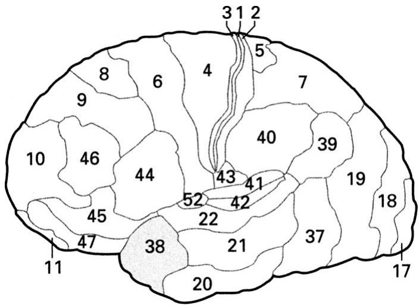
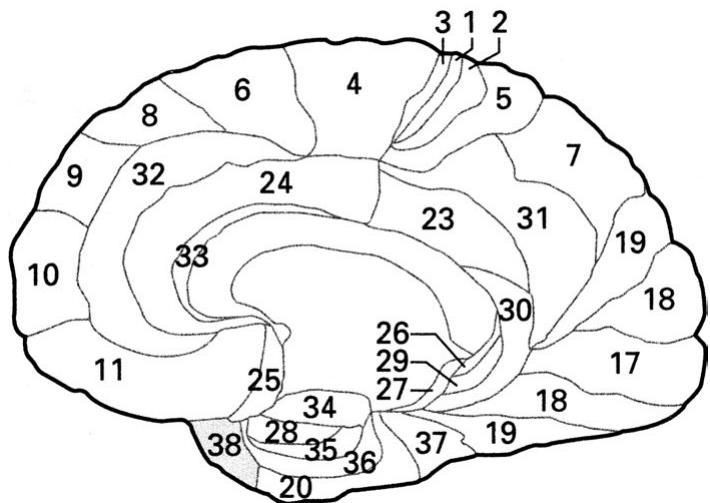
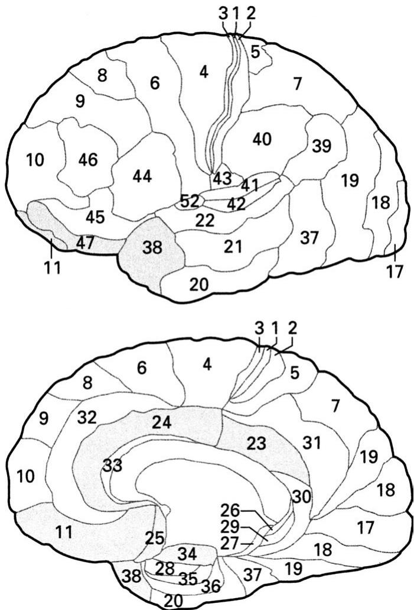
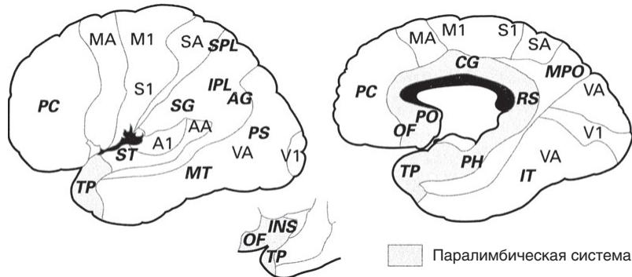
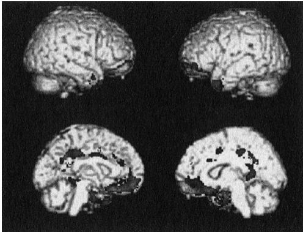
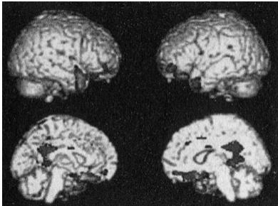
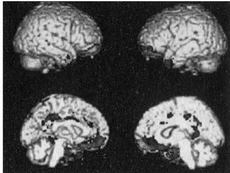

# Конкретные психопаты

Параллельно с написанием заявок я продолжал анализиро- вать тюремные данные, полученные во время учебы в аспи- рантуре.

Несколько исследований, которые я провел до отъезда из Канады, были продолжением тех наблюдений, которые я сделал благодаря клиническому опыту работы с психопа- тами. После того как я защитил магистерскую диссерта- цию, директор психологической клиники Регионального медицинского центра доктор Карсон Смайли попросил меня поприсутствовать на занятиях групповой терапии для совершивших тяжкие преступления, а также преступления на половой почве. Канадский департамент исполнения на- казаний позволяет магистрам-психологам работать врача- ми. Доктор Смайли хотел, чтобы я поподробнее узнал об их групповой терапии, чтобы ее усовершенствовать. Еще он хотел знать, может ли нейронаука, которой занимался я, сообщить им что-нибудь о нарушениях, свойственных психопатам. Цель состояла в том, чтобы использовать мои открытия для разработки более эффективной терапии пси- хопатов.

В то время я мало что знал о лечении преступников, совершивших насильственные и половые преступления, но я решил, что это будет для меня хорошим опытом, и по- тому согласился помочь. Занятия проводила психиатриче- ская медсестра, а я сидел тут же в комнате и наблюдал.

На групповых занятиях использовалась когнитивно-по- веденческая психотерапия, КПП. КПП — это такой тип разговорной терапии, которая помогает пациенту посмо- треть на свои проблемы с разных точек зрения, используя целенаправленный, систематический подход. Примени- тельно к преступникам КПП используется, чтобы вызвать у человека сомнения по поводу его неадекватного образа мыслей и убеждений. Задача состоит в том, чтобы заменить эти ошибочные установки более конструктивными схема- ми, которые снизят вероятность будущего антисоциально- го поведения.

На этих групповых занятиях я заметил, что психопаты не в состоянии понять абстрактных концепций. Например, медсестра часто прибегала к метафорам, чтобы подчерк- нуть какие-то моменты. И психопаты, с которыми она го- ворила, часто в ответ просто смотрели на нее пустыми гла- зами.

Я уже видел такое выражение лиц психопатов. Это их выдавало — как игрока в покер. Оно было заметнее всего, когда я спрашивал психопата, заботит ли их что-нибудь. Типичный пример того беспокойства, о котором я гово- рю, — это обсессивно-компульсивное расстройство (ОКР). Больные ОКР все время о чем-то беспокоятся; например, что не закрыли газ, уходя из дома. В конце концов может дойти до того, что больной не может уйти из дома, потому что слишком волнуется и постоянно вынужден возвращать- ся и проверять, все ли в порядке.

Если спросить психопата, не беспокоится ли он, что оставил дома невыключенный газ, вы увидите это пустое выражение, о котором я говорю. Психопаты не понимают, что значит беспокоиться. Психопатия и обсессивно-ком- пульсивное расстройство находятся на противоположных концах спектра. Я никогда не встречал психопата с ОКР — по-моему, таких вообще не существует.

Меня буквально завораживало, когда я видел, что пси- хопаты не в состоянии понять метафор. Такое впечатление, что психопаты способны понимать концепции, только если они представлены в конкретных терминах. Я тут же заду- мал серию исследований, чтобы проверить, можно ли све- сти неспособность психопатов обрабатывать абстрактные понятия к более простому стимулу. В первом я изучал про- цесс обработки абстрактных и конкретных слов психопа- тами.

Психологи по-разному классифицируют слова. Их мож- но разбить по частоте употребления. Например, «трубко- зуб» — редкое слово, а «олень» — частое. Оказывается, что обычные слова мозг обрабатывает не так, как необычные.

Мозг также отличает абстрактные слова от конкретных. Абстрактные — это те, которые не имеют физического смыс- ла. Например, «бесконечный» — это абстрактное слово, а «стол» — конкретное. Я составил базу данных с конкретны- ми и абстрактными словами, разбитыми на группы по таким признакам, как, например, частота употребления, длина слова и количество гласных. Я хотел знать, отличает ли мозг психопата конкретные слова от абстрактных в разных усло- виях. Я подобрал все конкретные и абстрактные слова так, чтобы они были эмоционально нейтральными. Я не хотел, чтобы мои исследования осложнились из-за неспособности психопатов к эмоциональной обработке языка.

Но еще у меня возникла идея, что эмоциональные ано- малии психопатов могут происходить из-за неспособности обрабатывать абстрактную информацию. В конце концов, эмоциональные слова часто абстрактны. «Любовь», напри- мер, очень абстрактное слово. Для разных людей оно озна- чает очень разные вещи и не обязательно имеет конкрет- ный смысл. Мы пытаемся объяснить абстрактные аспекты любви с помощью стихов, музыки и театра — но что такое любовь как чувство?

Я часто спрашиваю психопатов во время интервью: «Что для вас значит любовь?» Самый частый ответ — секс. По- сле этого ответа психопаты часто описывают свои любимые сексуальные эскапады. Они застревают на физическом, конкретном, и не могут объяснить абстрактных связей, ко- торые дает любовь.

В первых исследованиях я использовал ЭЭГ, чтобы про- верить нейтральную реакцию психопатов на абстрактные слова. Я обнаружил, что у психопатов не наблюдается та- кой же разницы в мозговой активности при обработке кон- кретных и абстрактных слов, как у непсихопатов и здоро- вых людей2.

Мозг поистине удивителен в том, как он различает типы слов. Через 175 миллисекунд после предъявления слова от- правляет абстрактное понятие совсем по другому пути об- работки, чем конкретное3. Однако мозговые волны психо- патов показывают, что все слова у них обрабатываются по одному и тому же пути. Их мозг реагирует одинаково на абстрактные и конкретные слова.

Казалось, из этих исследований довольно ясно следует, что психопаты недостаточно хорошо понимают абстракт- ные слова; есть какое-то нарушение в нейронных цепоч- ках, которое не дает двум типам слов обрабатываться по- разному.

Тогда я использовал технику фМРТ, чтобы узнать, где именно в мозге у психопатов происходит какая-то ошибка при обработке абстрактных слов. У непсихопатов важней- ший узел различения абстрактных представлений речи, включая разницу между абстрактными и конкретными сло- вами, — это правый передний височный полюс (см. рис. 5). Как я и предполагал в своем исследовании, у психопатов оказался большой дефицит активности в этом участке моз- га при обработке абстрактных слов4.

Височный полюс — зона, в которой интегрируется ин- формация от органов чувств, подобно тому как сводится звук и изображение при монтаже фильма. Такое впечатле- ние, что психопатам трудна вставить абстрактное содержа- ние в сюжет.

  
Рис. 5. Изображение человеческого мозга сбоку (вверху) и в разрезе (внизу), как если бы мозг разделить посередине на две половинки. Числа соответствуют отделам на карте цитоархитектонических полей (отделов мозга) Бродмана, составленной в 1909 году. Ученые поль- зуются системой Бродмана, чтобы сравнивать результаты разных исследований разных лабораторий. Исследование обработки аб- страктных слов у психопатов показало участие переднего височного полюса (поле 38)

  
Рис. 6. Изображение отделов мозга, которые считаются связанными с психопатией на 2000 год. К ним относятся миндалевидное тело, гиппокамп, передняя и задняя поясная кора, передний височный полюс и глазнично-лобная кора. Числа соответствуют полям Брод- мана. Подробности см. на предыдущих иллюстрациях

Исследование позволило предположить, что причина, почему на психопатов так плохо действует лечение с ак- центом на абстрактных концепциях, заключается в том, что их мозг не способен их воспринимать. Данные изуче- ния мозга сказали нам: чтобы терапия приносила пользу психопатам, она должно выражаться на простом, конкрет- ном языке.

Мои канадские исследования показали, что у психопа- тов есть нарушения в некоторых участках мозга: в минда- левидном теле, гиппокампе, передней и задней поясной коре и височном полюсе. Другие ученые нашли нарушения и в глазнично-лобной коре.

На рис. 6 кратко показаны отделы мозга, которые в на- чале XX века считались связанными с психопатией.

**Цветные карты**

Один из плюсов работы в Йельском университете был в том, что там собрались специалисты мирового уровня практически по всем мыслимым предметам. Я с головой ушел в научное сообщество университета и продолжал са- мообразование в качестве ученого, посещая все лекции по психологии, психиатрии, неврологии, нейронаукам и эко- номике.

Кроме того, я занялся новым вопросом: как сложить целую головоломку из фрагментов психопатического мозга. Я стал изучать разные теории развития мозга. Больше все- го меня интересовало: почему у психопатов аномалии в таких разных отделах мозга? Есть ли в этом какая-то си- стема? Возможно ли создать единую теорию, объединяю- щую все открытия, к которым пришел я и другие ученые?

Разгадка этой головоломки начала оформляться у меня, когда доктор Хилари Блумберг с кафедры психиатрии Йельского университета проводила семинар о нейрофизи- ологических коррелятах депрессии. Хилари начала лекцию с карты цитоархитектонических полей Бродмана. Корби- ниан Бродман (1869—1918) — врач-невролог, который раз- работал подробнейшую систему анатомической классифи- кации отделов мозга, распределив их по типу и плотности нейронов, из которых эти отделы состоят.

Я был знаком с картами Бродмана как с системой клас- сификации, но Хилари представила их в таком виде, в ко- тором мне еще не приходилось видеть. Отделы мозга на ее картах были закрашены разными цветами.

Синим были отмечены базовые сенсорные системы зрение, слух, моторные функции. Эти участки отличались схожим типом и плотностью нейронов, в основном выпол нявших одинаковые функции — обработку базовых сенсор- ных вводов. Желтый цвет отмечал сенсорную кору более высокого порядка. Розовый — префронтальную и темен- ную кору. Большая префронтальная кора у человека отли- чает его от других приматов. И наконец, зеленый цвет по- казывал районы мозга, которые Бродман классифицировал как паралимбические. Они включали классические лимби- ческие структуры: миндалевидное тело, гиппокамп, перед- нюю и заднюю поясную кору, но не только эти. К ним также была отнесена глазнично-лобная кора, островок и височный полюс (см. рис. 7).

В этот момент у меня в голове вспыхнула лампочка. «Вот оно!» — подумал я. Части мозга, в которых я нашел аномалии у психопатов, четко совпали с теми, которые Бродман назвал паралимбическими. Просто невероятно, насколько сошлись обе картины. Я упросил Хилари отдать мне копию этого слайда и пошел прямо в библиотеку, что- бы прочитать об этой описанной Бродманом паралимбиче- ской системе все, что только смогу найти.

Затем был целый год исследований — и чтения тысяч статей. Я затратил на это много сил, потому что мне при- ходилось работать по выходным и вечерам, чтобы соста- вить исчерпывающую картину мозга психопатов. В итоге я разработал так называемую модель паралимбической дис- функции психопатии, которую опубликовал в рецензируе- мом журнале по нейронаукам5. Мое первое примерное из- ложение модели паралимбической дисфункции оказалось длиннее моей же докторской диссертации.

  
Рис. 7. Карта цитоархитектонических полей Бродмана, основан- ная на принципе организации нейронов. Обратите внимание на сходство между паралимбической системой (окрашенные участки) и зонами, которые оказались аномальными у психопатов (см. рис. 6). Оба рисунка поразительно похожи. Это и подтолкнуло меня к формулировке моей модели паралимбической дисфункции у пси- хопатов

Однако у меня сложилась полная картина, словно ужин, идеально дополненный бутылкой вина. Моя модель вклю- чила связанные данные, полученные благодаря нейровизу- ализации психопатов, в то время еще молодой области на- уки, анализу и интерпретации аномалий ЭЭГ у психопатов и, наконец, подробному изучению последствий, к которым приводили нарушения в определенных паралимбических отделах мозга. Как оказалось, если человек перенес ин- сульт или иного рода повреждение части паралимбической системы мозга, это могло вызвать проявление симптомов психопатии.

**Знаменитый пациент из Вермонта**

Большинство знает, что если человека сильно ударить по голове, так чтобы он потерял сознание, он может потерять память. Потеря памяти, или амнезия, — обычный симптом после сотрясения мозга. Однако повреждение мозга может вызвать множество нарушений и другого рода. Иногда оно даже приводит к изменению личности, которая становится похожа на то, что мы видим у психопатов.

Самый яркий пример подобных изменений — это случай со строителем из Вермонта Финеасом Гейджем6. 13 сентября 1848 года Гейдж перенес черепно-мозговую травму: при про- кладке железной дороги металлический прут трехсантиме- тровой толщины пробил ему голову ниже левой глазницы и вышел через макушку.

Случай Гейджа примечателен по нескольким причинам. Во-первых, это чудо, что он выжил. Во-вторых, врач Гейд- жа описал его, и теперь мы можем сделать выводы из его опыта. И наконец, из-за этой травмы Гейдж превратился из ответственного работника и мужа в импульсивного, без- ответственного, неразборчивого в связах и равнодушного человека. Многие симптомы Гейджа совпадают с класси- ческими симптомами психопатии. Из-за прута, который прошел через мозг Гейджа, он лишился нескольких участ- ков паралимбической системы.

Исследования пациентов с аналогичными травмами моз- га позволяют предположить, что паралимбическая система обуславливает большую часть качеств, связанных с психо- патией. Сначала неврологи назвали состояние Гейджа псев- допсихопатией7, но потом его стали называть приобретенной социопатической личностью8. Иными словами, если повре- дить часть паралимбической системы, можно приобрести психопатические черты.

Для пациентов с повреждениями паралимбической си- стемы мозга в целом характерны проблемы с агрессией, мотивацией, эмпатией, планированием и организацией, импульсивностью, безответственностью, недостатком ин- туиции и слабым поведенческим контролем9. В некоторых случаях у пациентов появляются идеи величия и бесцель- ная ложь10. Все это симптомы, которые мы видим у психо- патов.

Повреждения некоторых участков паралимбической си- стемы встречаются не так уж редко. Например, если мозг ударится о переднюю часть черепа, он натолкнется прямо на костистый хребет, проходящий прямо над глазами. От удара может повредиться глазнично-лобная кора. Такой вид повреждения встречается у игроков в американский фут- бол, которые неоднократно получали сотрясение мозга. Из-за единичного случая или общего воздействия множе- ственных травм мозга у людей с поврежденной глазнично- лобной корой в конце концов могут развиться те же проб- лемы, что и у Гейджа. Бывшие игроки Национальной лиги американского футбола начинают сознавать эту опасность как потенциальный профессиональный риск.

Складывая фрагменты головоломки, я понял, как круп- но мне повезло, что моя спортивная карьера оборвалась в колледже из-за травмы колена. Я еще в школе четыре раза перенес сотрясение мозга. К счастью, он, кажется, не по- вредился. Должен признать, однако, что каждый раз, когда я встаю со стола томографа после исследования, где-то в глубине души я боюсь, что на моей томограмме могут про- явиться какие-то нарушения в глазнично-лобной коре.

У Гейджа были не все симптомы психопатии. Я изучил литературу по этой теме и пришел к ясному выводу: по- вреждение только одной или двух частей паралимбической системы не приводит к возникновению полного набора симптомов, которые присутствуют у психопатов. Однако повреждение любой части паралимбической системы часто вызывает один и более симптомов психопатии.

Но даже если многие части оказываются повреждены уже в пожилом возрасте, некоторые проявления психопа- тии так и не возникают. Например, бессердечие — одна из черт, присущих психопатам, но редко встречающаяся у взрослых пациентов с повреждениями паралимбической системы. Почему? Возможно, нужны годы, чтобы у че- ловека с аномалией паралимбической системы развилось бессердечие; большинство пациентов просто не живут так долго.

Эти выводы подкрепляются исследованием двух пациен- тов, которые еще в младенчестве перенесли травму мозга. Ученые показали, что в зрелом возрасте у них чаще наблю- дались бессердечные поступки, чем обычно бывает у паци- ентов, перенесших аналогичные травмы уже взрослыми11.

Иными словами, если психопаты уже рождаются с ано- малиями паралимбической системы, возможно, это и вы- зывает развитие бессердечия в зрелом возрасте.

Что интересно, у пациентов с повреждениями паралим- бической системы иногда появляется и ночное недержание (то есть энурез). Выше я указывал, что у детей, страдающих хроническим энурезом, может быть повышенный риск де- структивного поведения в будущем. Пока мы не знаем, яв- ляются ли пациенты с повреждениями паралимбической системы, у которых развивается недержание, более агрес- сивными, чем другие пациенты с такими же повреждения- ми. В этом еще предстоит разобраться.

Помимо сходства симптомов психопатии и поведенче- ских изменений у пациентов с травмами паралимбической системы, у этих двух групп похожи и нейропсихологиче- ские профили.

Нейропсихология использует задания или игры для того, чтобы понять, какие проблемы может испытывать человек после травмы мозга. В ходе своих библиотечных поисков я обнаружил, что пациентам с поврежденной па- ралимбической системой и психопатам-заключенным пло- хо удаются поразительно одинаковые виды заданий.

У пациентов с травмами, как и у психопатов-преступ- ников, с трудом распознаются нюансы интонации или вы- ражение лица. Им сложно управлять поведением, прини- мать решения, сдерживать себя, избегать вредных для них ситуаций, они апатичны, беспорядочны в связах, проявля- ют неподчинение, не соблюдают общественные нормы и не испытывают уважения к властям.

Повреждения других участков лобной коры (например, верхней лобной или дорсолатеральной префронтальной), теменной или затылочной коры не приводят к таким же поведенческим симптомам или когнитивным аномалиям; то есть травмы участков, не относящихся к паралимбиче- ским по Бродману, не приводят к появлению симптомов психопатии.

Иными словами, создается впечатление, что у психопа- тов проблемы именно с паралимбической системой.

Так сложились все фрагменты ребуса. Я нашел ответ на свои вопросы о тайнах мозга психопатов. Вооруженный новой теорией об аномалиях мозга, я стал придумывать но- вые исследования, чтобы проверить функции отдельных компонентов паралимбической системы у психопатов.

**Преимущества тюрьмы**

Работа в Йельском университете и Институте жизни при- носила мне большое удовлетворение как в личном, так и в профессиональном плане. У меня появились близкие дру- зья, с которыми я ездил на лыжах, на горном велосипеде и проводил отпуск, компенсируя в какой-то степени свой трудоголизм в годы аспирантуры.

Я получил гранты от Национальных институтов психи- ческого здоровья и Национального института по пробле- мам наркомании. Мне оказали особую честь — попросили поработать в исследовательской секции Национальных ин- ститутов здоровья, где я давал отзывы на поданные други- ми учеными заявки на гранты. Я уверенно поднимался по академической карьерной лестнице.

Но жизнь не обходилась совсем без сложностей. Во-пер- вых, к моей досаде, оказалось, что находить и набирать психопатов для исследования на воле гораздо сложнее, чем в тюрьме. Психопаты, что неудивительно, после освобож- дения сразу же куда-то исчезают. И даже если их отыскать, они редко появляются в назначенный час, если появляют- ся вообще.

У нас в лаборатории мы испробовали все возможное, чтобы решить эту проблему. Мы посылали открытки с на- поминанием, звонили за неделю, за несколько дней, на- кануне вечером и даже утром назначенного дня. Но все равно многие не приходили. Мои сотрудники большую часть времени тратили на то, чтобы добиться встречи, а не на сбор данных.

В тех редких случаях, когда психопаты все-таки показы- вались в назначенный час, для них было обычным делом устроить какую-нибудь выходку. Они приходили с силь- ным похмельем и не могли отвечать на вопросы, так что мы вынуждены были отсылать их домой. Либо они явля- лись пьяными или под кайфом. Иногда мы даже вызывали охрану, чтобы вывести какого-нибудь буйного психопата во хмелю, посадить в такси и отправить домой. Я перезна- комился со всеми охранниками больницы.

Мне стало ясно, что с психопатами гораздо безопаснее работать в тюрьме, чем на свободе.

Тем не менее мы не сдавались и упорно продолжали медленно, но верно продвигаться вперед в исследовании отсидевших психопатов.

**Женщины-психопаты?**

Я выступил перед своими коллегами по кафедре психиат- рии Йельского университета о последних достижениях в области изучения психопатии. После лекции ко мне подо- шел врач местной тюрьмы строгого режима. Он попросил меня прийти и дать оценку одной женщине-заключенной, насколько на нее подействует лечение. Я согласился.

Джуди было 25 лет. Это была стройная блондинка с во- лосами до плеч, весом всего 48 килограммов и ростом 160 см. Я подготовился к разговору с Джуди, изучив ее тюремные материалы. Это была папка толщиной в несколько пальцев, еще к ним прилагались видеозаписи.

Я приехал в тюрьму, устроился в приготовленном для меня помещении и вставил кассету в видеомагнитофон. Там была запись с камеры наблюдения из комнаты для до- просов, похожей на ту, где сидел я. На видео Джуди сиде- ла за большим столом по другую сторону от женщины-пси- холога, проводившей интервью. Я посмотрел минут десять записи, когда это случилось: Джуди бросилась через стол, напав на терапевта. Джуди молотила руками по воздуху и дважды ударила психолога, прежде чем та вообще сообра- зила, что происходит. Психолог упала на пол, Джуди осед- лала ее и ударила еще раз шесть-семь, пока в комнату не ворвалась охрана и ее не стащили с жертвы. Изо рта вра- ча на пол текла темная кровь, она лежала без сознания. По-моему, во время нападения она лишилась нескольких зубов.

Я перемотал запись и посмотрел ее еще раз. Джуди ничем не выдавала того, что вскоре произошло; нападение было неспровоцированным и жестоким. Охрана, видимо, нахо- дилась где-то поблизости, потому что психолог не успела нажать тревожную кнопку; первые два удара ее полностью обездвижили.

Я выключил запись и стал читать личное дело Джуди. Она попадала в тюрьму несколько раз начиная с 12 лет. В шестнадцать Джуди застрелила другого подростка. В свою защиту она сказала, будто не знала, что пистолет за- ряжен, направляя его в голову жертвы и нажимая на спу- сковой крючок. Она получила срок за непредумышленное убийство.

Джуди постоянно нарывалась на неприятности и для надзирателей в тюрьме стала настоящим кошмаром. В спи- ске проступков у нее были десятки драк с заключенными и два нападения на охрану. Тюремные врачи попросили меня определить, отвечает ли она критериям психопатии. После оценки они хотели узнать, не смогу ли я посовето- вать им что-нибудь, чтобы им научиться контролировать поведение Джуди.

Они свидетельствовали о серьезных эмоциональных и дис- циплинарных проблемах практически во всех областях ее жизни. Хотя к тому времени я проинтервьюировал сотни заключенных, эта Джуди должна была стать первой женщи- ной среди них. И я надеялся, что это не окажется моим пер- вым интервью, которое закончится физическими увечьями.

Джуди пришла на интервью в девять утра, еще не совсем проснувшаяся. Она сонно пожала мне руку и плюхнулась на стул напротив меня. Я объяснил ей, что интервью по- может определить варианты ее лечения.

У Джуди была такая же история, как у сотен психопа- тов-мужчин, с которыми я говорил раньше. В раннем дет- стве она не могла учиться на собственных ошибках, на нее не действовали наказания. Родители отвечали на ее агрес- сивное поведение и хулиганские выходки строгостью и в итоге поместили ее под «домашний арест» на несколько месяцев. Тогда Джуди стала портить электротехнику: от- верткой сломала телевизор, музыкальный центр и даже по- жарную сигнализацию. Больше того, вой пожарной сирены среди ночи стал своего рода обычным развлечением для Джуди. Ей нравилось смотреть, как ее родители носятся по дому в поисках дыма или огня.

С 14 лет Джуди стала носить при себе пистолет, прак- тически куда бы ни шла. Это была полуавтоматическая «беретта» с магазином на девять пуль. Я попросил Джуди поделиться со мной ее приключениями с пистолетом. Она благосклонно рассказывала мне историю за историей о том, какой она меткий стрелок и как превосходно владеет оружием по сравнению со сверстниками. Еще она поведа- ла, что не раз выпускала все пули во время автоперестрелок с соперничающими бандами. Она ездила в машине с дру- гим подростком, чтобы, если их остановит полиция, они могли бы притвориться, что у них просто свидание. Благо- даря остроумному плану они не раз выкручивались, когда их останавливали и задавали вопросы.

Я вернул разговор к отношениям Джуди с ее родителями и братьями. Она не видела родителей несколько лет и по- лагала, что два младших брата тоже поживают нормально. Братья не последовали за Джуди по кривой дорожке.

Когда интервью подходило к концу, я заговорил о самом тяжком преступлении Джуди, совершенном в подростко- вом возрасте, — неумышленном убийстве.

Я попросил Джуди рассказать, что произошло.

Она стала отрепетированно говорить, как она и еще двое ребят играли с пистолетом, как вдруг подняла на меня глаза и замолчала. Я увидел в ее взгляде смесь гнева и рас- терянности. Она поняла, что я ее поймал. Я напрягся, ожи- дая броска, но она просто еще больше обмякла на стуле.

Я воспользовался установившейся между нами связью, чтобы Джуди похвасталась мне своим умелым обращением с «береттой» до «несчастного случая». И она поняла, что теперь говорить, будто бы выстрел произошел случайно, из-за ее неопытности, бессмысленно, учитывая, что она сама призналась в мастерском владении оружием еще за несколько лет до убийства.

— Что, шило вывалилось из мешка, да? — сказала она, не вставая со стула.

— Да, — ответил я.

— Тогда можно и правду сказать. Это все равно; меня не могут судить два раза.

Джуди имела в виду, что уже признала себя виновной в неумышленном убийстве и ее не могли отдать под суд вто- рой раз за то же преступление.

— Майкл сказал, что мне слабо выстрелить, тогда я при- ставила пистолет к его голове и спустила крючок с пустым магазином. Щелк. Я только хотела его напугать. Но потом он опять стал меня оскорблять, что, дескать, у мне не хва- тит духу его застрелить. Ну, я зарядила пистолет, приста- вила к его голове и выстрелила. Больше он меня не достает.

Она смотрела на меня пустым, бесчувственным взгля- дом. Это был тот же взгляд, который я видел у сотен пси- хопатов-мужчин, но я впервые увидел его у женщины.

Джуди встала и сказала, что она уже наговорилась. Она вышла из комнаты и вернулась в камеру.

Я ответил тюремным врачам, что лечить Джуди будет очень трудно.

О женщинах-психопатах очень мало исследований. Ис- ходя из наилучших данных, которые у нас имеются, можно сказать, что на десятерых психопатов-мужчин приходится по одной психопатке. Как и мужчины, женщины-психопа- ты в конце концов сталкиваются с законом и часто попа- дают в тюрьму. Количество психопаток среди женщин-пре- ступниц составляет 15—20 процентов, примерно как и у мужчин. Но женщин в тюрьмах всего 10 процентов. Таким образом, женщины-психопаты встречаются намного реже мужчин-психопатов. Также нет опубликованных данных по нейровизуализации женщин-психопатов. Со времени моего интервью с Джуди моя лаборатория собрала некоторые дан- ные нейровизуализации осужденных женщин, и мы плани- руем опубликовать первые исследования женщин-психопа- тов в ближайшем будущем.

**Изменение среды**

Однажды утром мне позвонил старый друг Винс Кларк. Док- тор Кларк ушел из университета при Коннектикутском цен- тре изучения здоровья за несколько лет до того, чтобы рабо- тать в Университете Нью-Мексико. Когда мы встречались на конференциях, он расхваливал жизнь в Нью-Мексико — 320 солнечных дней в году, никаких дождей и туманов, дома по доступным ценам, отличные лыжные склоны в Таос- Ски-Вэлли и первоклассные трассы для горного велосипеда чуть ли не прямо за дверью в соседних горах Альбукерке. Казалось, что доктор Кларк очень доволен своим переездом.

Он звонил, чтобы пригласить меня вместе с доктором Калхуном в Нью-Мексико выступить в Институте изучения психических заболеваний и мозга\* в кампусе Университета Нью-Мексико. Институт был мирового класса некоммер- ческим центром по визуализации мозга, изучающим ши- зофрению и другие психические болезни; он был учрежден сенатором от Нью-Мексико Питом Доменичи, который пять сроков отсидел в сенаторском кресле.

По приезде доктор Кларк встретил нас с распростертыми объятиями. Как-то вечером в конце нашего визита, после того как он потряс нас обширными ресурсами и возмож- ностями института и университета, доктор Кларк выставил перед нами свой товар. Он спросил, не хотим ли мы с Вин- сом перебраться в Нью-Мексико.

Мы с Винсом были польщены, но сказали доктору Кларку, что нам хорошо и в Коннектикуте.

Но доктор Кларк настаивал. Он сказал, что нас возьмут к себе совместно Университет Нью-Мексико и некоммер- ческий институт. Университет даст нам места на факульте- те, а институт разместит у себя наши исследовательские лаборатории и предоставит средства для начала работы.

Доктор Кларк умел вести переговоры. Он уже сумел за- ставить меня высказать свою досаду из-за работы с пси- хопатами в Коннектикуте. К тому же коннектикутский департамент исполнения наказаний не желал доставлять заключенных из тюрьмы в Институт жизни для исследо- ваний. Доктор Кларк знал, что меня заинтересуют альтер- нативные решения.

Тогда я сказал ему, что всегда мечтал иметь мобильный МР-сканер, чтобы возить его в тюрьмы. И тогда Винс вы- дал мне свое предложение, от которого невозможно от- казаться: магнитно-резонансный томограф большой мощ- ности для крупных исследований. Мы сказали доктору Кларку, что, если он осуществит наши желания, мы станем нью-мексиканцами. Нам с Винсом казалось немыслимым, что доктор Кларк найдет ресурсы, чтобы выполнить наши запросы. Мы ошиблись.

Всего через неделю доктор Кларк позвонил и сказал, что я могу получить свой мобильный МРТ, а Винс — свой для других исследований. Институт также создаст большую базу данных, где будут храниться все данные по нейрови- зуализации. Там это назвали нейроинформационной систе- мой. Это была мечта Винса.

Мы с Винсом, сидя в конференц-зале, посмотрели друг на друга через стол и с недоверием уставились на динамик.

— Вы не могли бы повторить, доктор Кларк? — спро- сил я.

На другом конце раздался смех. Потом доктор Кларк сказал:

— Мы хотим, чтобы вы переехали к нам. И мы считаем, что ваши исследования имеют огромное значение для об- щества. Вы подумайте об этом и дайте мне знать.

После звонка Винс повернулся ко мне и сказал, что хо- чет ехать. Я ответил, что мне нужно сначала выяснить, смогу ли я получить доступ в нью-мексиканские тюрьмы. И я взял билет на самолет до Нью-Мексико.

У штата Нью-Мексико большая площадь, но населения там чуть больше двух миллионов человек. Из-за этого до нью-мексиканских политиков довольно легко добраться. Всего через несколько недель после звонка доктора Кларка я смог попасть на встречу с директором по делам прави- тельства при тамошнем губернаторе Билле Ричардсоне. Видимо, ему позвонил основатель института сенатор Пит Доменичи, и встречу организовали без проволочек.

Юридический отдел губернатора уже изучил вопрос и установил, что мое исследование вполне законно. Мою ра- боту финансировали Национальные институты здоровья, ее одобрили комиссии по этике Хартфордской больницы, Йельского университета и Федерального управлении по за- щите человека при исследованиях.

Директор по делам правительства сказал, что штат Нью- Мексико приветствует научные исследования вообще и любые исследования в частности, когда их цель — снизить уровень преступности и наркомании. После этого меня от- правили к главе нью-мексиканского департамента испол- нения наказаний Джо Уильямсу.

Джо Уильямс оказался богатырем выше 180 сантимет- ров, с широкой грудью и вообще очень внушительной внешностью. Он пожал мне руку и сказал:

— Мне звонил губернатор. Кажется, мы с вами собира- емся заняться наукой, да?

— Да, сэр, — ответил я. — И моя лаборатория будет в полном вашем распоряжении, если вам понадобится что- либо изучить или у вас будут вопросы о рецидивизме, оценке риска или о чем-то другом, что входит в сферу на- шей компетенции.

Я был готов хоть туалеты чистить, если мне позволят вернуться в тюрьму.

Секретарь Уильямса уже выбрал первое исправительное заведение, с которого мы могли приступить к программе ис- следований. Это была Западная Нью-Мексиканская тюрьма в Грантсе, примерно в 130 километрах западнее Альбукерке. Начальника тюрьмы поставили в известность, и он был го- тов меня встретить.

Удивительно, чего только не добьешься в небольшом штате с небольшим правительством одним-единственным звонком. Конечно, если за тебя ходатайствует сенатор вро- де Пита Доменичи, это очень помогает.

На следующее утро я надел свой лучший костюм, от- правился в тюрьму и встретился с начальником. Я сказал ему, что нам нужны несколько помещений и место под мобильный МРТ. Начальник передал меня в руки своего заместителя Дианны Хойзингтон, миниатюрной блондин- ки, скорой на улыбку и острое словцо.

К нам с Дианной присоединился Доминик, завхоз, ко- торый проводил нас в медицинское крыло. Доминик по- казал четыре кабинета, которые они освободят для моей группы. Он закажет и установит там новую мебель.

Начальник тюрьмы настоял на том, чтобы приставить ко мне сотрудника тюремной охраны на случай каких-либо проблем. Он будет находиться дальше по коридору, но в пределах слышимости, если вдруг кто-нибудь позовет на помощь. Я знал, что мои сотрудники оценят эту любез- ность. Никто из них еще не работал в тюрьме.

Когда мы подошли к задней двери медицинского крыла, Доминик достал большой латунный ключ, чтобы ее отпе- реть, — практически такой же, как тот, которым я пользо- вался в канадской тюрьме. Мы вышли из здания на яркий солнечный свет; дверь выходила в открытый участок, ого- роженный по периметру забором. Доминик показал на во- рота и сказал, что в них будет въезжать мобильный МРТ, огибать сзади медицинское крыло и парковаться на пло- щадке, которую он зальет бетоном.

Для мобильного томографа нужны бетонная площадка и электричество. К нему он подключается через разъемный кабель, отходящий от нижнего отделения трейлера. Я по- казал Доминику схему подключения и размеры бетонной площадки.

Заканчивая обход, Доминик спросил, можно ли ему бу- дет сделать снимок мозга, когда приедет томограф.

— Конечно, — сказал я ему. — С удовольствием, когда захотите.

За обедом Доминик признался, что тоже играл в футбол в старших классах; он хотел убедиться, что у него в голове все в порядке.

Напоследок мне нужно было пройти собеседование на кафедре психологии в Университете Нью-Мексико. Я под- готовил новую презентацию, в которой упирал на разра ботку моей модели паралимбической дисфункции у психо- патов, мучительно подбирая темп и интонацию речи. Начал я с проблем, которые представляют психопаты для обще- ства, потом рассказал о последних данных науки и о тех следствиях, которые мое исследование может иметь для общества. Это была речь — «песочные часы»: она начина- лась широко, потом сужалась и уже заканчивалась мас- штабной картиной влияния на общество.

Кафедра психологии проголосовала за то, чтобы дать мне место на факультете. Параллельно Винс прошел со- беседование на кафедре электротехники. Насколько я пом- ню, за него проголосовали единогласно.

Потом мы с Винсом собрались и обдумали, что нам пред- лагали. Мы проработали вместе почти десять лет и подружи- лись. Институт мозга и Университет Нью-Мексико превзо шли все наши ожидания. Условия, которые мы поставили, выполнены. Винс протянул руку, и я крепко ее пожал.

— Я обеими руками за, — сказал он мне.

— Я тоже, — ответил я.

Однако нам обоим не хотелось даже думать о следующем шаге — тягостной обязанности сказать нашим близким дру- зьям и коллегам в Коннектикуте о своем отъезде.

Моя встреча с Хэнком прошла трудно. Хэнк заменил мне отца, потому что мой родной отец умер, еще когда я учился в университете. Мы с Хэнком вместе преодолели горы. В буквальном смысле слова. Однажды мы поднялись на Маунт-Уитни, а на следующий год на Шасту и стали очень близки. Я знал, что мой уход будет для него тяжелым ударом. Но в конце концов оказалось, что он эмоциональ- но сильнее меня.

Рассказывая Хэнку о предложении, которое я получил, я не выдержал.

Хэнк всегда оставался профессионалом в высшем смыс- ле слова. Он сказал мне, что понимает мое решение. Фак- тически он даже настаивал, чтобы я его принял. Он велел мне не вешать нос и радоваться новому этапу моей жизни. И кто знает, добавил он, может быть, когда-нибудь я вер- нусь в Коннектикут.

Я принял решение. Теперь мне оставалось только на- деяться, что когда-нибудь я смогу хотя бы отчасти повто- рить ту плодотворную научную атмосферу, какую Хэнк создал в Институте жизни.

**Тюремная эффективность**

Через три дня после моего возвращения в Коннектикут мне позвонил Доминик, завхоз тюрьмы в Нью-Мексико, и ска- зал, что площадка для мобильного томографа и подключе- ние к электричеству готовы.

— Я велел заключенным построить площадку и проло- жить дорогу вдоль медицинского крыла. Электрик смог протянуть кабели. Так что все готово.

Доминик, наверное, пропустил мимо ушей, что мобиль- ный томограф еще даже не разработан и не изготовлен. Однако он нисколько не смутился, когда я это объяснил; он только сказал, что хочет стоять первым в очереди на снимок, когда система заработает.

После этого я связался с «Сименс», «Дженерал элек- трик» и «Филипс». Я назначил представителям всех фирм встречу на одно и то же время, чтобы обсудить варианты мобильного томографа.

«Сименс» пообещал поместить в трейлер самый быстрый из производимых ими МР-сканеров. «Сименс» никогда еще не выпускал томографы для трейлеров. Мы договорились о том, что все будет испытано и проверено самым строжай- шим образом. «Сименс» гарантировал, что система будет соответствовать всем моим требованиям — либо они не возьмут за нее денег. Это меня впечатлило. Фирма была очень уверена в своих инженерах. Этот выбор оказался од ним из самых простых в моей жизни. Я выбрал «Сименс».

Они направили меня к трем компаниям, выпускающим трейлеры для мобильных томографов в США и Канаде. Я полетел в Чикаго, потом в Лос-Анджелес, чтобы погово- рить с руководителями двух из них, которые были готовы разработать первую в мире мобильную систему для функ- циональной магнитно-резонансной томографии. Послед- нюю остановку я сделал в фирме «Медикал коучес инк.» в небольшом городке Онионта на севере штата Нью-Йорк.

Я приехал в «Медикал коучес» с парой сотрудников из Нью-Хейвена. Мы встретились с директором по производ- ству Леном Маршем и вице-президентом по конструктор- ским и технологическим вопросам Диком Мэттисом за обедом в «Брукс-Хаусе». Весь обед Марш и Мэттис рас- писывали свой производственный процесс, который по- зволит им выполнить заданные технические условия. Они работали исключительно для «Сименс» по немецким стан- дартам. Фирма «Медикал коучес» оказалась лучшей.

Я передал им чертежи, и мы решили вместе подать за- явку на патент трейлера с нашими изменениями. Мы разо- брали его по винтикам и реконструировали с учетом специ- альных возможностей, которые позволят установить в него аппаратуру, необходимую для высокоскоростной функ- циональной нейровизуализации. Я внес в проект поправки на основе опыта создания двух комплексов для МРТ и все возможные мелочи, которых только мог пожелать исследо- ватель.

Когда мы выбирали место для кнопки срочного отклю- чения, я не мог не заметить, что она — большая и красная — напоминает тревожную кнопку в ванкуверской тюрьме.

Дик Мэттис хотел поместить ее в самой середине, чтобы она была у всех на виду.

Кнопка срочного отключения нужна на случай аварии, какой-то опасности для здоровья и жизни человека, нахо- дящегося в сканере, например, если металлический пред- мет попадет в магнитное поле томографа. Оно всегда вклю- чено, и эта кнопка сможет его отключить. К этой мере предосторожности можно прибегать только в самом край- нем случае. Если нажать кнопку, отключится сверхпрово- дящий магнит. Однако это может привести к повреждению магнита стоимостью 2 миллиона долларов. И даже если с магнитом ничего не случится, только одна замена жид- кого гелия после его испарения стоит около 100 тысяч. Эта кнопка сама, как сильнейший магнит, притянула бы к себе кого-нибудь вроде Ричи-Шокера.

Я объяснил Мэттису, что мы будем сканировать пре- ступников вроде Ричи и что, помещая кнопку на самом виду, мы прямо-таки напрашиваемся, чтобы кто-нибудь ее нажал. Поэтому мы решили спрятать ее в специальный ящичек, чтобы нажать ее мог только обученный сотрудник.

По окончании разработки инженеры «Медикал коучес» отправили чертежи на производство. Благодаря присылае- мым по электронной почте фотографиям я имел возмож- ность следить за тем, как появляется на свет первая мо- бильная система для функциональной томографии.

**Г л а в а 8 ПОДРОСТКИ-ПСИХОПАТЫ**

ФАКТ: содержание несовершеннолетних в тюрьме строгого режима может обходиться в 514 тысяч долларов1 на человека в год2.

Любой родитель скажет, что подростковый возраст — самый трудный. Наука подтвердила, что деструктивное и антисо- циальное поведение в эти годы достигает пика3. Большин ство мальчиков и значительное число девочек в период взросления совершают антиобщественные поступки. К сча- стью, делинквентное поведение, как правило, ограничи вается сравнительно мелкими проступками, например ван- дализмом, выпивкой, употреблением легких наркотиков, драками, неаккуратным вождением и прочими хулигански ми выходками. Однако часть подростков идет по пути анти- социального образа действий, который в итоге приобретает более серьезный, более необузданный характер.

Мы оставили Брайана и Эрика, когда им обоим было по 13 лет и их только что приговорили к сроку в исправительной колонии для несовершеннолетних за многократные преступ- ления (см. главу 6). Брайана судили за кражи со взломом, Эрика — за хранение и приготовление к сбыту наркотиков, а также за неоднократные взломы домов. Брайана отправили в Иллинойс; Эрик отсиживал срок неподалеку, в Висконсине.

**Брайан**

После короткого заключения в возрасте 13 лет Брайана на несколько месяцев поместили в детский приют для маль- чиков, прежде чем снова передать родителям. По возвра- щении домой он пытался принудить к анальному сексу одного из младших братьев. Родители Брайана пришли в ужас и решили, что он научился этому у других мальчиков в приюте. Однако они не стали обращаться за помощью к психологу или психиатру. Его извращенное сексуальное поведение усугубилось в следующем году, когда Брайан подговорил десятилетнюю девочку на железнодорожном вокзале улизнуть от родителей и заняться с ним сексом. Когда Брайан с девочкой вернулись, она рассказала обо всем родителям. Родители девочки отвели Брайана домой и поговорили о случившемся с его родителями, но потом обе пары решили помалкивать.

Брайан продолжал заниматься сексом с кем попало, ме- няя партнерш. Однажды к нему в дом пришла девочка-под- росток с младенцем и заявила, что он от Брайана. Бабушки и дедушки с обеих сторон решили, что ребенка нужно от- дать на усыновление. В этот период у Брайана также была связь с замужней женщиной гораздо старше его. Брайана арестовали за кражу часов, которые он хотел подарить ей.

Когда Брайан перешел в старшие классы, сначала он получал оценки выше среднего. Однако через несколько семестров наступил упадок. Брайан стал выпивать и курить марихуану каждый день. Как он позднее сказал, марихуана помогала ему снять головные боли, которые по-прежнему его мучили.

В семье Брайана тоже царил беспорядок. Отец продол- жал пить и снова потерял работу. Их семью опять высели- ли из дома за неуплату. Родители Брайана все больше скан- далили, и однажды дело кончилось обвинением его отца Джеймса в нанесении побоев. Соседи сообщили, что за детьми практически никто не присматривает. Женевьева, мать Брайана, отдалилась от соседей и друзей. У нее тоже были проблемы с алкоголем.

Среди забав Брайана была одна, когда он целился из игрушечного, но очень похожего на настоящий пистолета в маленьких детей, после чего смотрел, как они убегают. Дети пожаловались родителям, те подняли панику, будто где-то по округе ходит потенциальный убийца. Полиция задержала Брайана под дулом пистолета, и ему предъявили обвинение в нарушении общественного порядка.

Брайан продолжал взламывать дома, иногда влезал туда же, где уже попадался. Он не умел планировать, и его не- сколько раз ловили с краденым. Судьи давали ему от ус- ловного срока до нескольких месяцев в исправительном заведении для несовершеннолетних или воспитательном доме для мальчиков, откуда Брайан убегал.

В таких заведениях Брайан подвергался сексуальному насилию со стороны других подростков, и его лечили от анальных папиллом и геморроя.

После освобождения Брайана всегда отправляли домой, где он быстро возвращался к кражам в домах и магазинах. Однажды зимой его поймали с поличным, когда он влез в «Кентакки фрайд чикен», и приговорили к нескольким ме- сяцам заключения.

Брайан рассказал воспитателю, что как-то голосовал на дороге и его подобрал мужчина на большом пикапе со строительными материалами. Мужчина отвез его в безлюд- ное место и заставил заняться с ним оральным сексом. По- том он высадил его на автозаправке и уехал. Брайан купил там банку газировки, чтобы прополоскать рот после спер- мы. Через несколько недель Брайан сказал воспитателю, что узнал этого мужчину по фотографии в газете — того арестовали за аналогичные преступления.

Из-за семейных неурядиц и правонарушений Брайан мотался по исправительным заведениям и приютам. Его наркомания и другие поведенческие проблемы усилились.

Брайан за три года успел поучиться в трех разных шко- лах. Он нередко находился на таком режиме, когда его от- пускали в школу из исправительного заведения, куда он каждый день должен был возвращаться к отбою. Он не участвовал ни в каких школьных делах или спортивных ко- мандах. В конце концов он совершенно забросил учебу.

По отчетам психологов, в заключении и в детских домах Брайан вел себя тихо и не участвовал ни в какой совместной деятельности. Некоторые называли его хитрым и агрессив- ным и утверждали, что он оппозиционно и вызывающе на- строен по отношению к взрослым и авторитетным фигурам. Брайан плохо сходился с людьми и предпочитал быть сам по себе. Впоследствии психолог, беседовавший с ним, пришел к выводу, что у Брайана «аффективное уплощение», он не- дальновиден и безответствен и не имеет перед собой ника- кой цели. Тем не менее его коэффициент интеллекта состав- лял 122 балла или выше, то есть выше среднего.

В 17 лет Брайана снова отправили жить с родителями. В течение нескольких недель он серьезно поругался с ма- терью, и она выгнала его из дома. На улице Брайан жил грабежом. Он съехался с девушкой постарше и жил у нее несколько месяцев. Их отношения испортились, он стал бродяжничать, перебирался из штата в штат. В Айове его арестовали за взлом, он отбыл несколько месяцев в тюрь- ме. Однако трехразовое питание и теплая постель были для него приятной переменой после ночевок в машине.

После возвращения в Иллинойс Брайана арестовали по подозрению во взломе магазина. Перед восемнадцатилети- ем его снова арестовали и обвинили в сопротивлении по- лиции, противозаконном применении силы, преступном причинении ущерба и употреблении запрещенных веществ. По дороге в участок Брайан подрался с полицейскими, и в местной больнице ему лечили сломанный нос. Он вышел на свободу после дня рождения и опять вернулся в Илли- нойс, где его арестовали за взлом с проникновением и хра- нение марихуаны. Между 13 и 18 годами Брайан провел больше времени в заключении, чем на свободе.

**Эрик**

К 13 годам Эрика судили за 14 разных преступлений, в том числе за хранение и сбыт марихуаны, два случая нанесения побоев, два поджога, незаконное владение и применение оружия и несколько угонов. Он находился на условном сроке, когда его поймали в угнанной машине. Через не- делю он ввязался в драку с учеником своей школы и достал пистолет. Пока шли расследование и суд, его передали в приемную семью; он тут же от них удрал. После задержа- ния его поместили в воспитательное заведение, откуда сбе жать было труднее. Оттуда он сбежал пять раз за первый месяц, так что о нем узнала вся полиция. На четвертый месяц в заведении с усиленным режимом он напал на под- ростка во время ссоры. Узнав, что ему грозит обвинение в нападении и нанесении побоев, он поджег приют. Пример но в то время, когда ему исполнилось 15 лет, его пригово рили к трем годам исправительного заведения для мальчи- ков строгого режима — такое наказание судьи приберегают только для самых антисоциальных подростков. Обвинитель утверждал, что его несдержанный нрав, беспечное обраще ние с оружием, особенно с пистолетом, и неспособность делать выводы из собственного опыта приведут Эрика к совершению более тяжких преступлений, поэтому ради об- щественного спокойствия его следует посадить в тюрьму.

В тюрьме для несовершеннолетних Эрик вел себя не лучше. Он ругался и дрался с надзирателями, отпускал гру- бые шуточки в адрес сотрудниц женского пола, дрался с другими подростками и портил вещи. В первый год в тюрь- ме его положение неуклонно ухудшалось. За два месяца он набрал сорок девять взысканий за нарушение правил рас- порядка, в том числе два за изготовление оружия и два за побои. (Такие проступки обычно наказываются несколь- кими днями в штрафном изоляторе.) По словам работни- ков, у него был «очень вспыльчивый характер». Они вся- чески старались поставить под контроль его агрессию, но на все попытки он отвечал только новыми враждебны- ми выходками. В итоге он стал проводить в изоляторе по 23 часа в сутки. Даже там он угрожал надзирателям и ру- гался с ними, часами колотил в металлическую дверь. В тот час, который он проводил вне камеры изолятора, Эрик по- стоянно высказывал угрозы, портил вещи в общих комна тах и отказывался возвращаться в камеру. После трех ме- сяцев в изоляторе его перевели в другую тюрьму, с более строгим режимом — для неуправляемых заключенных.

Там, если судить по первым отзывам, он вел себя спо- койно и шел на сотрудничество. На первой беседе он как будто наслаждался тем, что находится в центре внимания. Он объяснил, что все его поступки не такие уж плохие и что ни один из них не относится к уголовным преступле- ниям (на самом деле его судили по шести уголовным ста- тьям), и он возложил ответственность на двух других под- ростков, которые были вместе с ним, когда он в последний раз угнал машину. Эрик признался, что жил не так, как следует, что должен был слушаться маму и ходить в школу, но это казалось ему слишком скучным. Он заявил, что, когда очутился за решеткой в первый раз, это было самое ужасное время в его жизни. И все-таки, по его словам, он не помнил, что когда-нибудь был подавлен дольше чем не- сколько часов. Хотя он знал, что на тот момент его жизнь складывалась не слишком-то удачно, будущее его не вол- новало. Он не считал, что в чем-то потерпел неудачу. «Я слишком молод для неудач», — сказал он. Он почти чув- ствовал себя довольным и оценил себя в 10 баллов из 10. Один из психологов заметил, что Эрика отличали патоло- гическое высокомерие и нарциссизм.

Тестирование Эрика после прибытия в тюрьму строгого режима показало, что он эмоционально не угнетен. Однако он положительно ответил на вопросы, отражавшие его по- зицию, что нельзя доверять другим и что у них в основном злые намерения по отношению к нему. Он согласился с утверждениями, которые описывали насилие как необхо- димую часть жизни, и с тем, что человек вынужден иногда прибегать к насилию, чтобы помешать другим использо- вать его в своих интересах.

Когда Эрика спросили о школе, он признался, что его много раз отстраняли от занятий и исключали за срыв уро- ков или продажу наркотиков и сигарет, но в основном за драки. По прикидке Эрика, в школе он дрался не реже раза в неделю. Он сказал, что драки всегда провоцировали другие ученики, которые к нему «лезли». Но потом он признал, что обычно бил первым. По учебе Эрик отстал от сверстников на несколько лет, но при этом у него были нормальные ум- ственные способности и отсутствовали трудности с обуче- нием. Он сказал, что в штрафном изоляторе в предыдущей тюрьме он сидел в основном потому, что постоянно «взры- вался и матерился на охрану». Он обвинял в этих проблемах сотрудников, которые его «провоцировали».

В первый же вечер в новом месте заключения он по- жаловался на еду и потом перевернул свою камеру вверх дном. Когда ему разрешили позвонить матери и та велела ему прекратить ругаться, он вырвал телефонный шнур из стены. Его оценили как самого вспыльчивого заключенно го в истории тюрьмы. Уровень агрессии Эрика удивил даже опытных работников.

Эрик особенно не любил, когда ему говорили, что де- лать. Он продолжал нарушать правила, хулиганил, портил вещи. Весь остаток юности до совершеннолетия ему пред- стояло провести в тюрьме особого режима. Он должен был выйти на свободу вскоре после 18-го дня рождения.

Тюремная команда психологов поставила на Эрике це- лую уйму тестов. Одним из них был опрос по Перечню психопатических черт Хэра для детей и подростков, чтобы понять, насколько велик у Эрика риск рецидива и насколь- ко он поддается терапии. Два психолога независимо по- ставили ему 34 балла из 40 возможных, отнеся его тем са- мым к группе высокого риска.

**Подросток-психопат?**

ППЧ очень верно предсказывает риск рецидива у взрослых преступников мужского пола. У заключенных, набравших высокие баллы по перечню, вероятность совершить новые преступления после выхода на свободу в 4—8 раз выше, чем у тех, кто получил низкие баллы. Почти все взрослые психопаты, с которыми я говорил, были осуждены еще в подростковом возрасте. А оставшиеся с готовностью при- знают серьезные межличностные конфликты и импульсив- ные, необдуманные поступки, часто весьма антисоциаль- ного характера.

Эти факты и заставляют множество исследователей упорно разрабатывать инструменты ранней диагностики таких подростков, которые стоят на дороге к взрослой пси- хопатии. Одна из целей научных усилий — определить этих молодых людей из группы риска и попытаться повлиять на их развитие.

Важнейшей попыткой создать эффективный и надежный инструмент клинической оценки психопатических черт в раннем возрасте стал ППЧ Хэра для детей и подростков4. В его основе лежит вариант для взрослых. Как и оригинал, ППЧ для детей состоит из 20 пунктов, по каждому из кото- рых можно поставить одну из трех оценок (0 баллов, если пункт неприменим к пациенту, 1 балл, если применим в не- которой степени, и 2 балла, если безусловно применим). В итоге подросток может набрать от 0 до 40 баллов. Как и у взрослых, 30 баллов считаются границей.

Однако ученые стараются не навешивать на несовер- шеннолетних ярлык психопата. Само это слово чрезвычай- но оскорбительно, и исследователи не хотят, чтобы про- тив детей создалось предубеждение. Поэтому аффективные симптомы психопатии у детей и подростков называются чертами бессердечия и безразличия. О подростках, набрав- ших высокие баллы по ППЧ, обычно говорят, что у них «расстройство поведения и бессердечия». Это звучит менее оскорбительно, чем термин «психопат». Черты и поведе- ние, присущие этому расстройству, оцениваются при по- мощи Перечня психопатических черт для детей и подрост- ков и приведены во вставке 4.

**В С Т А В К А 4**

**Перечень психопатических черт для детей и подростков**

1. Подача себя

2. Преувеличенное чувство собственной значимости

3. Стремление к возбуждению

4. Патологическая лживость

5. Манипуляция ради личной выгоды

6. Отсутствие раскаяния

7. Аффективное уплощение

8. Бессердечие/отсутствие эмпатии

9. Паразитическая ориентация

10. Гневливость

11. Безличные сексуальные связи

12. Ранние поведенческие проблемы

13. Отсутствие целей

14. Импульсивность

15. Безответственность

16. Неспособность брать на себя ответственность

17. Нестабильные межличностные отношения

18. Серьезные правонарушения

19. Серьезные нарушения условий освобождения

20. Разнообразие преступной деятельности

Значительное количество исследований показывает, что аффективные и межличностные психопатические черты сравнительно стабильны начиная с подросткового периода. Лучше всего об этом свидетельствуют лонгитюдинальные исследования подростков из группы высокого риска5. Они продемонстрировали, что без вмешательства эти черты практически не меняются с подросткового возраста до ран- ней молодости.

Также научно установлено, что ППЧ для детей и под- ростков точно предсказывает агрессивное и антисоциальное поведение6. Было доказано неоднократно, что перечень луч- ше прогнозирует развитие деструктивных черт, чем изучение других факторов риска. Молодые люди с повышенными чер- тами бессердечия и безразличия более агрессивны, раньше начинают нарушать закон и чаще сталкиваются с полицией, чем их сверстники из группы низкого риска7. В рамках су- дебно-правовой системы в последние десять лет оценка риска агрессии стала намного чаще использоваться на про цессах с несовершеннолетними, где представляются свиде- тельства психопатии8.

Судебные психиатры, обвинители и в конечном итоге судьи все чаще вынуждены прогнозировать агрессивное по- ведение подростков. Поскольку, по данным науки, бессер- дечие и безразличие могут предсказать уровень агрессии в будущем, целесообразно как можно точнее оценивать эти черты у молодых людей из группы высокого риска.

Однако люди, наделенные правом принимать решения в юридической области, должны применять наилучшие ин- струменты оценки и хорошо понимать их достоинства и недостатки, а также их прогностическую ценность в усло- виях конкретного применения. Перечень психопатических черт для детей и подростков предсказывает будущее пове- дение не во всех контекстах и не для всех типов юных правонарушителей. Например, пока недостаточно надеж- ных данных по девушкам.

Оценка этих черт основывается не на единичном поступ- ке или изучении одной области жизни. Они должны при- сутствовать практически везде — дома, на работе, в школе, в общении с родными, друзьями и соседями. Только если черта является типичной во всех или почти всех областях жизни, человек получает высокий балл. Когда психологи работают с подростком, совершившим уголовное преступле- ние, им рекомендуется даже игнорировать этот факт при подсчете баллов по перечню. Специалист должен получить почти такую же сумму баллов даже без учета преступления. Таким образом гарантируется, что единственное серьезное деяние не повлияет на итог, создав ореол предубеждения во- круг подростка. Психологи должны оценивать черты, а не отдельные проступки. Поясню на примере Криса Гриббла.

**Нью-гемпширская трагедия**

Крис Гриббл — девятнадцатилетний парень, который ни- когда не нарушал закона до того, как стал соучастником одного из самых ужасных преступлений в истории штата Нью-Гемпшир. Крис вместе с тремя другими юношами (Стивеном Спейдером, Уильямом Марксом и Куинном

Гловером) как-то ночью залез в чужой дом. Спейдер, за- чинщик, уговорил остальных пробраться в фермерский дом, ограбить его и убить всех, кого они там найдут. Они хотели приключений — убийства ради острых ощущений.

Роковой ночью 4 октября 2009 года четверо подростков влезли через подвальное окно в дом семьи Кейтс, жившей в городке Монт-Вернон, штат Нью-Гемпшир.

Пока двое искали в доме какие-нибудь ценности, Спей- дер и Гриббл пробрались в хозяйскую спальню, где спали сорокадвухлетняя Кимберли Кейтс и ее одиннадцатилетняя дочь Джейми. Дэвид Кейтс, их муж и отец, уехал по делам и в ту ночь отсутствовал.

Спейдер стал безжалостно рубить Кимберли мачете, а Гриббл несколько раз ножом пырнул Джейми. Кимберли погибла, но Джейми чудом удалось выжить, когда она при- творилась мертвой. Хотя ей нанесли более десяти тяжелых ран, Джейми сумела вызвать полицию и добраться до две- ри, где первым прибывший на место ветеран полиции сер- жант Кевин Ферлонг оказал ей помощь и вызвал скорую.

Ужасное, бессмысленное преступление шокировало местных жителей.

Четверых подростков арестовали на следующий же день, когда многие стали звонить в полицию.

В адвокаты Грибблу дали Донну Браун, опытного обще- ственного защитника. Донна была знакома с моим иссле- дованием и позвонила мне, чтобы проконсультироваться. Она чувствовала, что с Крисом что-то не так, но не могла сказать, что это за болезнь, если болезнь вообще. Еще Дон на спросила, нельзя ли сделать ему снимок мозга, чтобы исключить клинические аномалии вроде опухоли.

У Гриббла было очень необычное детство. Мать с само- го начала учила его сама в их сельском доме. Ребенком и подростком он очень мало общался с другими людьми, по- тому что редко когда выходил из дома.

Родители Гриббла были набожными мормонами, и огра- ниченный круг общения Криса не выходил за рамки их кон- грегации. Подростком он два года встречался с девушкой, с которой познакомился в церкви. Они даже не целовались, а только держались за руки, гуляя вокруг церкви по воскре- сеньям. По словам девушки, Крис был очень замкнут.

Он не пробовал наркотиков. Пару раз он прибавлял ско- рость выше дозволенной, когда вел машину, но пугался и сразу притормаживал. Данных о его лживости или склон- ности к манипулированию нет.

Во многих областях жизни он испытывал те же эмоции, что и обычные люди, хотя ему была свойственна некоторая высокопарность. Он был скорее незрелым, чем недалеким и скорее плохо развитым, чем бессердечным. Ничто не го- ворило, что он был неспособен переживать чувство вины из-за проступков. У него были нормальные отношения с братом и немногочисленными друзьями-сверстниками.

Нет данных, что он был иждивенцем или паразитировал на других. Он много месяцев работал в «Сабвее», не во- ровал у родителей, друзей, подружек, соседей или работо- дателей. Даже не занимал денег у родных и друзей. Не пы- тался жить не по средствам.

Первый сексуальный опыт у Криса случился в 19 лет.

Нет сведений о каких-либо серьезных поведенческих проблемах Криса в детском или подростковом возрасте. Он ни разу не сталкивался с полицией до убийства в Монт- Верноне. Он не был ни вспыльчивым, ни безответствен- ным.

Криса чрезвычайно подавляли его отношения с ма- терью. Ему казалось, что мать издевается над ним, и в под- ростковый период его направили к психологу за помощью.

На нашем интервью я попросил Криса описать издева- тельства, которые он, по его мнению, перенес. Крис рас- сказал, что в детстве мать била его за несделанные уроки, что она сажала его «под домашний арест», если он отлы- нивал от работы по дому и других обязанностей.

Я указал Крису на то, что большая часть случаев, о ко- торых он рассказал, не тянут на издевательство или жесто- кое обращение с ребенком.

В редкую минуту ясности Крис признал, что понимает, что многие не считают поведение его матери жестоким, но ему оно причиняло большие страдания. Он так воспринимал ее образ действий, что стал интерпретировать его как же- стокость.

Крис абсолютно не принимал ответственности за пре- ступление. Больше того, вместо того чтобы признать, что он совершил ошибку, Крис пытался ее приукрасить.

Потом он сказал мне, что он психопат.

Я не сразу поверил своим ушам. Мне еще не приходи- лось слышать, чтобы кто-то добровольно и с такой же го- товностью называл себя психопатом. Для меня это был сигнал: здесь что-то не то.

Я спросил Криса, знает ли он, что такое психопат. Крис рассказал, что психолог, который помогал ему разобраться в отношениях с матерью, сказал ему, что он получил вы- сокий балл по опроснику ММPI по шкале психопатических отклонений, и, значит, он психопат.

— Психолог сказал тебе, что ты психопат, во время се- анса терапии на основании твоих ответов по ММPI? — переспросил я.

— Да, — подтвердил он.

Я был так шокирован, что мне понадобилась минута, что- бы собраться с мыслями и продолжить интервью. Этот пси- холог не только совершил чудовищную этическую ошибку, сказав подростку, что тот психопат, но еще основывал свой диагноз на опроснике для самоотчета — весьма сомнитель- ном инструменте для оценки такого расстройства.

Диагноз психолога оказал на Криса очевидное влияние.

С этим навешенным ярлыком Крис решил действовать как психопат. Диагноз стал своего рода самоисполняю- щимся пророчеством.

Психологам известна та проблема, что, если человек уверит себя в чем-то (даже если нет никаких признаков того, во что он верит), это может вызвать те самые послед- ствия, которых он и хочет избежать. Например, женщина ошибочно уверена, что ее брак трещит по швам, и из-за этого начинает вести себя таким образом, который факти- чески приводит к нарастанию семейных проблем и в ко- нечном итоге к разводу. Этот процесс и называют самоис- полняющимся пророчеством.

До встречи с Крисом я не знал ни одного случая, когда бы человеку сказали, что он психопат, и это заставило бы его поступать как свойственно психопату. Но именно так и случилось с Крисом. До убийства в Монт-Верноне у него не проявлялось никаких психопатических симптомов. Но после преступления Крис хотел, чтобы мир считал его пси- хопатом.

Однако Крис таким не казался; он просто не очень раз- вит в смысле социального взаимодействия и способности к эмоциональным связям с окружающими людьми. К тому же я заметил, что в Крисе было что-то очень странное.

Мой врачебный «нюх» явно что-то учуял.

У Криса были несколько неестественные движения глаз, но не в том смысле, в каком это бывает у психопатов. Его взгляд был совершенно не связан с мыслями и чувствами. Я подумал, что странные движения глаз могут объясняться нарушениями, возникшими из-за его социального и эмо- ционального недоразвития.

За мыслями и высказываниями Криса лежала невероят- ная эмоциональная и интеллектуальная незрелость. У него было чрезвычайно инфантильное мировоззрение, а навыки общения просто ужасали. Коэффициент интеллекта у него тоже был намного ниже обычного.

— Когда мы залезли в дом, мы хотели, чтобы не срабо- тала сигнализация, поэтому мы ходили медленно, чтобы нас не заметили сенсоры движения, — объяснил Крис.

Он встал и продемонстрировал, как он медленно хо- дил. Шаркая, прошел туда-сюда по линолеумному полу до- просной.

Защитница Донна Браун покачала головой, у нее на лице была полная растерянность.

— Я очень внимательно смотрел, и, если бы заметил, что у сенсора горит не зеленый огонек, а красный, я стал бы ходить еще медленнее. Но и так ходил очень медленно, и он меня не засек.

Крис все так же медленно шел по дому Кейтсов, пока не дошел до электрощита и не отключил электричество во всем доме, расправившись с сигнализацией.

Я посмотрел на Донну; она опустила голову и закрыла лицо руками, чтобы Крис не заметил ее выражения.

Я сказал Крису, что охранная сигнализация в домах, и сенсоры движения в частности, оснащена резервными ак- кумуляторами на случай, если преступники отключат элек- тричество. Оно к тому же часто отключается во время гро- зы; аккумуляторы решают эти вопросы.

Еще я сказал ему, что, если огонек сенсора переключил- ся с зеленого на красный, это значит, что он уже засек дви- жение.

Сигнализация не сработала в тот раз, сказал я ему, по- тому что в ту ночь Кейтсы ее не включили.

— Ну вот, — промямлил он, — каждый день узнаешь что-нибудь новое.

Мы видели и многие другие примеры того, что Крис был очень безыскусным человеком.

Например, он был необычайно восприимчив к внуше- нию. Он смотрел телевизор и верил, что может сделать так же, как показали в передаче. Он думал, что, если посмотреть много серий «Закона и порядка», можно стать юристом.

Я начал понимать, что уверенность Криса в его психо- патии была сродни бреду.

Позвольте объяснить. Мне как-то пришлось оценивать заключенного, который думал, что один известный голли вудский актер — его отец. Майкл, как я его буду называть, был в этом совершенно уверен и даже преодолел огромное расстояние от Канады до Лос-Анджелеса, чтобы повидать своего знаменитого отца. Он вломился в дом, который, как он думал, принадлежал актеру, и стал там жить. После аре ста он продолжал верить, что его отец — звезда кино, не- смотря на убедительные доказательства противного. На- стоящий отец Майкла навещал его в тюрьме; Майкл считал его скорее другом, чем отцом. Эта бредовая идея преследо- вала Майкла всю его взрослую жизнь.

Я встретился с Майклом лет через двадцать после того, как он в третий раз влез в дом актера. После третьего пре- ступления по канадским законам Майкл попадал в кате- горию «опасных рецидивистов», которые требуют особых условий судопроизводства и содержания, и получил дли- тельный тюремный срок.

Целая команда врачей несколько лет боролась с заблуж- дением Майкла. В прошлом году он наконец стал говорить, что уже не считает актера своим отцом.

Меня попросили оценить, можно ли выпустить Майкла по УДО.

Через два часа интервью у нас установилась хорошая связь, и я исподволь задал Майклу вопрос, который хотел задать больше всего: кто его родители по профессии.

Майкл тут же попался на удочку. Он сообщил, что его отец — актер, и стал рассказывать истории про знаменито- го «отца». При этом он смотрел прямо в видеокамеру, ко- торая записывала интервью. Майкл говорил правду — то, что считал правдой.

Я показал видео психотерапевтам. Они растерялись.

— Когда вы с ним говорили? — спросил главный тера- певт.

— Сегодня, — ответил я.

Они посмотрели друг на друга с недоверием.

Оказалось, что Майклу надоело слушать, как ему по- стоянно твердят, что его отец не актер, поэтому он сказал им то, что они хотели услышать. Но он все равно считал по-своему.

Я рекомендовал не выпускать его из тюрьмы. Я знал, что он прямиком поедет в Лос-Анджелес и опять влезет в дом актера. Я решил избавить того от неприятностей.

Майкл не был агрессивен, не доставлял проблем в тюрь- ме. У него было навязчивое заблуждение, и врачи не знали, как с ним справиться. Никто не знал. Мы знали только что его надо оставить в тюрьме, чтобы не дать ему снова на- рушить закон.

Я считал, что у Криса Гриббла было подобного же рода заблуждение. Бредовая идея Криса состояла в том, что он психопат. И это делало Криса очень опасным.

Психопатические симптомы Криса скорее происходили из его оторванности от реальной жизни, а не отражали глу- бинные свойства личности. Никакие данные из других об- ластей его жизни не говорили о том, что у Криса какие бы то ни было серьезные симптомы психопатии. Он не набрал высоких баллов по ППЧ для детей и подростков. На самом деле для юноши, совершившего преступление, его баллы оказались ниже среднего.

Крис винит мать в своих бедах и утверждает, что много лет хотел ее убить. Однако он ни разу даже не пытался при- чинить ей вред. Ребенок или подросток с повышенными чертами бессердечия и безразличия обычно без особых ко- лебаний нападает на мать или отца. Да, многие такие юно- ши так же легко дерутся с родителями, как с другими деть- ми на площадке. Я интервьюировал многих психопатов, которые убили своих родителей.

То, что Крис не причинял вреда матери, как хотел, под- тверждает, что он был способен себя контролировать.

Однако этот внутренний контроль был преодолен чужим влиянием, которое оказывал на него Стивен Спейдер. У Спейдера был длинный список нарушений закона и столк- новений с полицией. Он злоупотреблял алкоголем и нар- котиками. У него было множество подружек, которым он часто изменял. Он воровал у родителей и друзей. Он мани- пулировал людьми, чтобы они распространяли для него наркотики. Он куда лучше вписывался в профиль психо- пата, чем Крис, хотя я лично Спейдера не проверял.

Крис оказался не в том месте и не в то время. Он попал в дурную компанию. Получи он своевременную помощь, этого ужасного злодеяния могло бы не произойти.

**Эпидемия массовых убийств**

Такие трагические преступления, как то, что совершил Крис Гриббл, к несчастью, происходят слишком часто. Такое ощущение, что каждые две-три недели какой-нибудь психи- чески неуравновешенный молодой человек устраивает бой- ню тут или там. Эрик Харрис и Дилан Клиболд в школе «Колумбайн»; Чо Сын Хи в Технологическом университете штата Вирджиния; Джаред Ли Лофнер на политическом ми- тинге в Тусоне, Аризона; Джеймс Холмс в кинотеатре в Ав- роре, Колорадо; Адам Лэнза в школе Сэнди-Хук в Ньютау- не, Коннектикут, — это всего лишь несколько примеров терзающих общество чудовищных массовых убийств.

Меня часто спрашивают: психопаты ли те, кто их со- вершает? Конечно, акт массового убийства можно назвать психопатическим, но можно ли применить этот клиниче- ский термин к личности преступника? В большинстве слу- чаев ответ отрицательный — преступник не психопат. Как правило, они страдают не психопатией, а психозом. Вспом- ните, психоз — это дезорганизация мыслительного процес- са, которая вызывает такие симптомы, как галлюцинации и бред.

Бывают галлюцинации разных типов: пациент-психотик может слышать несуществующие голоса (слуховые галлюци- нации), видеть несуществующие вещи (визуальные галлюци- нации), ощущать то, чего нет (соматосенсорные галлюцина- ции), обонять то, чего нет (обонятельные галлюцинации) и чувствовать вкус того, чего тоже нет в реальности (вкусовые галлюцинации). Все способы восприятия могут находиться под действием психотического расстройства. Галлюцинации могут принимать разнообразные формы, но самые опасные среди них — императивные слуховые галлюцинации. Это голоса, которые велят пациенту поступать тем или иным об- разом. Иногда императивные галлюцинации велят убивать. Эти голоса могут быть мощной силой, которая заставляет человека совершать иррациональные поступки.

Бредовые идеи тоже являются одним из главных сим- птомов психоза. Они тоже принимают разные формы, но в основном они довольно безобидны. Но когда из-за бреда человек становится неспособен отдавать себе отчет в том, как его действия повлияют на других, это может быть очень опасно. Бредовые идеи могут пересиливать нормальный процесс рационального мышления и иногда доводят боль- ных до самоубийства.

Надо понимать, что в большинстве своем психотики не причиняют вреда другим. Однако психотические симптомы увеличивают риск совершения самоубийства.

Шизофрения — одно из главных психотических рас- стройств. По разным оценкам, шизофренией страдает менее одного процента населения, при этом шизофреники состав- ляют от 5 до 20 процентов от общего числа убийц9. Одно исследование мирового масштаба показало, что 1 из 269 па- циентов совершает убийство в первый эпизод психоза10. Для сравнения: лишь 1 из 25 000 обычных жителей США идет на убийство. Так, психоз дает 40-кратное увеличение вероят- ности убийства по сравнению со здоровыми людьми. Сред- ний возраст начала психоза у мужчин — 18 лет, у женщин — 25, и научные исследования показывают, что подавляющее большинство убийств, совершенных такими пациентами, случаются в первый год после начала заболевания.

Однако если психотики получают лечение, риск убий- ства падает с 1 из 269 до 1 из 9090 человек11. Самый эффек- тивный способ предотвращения убийств, совершаемых па- циентами с психозом, — это своевременное и эффективное эмпирическое лечение. К несчастью, как показали случаи в Аризоне, Вирджинии и Колорадо, несмотря на много- численные свидетельства психических заболеваний у буду- щих убийц, они не получили должного лечения.

Подводя итог, можно сказать, что большинство убийц, устраивающих массовые бойни, страдают тем или иным ви- дом психоза, включая императивные галлюцинации и бре- довые идеи. Как мы видели выше, личностные черты, осо- бенно психопатические, проявляются во всех аспектах и на протяжении всей жизни человека. Отдельное жестокое пре- ступление, даже если оно привело к гибели множества лю- дей, само по себе не доказывает психопатии. Кроме того, галлюцинации и бред не являются психопатическими сим- птомами; иными словами, большинство массовых убийц не отвечают критериям психопатии.

**Г л а в а 9 ТОМОГРАФИЯ С КОЛЕС**

ФАКТ: цена преступности в США составляет 3,2 триллиона долларов в год — больше, чем тратится на все здравоохранение, вместе взятое1.

Одним из членов правления некоммерческого Института мозга в Нью-Мексико2 был доктор Джон Нэш, нобелев- ский лауреат, экономист Принстонского университета. На жизни Джона Нэша основан сюжет фильма «Игры разума», где его сыграл Рассел Кроу. Доктор Нэш смог побороть свою психическую болезнь и создать теорию игр в эко- номике.

Доктор Нэш пришел к мнению, что научные исследова- ния, которые я проводил, изменят судебно-правовую си- стему, и был одним из тех, кто убедил меня принять пред- ложение Института мозга и Университета Нью-Мексико и перейти работать к ним.

Перевезти лабораторию из Коннектикута в Альбукерке было непросто. В ней работали 15 научных сотрудников на полной ставке, два аспиранта-психолога Йельского уни- верситета и дюжина студентов, выполняющих различные проекты. Кроме того, я должен был продолжать работу по текущим грантам в Коннектикуте и одновременно обустра- ивать лабораторию в Нью-Мексико, чтобы мой персонал мог переехать без затруднений.

На долгих встречах мы в конце концов составили планы студенческих и аспирантских проектов, которые должны были быть закончены в Коннектикуте. Потом я отправил всех сотрудников в Нью-Мексико, чтобы посмотреть на нашу новую лабораторию в институте. Они приехали в Альбукерке, когда там проходил Всемирный фестиваль воз- душных шаров. Город кипел; каждое утро мы видели сотни шаров в небе над городом — поразительное зрелище.

По возвращении в Коннектикут мои сотрудники собра- лись на встречу и позвали меня. Все они решили переехать. Это были преданные своему делу молодые профессионалы, они разделяли мой интерес к тому, как применить новей- шие методы изучения мозга, чтобы лучше понять психопа- тов. Я был польщен, что все согласились ехать за мной.

Нью-мексиканский департамент исполнения наказаний организовал для нас недельный обучающий курс по спе- цифическим условиям работы в тамошних тюрьмах. Стар- шие сотрудники прошли подготовку и составили руковод- ство, которым могли пользоваться остальные сотрудники.

Как только план переезда полностью оформился, я за- нялся поисками тех, кто помог бы мне завершить мои не- судебные проекты. Я по-прежнему активно занимался ней- ровизуализацией пациентов с психозом, а также проблемой ранней диагностики шизофрении при помощи методов нейронаук и отличия ее от биполярного расстройства лич- ности с острым психозом.

И наконец, я поехал в Онионту, Нью-Йорк, в компанию «Медикал коучес инк.», где создавался наш опытный об- разец мобильного МР-томографа. От успеха этого проекта зависело, сможет ли моя лаборатория получить данные, до- статочные для грантов. Это был рискованный шаг. Я чер- товски устал; я твердо решил так: или я заставлю работать этот мобильный томограф, или пускай все идет прахом.

**Рождение мобильной фМРТ**

Инженеры «Медикал коучес» учли десятки моих замеча- ний при создании трейлера, чтобы он смог уместить всю МРТ-совместимую аппаратуру, необходимую для функци- ональных исследований. В числе прочего это были пять настенных компьютеров в операторском отделении, повы- шавших производительность нашего труда по сбору дан- ных. Один компьютер для визуальных проекций, который предъявлял изображения или видео заключенным во время сканирования. Мы подключили компьютер к проекцион- ной системе высокого разрешения, установленной в экра- нированном отделении в задней части трейлера. Она долж- на будет проектировать видеоизображение на специальный экран, на котором заключенные смогут видеть визуальные стимулы, которые мы собирались им предъявлять. Эта ви- деосистема была изготовлена по последнему слову техники.

Еще один компьютер должен будет фиксировать и от- слеживать в реальном времени появление стимулов и ре- акцию пациентов. Когда работаешь с психопатами, при- ходится принимать меры, чтобы в сканере они все-таки му, которая следит за движениями глаз человека, нахо- дящегося в туннеле томографа. Мы сможем увидеть, куда именно на экране направлен взгляд заключенного во время предъявления стимулов. Это была дополнительная гаран- тия против того, что они махнут рукой на исследование и заснут!

Еще один компьютер будет контролировать все резуль- таты исследования и связываться с нейроинформационной системой института. Мы планировали собирать данные те- рабайтами, и нам нужно будет все это организовать, от- следить и продублировать.

И наконец, последний компьютер будет управлять про- екционной системой, которая будет показывать заключен- ным видео с нарисованным аквариумом. Я заметил, что, если начинать сканирование с изображения аквариума, это помогает заключенным разобраться, где находится экран и куда надо смотреть. Аквариум также будет успокаивать тех, кому, может быть, немного не по себе в замкнутом про- странстве узкого туннеля томографа.

Чтобы справиться с нагрузкой от дополнительных ком- пьютеров, в трейлере были усовершенствованы системы электропитания, обогрева и охлаждения. Между оператор- ским отделением и проекторным в задней части трейлера были установлены специальные трубки, так называемые волноводы. По ним мы собирались подключить оптоволо- конные чувствительные приборы LumiTouch, которые я разработал вместе с ванкуверской компанией. Они собира- ли данные о реакции заключенных, в то время как те вы- полняли когнитивные и эмоциональные задания в томо- графе.

Параллельно я распланировал график прилетов в Нью- Мексико раз в месяц на оставшийся 2006 год, так чтобы перевезти туда лабораторию в начале 2007-го. Первые че- тыре месяца 2007 года мы собирались проводить интервью и тестирование заключенных до поступления мобильного томографа в мае.

В свои ежемесячные приезды я начал завязывать отно- шения с сотрудниками нью-мексиканского департамента исполнения наказаний и департамента по вопросам дет- ства и семьи. Мы составили планы по организации лабора- торий в Западной мужской тюрьме и Нью-Мексиканской женской тюрьме, которые находились в городке Грантс примерно в 130 километрах от Альбукерке. Мы также за пустили проект в Исправительно-диагностическом центре, единственном в штате месте заключения несовершенно летних преступников со строгим режимом. И наконец, мы продумали основное место базирования нашей мобильной МРТ-системы в главном здании Института мозга на тер- ритории кампуса Университета Нью-Мексико в Альбу- керке.

Мне также предстояло запустить три проекта по гран- там: два при поддержке Национального института психи- ческого здоровья (НИПЗ) и один — Национального инсти- тута изучения наркомании (НИИН).

Первый проект по гранту от НИПЗ был задуман для проверки моей гипотезы паралимбической дисфункции у взрослых психопатов. Мы с моей командой планировали исследовать структуру и функционирование мозга заклю- ченных психопатов и непсихопатов. Мы разработали не- сколько эмоциональных и когнитивных задач для изучения того, как функционирует паралимбическая система.

Проект по гранту от НИИН был самым крупным и ам- бициозным из трех. Мы собирались набрать 150 заключен- ных-наркоманов на 12-недельную программу лечения. В это время они будут проходить когнитивно-поведенческую психотерапию одного из трех типов с целью прекратить употреблять наркотики. При помощи мобильного томогра- фа мы будем сканировать заключенных до, во время и по- сле завершения лечения. Таким образом мы сможем уви- деть, как меняется работа мозга под влиянием лечения. Возможно, мы даже узнаем, можно ли по каким-то участ- кам мозга или каким-то его функциям предсказать, кому поможет лечение, а кому нет.

Для проекта нам требовалось найти и подготовить более десятка квалифицированных клинических психологов для проведения когнитивно-поведенческой терапии, а также отследить и проинтервьюировать заключенных после от- бытия срока и собрать данные о том, стали ли они вновь принимать наркотики.

Второй проект по гранту НИПЗ планировалось прово- дить в тюрьме строгого режима для несовершеннолетних. Мы хотели проверить, насколько подростки с чертами бес- сердечия и безразличия отличаются от взрослых психопатов, а также подробнейшим образом изучить среду, в которой росли дети, собрав сведения об их воспитании, стрессовых ситуациях, травмах и других переменных, которые могли по- влиять на развитие упомянутых черт. Еще мы собирались исследовать воздействие наркомании на подростков.

Томограф в конце концов установили в специальный трейлер и доставили в Нью-Мексико к 5 мая 2007 года.

Когда он прибыл, я первым забрался в него, чтобы сде- лать снимок мозга. Когда томограф включился, зажужжал и запикал, только тогда я едва смог поверить, что моя меч- та о мобильном томографе для изучения психопатов в ме- сте заключения наконец-то сбылась.

У нас была неделя на то, чтобы протестировать сканер, прежде чем окончательно его принять и перевести послед- ний платеж по договору с «Сименс». Серия снимков за- ставила технику работать на максимуме возможностей.

И тут нас ждала первая закавыка. Мы сожгли микросхему, напрягая систему на полную катушку. Вместе с инженера- ми «Сименс» мы установили, что кое-что нужно модифи- цировать. Кое-какую аппаратуру пришлось ужать, чтобы она влезла в тесный трейлер.

Еще пришлось заменить некоторые мобильные компо- ненты обычными. Это было просто, и через пару дней мы вернулись к испытаниям. После первой помехи томограф стабилизировался и работал прекрасно, давая данные пря- мо-таки удивительного качества. Он оказался стабильнее многих стационарных, которые стоят в больницах. «Меди- кал коучес инк.» великолепно справилась с трейлером, а «Сименс» идеально подогнал аппаратуру под наши задачи. За неделю испытаний мы установили все наши компьюте- ры и оборудование для функциональной томографии. И тогда наш водитель сел за руль и направился в Западную мужскую тюрьму в Грантсе.

Я позвонил ее завхозу Доминику, сказал, что томограф уже едет, поблагодарил за терпение и уверил, что скоро он получит свой снимок.

**Закон пересекается с наукой**

Примерно в то время, когда мы дорабатывали мобильную систему для функциональной томографии, ко мне обратил- ся мой хороший друг, профессор Дартмутского колледжа Уолтер Синнот-Армстронг, и спросил, не хочу ли я присо- единиться к научно-исследовательской сети по изучению связи наук о мозге и права во главе с доктором Майклом Газзанигой. Фонд Джона и Кэтрин Макартур выделил фи- нансирование для своего рода фабрики идей, состоящей из психологов, нейрофизиологов и нейропсихологов, фило софов, профессоров права и судей разного уровня, которые ищут ответы на актуальные вопросы на стыке нейронаук и права. Эта аналитическая группа получила задание решить, какие исследования могут привести к прогрессу в этой раз- вивающейся области, и выделить им средства.

Уолтер сказал, что темой первых обсуждений был во- прос, насколько научные данные о психопатии могут по- влиять на философские смыслы таких правовых понятий, как уголовная ответственность, наказание и способность к изменению.

Участие в работе сети требовало значительных временных затрат. Общие заседания проходили раз в год; две подгруппы встречались раз в два месяца. И наконец, отдельные рабочие группы по самым актуальным темам встречались по мере на- добности. В следующие три года я не реже раза в месяц бы- вал на заседаниях сети Фонда Макартуров.

На этих ежемесячных встречах я попадал в своеобразный тигель, в котором сплавлялись мысли некоторых из лучших ученых умов страны. Мы с коллегами по нейронаукам рас- сказывали о методах нашей работы, об их достоинствах и недостатках, о том, как они могли усовершенствовать диа- гностику и лечение психических болезней. Профессора пра ва излагали философские основы законов и концепций, которые, по мнению некоторых, ждет коренное преобразо- вание благодаря открытиям наук о мозге. Судьи делились тем, какие трудные решения им приходится принимать каж- дый день, и поднимали вопросы о том, могут ли данные ней- ронауки каким-то образом облегчить этот процесс.

На некоторые вопросы не было простых ответов, одна- ко обсуждения в полной мере показали, что современные науки о мозге и право сходятся во многих областях и на многих уровнях.

Эта атмосфера интеллектуального поиска недавно соз- данной исследовательской сети о связи права и нейронаук при Фонде Макартуров стала для меня одним из лучших опытов в академической карьере.

**На полную катушку**

Во время моей учебы в аспирантуре у нашей лаборатории ушло пять лет, чтобы организовать доставку 50 заключен- ных для сканирования на университетском томографе. Моя мобильная фМРТ-лаборатория просканировала 50 человек всего лишь за первую неделю работы в нью-мексиканской тюрьме.

К концу первого года мы просканировали мозг более чем пятисот заключенных. Всего за год мы собрали самую большую в мире базу данных со снимками мозга осужден- ных преступников.

Я нашел способ снять по крайней мере одно возра- жение, выдвинутое когда-то редакторами журнала Science. Я решил, что никогда в жизни больше не опубликую ис- следование с небольшой выборкой — особенно учитывая, какие следствия может иметь для общества эта работа. Если и был такой тезис, с которым соглашались все участ- ники научно-исследовательской сети при Фонде Макарту- ров, то это был тезис о том, что наука о психопатии не может не оказать глубочайшее влияние на судебно-право- вую систему.

Работники и заключенные учреждений нью-мек си- канского департамента исполнения наказаний охотно под- держали нашу работу. Установившиеся между нами отно- шения показали, какую силу дает сотрудничество между государственными органами и учеными. Наша исследова- тельская программа даже оказала побочное, но положи тельное действие на безопасность. Через год работы один из заместителей начальника тюрьмы сказал, что с тех пор, как мы стали изучать заключенных, количество дисципли нарных нарушений снизилось. Заключенные говорили, что им нравится участвовать в исследовании, и поэтому они стараются не нарываться на неприятности, чтобы не по- пасть в изолятор и не пропустить своей очереди. Департа мент исполнения наказаний разрешил нам включить в про грамму и другие тюрьмы штата. Всего через несколько лет мы уже работали в более чем половине тюрем Нью-Мек- сико.

Мне пришлось закупить целый парк машин «тойота- приус» для сотрудников. Как правило, когда сотрудник ез- дит на личной машине по рабочим делам, он получает воз- мещение расходов в расчете на километр. Я все пересчитал и пришел к выводу, что при такой системе мне придется отдавать на бензин по 50 тысяч долларов в год из грантов. Я решил, что на «приусах» мы сэкономили бы около 150 тысяч за 5 лет исследований.

Когда я спросил, можно ли купить «приус», чтобы сэко- номить на бензине, руководителя программы доктора Сти- ва Гранта из Национального института изучения наркома- нии, он сказал: «Берите два». В итоге к концу второго года в Нью-Мексико у нас уже было четыре. Мои сотрудники, разъезжая по тюрьмам штата, в год наматывали по 80 тысяч километров с лишним. Вскоре они уже преодолели «лун- ную единицу» — 384 тысячи километров, добираясь до дальних уголков Нью-Мексико.

**Структура мозга психопата**

Дела в моей лаборатории кипели. Мы собирали данные для Калифорнийского университета в Санта-Барбаре, Гар- вардского университета, Университета Вандербильта, Уни- верситета Южной Калифорнии, Дартмутского коллед- жа, Университета Дьюка, Принстонского, Стэнфордского, Университета штата Аризона и Вашингтонского в Сент- Луисе.

Мы писали заявки на гранты, не переводя дух, чтобы и дальше финансировать наши исследования. Статья Джона Сибрука в The New Yorker, которую я упоминал в главе 2, привлекла большое внимание к нашей работе со стороны прессы, и благодаря этому мы даже получили несколько денежных даров.

Услышав о нашем исследовании психопатов, научные работники и психологи всего мира стали присылать заявки на работу в нашей лаборатории. Я был счастлив, что мы с ними разделяем страсть к изучению психопатов.

Одной из своих талантливых сотрудниц доктору Эльзе Эрмер я поручил проанализировать данные, собранные за первый год исследований у взрослых преступников муж- ского пола. Я хотел знать, отличаются ли психопаты от непсихопатов по плотности серого вещества в паралимби- ческой системе.

Серое вещество составляют клетки, которые занимают- ся обработкой информации. Эти мыслительные участки мозга состоят из серого вещества. Белое вещество, в от- личие от них, обеспечивает связь между участками серого вещества.

Анализируя данные структурной МРТ, ученые многое узнали о сером веществе. Например, мы знаем, что, к со- жалению, у пожилых людей серое вещество уменьшается во многих участках мозга. Но есть и другие, например, те, где хранится память, у которых с возрастом плотность уве- личивается. Чем больше у нас воспоминаний, тем больше плотность мозгового вещества в этих участках.

Еще нам известно, что у людей с высоким интеллектом плотность серого вещества больше, чем у людей с низким. У пациентов с психическими болезнями типа шизофрении есть аномалии серого вещества в лобной и височных долях мозга.

Я высказал гипотезу, что психопатия может быть связа- на с аномалиями серого вещества в паралимбической си- стеме, которая управляет эмоциями и импульсивностью.

В первой группе, которую предстояло обработать, было триста с лишним взрослых преступников мужского пола. Я попросил Эльзу поработать над анализом вместе с нашим программистом. Мы встретились и обговорили все мелочи, чтобы не упустить ни одного фактора, который может ис- казить интерпретацию результатов. Например, мы должны были убедиться, что ни у одного заключенного не было серьезных черепно-мозговых травм или других осложне- ний, которые могли бы повлиять на результаты.

По моим расчетам, на анализ данных функциональной томографии более чем трехсот человек должно было уйти несколько недель, если не месяцев.

Утром в понедельник я пришел на работу еще до восьми утра, но Эльза с нашим программистом уже сидели там, склонившись над компьютером.

— Доброе утро, — сказал я им, направляясь к себе.

— Стойте! Идите сюда! — воскликнула Эльза.

Она показывала на экран компьютера, за которым сидел программист нашей лаборатории Прашантх Ньялаканти.

— Посмотрите на результаты.

Мне и не снилось, что анализ можно закончить за одни выходные.

— Как они могут быть готовы?

Обычно уходило около суток на одного заключенного, чтобы расшифровать данные по плотности серого вещества во всех отделах мозга.

Прашантх сказал, что написал скрипт, который в вы- ходные задействовал все компьютеры института — более сотни; анализ был закончен в воскресенье ночью.

Каждый из сотни институтских компьютеров имел от четырех до восьми ядер. Прашантх дал всем по скану моз- га. То, что обычно занимает несколько месяцев, было за- кончено за ночь за счет распределения работы по более чем пятистам ядрам. Это было блестящее решение, которое к тому же использовало компьютеры, только когда другие со- трудники за ними не работали.

Я был впечатлен.

Эльза показала на экран. На карте мозга синий цвет по- казывал участки серого вещества, у которых была отрица- тельная корреляция с баллами по ППЧ. Эту карту я никог- да не забуду. Паралимбическая система была окрашена в ярко-синий цвет (см. рис. 8).

Эльза сказала:

— Разве это не удивительно?

У меня не было слов. Я мог только кивнуть в ответ.

Я схватил стул и чуть отодвинул Прашантха от компью- тера. У психопатов оказалась пониженная плотность се рого вещества в глазнично-лобной коре, миндалевидном теле, гиппокампе, островке, височном полюсе и передней и зад- ней поясной коре. Вся паралимбическая система была ано- мальна. Я даже не представлял себе такого эффектного результата. Он меня сразил.

Это был один из тех редких моментов в жизни учено- го, когда полностью подтверждается гипотеза — гипотеза, которую мы со всей моей лабораторией оттачивали и со- вершенствовали годами. Я велел Эльзе запомнить этот день на всю жизнь. У психопатов действительно оказал- ся аномальный мозг; мы получили надежное доказатель- ство.

  
Рис. 8. Результаты первого анализа данных структурной МРТ по осужденным психопатам, собранные с помощью мобильного томо- графа. Затененные области — это те участки мозга, которые атро- фированы у взрослых психопатов-преступников мужского пола. Они соответствуют большей части паралимбической системы (см. при- меч. 3)

Я распечатал копии карт и побежал вниз, чтобы пока- зать их своему коллеге Винсу Калхуну. Он задал несколько общих вопросов, дважды проверил мои выводы и потом попросил копию скрипта, который написал Прашантх для параллельной обработки данных. Его тоже впечатлила и находчивость Прашантха, и наши результаты.

Эльза занялась их изложением в статье. Ее быстро при- няли в «Журнале аномальной психологии» — главном пси- хологическом журнале в нашей области3.

Я в том же месяце представил данные о плотности моз- га психопатов на заседании исследовательской сети при Фонде Макартуров. Профессора права и судьи долго смот- рели на изображение, обдумывая, какие все это может иметь следствия. Я напомнил, что мы установили корреля- цию, но не причинно-следственную связь.

Чтобы помочь судьям разобраться в этом, я воспользо- вался следующей аналогией:

— Если вашу руку повесить на перевязи на груди и обез- движить, у вас со временем атрофируется бицепс. Если по- том вы придете к врачу, он, скорее всего, спросит, всегда ли у вас была атрофированная рука, или это произошло из-за того, что вы ею не пользовались. Врач не может опре- делить разницу, просто осмотрев руку. Мозг тоже в своем роде мышца. Плотность серого вещества иногда меняется со временем. Значит, только по этим данным нельзя ска- зать, атрофирован ли мозг психопата с рождения, или он атрофировался со временем под влиянием жизненного опыта. Иными словами, если не пользоваться какими-то частями мозга, они в конце концов могут уменьшиться, перестать работать и даже погибнуть.

Наши результаты снова не показали причинно-след- ственной связи; то есть мы не могли сказать, что психопа- тическое поведение — это прямое следствие атрофии мозга. Но я уже планировал следующий анализ, который, может быть, ответил бы на этот вопрос.

**Паралимбические открытия**

Как только статью о сером веществе у взрослых психопатов приняли для публикации, я снова позвал к себе Эльзу и Прашантха и попросил их проанализировать снимки мозга двухсот подростков из тюрьмы строгого режима для несо- вершеннолетних. Большинство было осуждено за неодно- кратные преступления. В тюрьме был целый блок, в кото- ром содержались подростки, совершившие убийство. Они относились к группе самого высокого риска среди подрост- ков страны.

Если сканы мозга заключенных подростков покажут те же результаты, что и у взрослых, это позволило бы пред- положить, что открытая нами атрофия едва ли происходит из-за того, что эти участки мозга не используются. Самым простым и очевидным выводом был бы тот, что атрофия паралимбической системы присутствует у них с рождения. Он соответствовал принципу бритвы Оккама — требовал меньше всего допущений.

  
Рис. 9. Результаты первого анализа структурной МРТ заключенных подростков, собранные при помощи мобильного томографа (четыре изображения слева). Затененные области соответствуют участкам мозга, атрофированным у подростков с чертами бессердечия и без- различия. Данные по взрослым заключенным мужского пола при- ведены справа для сравнения. Результаты обеих групп поразительно похожи. В обеих группах большая часть паралимбической системы показывает сниженную плотность серого вещества, то есть атрофию. Данные по подросткам взяты из Ermer E. et al (2013). Aberrant paralimbic gray matter in incarcerated male adolescents with psychopathic traits $/ \bar { / }$ Journal of the American Academy of Child and Adolescent Psychiatry, 52, 94—103. Данные по взрослым из Ermer E. et al (2012). Aberrant paralimbic gray matter in criminal psychopathy // Journal of Abnormal Psychology, 121(3), 649—658

Прашантху понадобились всего сутки, чтобы параллельно обработать данные. Когда Эльза отправляла мне файл Power-Point с данными, она приписала смайлик в теме письма.

Результаты меня снова поразили (см. рис. 9). У заклю- ченных подростков с чертами бессердечия и безразличия по баллам ППЧ для детей и подростков были те же анома лии мозга, что и у взрослых психопатов. Снимки мозга у тех и других оказались похожи до жути.

Я испытывал смешанные чувства. Как ученый я ощущал волнение и радость оттого, что моя гипотеза подтверди- лась. Как человек я жалел этих молодых людей с аномали- ей мозга. Было такое чувство, будто моя лаборатория от- крыла новую болезнь, от которой не было лекарств.

Когда бурлившие во мне чувства улеглись, мне стало ясным одно: эти результаты вызовут огромные споры и об- суждения. Споры между учеными, юристами и судьями и между государственными чиновниками и СМИ.

Но результаты были достоверные. Нас никто не мог упрекнуть в том, что мы опубликовали небольшую выбор- ку4. В нашем исследовании участвовало в десять раз больше подростков, чем у ближайшего конкурента.

Я надеялся, что когда-нибудь другие ученые повторят наши результаты. Но пока что я был доволен проделанной работой.

**Г л а в а 1 0 ДЕКОМПРЕССИОННАЯ КАМЕРА**

ФАКТ: некоторые виды групповой терапии мо- гут повысить вероятность рецидива у психопа- тов после освобождения из тюрьмы, но это луч- ше, чем отсутствие терапии вообще1.

**Брайан**

В 18 лет Брайан стал жить по поддельным документам и под чужими именами, чтобы скрыться от обвинения или получить срок поменьше. Он добывал деньги на жизнь до- мовыми кражами, иногда обворовывал больше десятка до- мов за один день. Жил Брайан с семьей старшей сестры в доме, который она снимала.

Брайан плохо уживался с сестрой, они часто скандали- ли; однажды соседи даже вызвали полицию.

Как-то Брайан влез в школьное здание и поджег его. На месте преступления его застал проезжавший мимо патруль, которому он назвался чужим именем. В полиции устано- вили его личность и обвинили в поджоге. Он отсидел в тюрьме меньше года, и потом его выпустили условно.

Брайан занялся грабежами и кражами буквально через несколько часов после освобождения. Когда ему исполни- лось 21 год, его арестовали за ограбление церкви и при- говорили к сроку от 2 до 6 лет в тюрьме штата.

Из тюремных документов следует, что коэффициент ин- теллекта у Брайана был выше среднего. В тюрьме он полу- чил аттестат о среднем образовании и заочно поступил в колледж.

Брайан обзавелся там немногими друзьями и многими врагами. ФБР, расследовавшее случаи изнасилования в тюрь- ме, установило, что на Брайана напали другие заключенные.

Брайан дал показания против них в обмен на то, чтобы его поместили под охрану, где он был изолирован от остальных.

Благодаря сотрудничеству с властями и хорошему пове- дению в одиночном заключении Брайана досрочно выпусти- ли на свободу. Но стоило ему оказаться на воле, как тут же вернулся к преступным занятиям. В 25 лет его арестовали по подозрению в сексуальном насилии над двадцатидвухлетней женщиной. Он внес залог, и в конце концов с него сняли обвинение, когда его брат Стив предоставил ему алиби на ночь совершения преступления.

Потом Брайан отправился бродяжничать. Он ненадолго останавливался в Техасе, Арканзасе и Аризоне. Часто пере- езжал с места на место, менял места работы и женщин. Примерно через год такой жизни Брайан вернулся в Илли- нойс. Он был неспособен долго поддерживать отношения с женщиной или делать одну и ту же работу.

Через шесть месяцев после возвращения в Иллинойс Брайана арестовали по подозрению в нескольких нерас- крытых взломах домов. Во время допроса он подрался с одним из следователей, и его обвинили в нападении на по- лицейского. В конце концов обвинения были сняты, и Брайана отпустили.

Брайан стал хорошо известен правоохранительным ор- ганам, которые часто задерживали его по подозрению в кражах и других нарушениях закона. Однажды в стычке с полицейскими ему сломали нос, и Брайану пришлось про- вести ночь в больнице.

Что касается девиантного сексуального поведения, оно все более усугублялось. Брайана несколько раз задержива- ли как подозреваемого в изнасиловании, но потерпевшие не смогли указать на него на опознании. Он по-прежнему злоупотреблял спиртным и разными наркотиками. Жил он за счет того, что продавал краденое через ломбард.

Вскоре после того, как Брайану исполнилось 26 лет, он изнасиловал молодую женщину и был арестован. Полиция подозревала его и по другим серьезным преступлениям. Общественный защитник рекомендовал Брайану согла- ситься на сделку с обвинением и срок от 10 до 15 лет, что- бы не доводить дело до суда, где ему мог бы грозить более суровый приговор.

У Брайана были все шансы провести большую часть жизни за решеткой.

**Эрик**

Эрика отправили в тюрьму строгого режима для несовершен- нолетних, где содержались самые неуправляемые нарушите- ли. Там его посадили в одиночную камеру. Ему нравилось быть одному. Эрик провел в тюрьме чуть больше года, когда его снова выпустили на свободу. Ему исполнилось 18 лет.

Эрик перебрался в Калифорнию, нашел работу и посту- пил в местный колледж. Через два года он перешел на че- тырехлетний бакалавриат и успешно его закончил.

К 25 годам Эрик проработал на одном месте уже больше трех лет. Он не совершил ни одного преступления с тех пор, как вышел из тюрьмы для несовершеннолетних.

Как же произошла столь радикальная перемена, ведь Эрику все детство и юность было свойственно чрезвычай- но антисоциальное поведение?

Оказывается, Эрик участвовал в экспериментальной программе, проводимой штатом Висконсин. Эрик прошел интенсивную терапию, основанную на последних данных науки и предназначенную для того, чтобы помочь таким же, как он, выйти из круга преступлений и наказаний. Это происходило в Мендотском реабилитационном центре для несовершеннолетних.

Успех программы удивил даже ее создателей.

**Мендотский реабилитационный центр для несовершеннолетних**

В начале 1990-х США захлестнула настоящая эпидемия подросткового насилия. Число преступлений, совершае- мых несовершеннолетними, почти удвоилось между 1980 и

1993 годами. Казалось, ничто не может остановить этот поток2.

Висконсин, как и большинство других штатов, дрогнул под напором подростковой преступности. Однако, в отли- чие от других штатов, в Висконсине решились на экспери- мент: проверить, не смогут ли новейшие методы лечения сдержать волну молодежной преступности.

В 1995 году законодательное собрание штата учредило Мендотский реабилитационный центр для несовершенно- летних (МРЦН) в рамках реформы ювенальной юстиции. Расположенный в Мендоте на территории Центра психи- ческого здоровья, крупнейшей в штате судебно-психиатри- ческой больницы, МРЦН находился под административ- ным управлением департамента исполнения наказаний, но работали в нем сотрудники департамента здравоохранения.

Такая организационная структура возникла не случайно. Поскольку МРЦН находится на территории государствен- ной психиатрической больницы, он стал своего рода лечеб- но-коррекционным гибридом, где оказалось возможным сочетать меры охраны и безопасности с принципами пси- хиатрической медицины.

Висконсинское собрание хотело видеть результаты. За- конодатели потребовали нанять ученого-психолога, чтобы он оценил работу МРЦН и проследил за прошедшими кор- рекцию юношами после их выхода на свободу, таким об- разом было бы возможно определить, есть ли какая-то польза от программы в смысле снижения рецидивизма по сравнению с обычными реабилитационными программами в системе ювенальной юстиции. Кроме того, психолог дол- жен был опубликовать выводы в рецензируемом научном журнале — независимо от результатов программы.

Вначале в МРЦН было сорок пять мест. Персонал вклю- чал трех психологов и трех соцработников, то есть по два сотрудника на пятнадцать человек. Это очень высокая доля. В одной тюрьме, где мне довелось работать, один психолог отвечал за психическое здоровье более 550 человек.

Вдобавок в центре работал детский психиатр на полной рабочей ставке. Повседневными делами управляла психи- атрическая медсестра. Она заведовала работниками, кото- рые входили в контакт с заключенными юношами и осу- ществляли ежедневный уход, например питание, уборку или обучение. Таким образом, в центре работали опытные специалисты в области душевного здоровья, интегрирован- ные при этом в структуру безопасности.

Поскольку МРЦН располагался на территории психиа- трической больницы, он мог пользоваться имеющимися у нее возможностями, в том числе речевой, языковой и тру- довой терапией, услугами диетолога, священника, стома- толога и других врачей.

В МРЦН собрали мальчиков, особенных даже по стан- дартам ювенальной юстиции. В центр набирали только тех, от кого отказались как от неисправимых два других, более крупных исправительных учреждения для несовершеннолет них. Почти все направленные в МРЦН юноши считались совершенно неуправляемыми. Это были самые отъявлен- ные несовершеннолетние преступники штата Висконсин. В среднем они были осуждены более чем по пятнадцати ста- тьям, больше половины — за тяжкие уголовные преступле- ния. Средний балл по Перечню психопатических черт для детей и подростков составлял у них 28 из 40, то есть у боль шинства юношей в МРЦН эти черты были резко выражены. Как говорилось в главе 4, по перечню можно набрать от 0 до 40 баллов, и средний для заключенных подростков состав- ляет около 20. ППЧ — золотой стандарт оценки импульсив- ного поведения и черт бессердечия и безразличия, типичных для подростков из группы риска, которым грозит развиться в психопата в зрелом возрасте.

В традиционных коррекционных моделях государство обладает огромной властью над личностью. Заключенных, которые плохо себя ведут в исправительном заведении, обычно наказывают все более строгими дисциплинарными мерами, например помещают в изоляцию под круглосуточ- ное наблюдение охраны.

Эти карательные меры в глазах заключенных часто яв- ляются чем-то таким, чему следует противостоять. В итоге создается эскалация насилия, в которой побеждает самая агрессивная или идущая на самые экстремальные меры сторона.

Насилие по отношению к заключенным рождает новое насилие. И как показал знаменитый Стэнфордский экспе- римент3, даже надзиратели начинают проявлять жестокость по отношению к заключенным, к которой они никогда бы не прибегли в иных обстоятельствах. Скандал в иракской тюрьме Абу-Грейб4 несколько лет назад стал тревожным примером того, какое страшное влияние могут оказать на охрану окружающие условия и в конце концов вызвать в них самих агрессию.

Задача по исполнению решения висконсинских законо- дателей об учреждении МРЦН была возложена на сотруд- ников Мендотской больницы, причем практически без предупреждения. Разработчики программы изучили все серьезные публикации о психопатии, новейшие модели когнитивно-поведенческой психотерапии для агрессивных подростков, статьи и книги о методах, которые уже были опробованы на молодежи в исправительных учреждениях, но не показали каких-либо положительных результатов.

Создатели центра были специалистами по буйным паци- ентам, страдающим психическими заболеваниями, психоти- кам (не то же, что психопаты), легко возбудимым пациен- там, которых еще более вывело из равновесия заключение в тюрьму. Создавая центр и программу лечения, они основы- вались на своем опыте работы с этими сложными пациен- тами.

Это было чрезвычайно рискованное вложение; Вискон- син поставил на то, что психологи их флагманской психи- атрической больницы в силах ответить на этот вызов. А вызов это был серьезный.

Ведущие специалисты Мендотской больницы ответили на него тем, что разработали радикально новую модель, фактически перевернувшую традиционную вверх ногами. Они поставили себе цель разрушить порочный круг взаим- ного усугубления, создающийся между необходимостью контролировать поведение заключенного в тюрьме и его стремлением к сопротивлению.

В основе терапевтической модели лежит то, что суровые дисциплинарные меры и враждебная реакция на них пре- вращаются в бесконечную спираль повторяющихся циклов. Заключенные вкладывают все больше сил в эту «традицию» и оказываются под все большим давлением санкций и на- казаний, которые становятся все строже. В конце концов нажим оказывается таким сильным, что единственным от- ветом, еще остающимся в их поведенческом «репертуаре», остается агрессия.

Поэтому модель, разработанную для МРЦН, назвали декомпрессионной — моделью ослабления давления, как в декомпрессионной камере, в которой водолазы привыкают к нормальному атмосферному давлению после подъема с глубины. Задача модели состоит в том, чтобы медленно снизить давление на психику юноши, провоцирующее его оппозиционно-вызывающее поведение. Исходя из этого принципа было создано лечение с целью развития у юно- шей базовых просоциальных связей, постепенной «деком- прессии» и переориентации имеющихся у них навыков общения на установление минимальных просоциальных связей.

Репрессивные меры показали свою неэффективность в работе с этим сегментом несовершеннолетних заключен- ных. Обычным людям иногда трудно понять, что некото- рых наказание попросту ничему не учит и никак на них не влияет. Многие из нас считают страх перед расплатой чем- то само собой разумеющимся. Мы научаемся избегать на- казания, что формирует у нас процесс принятия моральных решений. Однако, как у любых психологических феноме- нов, существует довольно большой разброс между крайно стями: теми, кто очень сильно реагирует на наказание, и теми, кто не делает из него никаких выводов. Большинство людей находится где-то посередине. К сожалению, когда люди с низкой чувствительностью к наказанию оказыва- ются не в тех условиях, их поведение может стать анти общественным и агрессивным. В экстремальных случаях такие молодые люди совершают такие действия, которые приводят к помещению их в тюрьмы строгого режима.

Еще в начале своей научной работы я пришел к выводу, что наказание — отнюдь не единственный фактор, влияю- щий на поведение. Если вы помните, я еще в колледже добровольно участвовал в проекте по записи мозговых волн у находящихся в неволе косаток. Если косатки поступали не так, как от них требовалось, дрессировщики их не на- казывали. Напротив, они использовали положительные стимулы, например, кормили лососем, чтобы заставить их поступать так, как было нужно для наших опытов. Разве не глупо устраивать трепку косатке за то, что она поступает не так, как хочет дрессировщик? Так же глупо строго на- казывать ребенка, который на это не реагирует. Это просто не даст никакого эффекта и не изменит его поведение.

Первая задача декомпрессионной модели — смягчить деструктивное поведение подростка. После этого наступит время для психиатрических интервенций, учебной деятель- ности и в конечном итоге рекреационных занятий.

Сотрудники центра наблюдают за подростками в те- чение всего дня. Всё направлено на то, чтобы не упустить ни одного случая позитивного поведения со стороны под- ростков, даже самого редкого. При постоянном наблюде- нии сотрудники имеют возможность замечать такие случаи и подкреплять их тем или иным образом. Чем больше под- крепляется положительное поведение, тем больше вероят- ность его повторения.

Один из ключевых компонентов программы состоит в том, что каждый сотрудник от поваров и уборщиков до ди- ректора прошел подготовку и лично участвует в декомпрес- сионной модели.

Просоциальное поведение юношей подкрепляется суще- ственно и прямым образом. Это называется программой «Сегодня-завтра», то есть молодой человек привыкает к тому, что если сегодня он ведет себя хорошо, то завтра он получит положительное подкрепление. Предусмотрено раз- ное вознаграждение, то есть чем лучше поступок, тем лучше награда. Это может быть и шоколадка, и возможность играть в видеоигру у себя в камере. Психологи называют такое си- стематическое подкрепление оперантным обусловливанием.

Что интересно, исследования снимков мозга показали, что мозговые центры, реагирующие на вознаграждение, активируются и лакомствами, и видеоиграми. Создатели МРЦН в своей работе над декомпрессионной моделью чер- пали из всех имеющихся научных источников.

Юноши, проходившие программу терапии в центре, не могли не показать хороший результат. Их направили туда потому, что остальные учреждения оказались не в состо- янии с ними справиться. Центр был их последним шансом. И его сотрудники упорно, не сдаваясь, до конца работали над всеми своими подопечными.

Тех, кто быстро отвечал на декомпрессионную модель, часто переводили в другие учреждения для несовершенно- летних либо по отбытии срока выпускали на свободу. Те же, кто продолжал проявлять агрессию, в основном прово- дили остаток срока в центре.

**Успешна ли декомпрессионная модель МРЦН?**

Власти штата Висконсин наняли ученого-психолога, кото- рый должен был определить, способна ли декомпрессион- ная модель хотя бы отчасти снизить уровень преступности в штате. Был проведен ряд исследований, в которых ученые проследили за жизнью трехсот юношей, прошедших про- грамму реабилитации за пять лет. После этого их сравнили с аналогичными подростками, которые прошли терапию в других коррекционных учреждениях.

Вопрос стоял так: совершают ли юноши, прошедшие терапию в Мендотском центре, меньше преступлений по- сле выхода на свободу, чем другие?

Результаты поразили всех.

Почти все юноши — 98 процентов, — которые не лечи- лись в Мендотском центре, были арестованы за новые пре- ступления в течение четырех лет после освобождения. За то же время было вновь арестовано лишь 64 процента мо- лодых людей после МРЦН. Иными словами, программа центра снизила рецидивизм на 34 процента.

Но самым ошеломительным следствием стало сокраще- ние преступлений, связанных с насилием. У юношей после программы МРЦН вероятность снова попасть в тюрьму за тяжкое преступление в течение двух лет была на 50 про- центов меньше, чем у других. В течение четырех лет эта вероятность все еще была на 43 процента меньше.

Программа не только снизила количество насильствен- ных преступлений более чем на 50 процентов, уменьшилась и их тяжесть. Молодые люди, не прошедшие через центр, убили 16 человек за четыре года после освобождения из тюрьмы. Те же, кто лечился в Мендотском центре, не со- вершили ни одного убийства! Это потрясающий результат.

Результаты этого исследования были представлены на суд научной общественности и опубликованы в известней- ших профессиональных журналах5.

Эффективность программы центра взволновала меня до глубины души. Впервые в истории группа психологов раз- работала индивидуализированную программу интенсивной когнитивно-поведенческой терапии для молодых людей с психопатическими чертами. И она заработала.

**Стоит ли овчинка выделки?**

Власти штата Висконсин выделили средства для МРЦН из бюджета департамента исполнения наказаний. Такие по- литические меры часто весьма раздражают тех, кому при- ходится справляться с урезанным финансированием. А те, кто получил ресурсы, оказываются в затруднительном по- ложении людей, которым придется оправдывать решение политиков.

Эксперт-психолог должен был провести экономический анализ и определить, эффективна ли программа центра с точки зрения финансовых затрат. Он подсчитал среднюю стоимость дневного пребывания и лечения на человека в центре и в других исправительных заведениях для несовер- шеннолетних в Висконсине. Затем стоимость ювенальной юстиции, включая пребывание под стражей и судебный про- цесс с обвинением и защитой. И наконец, стоимость заклю- чения осужденных за повторное преступление после выхода на свободу, а именно стоимость пребывания на человека в день во всех тюрьмах, куда помещали рецидивистов.

Как и ожидалось, лечение в центре по последнему сло- ву науки и техники стоило в два с лишним раза дороже средних затрат на человека в день в обычной тюрьме для несовершеннолетних. Однако дальнейшие расчеты показа- ли, что экономическая выгода центра становится очевид- ной в течение первого же месяца пребывания в нем.

Как только молодые люди попадали в декомпрессион- ную модель, у них резко снижались нарушения правил рас- порядка. Поскольку такие нарушения иногда приводят к новым обвинениям и увеличению тюремного срока, это позволяло сэкономить средства, так как юноши, прошед- шие центр, выходили на свободу быстрее тех, кто продол- жал нарушать дисциплину в обычных тюрьмах для несо- вершеннолетних.

Вдобавок штат значительно экономил средства за счет того, что юноши после центра меньше нарушали закон по- сле освобождения из тюрьмы по сравнению с другими. Если помните, практически все (98 %) заключенные обыч- ных тюрем были повторно осуждены в течение четырех лет, тогда как из прошедших центр новые преступления совер- шили всего 64 процента.

И наконец, первые совершили более тяжкие преступле- ния, включая упомянутые 16 убийств. По оценкам эконо- мистов, убийство — самое дорогостоящее преступление в том, что касается расходов на расследование, обвинение и защиту. К тому же осужденный, скорее всего, будет отбы- вать срок в тюрьме строгого режима, которая тоже обхо- дится дорого.

Так, проведя подробный экономический анализ, иссле- дователи обнаружили, что на каждые 10 тысяч долларов, вложенных штатом Висконсин в программу Мендотского центра, он сэкономил более 70 тысяч за четыре года6. Если бы те же 10 тысяч штат вложил в акции, они принесли бы доход немногим более 20 тысяч долларов.

Итог: программа центра оказалась чрезвычайно эффек- тивной экономически, главным образом за счет снижения будущих расходов на тюремное заключение.

Конечно, экономический анализ рассматривал стои- мость только для штата Висконсин. Он не учитывал до- полнительных расходов, которые, по мнению многих эко- номистов, влияют на экономическую целесообразность. Например, преступление влечет за собой значительные финансовые последствия для его жертв, включая недополу- ченные доходы, стоимость возмещения украденной соб- ственности, расходы на лечение травм и ранений и другой медицинский уход для потерпевших. Стоимость всего это- го тоже можно прибавить к средствам, сэкономленным за счет программы центра.

Кроме того, анализ также не включил стоимость 16 убийств для общества в целом. Экономисты оценивают экономический вклад обычного человека примерно в мил- лион долларов — иными словами, убийство человека стоит обществу миллион долларов. Таким образом, можно ска- зать, что программа Мендотского центра только за счет 16 несовершенных убийств сэкономила штату Висконсин десятки миллионов долларов.

К тому же практически невозможно найти денежное вы- ражение того, каким тяжким бременем ложится преступле- ние на общество в целом и на его жертв в частности. Как оценить потери, которые понесли семьи 16 убитых?

Иными словами, программа МРЦН принесла огромные выгоды гражданам Висконсина и значительно сэкономила бюджет штата. Мне даже жалко, что я не смог вложить соб- ственные деньги в Мендотский центр! Да я бы продал ма- шину и ходил пешком, если бы власти Висконсина позво- лили мне получить такой доход с инвестиций.

Возвращаясь к Эрику, более пяти лет после реабилита- ции в центре и выхода на свободу он не нарушал закона и успешно работал. В письме создателям программы он го- ворит, что жизнь его теперь гораздо лучше и он не собира- ется больше возвращаться к преступлениям. Он больше не употребляет наркотиков. Хочет продолжить образование, чтобы получить повышение по службе. Такую перемену мировоззрения Эрик объясняет тем, что прошел програм- му в МРЦН.

Обратите внимание, что, когда Эрик попал в центр, он набирал очень высокий балл по Перечню психопатических черт для детей и подростков. Это проявлялось во всех его взглядах и поступках. Однако его теперешний балл нужно было бы скорректировать с учетом того, что он отказался от антисоциального образа действий и уже долго живет как самый обычный человек. Зная подробности новой жизни Эрика, я дал бы ему низкий балл по ППЧ для взрослых. Не могу сказать наверняка, что программа излечила Эрика, но она определенно продемонстрировала его способность к изменению. И те перемены, которые мы наблюдаем у Эрика, показывают, что программа может менять жизнь даже подростков из группы очень высокого риска.

**Будущее центра**

На 2013 год штат Висконсин продолжает финансировать Мендотский реабилитационный центр, однако программа недавно была сокращена с 45 до 30 мест. Создатели про- должают совершенствовать декомпрессионную модель та- ким образом, чтобы она отвечала всем особенностям несо- вершеннолетних преступников из группы самого высокого риска. Новые исследования по-прежнему говорят, что про- грамма работает.

С 2012 года моя лаборатория сотрудничает с центром. Мы развернули нашу мобильную МРТ-систему на территории Мендотской больницы и стали изучать, как со временем ме- няется мозг у юношей, проходящих декомпрессионную те- рапию. Мы хотим узнать, изменяется ли под ее влиянием функционирование и структура паралимбической системы. Проект в самом начале, мы обращаемся за финансовой под- держкой к государственным органам и потенциальным спонсорам, которые так же, как и мы, хотят знать, может ли декомпрессионная модель излечить психопатию.

**Г л а в а 1 1 СЕРИЙНЫЙ УБИЙЦА БЕЗ ПРИКРАС**

ФАКТ: по оценке ФБР, в США на данный мо- мент действуют 50 еще непойманных серийных убийц.

В среднем я получаю около трех писем в день от людей, интересующихся психопатией. Я стараюсь отвечать на все и направлять людей в ту сторону, где они могут получить ответы на свои вопросы. Летом 2009 года я получил одно письмо, которое меня особенно заинтриговало. Оказалось, что оно изменит мою жизнь.

Мне писал доктор Джим Кавана, директор чикагского Центра имени Айзека Рея, он хотел обсудить со мной дело, над которым работал. Я предложил ему поговорить по те- лефону, но он сам вызвался прилететь в Альбукерке ради личной встречи. В ответ я назвал несколько подходящих дат в ближайшие две-три недели; он тут же написал, что хочет увидеться на следующий день. Я согласился, потому что мне стало интересно, из-за чего такая срочность.

Мы встретились за завтраком в моей любимой кофейне. После обмена любезностями Джим сразу же приступил к делу.

— Я судебный психиатр. В основном я работаю с обви- нением, даю оценку вменяемости и процессуальной пра- воспособности, провожу психиатрические обследования и тому подобное, — начал он. — Но в данном случае, о ко- тором я хочу с вами поговорить, я согласился работать с защитой. Наш клиент — мистер Дуган. Он серийный убий- ца. Вы о нем не слыхали?

Я порылся в памяти и медленно покачал головой, ис- черпав список известных мне серийных убийц.

— Нет, я не знаю никого по имени Дуган.

— Тогда позвольте рассказать. В начале 1980-х Дуган изнасиловал и убил по меньшей мере трех жертв — одну взрослую женщину и двух девочек. В 1984 году его аресто- вали по подозрению в одном из убийств, и он признал себя виновным по всем трем. В общем… — Джим нерешительно помолчал, — обвинение согласилось, что он виновен по двум убийствам, и он получил два пожизненных срока. Но последнее… с последним возникла некоторая путаница.

Он отпил кофе и пристально посмотрел на меня.

— В 1983 году десятилетнюю девочку выкрали из дома средь бела дня, изнасиловали и убили. Это случилось в бо- гатом пригороде Чикаго — Нейпервилле, округ Ду-Пейдж. Чудовищное преступление. За убийцей шла настоящая охо- та. Полиция несколько месяцев не могла найти подозрева- емых. На нее и прокуратуру оказывалось мощное давление со стороны журналистов и обычных людей.

Через несколько месяцев полиция арестовала троих муж- чин. Двоих признали виновными и приговорили к смерти; по третьему присяжные не пришли к согласию.

Впоследствии Верховный суд штата Иллинойс отменил вердикт по двоим осужденным, так как на процессе обви- нение не смогло опровергнуть сведения, которые могли их оправдать.

Джим опять помолчал и хлебнул кофе.

— Этих двоих судили еще раз, снова признали виновны- ми и снова приговорили к смерти. То есть, кажется, один получил смертную казнь, а другой — пожизненный срок. На самом деле эти подробности не имеют значения, — ска- зал он, махнув рукой.

Было видно, что он старается как можно быстрее до- браться до сути.

— И тогда Верховный суд штата опять отменил смерт- ный приговор, в первый раз в истории Иллинойса. — Он покачал головой, как бы говоря «какое нелепое дело». — Но в осуждение этих двоих было вложено уже столько сил и времени, что прокуроры решили обвинить их в убийст- ве и в третий раз. В Чикаго вокруг этого дела был боль- шой шум.

Я старался осознать всю серьезность того, что он мне говорил. Ведь это был не пересказ какого-то голливудско- го триллера, а настоящая история преступления.

— На третьем процессе судья постановил, что обвине- ние не смогло доказать виновность, и снял обвинение, пре- жде чем защита даже успела выступить. Из-за этого дела многие полетели со своих мест. Оно тянулось больше два- дцати лет. Кто-то подсчитал, что с учетом всех расходов это самое дорогостоящее дело в истории США…

Я перебил его:

— Простите, если у обвинения было признание Дугана, почему они так упорно пытались осудить тех двоих?

По-моему, в этом не было никакого смысла. Преступ- ления подобного рода почти всегда совершают преступни- ки-одиночки. Я разговаривал со многими осужденными по таким же статьям. К тому же Дуган признался в аналогич- ных преступлениях, и добровольно. Разумеется, он должен был рассказать какие-то подробности, которые мог знать только убийца. Что-то тут не сходилось.

— Сейчас я до этого дойду. Но как раз здесь дело ста- новится интересным, — прибавил Джим.

Можно подумать, я еще не успел заинтересоваться. Он поймал меня на серийного убийцу, как на крючок.

— После третьего суда было назначено специальное рас- следование о роли полицейских и обвинителя по этому делу. Следователи занимались этим год, и в итоге большое жюри присяжных постановило, что семеро полицейских и прокуроров должны предстать перед судом более чем по сорока случаям лжесвидетельства, манипулирования сви- детелями и подделки улик. Этот процесс называли «Семер- ка из Ду-Пейджа».

— Черт возьми, — вырвалось у меня. Пришлось изви- няться за грубость.

У меня четверо двоюродных братьев работают в поли- ции Феникса, штат Аризона, и я знаю, каким тяжелым бременем такие дела могут ложиться на полицейский де- партамент. Иногда очень тяжелым.

— Правление округа Ду-Пейдж проголосовало за то, чтобы оплатить адвокатов для семерых полицейских и про- куроров. Но им не разрешили заключить сделку со след- ствием. По-моему, это против законов штата, чтобы сред- ства округа использовались для защиты в уголовном суде его же служащих. Всех семерых судили, и это обошлось округу в миллионы долларов, и в конце концов всех сочли невиновными. Присяжные после вердикта пошли выпивать с обвиняемыми в ближайшем баре.

— Какая-то невероятная история.

Мне казалось, что сейчас из-за кассы выскочит Эштон Кутчер и скажет, что меня разыграли.

Джим улыбнулся:

— Те двое, которых осудили за убийство девочки, десять лет просидели, дожидаясь смертной казни, пока все счита- ли их насильниками-педофилами и детоубийцами, — ска- зал он.

Мы оба знали, что это значит. Такие преступники в тю- ремной иерархии стояли на самой низкой ступени. Другие заключенные считают, что насильники, особенно педофи- лы, недостойны даже презрения. Несправедливо осужден- ные, наверное, пережили настоящий ад.

Я спросил:

— А эти двое подали в суд на округ Ду-Пейдж?

— Да, — сказал он. — Им присудили 3,4 миллиона от округа в возмещение ущерба.

Я задумался об этой сумме. Слишком малая цена. Три судебных процесса, два смертных приговора, десять лет в камере смертников — и все из-за ошибок полиции и про- куратуры. История меня разбередила.

— Но вернемся к мистеру Дугану. Он пытался заявить о своей виновности в убийстве десятилетней девочки в 1984 го- ду, когда признался в двух других убийствах, хотя в первом его не подозревали. Но только к тому времени в округе уже осудили двух человек по этому делу. Вот прокурорские и за- явили, что не поверили Дугану.

«Ну разумеется, — подумал я. — Ведь уже столько сил было вложено в обвинительный приговор».

— Однако на втором суде обвинители передумали и за- явили, что двое осужденных убили девочку вместе с Дуга- ном. Но Дугану обвинения так и не предъявили. И он от- казался давать показания, потому что прокурорские не хотели заменить ему смертный приговор на срок в тюрьме. Это очень запутанная история. В конце концов в 1995 году провели анализ ДНК, и он доказал, что именно Дуган убил девочку. Само собой, по убийству нет срока давности, и некоторое время назад окружной прокурор предъявил Ду- гану обвинение в убийстве девочки. По всему выходит, что Дуган — психопат. Обвинение утверждает, что это делает его опасным для общества, и настаивает на смертном при- говоре.

Дуган признал вину, осталось только вынести приговор. Решение, что получит Дуган: третий пожизненный срок или смертельную инъекцию, — будут принимать присяж- ные округа Ду-Пейдж. Обвинение должно продемонстри- ровать отягчающие обстоятельства, например, что он пред- ставляет опасность для общества, вот почему они упирают на то, что Дуган психопат. Защита должна представить смягчающие обстоятельства. — И тут Джим выложил, за- чем приехал: — Я хочу спросить, не согласитесь ли вы съез- дить в Чикаго, побеседовать с Дуганом и подтвердить, что он отвечает критериям психопатии, и рассказать его ад- вокатам о последних данных науки в области психопатии. Еще мы хотели бы получить снимок мозга Дугана, если это сыграет на руку защите.

Я допил свой четверной эспрессо.

Джим продолжал:

— В 1982 году я работал с обвинением по делу Джона Хинкли-младшего — который совершил покушение на Рей- гана. Защитники сделали компьютерную томографию мозга Хинкли в доказательство того, что у него психоз и он не от- дает отчета в своих действиях. Присяжные согласились с за- щитой и сочли его невиновным по причине невменяемости. Хинкли отправили в психиатрическую больницу.

Я был знаком с делом Хинкли, но впервые встретил че- ловека, который фактически по нему работал. Я рассма- тривал это дело в ознакомительных лекциях для судей и правоведов, поскольку это был первый случай в США, ког- да в суде использовались снимки мозга в поддержку пси- хиатрического диагноза.

У Хинкли была бредовая идея, что убийством президен- та Рейгана он привлечет к себе внимание актрисы Джоди Фостер (и этого он добился) и в конце концов завоюет ее любовь (а с этим ничего не вышло).

В мозге есть участки, называемые бороздами и желудоч- ками, у Хинкли они оказались крупнее обычного. На тот момент исследования показывали, что увеличенные бороз- ды и желудочки связаны с шизофренией. Защита утверж- дала, что Хинкли отвечает диагнозу «шизофрения».

Однако увеличенные борозды и желудочки не позволяют диагностировать шизофрению. То есть не у всех шизофре- ников они увеличенные, и не все, у кого они увеличены, больны шизофренией. На тот момент наука говорила, что увеличенные борозды и желудочки — лишь факторы риска.

Рассказывая о своем участии в процессе Хинкли, Джим сказал:

— Психиатры, которых пригласили соперничающие сто- роны, спорили, был у Хинкли психоз или нет. По-моему, снимки мозга склонили чашу весов в пользу защиты.

За 25 лет после покушения на Рейгана стало ясно, что Хинкли действительно страдает шизофренией. Благодаря вердикту о невменяемости он оказался в психиатрической больнице, где получал хороший медицинский уход. Однако в то время представление снимков мозга в качестве доказа- тельства психиатрического диагноза вызвало много споров.

В наше время довольно просто использовать сканиро- вание мозга для подтверждения диагноза «шизофрения». Наша лаборатория в сотрудничестве с нашим коллегой доктором Винсом Калхуном опубликовала множество ис- следований, свидетельствующих, что возможно отличить пациентов с шизофрений от здоровых людей по снимкам мозга, если сканирование проводилось с очень высокой чувствительностью и четкостью. В 2012 году мы опублико- вали данные исследования, которые показали, что мы от- личаем шизофреников от здоровых людей по снимкам моз- га с 98-процентной точностью1. Мы можем даже отличить типы психических заболеваний по изображениям мозга, например шизофрению от биполярного расстройства2.

Наша работа может облегчить раннюю диагностику пси- хических болезней и, следовательно, сделать их лечение более эффективным. В последнее время этими открытиями заинтересовались и в судебно-правовой системе.

— Может быть, понадобится сделать МРТ, чтобы пока- зать присяжным, на что похож мозг психопата, если это поможет аргументировать смягчение наказания, — сказал Джим.

Многие ученые исследовательской сети при Фонде Ма- картуров полагали, что нейронауки изменят всю систему пра- ва; другие были не так уверены в этом. Но одно я знал точно: в проекте не участвовал ни один практикующий юрист, веду- щий дела со смертной казнью или с серийными убийцами — психопатами. Я подумал, что хорошо было бы узнать, что требуется юристам на передовой, и потом рассказать участ- никам проекта. Это могло вызвать широкую дискуссию.

— Да, — ответил я Джиму. — Я охотно расскажу о пси- хопатии вашей команде. — А еще я сказал ему: — Пожалуй, нам не нужна томография, чтобы подтвердить диагноз пси- хопатии, раз обвинение уже признало, что он отвечает ее критериям. Но для томографии могут быть другие основа- ния, например травма головы в прошлом. Мне нужно будет изучить документы по делу, прежде чем дать какие-то ре- комендации.

За несколько последних лет я просмотрел сотни дел, где данные сканирования мозга предъявлялись в качестве до- казательства на суде. У адвокатов было множество причин прибегать к томографии: от подтверждения показаний пси- хиатра до наглядной иллюстрации серьезной патологии, такой как опухоль или травма.

— Отлично, — ответил Джим. — У меня только есть пара вопросов. Речь идет только о смягчении наказания, а не об уголовной ответственности. Дуган отвечает за пре- ступление; он уже признал вину. Единственный вопрос — как его наказать. Вынося вердикт, присяжные должны взвесить все смягчающие и отягчающие обстоятельства и проголосовать за пожизненный срок в тюрьме или смерт- ную казнь. По смертной казни голосование должно быть единогласным. Итак, прежде всего, считаете ли вы, что психопатия — это эмоциональное расстройство? — спро- сил он.

— Да. Психопатия связана с эмоциональным дефици- том, проявляющимся практически во всех сферах жизни; любой мой коллега по этой области согласится с такой оценкой. — Я помолчал. — То есть любой согласится, что у психопатов есть проблемы с эмоциями, единственное, нам неизвестна точная причина.

— А есть ли серьезные научные публикации об этом эмоциональном дефиците?

— Да, и много, — ответил я.

— Вы считаете, что у психопатов аномалии мозга?

— Да, — честно ответил я. — Наука явно показала, что у психопатов аномалии мозга.

При этих словах я подумал: интересно, может быть, суд и юристы по-другому определяют аномалию, не так, как я у себя в аспирантуре?

— Вы полагаете, что у психопатов врожденные анома- лии мозга?

— В основном данные науки указывают в этом направ- лении, — сказал я.

Я поймал себя на том, что начал отвечать уклончиво. Джим словно допрашивал меня в суде. Я старался ничего не преувеличить и не сказать ничего такого, что можно было бы неверно интерпретировать.

— В Иллинойсе, если подзащитный страдал сильным психическим или эмоциональным расстройством в момент совершения преступления, это считается смягчающим об- стоятельством, и присяжные должны учитывать его при вы- несении вердикта, — сказал Джим. — Так по-вашему, пси- хопатия — эмоциональное расстройство? — повторил он.

— Да. Это эмоциональное расстройство, которое длится всю жизнь, — вновь честно ответил я.

Потом я рассказал Джиму о нашем исследовании эмо- ционального интеллекта у психопатов.

— Эмоциональный интеллект, — объяснил я, — это спо- собность распознавать, оценивать и контролировать эмо- ции: собственные, чужие и общие. Есть разные способы оценки эмоционального интеллекта, в том числе опросники для самоотчета, тесты и личные беседы. В Йельском универ- ситете я работал с доктором Питером Сэловеем, который всю свою жизнь в науке разрабатывал тест на эмоциональ- ный интеллект на основании способностей — MSCEIT. С помощью Сэловея мы применили тест к большой выбор- ке заключенных, многие из которых были психопатами3. Психопаты показали большой недостаток эмоционального интеллекта по сравнению с преступниками-непсихопатами. При этом у психопатов обычный уровень интеллекта.

Джим откинулся на спинку стула и задумался о наших открытиях. Я видел, что он пытается в уме провести срав- нение коэффициентов интеллекта и эмоционального ин- теллекта.

— Джим, почти у всех есть знакомые с низким КИ, и большинство интуитивно полагает, что, если он совершил преступление, он несет за него меньшую ответственность, чем человек с обычным интеллектом. Как вы, наверное, знаете, в 2002 году Верховный суд США вынес свое эпо- хальное решение по делу «Аткинс против штата Вирджи- ния», что люди с низким интеллектом не должны пригова- риваться к смертной казни. Это дело в Верховном суде представлял профессор права Нью-Мексиканского универ- ситета Джим Эллис. Когда я переехал в Нью-Мексико, мы встретились с профессором Эллисом, и я познакомил его с нашим исследованием эмоционального интеллекта у пси- хопатов. По мнению профессора Эллиса, в делах со смерт- ной казнью ту же логику можно применить и к людям с низким эмоциональным интеллектом.

Когда я договорил, Джим удивленно поднял брови и сказал:

— Вот это да! Как я рад, что прилетел с вами повидать- ся. Эти исследования эмоционального интеллекта — очень важный вопрос, нам обязательно нужно изучить его для разработки плана защиты Дугана, потому что если какое-то дело способно дойти до самого Верховного суда и устано- вить прецедент, то это дело Дугана.

— Джим, Айзек Рей верил, что эмоциональная и интел- лектуальная стороны психики одинаково важны в вопро- се юридического определения невменяемости. Идеи Рея сыграли огромную роль в суде над Шарлем Гито, — до- бавил я.

Джим покраснел и спросил:

— А кто такой Шарль Гито?

Судебный центр, которым руководил Джим, носил имя выдающегося психиатра Айзека Рея, и он смутился оттого, что знаком не со всеми делами, на которые Рей оказал за- метное влияние.

— Гито убил президента Гарфилда в 1881 году. Теории Рея о нравственном помешательстве, как в то время на- зывали психопатию, стали ключевыми на его процессе, — пояснил я.

Джин задумался об исторических параллелях между Гито и Дуганом. Эпохальное столкновение судебной систе- мы и психиатрической идеи нравственного помешательства в 1800 году повторялось двести лет спустя уже с новыми открытиями психологии и нейронауки о психопатии.

Именно так, как и предсказывали многие ученые, рабо- тавшие в исследовательской сети по изучению связи между правом и нейронаукой при Фонде Макартуров.

**Гринберг**

Доктор Джим Кавана прислал мне подшивки документов о Дугане. Они так подробно фиксировали всю его жизнь, что мне не требовалось даже лично разговаривать с ним, чтобы поставить ему баллы по Перечню психопатических черт. Команда его адвокатов переговорила практически со всеми, с кем он контактировал, включая родственников, друзей детства, соседей, учителей и работодателей.

Но я не собирался отказываться от возможности побе- седовать с Дуганом. Я стал заниматься психопатией, по- тому что хотел знать, как остановить преступников вроде Теда Банди еще до того, как они совершат преступление, и вот наконец-то я получил возможность лично пообщать- ся с серийным убийцей, не так уж отличающимся от Бан- ди. Я хотел узнать о нем все, понять, почему он убивал. Я забронировал билет до Чикаго.

Команду защиты Дугана на предстоящем процессе воз- главлял адвокат Стив Гринберг. Гринберг предложил встре- титься за ужином. Он сказал, что принесет с собой послед- ние данные их изысканий, чтобы я просмотрел их перед интервью с Дуганом. Мы договорились пообедать в Чикаго накануне моего интервью с Дуганом.

Один из моих лучших друзей — Эзра Фридман, эконо- мист и юрист, недавно переехал в Чикаго и преподавал право в Северо-Западном университете. Я написал Эзре и пригласил его поужинать вместе с нами.

Мы с Эзрой и Гринбергом договорились встретиться в стейк-хаусе «Гибсонс» оживленным субботним вечером. Ресторан был забит посетителями. Подходя к стойке бара и выискивая Гринберга в толпе, я вспомнил, что забыл за- резервировать столик.

Гринберга было несложно заметить. У него единствен- ного у бара были заняты обе руки. В правой руке он держал большую папку, в левой — бокал мартини размером с фут- больный мяч.

После знакомства Гринберг передал мне папку и пред- ложил сесть за стол, чтобы уже приватно поговорить о деле.

— На какое имя резервировали? — спросил он.

— Я забыл, — признался я.

Гринберг подмигнул и направился в стойке метрдотеля. Когда он подошел, метрдотель улыбнулась и обняла Гринберга. Она посадила нас за угловой столик на веранде, выходившей на Раш-стрит. Это было лучшее место в ре- сторане.

Через несколько минут она вернулась с новым бокалом мартини для Гринберга.

— За счет заведения, — сказала она.

Потом она что-то шепнула ему на ухо, и он ответил:

— Без проблем. Просто скажите, если ему понадобится что-нибудь еще.

Я взглянул на Гринберга. Он объяснил, что помог ей с «маленьким арестом ее двоюродного брата».

Пока Гринберг объяснял стратегию защиты, нас то и дело прерывали люди, проходившие мимо по улице. Они останавливались, приветствовали Гринберга, благодарили его за решение проблемы или за совет. Все эти короткие встречи он завершал радушным рукопожатием.

В конце концов ему пришлось встать и передвинуть стул, чтобы сидеть спиной к улице, надеясь, что его будут узнавать пореже.

Когда принесли закуски, за соседний столик село не- сколько игроков НБА. Как по сигналу один из них накло- нился к Гринбергу и сказал:

— Спасибо, что решили мою проблемку.

На наш столик принесли бутылку вина. Официант раз- лил его по трем бокалам. Гринберг поднял бокал, благо- даря одного из игроков.

Несмотря на такую известность, Гринберг оказался про- стым парнем. Он мне сразу же понравился.

К концу ужина мы уже звали друг друга по имени. Стив рассказал нам немало историй о юридических баталиях по делу Дугана. Это была настоящая сага, в которой ярко про- явилось все лучшее и все худшее, что есть в судебной си- стеме.

Несколько коллег Эзры по юридическому факультету Северо-Западного университета тоже участвовали в спасе- нии от смертной казни двоих несправедливо осужденных по этому делу.

После интересного разговора и обильного ужина я попро- щался и удалился в гостиничный номер, чтобы прочитать папку, которую мне принес Гринберг. Мое первое интервью с Дуганом должно было состояться следующим утром.

Изучая подробности его преступлений, я понял, что это будет тяжелое интервью. Он не менее трех раз похищал жертв средь бела дня, увозил их в безлюдное место, где насиловал и потом просто забивал до смерти. Две жертвы были малень- кими девочками, а третья — двадцатидвухлетней медсестрой. Трудно было себе представить более ужасное преступление.

**Интервью с Дуганом**

Я рано проснулся, выпил четверной эспрессо в ближайшей кофейне и поехал в окружную тюрьму, где содержался Ду- ган. Проходя сквозь металлодетекторы и досмотры, я мыс- ленно репетировал вопросы, которые хотел задать Дугану во время интервью. Меня проводили в удобную комнату, и потом охранник пошел за Дуганом.

Он вернулся с заключенным средних лет, седоволосым, одетым в ярко-оранжевый комбинезон и белые кеды. Он казался бледноватым, но в остальном был в хорошей фор- ме. Охранник снял с него ручные и ножные кандалы, не спрашивая, хочу ли я, чтобы заключенного освободили.

Как только охранник вышел из комнаты, заключенный встал и протянул мне руку через стол.

Я встал, пожал его руку и сказал:

— Мистер Дуган, меня зовут доктор Кил, и ваши защит- ники попросили меня с вами поговорить.

Он сел и сказал:

— Зовите меня Брайан.

**Брайан**

На нашем первом интервью с Брайаном Дуганом я провел четыре часа. Мы начали с того, что поговорили о разных аспектах его жизни до того момента, когда его приговори- ли к пожизненному сроку за два убийства.

И дома, и в школе, и на работе, и в романтических от- ношениях жизнь Брайана до тюрьмы была в полном бес- порядке, как вы уже знаете из предыдущих глав (да, это тот самый Брайан, которого вы впервые встретили в главе 6), и это подтверждалось показаниями родственников, учите- лей, работодателей и бывших подружек.

Когда я получил ответы на все основные вопросы, мне стало совершенно ясно, что Брайан получит высокий балл по шкале психопатии. Психопатические черты присутство- вали во всех аспектах его жизни. Брайан был образцовым психопатом, хоть вставляй в учебник.

Но я хотел, чтобы Брайан раскрыл мне, почему он со- вершил эти убийства.

Я изучил разнообразные теории о том, почему люди со- вершают убийства на сексуальной почве. Рассматривая мотивы и образ действий Брайана, я надеялся, что смогу помочь правоохранительным органам поймать других се- рийных убийц. Я уже нашел несколько важных подсказок в фоновых сведениях о Брайане и надеялся, что он рас- скажет мне подробности, которые дадут мне представление о его методах и образе мыслей.

Большинство психологов придерживается мнения, что взрослые, совершившие преступления на сексуальной почве, в детстве сами были жертвами сексуального насилия. То есть в данном случае мы можем иметь дело с порочным кругом. Хотя, пожалуй, невозможно подсчитать, как могла детская травма воздействовать на Брайана или тысячи других под- вергшихся насилию детей, трудно себе представить, что пе- режитое в детстве насилие никак не повлияло на их развитие.

Пока мы с Брайаном говорили о его жизни, между нами установилась хорошая связь. Тогда я стал задавать ему трудные вопросы о сексуальном насилии в детстве. Но ока- залось, что мне задавать их труднее, чем ему отвечать.

— Брайан, из документов следует, что в детстве вас по- хитил взрослый мужчина и заставил произвести с ним дей- ствия сексуального характера.

— Да. Я был мальчишкой. Тот тип ехал на грузовике, он меня забрал, отвез в безлюдное место и заставил ему отсо- сать, — заявил Брайан. — Потом отвез обратно в город, дал двадцатку, высадил на заправке и уехал.

Брайан чуть ли не посмеивался, рассказывая об этом. Его странное поведение нарушило ход моих мыслей. От- клоняясь от списка вопросов, я спросил:

— Этот случай заставил вас переживать?

— Да нет, не особо. То есть я хочу сказать, ну и что с того. Это все быстро кончилось, к тому же я получил два- дцатку, — сказал Брайан, пожав плечами.

Кажется, событие не оказало на него никакого эмоцио- нального воздействия, по крайней мере такого, которое он смог бы выразить словами. Он говорил об этом даже с ка- кой-то симпатией, почти улыбался. Это было странно.

— И вы потом узнали этого мужчину по газетной статье? — спросил я.

— Да. Когда это случилось, я рассказал воспитателю в детском доме, а потом показал того типа на снимке в газе- те, когда его арестовали за другое. Только ничего не вы- шло. Полиция не приходила, обвинения никому не предъ- явили.

— Но вы знаете, кто это был, правда? — спросил я.

— Да, Джон Уэйн Гейси. Я прочитал в газетах, пока шло его дело. Он многих мальчиков убил. Так что мне, пожа- луй, повезло, — сказал Брайан с подобием улыбки на лице.

Джон Уэйн Гейси убил по меньшей мере тридцать трех мальчиков в Иллинойсе в начале 1970-х. Брайану было че- тыре, когда произошел тот случай. Он описывал нападение Джона Уэйна Гейси таким же тоном, каким мог бы расска- зывать, как надевал утром ботинки, — с полным отсутстви- ем аффекта. Отсутствие у него эмоций было еще заметнее, чем у других заключенных, с которыми мне приходилось говорить.

Брайан также признал, что в детстве его насиловали в исправительном учреждении для мальчиков в Менарде.

— Эти случаи как-то изменили вашу жизнь?

Брайан посмотрел на меня с недоумением:

— А почему из-за них у меня должны были быть проб- лемы?

— Вы не думаете, что эти случаи имеют какую-то связь с убийствами, которые вы совершили? — спросил я.

— Не-а, — ответил он.

Он так посмотрел на меня, будто я сморозил какую-то глупость. Он просто не представлял себе, что эти детские травматические переживания могли повлиять на его по- ступки в зрелом возрасте.

Однако на это отсутствие аффекта у Брайана можно по- смотреть с разных точек зрения. С одной стороны, у Брай- ана могла быть просто хорошая сопротивляемость к дет- ским переживаниям. В конце концов, большинство детей, с которыми происходит что-то похожее, не становятся пре- ступниками и уж тем более серийными убийцами. В основ- ном дети способны оправиться от стрессовых ситуаций или сопротивляться им и не приобретают серьезных психиче- ских проблем в зрелом возрасте. Это процесс выживания. Мы пересиливаем и идем вперед.

С другой стороны, Брайан может просто не понимать, как эти события повлияли на его развитие. У него явно были проблемы с пониманием во многих сферах жизни. Однако является ли такое непонимание психологическим механизмом преодоления травмы или врожденным нейро- физиологическим дефектом, сказать нельзя.

Последние данные наук позволяют предположить, что ответ на эту загадку состоит в той или иной комбинации обоих факторов. Согласно генетическим исследованиям, не менее 50 процентов того, что наличествует у Брайана, — врожденные. Эта большая генетическая нагрузка в виде психопатических черт, включая отсутствие аффекта, может быть результатом недоразвитой паралимбической системы мозга, что привело его к психопатии в зрелости. Более того, сексуальная травма, которую он пережил, скорее все го, еще больше нарушила уже атрофированную паралим- бическую систему, из-за чего Брайан стал еще менее спо- собен испытывать эмоции, свойственные обычным людям.

Адвокатская команда составила полную историю эмо- циональных и поведенческих проблем Брайана с самого раннего возраста. Скудость, недостаточность чувств была типична для Брайана в детстве и юности. И сейчас было совершенно ясно, что у пятидесятидвухлетнего мужчины, сидевшего передо мной, полностью отсутствовал аффект. Брайан был хронически неспособен оценить значение его поступков для окружающих или их поступков для него.

Надо сказать, отсутствие аффекта у Брайана было на- столько неестественное, что это в какой-то степени сбило меня с толку. Он оказался одним из тех редких заключен- ных, которые, видимо, не в состоянии оценить или понять чужие эмоции на любом уровне.

Я быстро набросал заметки у себя в блокноте и перешел к следующему набору вопросов — о планировании убийств. Если сексуальное насилие в детстве не связано с тем, что заставило его убивать, тогда, может быть, что-нибудь дру- гое подтолкнуло его к убийствам.

— Вы планировали преступления? — спросил я.

— Да нет, не особо, — сказал он. — Вообще я их нико- гда не планировал.

— А как же быть с тем, что при вас нашли изоленту, монтировку и нож? — спросил я.

Многие серийные убийцы держали при себе набор ве- щей, нужных им для того, чтобы похищать и убивать. Из полицейских протоколов следовало, что полиция нашла эти предметы в машине Брайана, когда его арестовывала.

— А, ну да. Я брал их на тот случай, если полезу в дом, но я никого не планировал убить; так просто получалось само собой, — заявил он. — А изолентой я заклеивал си- денья в тачке, она была у меня паршивая.

Слова Брайана соответствовали документам. Видимо, он был неспособен к долгосрочному планированию чего-либо, в том числе и преступлений.

— Значит, когда вы нападали на женщин или пытались их похитить, вы просто брали первую попавшуюся?

— Ну да. Я ездил по округе, выбирал, какой бы дом взломать. Курил травку, кружил в машине часами. Иногда ничего не находил, что бы мне понравилось, и ехал домой. Иногда влезал в пять-шесть домов. А если натыкался на симпатичных девиц, иногда затаскивал в машину и трахал.

Я готовился к этому интервью несколько недель, но у меня в голове возникали все новые вопросы.

Я поймал себя на мысли, что страшнее — бояться того, кто преследует тебя, или знать, что на свете существуют люди, которые могут напасть на тебя просто так, потому что ты подвернулся им под руку.

Брайан продолжал:

— Я затаскивал их в машину, ехал в какое-нибудь без- людное место, мы занимались сексом, потом я отвозил их домой и отпускал. Одна женщина даже предложила мне встретиться еще раз.

Я был ошарашен. Неужели он правда думал, что жен- щина захочет иметь с ним отношения, после того как он ее похитил и изнасиловал? Больше того — и это невероят- но — он назвал свое имя и телефонный номер жертве, над которой только что надругался.

— Брайан, вы давали свой телефон женщинам, которых изнасиловали? — не веря, спросил я.

— Ну да. Я часто говорил им свое имя и просил зво- нить, — сказал он. Потом добавил: — Теперь это кажется глупым, но в то время я думал, что мы оба получили удо- вольствие.

Брайан просто не понимал. Я подозревал, что он может оказаться рекордсменом по недостатку эмоционального интеллекта.

И потом мы перешли к убийствам.

— Брайан, почему вы убили этих девочек?

Он посмотрел на меня, покачал головой и сказал:

— Сам не понимаю почему. Мне самому жаль, но я не знаю, почему делал многое.

Этот ответ меня совершенно не удовлетворил.

Но таков был его ответ. Я столько времени планировал, как влезу в глубины его психики, попробую найти события в жизни, которые заставили его насиловать и убивать, вы- ясню, что толкнуло его на это. Мне даже не приходило в голову, что он сам не знает почему.

Я переговорил с десятками убийц, многие из них были серийными. У всех были причины. Обычно мне называли такие: «я разозлился», «я хотел отомстить», «я пытался скрыть преступление», «нужно было убрать свидетеля», «я убил за деньги», «я просто хотел узнать, как это». Не- которые серийные убийцы лишают жертву жизни и пото- му, что их это заводит. Фактически многие серийные убий- цы — садисты, помимо того что психопаты. Садизм — это сексуальное расстройство, парафилия. Садисты сексуально возбуждаются, причиняя боль, а иногда и смерть.

Брайан стал первым убийцей на моей памяти, который не мог ответить, почему убивал. Он даже не пытался найти предлог. Он не пытался возложить вину на кого-то еще. Он просто не знал почему.

— Брайан, может быть, вы их убили, потому что хотели убрать свидетелей, чтобы они не дали против вас показа- ния в суде? — спросил я.

— Нет, — сказал он, качая головой. — Я даже не думал про свидетелей.

Видимо, он говорил правду. В конце концов, Брайан из- насиловал гораздо больше женщин, чем убил. Если бы он убивал ради устранения свидетелей, мертвых жертв было бы гораздо больше. Но Брайан, напротив, как это ни странно, думал, что изнасилованным женщинам это понравилось.

— Вы убивали их ради возбуждения? — спросил я.

— Нет. Я просто забивал их быстро, как только мог, не знаю почему, так уж получилось, — повторил он, снова по- жав плечами.

У его убийств не было мотива. Это было трудно понять. Это не имело смысла. Я сделал перерыв и попросился выйти в туалет, чтобы плеснуть в лицо холодной воды.

Уставясь на себя в зеркало, я вспомнил фундаменталь- ный труд о психопатах, написанный доктором Херви Клек- ли, — «Маска нормальности». Я мысленно повторил сим- птомы, характеризующие психопатов по Клекли. Один из самых озадачивающих Клекли назвал «неадекватно моти- вированное антиобщественное поведение».

Этот симптом, можно сказать, содержит внутреннее противоречие. Меня учили, что у всякого поведения есть мотив. Но, глядя в это зеркало, я впервые в жизни осознал, что именно имел в виду Клекли, когда включил этот сим- птом в описание психопатии.

Психопаты не способны понять, почему они соверша- ют антисоциальные поступки. У них в буквальном смысле слова отсутствуют мотивы, которые могут быть у других людей.

Я не чувствовал ни раздражения, ни злости, оттого что Брайан не смог сказать, почему он совершил эти жуткие злодеяния. Теперь я понимал, что он был не в состоянии этого понять. Он никогда не сможет дать нормальный ответ на вопрос «почему»4. Он никогда не попытается оправдать свои чудовищные поступки каким-нибудь логичным объяс- нением.

Когда Брайана спрашивали, почему он убил своих жертв, его мозг просто не реагировал. Возможно, так мы, обычные люди, почувствовали бы себя, если бы нас попро- сили решить эйнштейновские уравнения поля для общей теории относительности, — никак.

Психологи хотят понять, что заставляет Брайана и мил- лионы других психопатов, подобных ему, совершать агрес- сивные антисоциальные поступки. Но иногда психопаты действуют без причины, без мотива. Мы ищем какую-то логику, пусть даже морально извращенную, которая помог- ла бы разобраться почему. Но мне пришлось принять тот факт, что на загадку многих преступлений, совершенных подобными Брайану людьми, нет ответа, несмотря на разо- чарование.

Глядя в зеркало, я понял, что делать теперь. Может быть, сам Брайан и не в состоянии ответить, почему он сделал то, что сделал, но можно спросить его мозг.

Мной овладело острое желание привезти туда мобиль- ный томограф и заглянуть в мозг Брайана, чтобы найти ответ на вопрос, который не давал мне покоя. Я знал, что Брайан не может назвать причины своих действий, но, мо- жет быть, я расшифрую секреты его мозга и получу ответ, которого Брайан сам не знает. Где-то в его голове сидела разгадка того, почему он стал настолько ненормальным. И я обязательно должен был ее найти.

**Плохие мозги**

Мысль расшифровать тайну преступлений Брайана, загля- нув в его мозг, возможно, кому-то покажется довольно не- лепой. Однако многие люди с психическими расстройства- ми не могут сказать, почему они сделали то или иное.

Один из моих излюбленных примеров — человек, кото- рого я назову Брэд. Брэд был типичным сорокалетним мужчиной. Он не страдал душевными болезнями, у него не было проблем дома, на работе или в школе. Он окончил университет со степенью магистра, работал школьным учи- телем и недавно женился на женщине с маленькой до- черью.

Примерно два года назад Брэд стал испытывать непре- одолимую страсть к порнографии. Он часами собирал пор- ножурналы и искал порно в Интернете. Потом он стал хо- дить по массажным салонам в надежде заняться сексом с работавшими там женщинами. Потом, по словам Брэда, он стал испытывать такое сильное вожделение, что едва мог себя контролировать. Однако он считал такое поведение аморальным и поэтому скрывал его от жены. Потом однаж- ды вечером он стал приставать к своей малолетней падче- рице.

Она рассказала об этом матери, которая добилась его ареста. Брэда признали педофилом и прописали ему лекар- ство (медроксипрогестерона ацетат) для так называемой химической кастрации. Брэд совершил такое преступление впервые, и суд постановил, что он должен пройти програм- му избавления от сексуальной зависимости в стационаре под надзором.

Сексуальное поведение Брэда все усугублялось даже во время лечения. Он приставал к другим пациентам и даже персоналу. В конце концов его оттуда выгнали. Поскольку Брэд не прошел программу реабилитации, судья решил от- править его в тюрьму. Вечером перед отправкой в тюрьму Брэд пожаловался на сильную головную боль. Врачи на- правили его на МРТ и обнаружили огромную опухоль в лобных долях мозга над самыми глазами. Этот участок — глазнично-лобная кора — осуществляет контроль над им- пульсивным поведением и управляет эмоциональными ре- акциями.

Опухоль Брэда успешно удалили. После выздоровления у него не отмечался интерес к порнографии, проституции или дочери жены. Его выпустили из больницы, и жена сно- ва впустила его в дом. Все шло хорошо больше года. Потом у Брэда снова появились предосудительные мысли. Ему сделали томографию, и оказалось, что у него опять стала расти опухоль. Ему провели вторую успешную операцию5.

Что я хочу сказать. Легко понять, что серьезные мозго- вые нарушения, например опухоли, могут радикально из- менить поведение человека. Однако те, с кем это произо- шло, не могут объяснить, почему они так себя ведут. На интервью еще до того, как Брэд узнал об опухоли, он про- сто сказал, что испытывает сильную тягу к сексу. Брэд не знал, что причина этого в том, что опухоль буквально раз- давливает его мозг. И только после обнаружения опухоли Брэд смог узнать, почему он вел себя таким непристойным образом.

Некоторые правоведы полагают, что тем не менее Брэда следует считать виновным в развратных действиях по от- ношению к падчерице, независимо от того, что его на это толкнуло, опухоль или нет. Некоторые ученые утверждают, что Брэд был бы виновен, даже если бы зеленые человечки с летающей тарелки телепатически заставили его это сде- лать; иными словами, они уверены, что если обнаружение процесса, который заставляет человека вести себя недолж- ным образом, снимает с него уголовную ответственность, то тогда не может быть вообще никакой уголовной ответ ственности, раз любой поступок вызван какой-то причи- ной. Профессор права из Пенсильванского университета Стивен Морс называет этот каузальный парадокс «фунда- ментальной психоправовой ошибкой».

Какую бы интересную полемику ни вели теоретики во- круг философских следствий концепции уголовной ответ- ственности, большинство, включая и судей Верховного суда США, считает, что, даже если лица с аномальным или отличающимся мозгом не могут быть освобождены от всех уголовных санкций, наличие подобных аномалий все же хотя бы отчасти снимает с них личную ответственность. Именно этими доводами руководствовался Верховный суд, отменяя смертную казнь для несовершеннолетних (дело «Томсон против Оклахомы» и «Ропер против Симмонса») и лиц с низким коэффициентом интеллекта («Аткинс про- тив Вирджинии»)6.

По сути, позиция Верховного суда состояла в том, что лица с нестандартным поведением и, следовательно, не- стандартным психическим профилем могут считаться ме- нее виновными, чем здоровые, нормальные люди, в том, что касается смертной казни. Несовершеннолетние, мозг у которых еще не успел полностью сформироваться, и лица с низким коэффициентом интеллекта, у которых сущест- венный недостаток серого вещества мозга, менее виновны, чем здоровые, взрослые люди, поскольку их мозг отлича- ется. Эту позицию убедительно подтверждают обширные научные данные, которые показывают, что несовершенно- летние и лица с низким КИ коренным образом отличают- ся от здоровых взрослых, и новые исследования в этой об- ласти еще больше подкрепляют это мнение.

Верховный суд также постановил, что в вопросе возмез- дия — то есть стремления к тому, чтобы преступник полу- чил заслуженную кару, так сказать, око за око, — суровость надлежащего наказания должна зависеть от степени вино- вности преступника7. Это вполне логично. Мы наказываем детей не так строго, как взрослых, и людей с низким ин- теллектом не так строго, как с нормальным, потому что чувствуем, что они менее ответственны за свое поведение.

Кроме того, по заявлениям Американской психиатриче- ской ассоциации и Американской психологической ассо- циации, новые исследования нейронаук подтверждают, что несовершеннолетние и люди с низким интеллектом не должны нести суровое наказание, поскольку своим пове- дением и структурой мозга они отличаются от взрослых, здоровых людей. Сторонники этого мнения раз за разом участвуют в судебных разбирательствах, которые постепен- но заставляют общество отказаться от суровых наказаний, например от пожизненного заключения без права на до- срочное освобождение — фактически смертный приговор, для несовершеннолетних преступников. Они утверждают, что такая строгая мера наказания не должна использовать- ся по тем же причинам, которые указывались в делах Том- сона, Ропера и Аткинса. Их усилия окончились успехом, и Верховный суд США несколько раз последовательно вы- носил решение об отмене некоторых самых тяжких уголов- ных наказаний для несовершеннолетних при определенных обстоятельствах. Есть много еще нерешенных дел, когда реформаторы ювенальной юстиции пользуются новейшими данными нейронаук, чтобы аргументировать свою позицию в пользу ограничения уголовной ответственности для не- совершеннолетних.

Я нахожу эту логику убедительной и, однако, очень сложной для общества в целом и судебной системы в част- ности. Новые данные нейронаук неуклонно свидетельст- вуют о том, что психические болезни связаны с аномали- ями мозга. Исследования мозга раз за разом показывают, что посттравматическое стрессовое расстройство, обсес- сивно-компульсивное расстройство, шизофрения, бипо- лярное расстройство, пограничное расстройство личности и большинство других серьезных психических заболеваний связаны с нарушениями в структуре, функции и связях мозга. И одно такое расстройство, в частности, по кото- рому данные нейронаук вызывают интерес юристов, — это психопатия.

**Мозг Брайана**

Юристы, работающие с делами, где подсудимому грозит высшая мера наказания, должны всесторонне изучить его историю жизни, чтобы найти потенциально смягчающие обстоятельства, чтобы присяжные учли их, принимая ре- шение. Если адвокат упустит какие-то смягчающие факто- ры, имеющие отношение к делу, это может дать его подза- щитному возможность успешно обжаловать приговор на основании неэффективной защиты. Ни адвокатам, ни про- курорам это не нужно, потому что первые могут лишиться адвокатской лицензии, а вторым придется снова поддер- живать обвинение в суде.

Я выступил перед командой защитников Дугана о том, как данные нейронаук могут использоваться в суде в на- стоящем и в будущем. Они сразу же решили, что у них есть основания сделать томографию мозга Брайана.

История жизни Брайана полна фактов, которые мо- гут указывать на мозговые аномалии. Осложнения при ро- дах, травмы головы в раннем детстве, когда он бился ею о стену, чтобы заглушить мучительные головные боли, их тяжесть и продолжительность, многочисленные сотря- сения в детстве и по меньшей мере одно в зрелом возрас- те, а также нарушения мозга в результате приема нарко- тиков и алкоголя — это далеко не все факторы, которые вместе или по отдельности могли причинить повреждения мозгу.

После моего выступления о последних данных нейро- наук по психопатии защитники Брайана попросили меня определить, совпадает ли структура и функции мозга Брай- ана с профилем сотен других психопатов, просканирован- ных моей лабораторией. Они хотели представить тот аргу- мент, что психопатия — это расстройство эмоционального развития, и новые данные науки могли бы помочь им это доказать. Адвокаты считали, что присяжные должны учесть этот фактор, и было бы упущением не сказать об этом на процессе.

Судья без промедлений одобрил томографию для Брай- ана по ходатайству адвокатов. Он и даже обвинители со- гласились с тем, что есть множество причин заглянуть в его мозг. Я думаю, судье и обвинителям, как и мне, хотелось узнать, что такого необычного в мозге Брайана.

Получив разрешение, я должен был найти место, где Брайан мог бы пройти процедуру сканирования. Я сказал адвокатам, что для проведения фМРТ нам потребуется мно- го специальной аппаратуры, которой не оснащены обычные сканеры. К счастью, мои поиски оказались несложными. Я знал, что в медицинском кампусе Северо-Западного универ- ситета в Чикаго есть МРТ-система «Сименс» для научных исследований, аналогичная той, что использовали мы. По- этому я позвонил тамошнему ведущему физику доктору Тод- ду Пэрришу.

По телефону я объяснил Тодду, что адвокаты хотят про- сканировать мозг осужденного серийного убийцы.

— Класс, — сказал он. — Я еще никогда не видел мозга серийного убийцы.

Я спросил Тодда, есть ли у него какие-то возражения.

— Нет, — ответил он. — Это может даже оживить обста- новку.

— Нам придется перепрограммировать сканер под наши задачи на вашей проекционной системе, — сказал я.

— Без проблем, — уверенно ответил Тодд.

У нас был довольно сложный код. Он очень глубоко влезал в программное обеспечение «Сименс», чтобы из- влечь оттуда исходные данные нейровизуализации на са- мом раннем этапе. Под конец разговора с Тоддом я рас- сказал ему о последовательности визуализаций и коде для извлечения данных, который нам понадобится ввести.

Тодд — один из тех редких физиков, которые могут в два счета заставить томограф плясать под свою дудку. Он за считаные минуты перепрограммировал его под наши по- требности.

Это произвело на меня впечатление.

Потом Тодд установил все программы, нужные для предъявления эмоциональных и когнитивных задач, кото- рые должен был выполнять Брайан во время сканирования. Тодд даже установил нашу аппаратуру, чтобы мы могли следить за мозгом Брайана в реальном времени.

Ему удалось впечатлить меня еще больше.

Главной целью сканирования было установить, что у Брайана нет серьезного нарушения, например кисты или опухоли. Следующим вопросом, на который мог ответить сканер, — это наличие у Брайана каких-либо заметных аномалий мозга из-за перенесенных сотрясений.

Адвокаты также попросили меня сравнить плотность серого вещества у Брайана с теми аномалиями, которые мы нашли у других психопатов. И наконец, я хотел проверить, совпадает ли схема функциональной активности мозга Брайана во время решения задач на эмоции и внимание с профилем психопатов, который мы установили в прошлых исследованиях.

Вопрос состоял в следующем: наблюдается ли у Брайана недостаточная плотность и неполноценное функциониро- вание паралимбической системы?

После многочисленных переговоров с офисом шерифа округа Ду-Пейдж и службой безопасности Северо-Запад- ного университета нам удалось организовать доставку Брайана Дугана из окружной тюрьмы в Нейпервилле, на- ходящейся в 50 километрах от Чикаго, чтобы просканиро- вать его на новейшем университетском томографе «Си- менс».

Тодд попросил нас запланировать это на субботнее утро, когда в лаборатории пусто. Он не хотел, чтобы аспиранты, зайдя туда, наткнулись на серийного убийцу.

Я прилетел в Чикаго накануне и поужинал с Тоддом. Мы просмотрели протоколы, и Тодд заверил меня, что все работает отлично.

Тодду понравился наш код, который взаимодействовал с программным обеспечением томографа и извлекал данные из него в 32-битном формате высокого разрешения, и он спросил, нельзя ли ему оставить его у себя. Инженеры «Си менс» сконструировали МРТ-системы таким образом, чтобы они собирали чрезвычайно детализированные изображения. Но в США для МРТ-сканеров принят стандарт DICOM — стандарт радиологических изображений с 12-битным низ ким разрешением. Человеческий глаз может различать все- го двести оттенков серого, поэтому радиологи сочли, что им не нужно все это лишнее разрешение, раз они не могут разглядеть такие подробности, чтобы поставить диагноз. Од- нако алгоритмы, которые мы использовали для анализа дан- ных функциональной нейровизуализации, различают го- раздо больше оттенков серого, чем человеческий глаз, и результат получается гораздо лучше, если пользоваться дан- ными высокого разрешения. Я собирался пустить в ход но- вейшие и самые сложные алгоритмы, которые имелись у меня в арсенале, чтобы разобраться, что же не так с мозгом Брайана Дугана.

В субботу 5 сентября 2009 года Брайан Дуган прибыл в МРТ-центр Северо-Западного университета одетый в оран- жевый комбинезон и белые кеды. Его сопровождали два помощника шерифа округа Ду-Пейдж

Я был удивлен, увидев всего двух помощников. Потом я спросил у одного из них, стандартная ли это процедура, ког- да серийного убийцу сопровождают всего два сотрудника. Они сказали, что Брайан не представляет риска. Он пробыл в тюрьме больше двадцати пяти лет и ни разу не нарушил дисциплины. Его считали образцовым заключенным.

Брайан очень интересовался сканированием. Ему было любопытно, что оно может сказать о его мозге. Он задавал много неглупых вопросов об анализе и процедурах, кото- рые мы собирались выполнять. Видимо, он прочитал об МРТ и фМРТ в книгах и статьях, которые дали ему адво- каты, и стал довольно компетентным.

Мне пришлось напомнить себе, что коэффициент ин- теллекта у Брайана 122, то есть находится в диапазоне выше среднего, потому что каждый раз, глядя на него, я мог думать только о его низком эмоциональном интеллек- те. Как я и предполагал, по тесту на эмоциональный ин- теллект MSCEIT Брайан набрал очень низкий балл.

Я повторил с Брайаном, как будет проходить сканиро- вание, дал ему тренировочные задания, такие же, как те, которые ему придется выполнять. После тестирования мы отвели Брайана к томографу и уложили на стол. Тодд с по- разительной эффективностью подготовил Брайана всего за несколько минут. Он отрегулировал головную катушку и мягкую опору, чтобы помочь Брайану не двигать головой во время сканирования. Перед началом оставалось только одно.

Тодд передал Брайану устройство аварийного сигнала и сказал, что его нужно нажимать только в том случае, если он запаникует или ему будет нужно, чтобы к нему подо шли сотрудники из операторской. Брайан спокойно держал его в левой руке.

Я с нежностью вспомнил о Ричи-Шокере и его выходке в первый день, когда мы сканировали психопатов больше десяти лет назад. Мне показалось, что это было вчера.

Брайан лежал спокойно и знаком — выставив большой палец вверх — показал, что готов. Я посмотрел на его глаза в зеркало, прикрепленное к головной катушке. Они были пусты и не выражали никаких признаков беспокойства.

Я задумался: может быть, спокойствие Брайана связано с его возрастом? Может быть, психопаты с годами стано- вятся менее импульсивными? Пожалуй, надо провести ака- демический отпуск во Флориде и посмотреть, нет ли там каких-нибудь престарелых психопатов для изучения.

После того как мы покинули комнату, помощник ше- рифа проверил, все ли там в порядке, и присоединился к нам в операторской.

— Будет интересно, — заявил он.

По-моему, всем присутствующим, включая помощников шерифа и Брайана, хотелось узнать, что у него в голове.

Тодд сел у консоли, задал последовательность, связался с Брайаном по громкой связи, и аппарат знакомо запикал и загудел.

В операторской стояло буквально ощутимое напряжение.

Когда на экране возникли первые снимки мозга Брайа- на, Тодд рассмотрел их и заявил:

— Хм. С виду все совершенно нормально!

Стоявший рядом помощник шерифа усмехнулся и ска- зал:

— Не может быть, чтобы у этого типа были нормальные мозги.

Остаток сеанса прошел быстро. Брайан выполнил все положенные задания. Однако я заметил, что он сделал не- сколько любопытных ошибок во время одного теста на эмоции.

В этом задании я попросил Брайана расставить картин- ки по тяжести изображенных на них нарушений морали. Например, картинки с самыми тяжкими нарушениями изо- бражали сцены с общественными беспорядками или чело- веком, который злобно орал на съежившегося от страха ребенка; к легким нарушениям относились картинки с зе- ваками, глядящими на разбитую машину, или с хирургиче- ской операцией. Эту задачу разработала одна из моих со- трудниц Карла Харенски.

Мы опубликовали исследование, которое показало, что при оценке подобных изображений у непсихопатов задей- ствуется миндалевидное тело. Но у психопатов эта часть па- ралимбической системы мозга не активируется. Минда- левидное тело дает своего рода толчок к распознанию морального содержимого, но у психопатов этого не проис- ходит, в отличие от непсихопатов. Это согласуется с хорошо известной неспособностью психопатов принимать мораль- ные решения8.

Брайан посчитал некоторые серьезные моральные нару- шения гораздо менее аморальными, чем их считали осталь- ные. В частности, Брайан оценил картинку с человеком, который держит нож у горла женщины, как несерьезное на- рушение. Позднее, во время обсуждения, Брайан признался, что знал, что большинство оценит ее содержание как чрез- вычайно аморальное, но, по его мнению, это не является каким-то особенным нарушением. Как он ни старался, было совершенно ясно, что у Брайана отсутствуют эмоциональ- ные связи, которые мы считаем чем-то само собой разуме- ющимся.

Мы закончили сканирование. Все прошло идеально; установленный Тоддом код работал безупречно.

Пока я загружал данные на свой сервер в Нью-Мексико, Тодд помог Брайану выбраться из сканера. Ему дали пере- дохнуть и накормили легким обедом. После загрузки я инициировал обработку данных. Алгоритмы будут работать всю ночь, расшифровывая их. Я воспользовался кодом на- шего программиста, чтобы запараллелить обработку дан- ных на нескольких компьютерах, так чтобы результаты были готовы к моему возвращению в Нью-Мексико на следующий день. Как только я убедился, что процесс по- шел, я сохранил данные на флешке и взял свои заметки.

Я договорился, что проведу с Брайаном еще одно ин- тервью прямо там же, в университетском здании, в отдель- ном кабинете. Брайан сел на офисный стул и посмотрел на снимок мозга, который я ему дал.

Я пытался расшифровать выражение, с которым он гля- дел на снимок.

Он поднял глаза и заметил, что я смотрю на него.

— Это мозг психопата? — спросил он.

Мне не нужен был снимок мозга, чтобы знать, что я сижу рядом с психопатом. Но я ответил:

По одному снимку нельзя сказать, что человек пси- хопат. Надо, чтобы компьютер подробно проанализировал данные и сравнил ваши результаты с другими психопатами. Моя лаборатория обнаружила у психопатов пониженную плотность участков мозга, которые обрабатывают эмоцио- нальную информацию. Мозг похож на мышцу, — продол- жал я, — и у некоторых людей мышцы слабее, чем у других. Слабые мышцы могут быть врожденными, а может быть, они атрофировались из-за неиспользования. Вот и с моз- гом то же.

Брайан кивнул, соглашаясь.

Я продолжил:

— Из новейших данных науки можно сделать вывод, что психопаты уже рождаются с недостаточностью тканей моз- га в тех частях, которые управляют эмоциями. У детей, ко- торые проявляют такие симптомы, как отсутствие эмпа- тии, уплощенный аффект и слабый поведенческий контроль, уже в 12 лет такая же пониженная плотность эмоциональ- ных участков мозга, как у взрослых психопатов.

Адвокаты попросили меня объяснить Брайану, какие следствия может иметь сканирование для его дела.

— Брайан, эта мозговая ткань у психопатов, видимо, не настолько атрофирована или повреждена, чтобы психопаты совсем не обладали способностью контролировать поведе- ние. Но, вероятно, это сказывается на принятии ими ре- шений. Мы пока не знаем точно, почему этот недостаток ткани вызывает эмоциональный дефицит, импульсивность и прочее. То есть это исследование не означает, что пси- хопаты не несут ответственности за совершенные преступ- ления. Но в вашем случае адвокаты хотят понять, под- тверждает ли анализ вашего мозга их аргумент о том, что у вас эмоциональное расстройство. Они собираются заявить, что оно у вас с детства, может быть даже с рождения. По- следние данные науки подтверждают эту точку зрения. Вот что ваши адвокаты хотят сказать присяжным.

— Мне все это очень интересно, — сказал Брайан. — Я всегда знал, что отличаюсь от остальных. Я часто думаю, почему я сделал то, что сделал. В тюрьме много времени для размышлений. — Он помолчал и продолжил: — Я мно- го чего прочитал о психопатии с нашего прошлого разго- вора. Я прочитал список симптомов и могу сказать, что они почти все у меня есть.

Первый раз в моей жизни психопат нашел симптомы сам у себя, без посторонней помощи.

— Но я все равно не стал чувствовать по-другому. То есть я очень хочу чувствовать по-другому насчет того, что сделал, но не могу, — сказал Брайан.

Закончив, он посмотрел на меня своими невыразитель- ными глазами. Я знал, что он старается, но не может. Брай- ан, видимо, был неспособен осознать тяжесть совершенных деяний. Даже после десяти лет работы с психопатами мне по-прежнему было очень сложно принять этот факт.

Я еще около часа расспрашивал Брайана о подробностях его жизни, о том, что он думает о людях, о его преступле- ниях. Он был очень настроен на сотрудничество. Он по- зволил мне понять многое о том, как действуют и думают психопаты. Я исписал десятки страниц.

Выйдя из кабинета, я пошел в помещение с томогра- фом. Тодд и два помощника шерифа склонились над ком- пьютером, глядя на снимки мозга Брайана.

Я услышал, как Тодд сказал:

— Это выглядит несколько странно… ой, подождите. Это не аномалия. Ничего особенного. Извините.

После этих слов все трое в унисон отодвинулись от экрана.

— НАШЛИ ЧТО-НИБУДЬ? — громко спросил я, на- пугав всех троих.

— Господи! — воскликнул Тодд. — Разве можно так подкрадываться к людям, когда в здании серийный убийца? Мы все засмеялись.

Когда Брайана забирали, я спросил Тодда, нашел ли он что-нибудь ненормальное в его мозге.

— Нет. Выглядит вполне нормально. Жду не дождусь, что покажет BOM-анализ.

BOM — это значит воксель-базированная морфометрия, анализ плотности, который производили мои компьютеры в Нью-Мексико в тот самый момент, когда мы говорили.

— Я тоже, — отозвался я.

**Результаты**

На следующее утро, дожидаясь в аэропорту обратного рейса, я залогинился на сервере, чтобы проверить статус анализа данных Брайана Дугана. Анализ плотности мозга прибли- жался к завершению; четыре анализа данных функциональ- ной томографии были сделаны всего на 30 процентов. Я по- тягивал эспрессо и смотрел, как планка на шкале анализа плотности паралимбической системы ползет к концу.

Тут, к сожалению, объявили посадку на мой рейс. При- дется ждать до приземления в Нью-Мексико, чтобы узнать результат. Но прежде чем выключить компьютер, я написал одной из своих аспиранток, Лоре Коуп, и попросил ее за- няться этим случаем. Я сказал, где находятся данные, и попросил ее проделать независимый анализ, чтобы прове- рить результаты.

Во время обратного полета я работал над расшифровкой записей, которые наскоро делал во время разговора с Брай- аном. Я собирался перенести все в компьютер, пока они еще были свежи у меня в голове. Я поставил ноутбук на колени, а листы с заметками воткнул в карман на переднем кресле.

Я неплохо продвигался вперед, но тут девушка, сидев- шая в середине, встала и задела мои старательно заправ- ленные заметки, рассыпав их по полу. Она поспешно из- винилась и направилась в хвост самолета к туалету.

Мне понадобилось некоторое время, чтобы разобрать листы и снова взяться за работу. Я как раз собирался на- чать, когда стюардесса объявила о скорой посадке. Я за- крыл ноутбук и убрал в сумку.

Шасси коснулись земли, я включил смартфон и пошел посмотреть, что на сервере. Анализ плотности был закон- чен. Мне не терпелось добраться до дома и узнать резуль- таты. Я чуть не бегом выскочил из самолета и понесся пря- мо к выходу на парковку, где стояла моя машина.

Проходя металлодетектор, я почувствовал, что кто-то крепко сжал мою левую руку. Я повернулся и оказался ли- цом к лицу с полицейским в форме. На его лице изобра- жался сущий ужас. В растерянности я стал оглядываться, пытаясь узнать, что могло вызвать такой страх.

— Не могли бы вы пройти со мной, сэр? — спросил он.

— А что случилось? — Он меня озадачил.

— Не могли бы вы пройти со мной? — повторил он.

— Мм, конечно, — проговорил я.

Мне очень хотелось поскорей оказаться дома и посмо- треть на результаты сканирования Брайана. Но я знал, что лучше не связываться с полицией аэропорта.

Мы прошли в небольшой кабинет, где полицейский же стом велел мне сесть на стул. Я заметил, что он сел на стул, ближайший к двери. В комнату вошел второй полицей- ский, гораздо крупнее первого.

— Позвольте посмотреть вашу сумку, сэр, — сказал он.

— Пожалуйста, — ответил я.

Здоровяк подошел, открыл мою сумку для ноутбука и достал вещи. Я немножко барахольщик. У меня там скопи- лись всякие счета из разных научных поездок, которые я еще не отдал в бухгалтерию для возмещения расходов, жур- налы с недочитанными статьями и много страниц с замет- ками из интервью с Дуганом. Когда полицейский доставал бумаги из моей сумки, несколько листов упали на пол.

Я тут же инстинктивно потянулся, чтобы их подхватить, и оба полицейских разом отпрянули.

Здоровяк выставил руку вперед, как бы блокируя атаку, а тот, что поменьше, шагнул к двери. Неловкий получился момент.

Я снова сел на стул и спросил:

— Что происходит, ребята?

— Сэр, прошу вас сидеть неподвижно, пока мы не за- кончим досмотр, — сказал здоровяк, и только.

Я сел поудобнее и постарался успокоиться.

Здоровяк протянул пачку бумаг из моей сумки малень- кому, потом достал из нее флакон с таблетками. Это был миорелаксант на случай, если заболит спина. Он внима- тельно осмотрел флакон, убрал в сумку и продолжил обыск.

Маленький встал и вышел из комнаты с моими запися- ми. Я не возражал; я решил, что он хочет проверить их на взрывчатку или еще что-нибудь.

Здоровяк закончил обыскивать мои сумки и поставил их на стул, где я мог их взять. Он вышел из комнаты, и я остался там один.

Прошло несколько минут.

Вошел новый полицейский и сел; у него с собой были мои записи. За ним вошли двое других и встали у стены по- дальше от меня. Они скрестили руки на груди в позе силы.

— Пожалуйста, назовите свое имя, сэр, — сказал новый полицейский.

— Доктор Кент Кил, — ответил я.

— Я бы хотел спросить вас о содержимом этих запи- сей, — сказал он. — Пассажир, летевший на вашем рейсе, уведомил власти, что вы печатаете признание в нескольких убийствах. Мы хотим спросить, не желаете ли вы при- знаться.

Я делал заметки от первого лица, в тех же словах, в каких говорил Брайан. Он рассказывал мне подробности убийств и других преступлений.

Женщина со среднего кресла, наверное, прочитала, что я печатал, на экране. Тут до меня дошло, что она так и не вернулась на место.

У полицейских был такой вид, будто они только что арес товали преступника века.

Мои подробные записи читались как признание, и в них было гораздо больше улик, чем обвинение могло выставить против тех двоих неправедно осужденных.

Я медленно показал полицейским, что собираюсь сунуть руку в карман, — не хотел опять их напугать. Я медленно достал бумажник и визитку Стива Гринберга, подвинул ее полицейскому через стол и сказал:

— Господа, боюсь, что не могу обсуждать с вами содер- жимое записей. Я хотел бы позвонить своему адвокату.

И постучал по визитке.

Новый полицейский был явно раздосадован. Он обер- нулся, посмотрел на двоих и велел им знаком выйти из комнаты. Потом он встал.

— У вас пять минут на звонок, но вам нельзя уйти, пока вы не расскажете нам об этих записях, — выразительно сказал он и вышел из комнаты в приступе раздражения.

Мне нужно было спросить Гринберга, конфиденциаль- ны ли подробности дела, или я могу сказать полицейским правду.

Стив быстро взял трубку. Я с облегчением услышал его голос.

— Что там у вас, док? — громко сказал он.

— Вы не поверите, — начал я.

Я рассказал ему о случившемся, о том, что женщина, сидевшая на соседнем кресле в самолете, решила, что я пишу признание в убийствах, и доложила полиции аэро- порта.

— Я сейчас в допросной. Мне можно сказать, что это запись разговора с Дуганом, или нужно сохранить конфи- денциальность?

Конечно, я не удивился, услышав в ответ смех, но мне самому в тот момент было вовсе не смешно.

— Обычно клиенту в вашем положении я велю держать язык за зубами, — сказал Гринберг, не прекращая смеять- ся, — но вы лучше просто расскажите им обо всем. Дуган уже сознался в трех убийствах и признал себя виновным.

Ему прятать нечего. Кроме того, мы дали вам разрешение на публикацию его дела. Так что не стесняйтесь, выкла- дывайте всю подноготную. — А под конец он сказал: — А если вам не поверят, звоните, я прилечу и попробую вы- тащить вас из тюрьмы.

Последние слова прервались новым взрывом смеха. И потом он повесил трубку.

Я встал, подошел к двери и постучал. Вошел допраши- вавший меня полицейский.

— Я получил разрешение рассказать вам об этих запи- сях, — невыразительно сказал я. — Я ученый, изучаю пси- хопатов и только что вернулся из Чикаго, где разговаривал с серийным убийцей по имени Брайан Дуган. Это запись его слов из вчерашней беседы.

Я достал из сумки документы по делу Дугана и показал полицейскому судебный ордер на его транспортировку и интервью.

Полицейский с подозрением на него посмотрел.

Я продолжил:

— У меня в ноутбуке есть кое-какие выдержки из газет с описанием преступлений Дугана, я могу вам их показать.

Я достал из сумки компьютер. Полицейский сел за стол напротив меня.

Я нашел последние статьи «Чикаго трибюн» с подроб- ностями дела Дугана и развернул ноутбук экраном к по- лицейскому. Он быстро просмотрел заголовки и вышел из комнаты.

Я убрал компьютер и записи и положил две мои сумки друг на друга. Мне хотелось как можно быстрее убраться из аэропорта.

Полицейский вернулся и сказал самые приятные слова, которые я слышал за долгое время:

— Доктор Кил, вы свободны. — А потом прибавил: — И пожалуйста, не печатайте ваши записи по таким делам во время полета.

Я обещал ему, что не буду.

Я ехал домой, строго соблюдая скоростной режим до самого конца.

**Результаты: часть вторая**

В понедельник утром я устроился в своем домашнем каби- нете, чтобы просмотреть анализ плотности мозга Брайана. Я вошел в защищенную сеть и стал извлекать результаты. Я планировал закончить за утро три проверки. Сначала надо было сделать контроль качества и убедиться, что об- работка прошла без ошибок. Затем надо было проанализи ровать внутренний физиологический контроль9, сравнив данные Брайана с контрольными испытуемыми в тех участ- ках мозга, где я не ожидал увидеть никаких аномалий; то есть Брайан должен показать нормальную ткань мозга в участках, не относящихся к паралимбической системе. На- конец, надо было проверить, понижена ли плотность па- ралимбической системы у Брайана, как у других психопа- тов в наших исследованиях10.

На первое потребовалось всего несколько минут. Все этапы анализа изображений прошли без сучка и задоринки.

Для второго я запрограммировал компьютер наугад вы- брать десяток участков мозга вне паралимбической систе- мы. Я извлек значения плотности этих участков мозга у Брайана и сравнил их с данными более сотни контрольных испытуемых11. Значение плотности было в пределах нормы.

Для последнего я извлек значения плотности паралим- бических участков мозга Брайана и сравнил их с базой дан- ных по другим просканированным психопатам.

Плотность паралимбической системы Брайана порази- тельно совпала с нашими данными по другим психопатам. В каждом участке паралимбической системы у Брайана оказалась такая же атрофия, которую мы видели у других тяжелых психопатов. Брайан попал в 99-ю процентиль по ППЧ, и плотность серого вещества у него полностью со- ответствовала этой процентили. У Брайана она была даже еще ниже, чем у большинства других психопатов.

Я допил остаток четверного эспрессо и откинулся на спинку кресла, обдумывая итог. В своей научной работе я просмотрел мозг сотен психопатов, но совпадение их моз- говых аномалий никогда не переставало меня удивлять.

**Даже слишком**

Проходя мимо кабинетов своих студентов и научных со- трудников в институте, я заметил, что в кабинете Лоры Коуп горит свет. Я замедлил шаг и легонько пнул дверь, давая ей знать о своем приходе. Лора испуганно вздрогну- ла и робко посмотрела на меня:

— Опять вы меня напугали.

У меня была дурная привычка пугать своих сотрудников. Это осталось у меня с детства, когда я рос с тремя сестрами. Родители учили меня никогда не проявлять физической агрессии по отношению к сестрам, поэтому многие наши детские ссоры принимали вид психологических подколов. Сестры изводили меня сотней способов. Я мстил тем, что по-всякому пугал их, когда они меньше всего этого ожидали. Эта привычка осталась со мной и в зрелости.

Я всегда чувствовал какое-то облегчение, когда мои со- трудники вздрагивали, если я заставал их врасплох. В кон- це концов, психопаты практически не пугаются. Это было что-то вроде моей маленькой проверки на психопатию.

Оправившись, Лора посмотрела на меня и сказала:

— Паралимбическая система мозга, который вы мне прислали, самая атрофированная из тех, что мне доводи- лось видеть.

За последние годы Лора проанализировала мозг сотен психопатов. Она была одним из ведущих мировых экспер- тов по анализу плотности их мозга.

— Я вам кое-что рассчитала, скоро пришлю. И к концу дня будут готовы результаты функциональной визуализа- ции, — сказала она.

Результаты выполненных Брайаном заданий во время функциональной томографии подтвердили мои ожидания. Как и у других психопатов, у Брайана недостаточно задейство- вались паралимбические структуры во время обработки эмо- циональных стимулов. Вдобавок в oddball-задаче у Брайана не задействовалась система ориентировочного рефлекса, которая включает большую часть паралимбической, и эти результаты согласовывались с научной литературой по психопатам.

Анализ мозга Брайана показал, что он сильно отличает- ся от обычных людей. Да и характер результатов различных анализов его мозга поразительно четко совпадал с послед- ними данными науки о психопатах.

Я составил отчет и отправил его адвокатам Дугана, под- черкнув, что данные визуализации мозга Брайана соответ- ствуют известным аномалиям у психопатов. Затем я под- готовил презентацию, чтобы просветить присяжных по новейшим научным данным о психопатии и о том, что баллы по Перечню психопатических черт и снимки мозга Брайана полностью вписываются в эту картину.

**Судебный процесс**

Во время процесса над Брайаном судья разрешил мне при- сутствовать, когда защитники излагали историю Брайана. Все данные о психическом состоянии Брайана были представле- ны на рассмотрение присяжных. Психолог дал показания о поведенческих и аффективных проблемах подсудимого в дет- стве. Доктор Джим Кавана высказал свое профессиональное мнение об эмоциональных проблемах Брайана. Присяжные выслушивали показания много дней подряд. Последним дол жен был выступить я со своей презентацией.

**Перед присяжными**

В утро моего выступления перед присяжными я рано встал и пошел в кофейню, чтобы выпить эспрессо. Одевшись и еще раз просмотрев свою презентацию, я направился в ве- стибюль гостиницы, где встретился с Гринбергом. Мы вме- сте поехали в суд, который находился неподалеку.

В зале суда я подключил ноутбук к проекционной си- стеме, на которой мою презентацию увидят присяжные. Там огромный экран, крупнее, чем в университетах. Я еще раз просмотрел слайды и удостоверился, что все в порядке. Судья пригласил присяжных в зал.

Меня вызвали на свидетельское место, и я выступил. Присяжные внимательно слушали, как я рассказывал им о новейших данных науки о психопатах. Один молодой че- ловек в первом ряду что-то быстро записывал.

Я объяснил, что данные нейровизуализации у Брайана совпадают с тем, что известно о психопатах. Несколько членов жюри кивнули в унисон.

Кажется, все в зале понимали, что с психопатами и с Брайаном что-то не в порядке.

В конце презентации адвокат задал мне вопрос: почему я как ученый решил заниматься психопатами?

Я искренне ответил:

— Чтобы найти для них наилучшую терапию и не дать им совершить преступления.

Когда я спустился со свидетельского места и присяжные удалились, ко мне подошел прокурор и пожал руку, говоря, что из меня получился прекрасный судебный эксперт и, если я захочу зарабатывать этим на жизнь, я добьюсь успеха.

Я сказал ему, что по возможности предпочел бы никог- да не давать показаний ни по одному аналогичному делу. В моем идеальном мире Брайана бы стали лечить еще ре- бенком, и, может быть, очень хотелось бы верить, мы смог- ли бы вообще предотвратить его преступления. Прокурор кивнул, соглашаясь.

**Вердикт**

После дачи показаний защита и обвинение выступили с заключительными речами. Судья велел присяжным уда- литься, чтобы обдумать вердикт. Судебный пристав увез их в фургоне в неизвестную гостиницу.

Команда защитников встретилась на последнем ужине, чтобы поздравить друг друга с окончанием тяжелого труда, который они проделали за последний год. Уверен, что ко- манда обвинителей поступила так же.

Один из адвокатов сказал, что в округе Ду-Пейдж ни- когда не было такого, чтобы присяжные обсуждали дело со смертной казнью дольше двух часов. Фактически, сказал он, присяжные никогда не заменяли казнь на пожизненный срок за убийство на сексуальной почве.

Я вернулся в Нью-Мексико на следующее утро, когда у присяжных пошел второй день обсуждения. На третий день я получил СМС от Гринберга с одним словом: «Казнь».

Мы ожидали такого вердикта.

**Итог**

Было одиннадцать вечера, примерно шесть часов спустя после того, как присяжные вынесли смертный приговор Брайану Дугану, когда зазвонил мой телефон — это был Гринберг.

— Здравствуйте, Стив, — сказал я.

— Вы не поверите! — воскликнул Стив. — Завтра мне придется вызвать в суд для дачи показаний самого судью, который вел процесс Дугана, — заявил он.

— О чем вы говорите? — спросил я.

— Вы разве не видели новостей? — спросил он.

— Нет, простите. А что случилось? — снова спросил я.

— Один присяжный по делу Дугана сказал репортеру, что подписанный вердикт с пожизненным приговором был отдан бейлифу и передан судье. Но судья так и не сказал об этом вердикте.

— О господи, — сказал я.

— Вот именно! Завтра пойду и заставляю судью предъ- явить вердикт. Представить не могу, чтобы такое случалось еще когда-нибудь в истории права, — сказал Гринберг.

Я так и видел, как он качает головой.

— Просто невероятно, — продолжал он. — Все это дело будет отменено, и нам придется начать сначала. Штату это обойдется в миллионы.

Последовали новые интервью с присяжными, из кото- рых следовало, что сначала четверо из двенадцати высту- пили за пожизненное заключение для Дугана. После мно- гих часов обсуждения присяжные подписали вердикт, в котором двое воздержались, двое проголосовали за пожиз- ненное и восемь за казнь. Этот вердикт передали бейлифу, который потом отдал его судье.

Суд округа Ду-Пейдж, готовясь к финалу этого дела длиной двадцать пять лет, превратился в учреждение с мак- симально строгим режимом допуска. Адвокатов провели внутрь здания под вооруженным конвоем через охраняе- мый вход. В зале установили пуленепробиваемые стеклян- ные щиты, которые защищали присяжных и юристов на случай, если кто-нибудь пронесет оружие через металлоде- текторы. Сотни протестующих собрались у здания суда.

Однако перед тем, как зачитать вердикт, один или не- сколько присяжных попросили время подумать еще. Судья уведомил защиту и обвинение, что присяжные снова уда- лятся для обдумывания, и отпустил их провести ночь в го- стинице. Судья не признал, что получил подписанный вер- дикт. Неясно, прочитал ли он вердикт на листке или нет, а бейлиф заявил, что не мог его прочесть, потому что при нем не было очков.

На следующее утро жюри заседало два часа и вынесло второй вердикт: казнь.

До телевизионного интервью в тот вечер Гринберг не по- дозревал, что существует два подписанных вердикта. На сле- дующее утро Гринберг в суде добился предъявления первона- чального вердикта, голосующего за пожизненное заключение.

Защита тут же подала апелляцию в Верховный суд Ил- линойса. Адвокаты считали, что он отменит вердикт и на- значит новое разбирательство.

Возможно, это самое запутанное дело об убийстве в истории США.

**Последняя глава**

Пока апелляция Дугана шла по инстанциям, в Иллинойсе произошло еще одно эпохальное событие. Сославшись на множество несправедливо приговоренных к смерти и на огромную стоимость разбирательства по делам со смертной казнью, губернатор штата Пат Куинн подписал указ об отмене смертной казни в Иллинойсе с 9 марта 2011 года. А так как указ не имел обратной силы, Куинн заменил при- говоры пятнадцати смертников, включая Брайана Дугана, на пожизненное заключение без возможности досрочного освобождения.

Дуган мог годами загружать суды, подавая апелляции из-за ошибок в его деле, но он совершил, может быть, единственный альтруистический поступок в жизни и до- бровольно отказался от всех обжалований. Из тюрьмы для смертников его перевели в тюрьму, где он уже провел боль- шую часть срока. Там он и будет доживать свои дни.

**Эпилог**

Дело Брайана Дугана показывает, как чудовищное престу- пление меняет жизнь столь многих людей. Похищение, из- насилование и убийство девятилетней Джанин Никарико навсегда изменило город Нейпервилл в округе Ду-Пейдж. Преступление вывело на свет как худшее, так и лучшее в полиции, прокурорах, журналистах, политиках, обществен- ных защитниках, адвокатах, судьях, правоведах и вообще людях.

Оно также демонстрирует, что данные нейронаук о ли- цах с тяжелыми эмоциональными и поведенческими рас- стройствами ставят под вопрос наши убеждения о свободе воли, наказании и правосудии.

После моего участия в деле Брайана меня часто спра- шивают: сторонник я или противник смертной казни? Я отвечаю, что сторонник профилактики. Терапевтические программы на основе лучших исследований и накопленно- го опыта — это единственный способ остановить волну преступности и насилия, захлестнувшую наше общество. Ибо, если общество внедрит такие экономически эффек тивные программы, как, например, первопроходческий Мендотский реабилитационный центр для несовершенно- летних, может быть, это предотвратит преступления, жерт- вой одного из которых стала Джанин. Да, МРЦН по всем статьям оказался чрезвычайно успешным. Я испытываю огромное уважение к его основателям — докторам Майклу Колдуэллу и Грегу Ван Рибруку. Это настоящие первоот- крыватели. Они отказались от вековых догм, утверждав- ших, что психопатов нельзя вылечить и исправить. Они разработали программу терапии, которая сэкономила мил- лионы долларов и спасла бог знает сколько жизней. Вот истинные усмирители психопатов.

Я бы хотел закончить словами благодарности читателям за то, что вместе со мной заглянули в мозг и сознание пси- хопата. Я надеюсь, что эта книга положит начало обсужде- нию, как создать общество, в котором всем было бы лучше и безопаснее. А что касается меня, что ж, меня ждет новая работа — мне пора возвращаться в тюрьму.

**Благодарность**

Благодарю мою жену и дочь, друзей и родных, теперешних и бывших сотрудников и студентов, коллег, преподавате- лей и наставников, а также моего агента и редактора — без вас бы эта книга не получилась. Всем ставлю выпить.

**Г л а в а 1. ТЮРЬМА СТРОГОГО РЕЖИМА**

1 Доктор Роберт Хэр впервые опубликовал Перечень психопати- ческих черт в 1980 г.: Hare R.D. (1980). A research scale for the assessment of psychopathy in criminal populations // Personality & Individual Differences 1 (2), 11—119. В 1991 г. он опубликовал руководство по применению ППЧ, а в 2005-м вышло исправленное издание в соот- ветствии с новейшими научными данными: Hare R.D. (1991) // Manual for the Hare Psychopathy Checklist-Revised. Toronto: Multi-Health Systems; Hare R.D. (2005) // Manual for the Hare Psychopathy Checklist-Revised (2nd ed.). Toronto: Multi-Health Systems.

2 Porter S., Brinke L. & Wilson K. (2009). Crime profiles and conditional release performance of psychopathic and non-psychopathic sexual offenders // Legal and Criminological Psychology 14(1), 109—118.

3 Monahan J.D. (1981). The Clinical Prediction of Violent Behaviour. Washington, DC: Government Printing Office. P. 47—49.

4 Hart S.D., Kropp P.R. & Hare R.D. (1988). Performance of male psychopaths following conditional release from prison // Journal of Consulting & Clinical Psychology 56 (2), 227—232; Hare R.D. & McPherson L.M. (1984). Violent and aggressive behavior by criminal psychopaths. Special Issue: Empirical approaches to law and psychiatry // International Journal of Law & Psychiatry 7 (1), 35—50.

**Г л а в а 2. СТРАДАЮЩИЕ ДУШИ**

1 На 1 января 2013 г. население мира составляло около 7 100 000 000 человек (из них около 3 550 000 000 мужчин). Доля психопатов среди мужчин составляет от 0,5 до 1 процента, то есть от 17 750 000 до 35 500 000 человек (среднее значение 26 625 000). Среди женщин доля психопатов составляет около 0,1 процента, или от 1 775 000 до 3 550 000 человек (среднее значение 2 662 500). Взяв усредненное количество психопатов мужского и женского пола, по- лучаем общее число 29 287 500 психопатов в мире на сегодняшний день. http://www.usarightnow.com

2 Seabrook J. (2008). Suffering souls // The New Yorker; 2008. 10 но- ября.

3 Koch J.L. A. (1888). Kurzgefaßter Leitfaden der Psychiatrie mit besonderer Rücksichtnahme auf die Bedürfnisse der Studierenden, der prak tischen Ärzte und der Gerichtsärzte. Ravensburg: Dorn.

4 http://en.wikipedia.org/wiki/Book\_of\_Deuteronomy; написана в Иерусалиме в VII в. до н. э. в контексте проводимых царем Осией религиозных реформ (правил в 641—609 до н. э.) (страница посеща- лась 16.11.2011).

5 Widiger T.A., Corbitt E.M. & Million T. (1991). Antisocial personality disorders. В A. Tasman & M. Riba (Eds.) // Review of Psychiatry (vol. 11). Washington, DC: American Psychiatric Press.

6 Murphy J.M. (1976). Psychiatric labeling in cross-cultural perspective // Science 191 (4231), 1019—1028.

7 Widiger et al. Antisocial personality disorders.

8 Pinel P. (1801). Abhandlung über Geisteverirrungen oder Manie. Wien, Austria: Carl Schaumburg.

9 В очень редких случаях пациент с психотическим расстрой- ством типа шизофрении может также соответствовать критериям психопатии. Я проинтервьюировал более сотни шизофреников, осужденных за тяжкие преступления, и лишь один из них отвечал критериям ППЧ. Это был очень странный человек, и бредовые идеи, пронизывавшие его мышление, раздули его эго, внушили манию величия и подтолкнули его к совершению преступлений. Во время наших бесед он не казался типичным психопатом, но тем не менее, если придерживаться строгого порядка диагностики, этот пациент действительно должен был получить баллы выше порогового значе ния. Я на собственном опыте (который разделяют многие ученые) убедился, что у психопатов редко наблюдаются психотические сим- птомы. Конечно, за исключением тех случаев, когда психопаты экс- периментируют с психоделическими наркотиками, но мы считаем, что кратковременные психотические расстройства, вызванные нар- котиками, по качеству и тяжести отличаются от симптомов, которые испытывают пациенты с шизофренией.

10 Rush B. (1827). Medical Inquiries and Observations upon the Diseases of the Mind. Philadelphia: Jonkoping.

11 Prichard J.C. (1837). A Treatise on Insanity and Other Disorders Affecting the Mind. London: Haswell, Barrington and Haswell.

12 Maudsley H. & Harry Houdini Collection (Library of Congress) (1875). Responsibility in Mental Disease. New York: D. Appleton and Co. P. 58.

13 A Treatise on the Medical Jurisprudence of Insanity А. Рея (1838) был первым англоязычным трактатом, который систематически рассмотрел проблему психического здоровья применительно к пре- ступлению и наказанию (ср. Overholser, 1962). Ray I. (1838). A Treatise on the Medical Jurisprudence of Insanity. Boston: Freeman and Bolles.

14 Стоит отметить, что термин «психопатия», возможно, впервые использовал австрийский врач и автор книг Эрнст фон Фейхтерсле- бен (1806—1849), который в 1845 г. написал первый австрийский учебник психиатрии (в переводе на английский 1846 г. The Principles of Medical Psychology). Однако широкое распространение термин получил лишь после выхода труда Коха.

15 Birnbaum C. (1909). Über Psychopathische Persönlichkeiten. Eine psychopathologische Studie. Grenzfragen des Nerven- und Seelenlebrens. Wiesbaden.

16 Полный перечень симптомов, сформулированных на первой конференции по психопатии, организованной Карпманом:

1) Крайне аномальное поведение, несмотря на нормально функционирующий интеллект.

2) Патологическая лживость — неспособность придерживаться истины без всякого мотива для лжи.

3) Неспособность понять последствия своих поступков для окружающих.

4) Устойчивое к изменениям поведение.

5) Наказание не влияет на поведение.

6) Отсутствуют признаки психотических симптомов (галлюци- нации, бред, аберрантное мышление); это отличает психопа- та от больного, страдающего шизофренией или биполярным расстройством.

7) Значительный недостаток эмоций; может описываться по- разному: эмоциональная неустойчивость, скудость эмоций, недостаточное выражение и узкий диапазон эмоций, эмоци- ональная отстраненность; неспособность устанавливать дол- говременные эмоциональные связи с окружающими.

8) Неспособность ощущать эмпатию и любовь.

9) Отсутствие чувства вины.

10) Вышеописанные признаки наблюдаются с детства и прояв- ляются в юности и зрелости.

11) Частые правонарушения с раннего детства.

12) Аберрантное или беспорядочное сексуальное поведение.

13) Злоупотребление алкоголем и наркотиками, однако не такое, как у алкоголиков и наркоманов.

17 Alport G. (1955). Becoming. New Haven, CT: Yale University Press.

18 Cleckley H. (1941). The Mask of Sanity. St. Louis: Mosby.

19 Hare R.D. (1980). A research scale for the assessment of psychopathy in criminal populations // Personality & Individual Differences 1(2), 111—119.

20 Hare R.D. (1991). Manual for the Hare Psychopathy Checklist-Revised. Toronto: Multi-Health Systems.

21 Hare R.D. (2003). Manual for the Hare Psychopathy Checklist-Revised (2nd ed.). Toronto: Multi-Health Systems.

22 При условии достаточной информации из дополнительных ис- точников психопатию возможно диагностировать и без личного ин- тервью. Wong S. (1988). Is Hare’s Psychopathy Checklist reliable without the interview? // Psychological Reports 62, 931—934.

Однако см.: Serin R.C. (1993). Diagnosis of psychopathology with and without an interview // Journal of Clinical Psychology 49 (3), 367—372.

Также обратите внимание, что, как правило, для постановки диагноза «психопатия» без интервью требуются чрезвычайно по- дробные дополнительные материалы.

Grann M., Langstrom N., Tengstrom A. & Stalenheim E.C. (1998). Reliability of file-based retrospective ratings of psychopathy with the PCL-R. // Journal of Personality Assessment 70 (3), 416—426.

23 Официальные критерии оценки ППЧ защищены авторским правом и не могут быть подробно изложены в этой книге.

24 У лиц, совершивших преступления на сексуальной почве, осо- бенно трудно диагностировать психопатию. Это чрезвычайно важно в случае принудительной госпитализации, когда рассматривается возможность пожизненного содержания в психиатрической больни- це во избежание рецидива. Врачи-практики должны пройти тща тельное обучение, чтобы правильно ставить диагноз и давать наи более точные рекомендации. Кстати, если преступник не получил высокого балла по шкале психопатии, это еще не значит, что у него невысокий шанс совершить повторное преступление. Следует учи- тывать и другие факторы риска. И разумеется, если речь идет о сексуальных преступлениях против детей, у лиц, отвечающих кри- териям педофилии, другая вероятность рецидива, чем у лиц, не от- вечающих критериям парафилии.

25 Hare R.D. (1998). The Alvor Advanced Study Institute. В Cooke D.J. et al. (eds.). Psychopathy: Theory, Research and Implications for Society. Dordrecht, The Netherlands: Kluwer Academic Publishers. См. Livesley W.J. & Schroeder M.L. (1991). Dimensions of personality disorder: The DSM-III-R Cluster B diagnoses // Journal of Nervous and Mental Disease 179 (6), 320; Widiger T.A. & Corbitt E.M. (1995). Antisocial personality disorder. В W. J. Livesley (ed.) // The DSM-IV Personality Disorders. New York: Guilford Press.

26 Widiger T.A., Cadoret R., Hare R.D., Robins L., Rutherford M., Zanarini M., et al. (1996). DSM-IV antisocial personality disorder field trial // Journal of Abnormal Psychology 105 (1), 3—16.

**Г л а в а 3. УБИЙЦЫ ПРЕЗИДЕНТОВ**

1 С 2000 по 2010 г. в США ежегодно совершалось более 16 000 убийств. Психопаты составляют около 20 процентов заклю- ченных в тюрьмах. Используя линейную оценку, получаем, что каж- дый год более 3000 убийств совершается психопатами. Также сле дует отметить, что, по данным некоторых исследований, более 44 про- центов убийств сотрудников правоохранительных органов в США и Канаде совершают психопаты. По оценке доктора Хэра, на долю психопатов приходится 50 процентов насильственных преступлений (http://en.wikipedia.org/wiki/Hare\_Psychopathy\_Checklist).

2 Hayes H.G., Hayes C.J., Dunmire A.J. & Bailey E.A. (1882). A Complete History of the Life and Trial of Charles Julius Guiteau, Assassin of President Garfield. Philadelphia: Hubbard Bros. P. 85—86.

3 Ogilvie J.S. (1881). History of the Attempted Assassination of James A. Garfield. New York: J.S. Ogilvie & Company.

4 Cleckley H. (1950). The Mask of Sanity (2nd ed.). St. Louis: Mosby. P. 370—371.

5 Johns, J.H. & Quay H.C. (1962). The effect of social reward on verbal conditioning in psychopathic and neurotic military officers // Journal of Consulting & Clinical Psychology 26, 217—220.

6 New York Times. 1882. 2 июля. Интервью с мистером Харольдом Эммонсом, адвокатом, у которого Гито арендовал помещение.

7 Hayes et al. Complete History. P. 83.

8 Ibid. P. 116—117.

**Г л а в а 4. ПСИХОПАТЫ И ЭЛЕКТРИЧЕСТВО**

1 Согласно переписи населения 2011 г., в США проживают при- мерно 68 873 400 взрослых мужчин (в возрасте от 18 до 50 лет). Если принять, что критериям психопатии отвечает 1 из 150 чело- век, значит, в США в настоящее время насчитывается 459 156 пси- хопатов мужского пола. По данным департамента юстиции США, в заключении находятся 2 266 832 человека, или, если вычесть женщин, несовершеннолетних и мужчин старше 50, примерно 1 772 073 мужчины в возрасте 18—50 лет. Допустим, что 20 про- центов из них отвечают критериям психопатии; следовательно, в американских тюрьмах находятся около 354 414 психопатов, или 77 процентов. Обратите внимание, что мужчины старше 50 лет мо- гут быть психопатами, однако исследования показывают, что в основном антиобщественное поведение приходится на возраст до 50 лет.

2 Szymanski M.D., Bain D.E., Kiehl K.A., Pennington S., Wong S. & Henry K.R. (1999). Killer whale (Orcinus orca) hearing: Auditory brain-

stem response and behavioral audiograms // Journal of the Acoustical Society of America 106 (2), 1134—1141.

3 Sutton S., Braren M., Zubin J. & John E.R. (1965). Evoked-potential correlates of stimulus uncertainty // Science 150 (700), 1187—1188.

4 Halgren E. & Marinkovic K. (1996). General principles for the physiology of cognition as suggested by intracranial ERPs. В Ogura C., Koga Y. & Shimokochi M. (eds.), Recent Advances in Event-Related Brain Poten tial Research (p. 1072—1084). Amsterdam; New York: Elsevier.

Kiehl K.A., Stevens M.C., Laurens K.R., Pearlson G., Calhoun V.D. & Liddle P.F. (2005). An adaptive reflexive processing model of neurocognitive function: Supporting evidence from a large scale (n=100) fMRI study of an auditory oddball task //uroimage 25 (3), 899—915.

**Г л а в а 5. ПСИХОПАТЫ И МАГНИТЫ**

1 Yamaguchi S. & Knight R.T. (1993). Association cortex contributions to the human P3. В Haschke W., Roitbak A.I. & E.-J. Speckmann (eds.). Slow Potential Changes in the Brain (pp. 71—84). Boston: Birkhauser.

2 Good C.D., Johnsrude I.S., Ashburner J., Henson R.N., Friston K.J. & Frackowiak R.S. (2001). A voxel-based morphometric study of ageing in 465 normal adult human brains // Neuroimage 14 (1, pt. 1), 21—36.

3 Ross E.D. (1981). The aprosodias. Functional-anatomic organization of the affective components of language in the right hemisphere. Archives of Neurology 38, 561—569.

4 Winner E. & Gardner H. (1977). The comprehension of metaphor in brain-damaged patients // Brain 100, 717—729.

Gardner H. & Denes G. (1973). Connotative judgments by aphasic patients on a pictorial adaptation of the semantic differential. Cortex 9 (2), 183—196.

Cicone M., Wapner W. & Gardner H. (1980). Sensitivity to emotional expressions and situations in organic patients. Cortex 16, 145—158.

5 Kwong K.K., Belliveau J.W., Chesler D.A., Goldberg I.E., Weisskoff R.M., Poncelet B.P. et al. (1992). Dynamic magnetic resonance imaging of human brain activity during primary sensory stimulation // Proceedings of the National Academy of Sciences of the United States of America 89 (12), 5675—5679.

**Г л а в а 6. ПЛОХОЕ НАЧАЛО**

1 Как следует из https://www.cia.gov/library/publications/the-world factbook/geos/xx.html, в мире каждую минуту рождается 252 чело века (по одному в 2,4 секунды). Даже при заведомо заниженной оценке доли психопатов среди населения в целом 0,5 процента это означа- ет, что каждые 47,6 секунды рождается психопат. Конечно, если мы

занизили долю психопатов в общей популяции (некоторые полага- ют, что она составляет 1 процент), это число может быть гораздо выше. (В последний раз сайт посещался 11.11.2011.)

2 MacDonald J.M. (1961). The Murderer and His Victim. Springfield: C.C. Thomas. См. также MacDonald J.M. (1963). The Threat to Kill // American Journal of Psychiatry 120, 125—130.

3 Bradley W.E. (1986). Physiology of the urinary bladder. В Walsh P.C., Gittes B.F., Perlmutter A.D. et al. (eds.). Campbell’s Urology (p. 129— 185). Philadelphia: Sanders W.B.

Bradley W.E. & Andersen J.T. (1977). Techniques for analysis of micturition reflex disturbances in childhood // Pediatrics 59, 546.

Bradley W.E., Rockswold G.L., Tinim G.W. et al. (1976). Neurology of micturition // Journal of Urology 115, 481.

4 Сотрудники моей лаборатории называют ее «триадой Кила— Макдональда».

5 Perepletchikova F. & Kazdin A.E. (2005). Oppositional defiant disorder and conduct disorder. В Cheng K. & Myers K.M. (eds.). Child and Adolescent Psychiatry: The Essentials (p. 73—88). Philadelphia: Lippincott, Williams & Wilkins. См. также Kazdin A.E. (2008). Evidence-based treatment and practice: New opportunities to bridge clinical practice research and practice, enhance the knowledge base and improve patient care // American Psychologist 63 (3), 146—159.

6 Можно использовать аудиоверсию или просто прочитать вопросы ребенку, который сам устно выберет ответы. Этим снимается возраже- ние против опросников для самооценки из-за неграмотности ребенка.

7 Frick P.J. & Hare R.D. (2001). The Antisocial Process Screening Device. Toronto: Multi-Health System.

8 ППЧ Хэра для подростков действует только для возраста от 12 до 18 лет. В настоящее время идут активные исследования воз- можности применения ППЧ с детьми младшего возраста.

9 Fink B.C., Tant A., Tremba K. & Kiehl K.A. (печатается). Assessment of psychopathic traits in a youth forensic sample: A methodological comparison // Journal of abnormal Child Psychology.

10 Frick P.J., Kimonis E.R., Dandreaux D.M. & Farell J.M. (2003). The 4 year stability of psychopathic traits in non-referred youth // Behavior Science & the Law 21 (6), 713—736.

Lynam D.R., Caspi A., Moffitt T.E., Loeber R. & Stouthamer-Loeber M. (2007). Longitudinal evidence that psychopathy scores in early adolescence predict adult psychopathy // Journal of Abnormal Psychology 116 (1), 155—165.

Munoz I.C. & Frick P.J. (2007). The reliability, stability and predictive utility of the self-report version of the Antisocial Process Screening Device // Scandinavian Journal of Psychology 48 (4), 299—312.

Obradovic( J., Pardini D.A., Long J.D. & Loeber R. (2007). Measuring interpersonal callousness in boys from childhood to adolescence: An ex-

amination of longitudinal invariance and temporal stability // Journal of Clinical Child & Adolescent Psychology 36 (3), 276—292.

11 McMahon R.J., Witkiewitz K. & Kotler J.S. (2010). Predictive valid ity of callous-unemotional traits measured in early adolescence with respect to multiple antisocial outcomes // Journal of Abnormal Psychology 119 (4), 752—763.

12 Burke J.D., Loeber R. & Lahey B.B. (2007). Adolescent conduct disorder and interpersonal callousness as predictors of psychopathy in young adults. [Research Support, N.I.H., Extramural] // Journal of Clinical Child Adolescent Psychology 36 (3), 334—346.

13 Lynam D.R., Caspi A., Moffit T.E., Loeber R. & Stouthamer-Loeber M. (2007). Longitudinal evidence that psychopathy scores in early adolescence predict adult psychopathy // Journal of Abnormal Psychology 116 (1), 155—165.

14 O’Keefe T.O., Liddle P.F. & Kiehl K.A. (2003, March). Neural sources underlying emotional lexical decision. Постер, размещенный на еже- годной конференции Общества когнитивных нейронаук, Нью-Йорк.

15 Levenson M.R., Kiehl K.A. & Fitzpatrick C.M. (1995). Assessing psychopathic attributes in a noninstitutionalized population // Journal o Personality and Social Psychology 68, 151—158.

16 Loney B.R., Frick P.J., Clements C.B., Ellis M.L. & Kerlin K. (2003). Callous-unemotional traits, impulsivity, and emotional processing in adolescents with antisocial behavior problems // Journal of Clinical Child and Adolescent Psychology 32 (1), 66—80.

17 Jones A.P., Laurens K.R., Herba C.M., Barker G.J. & Viding E. (2009). Amygdala hypoactivity to fearful faces in boys with conduct problems and callous-unemotional traits // American Journal of Psychiatry 166 (1), 95—102.

18 Finger E.C., Marsh A.A., Blair K.S., Reid M.E., Sims C., Ng, P. & Blair J.R. (2001). Disrupted reinforcement signalling in the orbitofrontal cortex and caudate in youths with conduct disorder or oppositional defiant disorder and a high level of psychopathic traits // American Journal of Psychiatry 168, 152—162.

Finger E.C., Marsh A.A., Mitchell D.G., Reid M.E., Sims C., Budhani S. & Blair J.R. (2008). Abnormal ventromedial prefrontal cortex function in children with psychopathic traits during reversal learning // Archives of General Psychiatry 65, 586—594.

**Г л а в а 7. НОВЫЕ ГОРИЗОНТЫ**

1 См сноску 1 к главе 4.

2 Kiehl K.A., Hare R.D., McDonald J.J. & Brink J. (1999). Semantic and affective processing in psychopaths: An event-related potential study // Psychophysiology 36, 765—774.

3 Kiehl K.A., Liddle P.F., Smith A.S., Mendrek A., Forster B.B. & Hare R.D. (1999). Neural pathways involved in the processing of concrete and abstract words // Human Brain Mapping 7, 225—233.

4 Kiehl K.A., Smith A.M., Mendrek A., Forster B.B., Hare R. D. & Liddle P.F. (2004). Temporal lobe abnormalities in semantic processing by criminal psychopaths as revealed by functional magnetic resonance imaging // Psychiatry Research: Neuroimaging 130, 27—42.

5 Kiehl K.A. (2006). A cognitive neuroscience perspective on psychopathy: Evidence for paralimbic system dysfunction // Psychiatry Research 142 (2—3), 107—128.

6 Harlow J. (1848). Passage of an iron rod through the head // Boston Medical Surgical Journal 34, 389—393.

7 Blumer D. & Benson D.F. (1975). Personality changes with frontal lobe lesions. В D. F. Benson & D. Blumer (Eds.) // Psychiatric Aspects of Neurological Disease (p. 151—170). New York: Grune & Stratton.

8 Damasio A.R. (1994). Descartes’ Error: Error, Reason and the Human Brain. New York: Grosset/Putnam.

9 Malloy P., Bihrle A., Duffy J. & Cimino C. (1993). The orbitomedial frontal syndrome // Archives of Clinical Neuropsychology 8, 185—201.

Stuss D.T., Benson D.F. & Kaplan E.F. (1983). The involvement of orbitofrontal cerebrum in cognitive tasks // Neuropsychologia 21, 235—248.

10 Schnider A. (2001). Spontaneous confabulation, reality monitoring and the limbic system — a review. Brain Research Review 36 (2—3), 150—160.

11 Anderson S.W., Bechara A., Damasio H., Tranel D. & Damasio A.R. (1999). Impairment of social and moral behaviour related to early damage in human prefrontal cortex // Nature Neuroscience 2 (11), 1032—1037.

**Г л а в а 8. ПОДРОСТКИ-ПСИХОПАТЫ**

1 Источник http://ctjja.org/resources/pdf/factsheet-juvenilecosts.pdf. Ежегодные расходы на одного несовершеннолетнего в Коннектикут- ском исправительном заведении строгого режима. Помимо ежегод- ных текущих расходов, штат Коннектикут потратил на ее строитель- ство более 57 миллионов долларов. Также в оценку не включены расходы на ремонт зданий. Возможно, стоит отметить, что губерна- тор Коннектикута Джон Роуленд отсидел 10 месяцев в федеральной тюрьме за мошенничество и уклонение от налогов, в том числе за то, что отдал контракт на возведение комплекса в обмен на бес- платный ремонт его летнего дома строительной компанией. Стра- ница проверялась 10.01.2012.

2 Во всех штатах (данные о которых известны) в средним затраты на одного несовершеннолетнего заключенного составляют около 100 тысяч долларов в год (в ценах 2011 г.). Сюда включены исправи-

тельные дома для трудных подростков, лечебные интернаты и учреж- дения тюремного типа. При переходе подростка в учреждение более строгого режима, например в тюрьму, стоимость возрастает. Источник http://www.justicepolicy.org/images/upload/09\_05\_REP\_CostofConfine ment\_JJ\_PS.pdf. В среднем на 2007 г. расходы соста вили 88 тысяч дол ларов в год на подростка. Если воспользоваться сервисом расчета ин- фляции http://www.usinflationcalculator.com/, получим приблизительно 96 тысяч долларов в ценах 2001 г. Страница проверялась 10.01.2012.

3 Moffitt T.E. (1993). Adolescence-limited and life-course-persistent antisocial behavior: A developmental taxonomy // Psychological Review 100 (4), 674—701.

4 Forth A.E., Kosson D.S. & Hare R.D. (2003) // The Psychopathy Checklist-Youth Version. Toronto: Multi-Health Systems.

5 Lynam D.R., Caspi A., Moffitt T.E., Loeber R. & Stouthamer-Loeber M. (2007). Longitudinal evidence that psychopathy scores in early adolescence predict adult psychopathy // Journal of Abnormal Psychology 116, 155—165.

Barry T.D., Barry C.T., Deming A.M. & Lochman J.E. (2008). Stability of psychopathic characteristics in childhood — the influence of social relationships // Criminal Justice and Behavior 35 (2), 244—262.

Frick P.J., Kimonis E.R., Dandreaux D.M. & Farell J.M. (2003). The 4 year stability of psychopathic traits in non-referred youth // Behaviora Sciences and the Law 21 (6), 713—736.

Obradovic( J., Pardini D.A., Long J.D. & Loeber R. (2007). Measuring interpersonal callousness in boys from childhood to adolescence: An examination of longitudinal invariance and temporal stability // Journal of Clinical Child and Adolescent Psychology 36 (3), 276—292.

6 Corrado R.R., Vincent G.M., Hart S.D. & Cohen I.M. (2004). Predictive validity of the Psychopathy Checklist: Youth Version for general and violent recidivism // Behavioral Sciences & the Law 22 (1), 5—22.

Penney S.R. & Moretti M.M. (2007). The relation of psychopathy to concurrent aggression and antisocial behaviour in high-risk adolescent girls and boys. [Research Support, Non-U.S. Gov’t] // Behavioural Sci ences & the Law 25 (1), 21—41.

Gretton H.M., Hare R.D. & Catchpole R.E. (2004). Psychopathy and offending from adolescence to adulthood: A 10-year follow-up // Journal of Consulting and Clinical Psychology 72 (4), 636—645.

Salekin R.T., Leistico A.M., Neumann C.S., DiCicco T.M. & Duros R.L. (2004). Psychopathy and comorbidity in a young offender sample: Taking a closer look at psychopathy’s potential importance over disruptive behavior disorders // Journal of Abnormal Psychology 113 (3), 416—427.

7 Frick P.J. & White S.F. (2008). Research review: The importance of callous-unemotional traits for developmental models of aggressive and antisocial behaviour. [Review] // Journal of Child Psychology and Psychiatry 49 (4), 359—375.

8 Viljoen J.L., MacDougall E.M., Gagnon N.C. & Douglas K.S. (2010). Psychopathy evidence in legal proceedings involving adolescent offenders // Psychology, Public Policy and Law 16, 254—283.

Salekin R.T. (2008). Psychopathy and recidivism from mid-adolescence to young adulthood: Cumulating legal problems and limiting life opportunities // Journal of Abnormal Psychology 117 (2), 386—395.

9 Fazel S. & Grann M. (2004). Psychiatric morbidity among homicide offenders: A Swedish population study // American Journal of Psychiatry 161, 2129—2131.

Coid J. (1983). The epidemiology of abnormal homicide and murder followed by suicide. Psychological Medicine 13, 855—860.

Wallace C., Mullen P., Burgess P., Palmer S., Ruschena D. & Browne C. (1998). Serious criminal offending and mental disorder: Case linkage study // British Journal of Psychiatry 172, 477—484.

10 Nielssen O. & Large M. (2010). Rates of homicide during the first episode of psychosis and after treatment: A systematic review and metaanalysis // Schizophrenia Bulletin 36, 702—712.

11 Nielssen O. & Large M. (2010). Rates of homicide.

Large M. & Nielssen O. (2008). Evidence for a relationship between the duration of untreated psychosis and the proportion of psychotic homicides prior to treatment // Social Psychiatry and Psychiatric Epidemiology 43, 37—44.

Large M., Smith G., Swinson N., Shaw J. & Nielssen O. (2008). Homicide due to mental disorder in England and Wales over 50 years. British Journal of Psychiatry 193, 130—133.

**Г л а в а 9. ТОМОГРАФИЯ С КОЛЕС**

1 См. Anderson D.A. (2011). The cost of crime // Foundations and Trends in Microeconomics, 7 (3), 209—265. См. также Kiehl K.A. & Hoffman M.B. (2011). The criminal psychopath: History, neuroscience and economics // Jurimetrics: The Journal of Law, Science and Technology, 2011, 355—397.

2 Некоммерческий Институт изучения психических заболеваний и мозга (Mental Illness and Neuroscience Discovery Institute) в Нью- Мексико в 2009 г. был переименован в Научно-исследовательскую сеть по изучению мозга (The Mind Research Network).

3 Ermer E., Cope L.M., Nyalakanti P.K., Calhoun V.D. & Kiehl K.A. (2012). Aberrant paralimbic gray matter in criminal psychopathy // Journal of Abnormal Psychology 121(3), 649—658.

4 Ermer E., Cope L.M., Nyalakanti P.K., Calhoun V.D. & Kiehl K.A. (2013). Aberrant paralimbic gray matter in incarcerated male adolescents with «Callous» Conduct Disorder // Journal of the American Academy of Child and Adolescent Psychiatry 52, 94—103.

**Г л а в а 10. ДЕКОПРЕССИОННАЯ КАМЕРА**

1 Rice M.E., Harris G.T. & Cormier C.A. (1992). An evaluation of a maximum security therapeutic community for psychopaths and other mentally disordered offenders // Law & Human Behavior 16 (4), 399—412.

2 Количество арестов несовершеннолетних на 100 000 человек в 1980—2009 гг. http://www.ojjdp.gov/ojstatbb/crime/JAR\_Display. asp?ID=qa05201.

3 http://en.wikipedia.org/wiki/Stanford\_prison\_experiment

4 http://en.wikipedia.org/wiki/Abu\_Graib\_torture\_and\_prisoner\_abuse

5 Caldwell M.F. & Van Rybroek G.J. (2001). Efficacy of a decompressions treatment model in the clinical management of violent juvenile offenders // International Journal of Offender Therapy and Comparative Criminology 45 (4), 469—477.

Caldwell M.F. & Van Rybroek G.J. (2005). Reducing violence in serious juvenile offenders using intensive treatment // International Journal of Law and Psychiatry 28 (6), 622—636.

Caldwell M.F., McCormick D.J., Umstead D. & Van Rybroek G.J. (2007). Evidence of treatment progress and therapeutic outcomes among adolescents with psychopathic features // Criminal Justice and Behaviour 34 (5), 573—587.

6 Caldwell M.F., Vitacco M. & Van Rybroek G.J. (2006). Are violent delinquents worth treating?: A cost-benefit analysis // Journal of Research in Crime and Delinquency 43(2), 148—168.

Caldwell M.F. (2013). Treatment of adolescents with psychopathic features. В K. A. Kiehl & W. Sinnott-Armstrong (eds.) // Handbook of Psychopathy and Law. New York: Oxford University Press.

**Г л а в а 11. СЕРИЙНЫЙ УБИЙЦА БЕЗ ПРИКРАС**

1 Du W., Li H., Calhoun V.D., Ma S., Eichele T., Kiehl K.A., Pearl son G.D. & Adali T. (2012). High classification accuracy for schizophrenia with rest and task fMRI data // Frontiers in Human Neuroscience 6 (145), 1—12.

2 Calhoun V.D., Maciejewski P.K., Pearlson G.D. & Kiehl K.A. (2008). Temporal lobe and «default» hemodynamic brain modes discriminate between schizophrenia and bipolar disorder // Human Brain Mapping 29, 1265—1275.

3 Ermer E., Kahn R.E., Salovey P. & Kiehl K.A. (2012). Emotional intelligence in incarcerated men with psychopathic traits // Journal of Personality & Social Psychology 103 (1), 194—204.

4 Хочу уточнить, что не может быть ответа, который оправдал бы совершенные Брайаном Дуганом убийства. Я же искал его логику или объяснение поступков. Если мы будем понимать его мотивы, у

нас будет больше возможностей потенциально решить эту проблему при помощи программ когнитивно-поведенческой терапии, как, на- пример, в МРЦН.

5 Burns J.M. & Swerdlow R.H. (2003). Right orbitofrontal tumor with pedophilia symptom and constructional apraxia sign // Archives of Neurology 60 (3), 437—440.

6 Верховный cуд США использовал термин «умственно отста- лый», но в академических кругах им давно не пользуются. Я пред- почитаю называть таких людей «лицами с низким коэффициентом интеллекта».

7 Thompson v. Oklahoma, 487 U. S. 815 (1988).

8 Harenski C.L., Harenski K.A., Shane M.S. & Kiehl K.A. (2010). Aberrant neural processing of moral violations in criminal psychopaths // Journal of Abnormal Psychology 119, 863—874.

9 Callicott J.H., Ramsey N.F., Tallent K., Bertolino A., Knable M.B., Coppola R., et al. (1998). Functional magnetic resonance imaging brain mapping in psychiatry: Methodological issues illustrated in a study of working memory in schizophrenia // Neuropsychopharmacology 18 (3), 186—196.

10 Ermer E., Cope L.M., Nyalakanti P.K., Calhoun V.D. & Kiehl K.A. (2012). Aberrant paralimbic gray matter in criminal psychopathy // Journal of Abnormal Psychology 121 (3), 649—658.

Ermer E., Cope L.M., Nyalakanti P.K., Calhoun V.D. & Kiehl K.A. (2013). Aberrant paralimbic gray matter in incarcerated male adolescents with «Callous» Conduct Disorder // Journal of American Academy of Child and Adolescent Psychiatry 52, 94—103.

11 В контрольной группе были психически здоровые, нормальные исследуемые, набранные из обычных людей, и исследуемые из на- ходящихся в заключении непсихопатов.

**О г л а в л е н и е**

Глава 1. Тюрьма строгого режима....7
Глава 2. Страдающие души....46
Глава 3. Убийцы президентов....63
Глава 4. Психопаты и электричество....93
Глава 5. Психопаты и магниты....111
Глава 6. Плохое начало....145
Глава 7. Новые горизонты....174
Глава 8. Подростки-психопаты....213
Глава 9. Томография с колес....232
Глава 10. Декомпрессионная камера....247
Глава 11. Серийный убийца без прикрас....260
Благодарность....305
Примечания....306

Кент А. Кил ПСИХОПАТЫ Достоверный рассказ о людях без жалости, без совести, без раскаяния

Ответственный редактор Л.И. Глебовская Художественный редактор Е.Ю. Шурлапова Технический редактор Н.В. Травкина Корректор О.А. Левина

27.01.2015. Формат 84×1081/ . Бумага офсетная. Гарнитура «Ньютон». Печать офсетная. Усл. печ. л. 16,8. Уч.-изд. л. 16,0 T 3 000 3. 33

ЗАО «Издательство Центрполиграф» 111024, Москва, 1-я ул. Энтузиастов, 15 E-MAIL: CNPOL@CNPOL,RU

WWW.CENTRPOLIGRAF.RU

ОАО «Тверской полиграфический комбинат» 170024, г. Тверь, пр. Ленина, 5